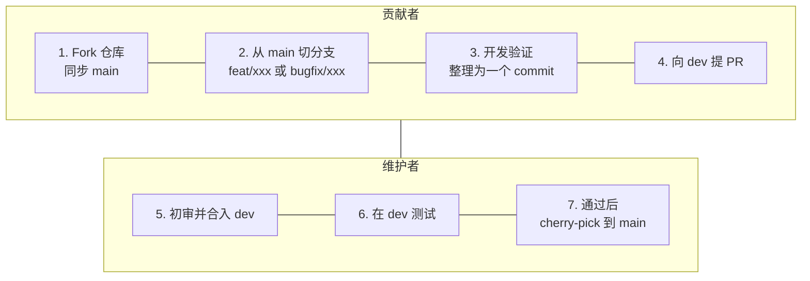

# 贡献指南

**简体中文** · [English](./CONTRIBUTING.en.md)

## 讨论与反馈

欢迎通过 [Issues](https://github.com/Yoan98/Ncurator/issues) 报告问题、提出需求或提问。社区与联系入口统一见 [README](./README.md#参与项目)。

提交前请先搜索已有 Issue，并优先在[创建入口](https://github.com/Yoan98/Ncurator/issues/new/choose)选择对应模板：

| 英文模板          | 标签          | 用途                   |
| ----------------- | ------------- | ---------------------- |
| `Bug report`      | `bug`         | 缺陷、异常行为         |
| `Feature request` | `enhancement` | 新功能、需求、功能改进 |
| `Question`        | `question`    | 使用咨询、问题讨论     |

模板名称、说明和字段提示统一使用英文，填写内容允许中文或英文。模板会自动添加对应的英文标签；也可以选择 `Blank issue` 直接提交，由维护者补充标签。

报告问题时说明应用版本、操作系统、模型服务商、复现步骤、预期与实际结果。截图和日志请移除 API Key、个人资料及其他敏感内容。较大的功能或架构改动，建议先开 Issue 对齐范围。

## 开发与验证

项目协作规则见 [AGENTS.md](./AGENTS.md)，文档修改遵循[文档准则](./doc/doc-guidelines.md)，系统设计见[架构文档](./doc/architecture.md)。

使用 Node.js 22、pnpm 9.12.2、Python 3.12；原生模块需要本地编译时，安装 macOS Command Line Tools 或 Windows C++ Build Tools。首次启动会准备原生模块，并按需构建网页抓取 sidecar，需要联网。只开发桌面界面时可先使用 `pnpm dev:no-sidecar`。

克隆自己的 Fork 后，在项目目录安装依赖并启动：

```bash
pnpm install --frozen-lockfile
pnpm dev
```

| 命令                             | 用途                                                 |
| -------------------------------- | ---------------------------------------------------- |
| `pnpm dev`                       | 启动桌面开发环境，按需准备原生模块和网页抓取 sidecar |
| `pnpm dev:no-sidecar`            | 暂不准备网页抓取 sidecar 的桌面开发入口              |
| `pnpm typecheck`                 | Main 与 Renderer 类型检查                            |
| `pnpm lint`                      | ESLint 检查                                          |
| `pnpm test:unit --suite <suite>` | 执行受影响的 Unit suite                              |
| `pnpm test:ai:non-live`          | AI 非 live backend 回归                              |
| `pnpm build:unpack`              | 构建并审计本机解包应用                               |
| `pnpm build:win`                 | 在 Windows 构建 Windows x64 安装包                   |
| `pnpm build:mac:arm64`           | 在 Apple Silicon Mac 构建 macOS arm64 安装包         |

根据改动执行对应检查，PR 中记录实际运行的命令和结果。测试分层、过滤参数和真实 E2E 规则见[测试文档](./doc/test.md)。新增测试文件前先与维护者确认分类；调整产品行为时同步相关 PRD 和测试计划。需要 live 模型的用例由贡献者在本机配置自己的凭证。

**提交 PR 前，请务必亲自运行软件，像用户一样完整体验并测试自己新增或修改的功能，并在 PR 中记录体验步骤与结果。** 亲眼看到自己的改动在软件里生效，也是一件很有成就感的事。

`.env-example` 只放变量名和非敏感示例。生产共享密钥、模型 Key、签名证书、用户数据库及测试日志均不应提交。普通开发不需要 COS / R2 上传权限或官方服务密钥；官方发布流程见[发布文档](./doc/deploy/release.md)。

## 提交 Pull Request



1. Fork 本仓库，并将自己的 Fork 克隆到本地。
2. 每次开发前，在 GitHub 打开自己的 Fork，切换到 `main`，点击 `Sync fork → Update branch`，同步原仓库最新的 `main`。
3. 在本地更新 `main`，从最新 `main` 创建工作分支：新功能使用 `feat/xxx`，问题修复使用 `bugfix/xxx`。
4. 一个 PR 聚焦一项改动，完成对应验证并同步相关文档。使用 `git commit --signoff` 提交，在提交信息中保留 `Signed-off-by`；提交信息使用 `feat: ...`、`fix: ...`、`docs: ...` 等格式。提交 PR 前尽量将改动整理为一个 commit，方便审核和 cherry-pick。
5. 将工作分支推送到自己的 Fork，向 `Yoan98/Ncurator` 的 **`dev` 分支**提交 PR。填写 PR 模板，说明关联 Issue、解决的问题、最终行为、验证命令与结果及已知限制；界面变化附截图。
6. 维护者初审代码，贡献者按反馈修改。评审期间可以继续提交修改，最终合入 `dev` 时保持一个完整 commit，并保留作者信息和 `Signed-off-by`。
7. 维护者在 `dev` 上进行集成验证和测试，通过后将对应 commit cherry-pick 到 `main`。

已克隆自己的 Fork 后，每次新建功能分支可执行：

```bash
git switch main
git pull --ff-only origin main
git switch -c feat/xxx
```

问题修复将 `feat/xxx` 换成 `bugfix/xxx`。这里的 `origin` 指自己的 Fork，先完成上述 GitHub 同步，再更新本地 `main`。GitHub 操作详见[同步 Fork](https://docs.github.com/en/pull-requests/how-tos/work-with-forks/syncing-a-fork)。

第三方代码、依赖、图片等材料需注明来源和许可证。

## 贡献许可

请先阅读项目的 [AGPL-3.0-only 许可证](./LICENSE)。提交贡献时，你确认有权提供相关内容，并同意贡献按该许可证提供；贡献者保留相应版权。通过 commit signoff 留下上述确认。

工作成果涉及雇主或其他权利人时，应先获得所需许可。第三方材料继续遵守原许可证。
