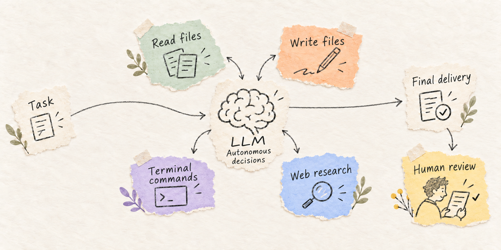

<p align="center">
  
</p>

<h1 align="center">NCurator</h1>

<p align="center"><strong>Building the most user-friendly AI assistant for working with local office documents</strong></p>

<p align="center">
  <a href="./README.md">简体中文</a> · <strong>English</strong>
</p>

<p align="center">
  <a href="./LICENSE"></a>
  
  
</p>

<p align="center">
  <a href="https://www.guanzhangai.cn/zh">Website & demos</a> ·
  <a href="https://www.guanzhangai.cn/zh/manual">Manual</a> ·
  <a href="https://github.com/Yoan98/Ncurator/releases">GitHub Releases</a> ·
  <a href="https://x.com/Yoan_Huang">Author on X</a> ·
  <a href="#get-involved">QQ group</a>
</p>

<p align="center">
  <a href="https://www.guanzhangai.cn/api/download/windows-x64"><strong>Download for Windows</strong></a> ·
  <a href="https://www.guanzhangai.cn/api/download/mac-arm64"><strong>Download for macOS (Apple silicon)</strong></a>
</p>

## Architecture Design

<p align="center">
  
</p>

## Capabilities

| Capability              | What it does                                                               |
| ----------------------- | -------------------------------------------------------------------------- |
| 📄 Office documents     | Read, create, and edit DOCX, PPTX, XLSX, and text; read PDFs               |
| 🧠 Local knowledge base | Index local folders and web material, retrieve content, and cite sources   |
| 🌐 Web and browser      | Search for information, extract web content, and use the built-in browser  |
| ✍️ Change review        | Preview results, inspect changes, and revert supported file edits          |
| ⏰ Scheduled tasks      | Run tasks on a schedule using a partner's material and model configuration |

See the [website](https://www.guanzhangai.cn/zh) for demos and real task examples.

## Get started

1. Download and install the Windows or macOS app.
2. Choose an available model or configure your own endpoint and API key.
3. Create a partner, add a working folder, and give it a task. To use the knowledge base, download an embedding model and build an index first.

## Roadmap

Join the discussion and help shape these plans:

| Direction                    | Planned work                                                       |
| ---------------------------- | ------------------------------------------------------------------ |
| 🌍 English support           | An English user interface                                          |
| 🔤 English knowledge base    | English embedding models and indexing                              |
| 🧩 Skill integration         | Connect and manage custom and third-party Skills                   |
| 🧭 Browser data import       | Import data from your browser, starting with bookmarks and history |
| 🖼️ Multimodal knowledge base | Parse, index, and retrieve images and audio with source references |

## Get involved

**QQ group: 891209383.** Interested in future iterations? Join us to discuss features, share ideas, and contribute to development, testing, or documentation. The group primarily uses Chinese.

Follow [@Yoan_Huang on X](https://x.com/Yoan_Huang) for updates. Report bugs and ideas in [Issues](https://github.com/Yoan98/Ncurator/issues), and read the [contribution guide](./CONTRIBUTING.en.md) before opening a PR.

## Run from source

Recommended: Node.js 22, pnpm 9.12.2, and Python 3.12.

```bash
git clone https://github.com/Yoan98/Ncurator.git
cd Ncurator
pnpm install --frozen-lockfile
pnpm dev
```

See the [contribution guide](./CONTRIBUTING.en.md#development-and-validation) for setup, builds, and validation, and [architecture documentation](./doc/architecture.md) for the system design.

## Browser extension

A separately maintained bookmark viewer and URL copying tool: [Source repository](https://github.com/Yoan98/Ncurator-Extension) · [Chrome](https://chromewebstore.google.com/detail/ncurator-knowledge-base-a/jdlfflbeekclkgcckcfombmfojmcdeio?hl=zh-CN) · [Microsoft Edge](https://microsoftedge.microsoft.com/addons/detail/hkdfdbpkmkpooopbkdghecbaipeoijpj).

## License

Licensed under [AGPL-3.0-only](./LICENSE). Commercial use is permitted subject to compliance with the license. Third-party components retain their own licenses.
