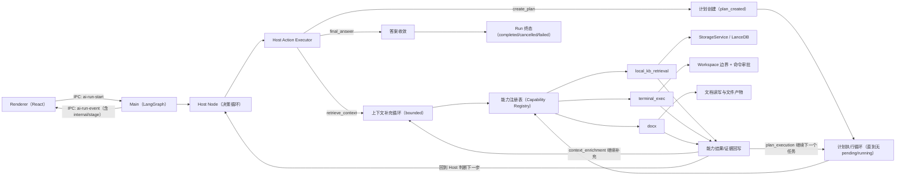
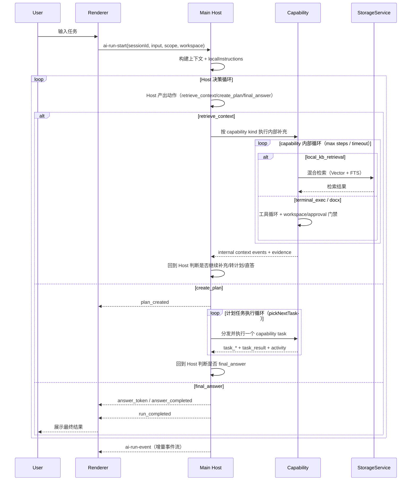

# NCurator-Desktop AI 架构

## 概览

NCurator-Desktop 当前的 AI 运行时采用基于能力（Capability）的 LangGraph 架构。

- 入口：Main 进程的 IPC `ai-run-start`
- 编排核心：`src/main/services/ai/graph.ts`（仅负责状态图路由）+ `src/main/services/ai/node/host/*`（Host 决策与动作执行）
- 能力节点：`local_kb_retrieval`、`terminal_exec`、`docx`
- 事件通道：通过 IPC `ai-run-event` 推送到 Renderer
- Host 控制协议：`retrieve_context` / `create_plan` / `final_answer` 三动作循环
- 执行边界：凡是 workspace-bound 能力（`terminal_exec`、`docx`）都必须通过工作区与审批门禁

旧版 writing workflow 已下线，不属于当前有效架构。

## 架构总览图

## 模块分层

- `src/main/services/ai/graph.ts`
  - 仅做 LangGraph 状态图编排和 capability registry 路由
  - 不内嵌 Host 决策细节
- `src/main/services/ai/node/host/hostNode.ts`
  - Host 主循环，负责动作选择、边界控制、终态收敛
- `src/main/services/ai/node/host/hostActionTools.ts`
  - Host 三动作 tool 协议与 fallback JSON 解析
- `src/main/services/ai/node/host/hostActionExecutor.ts`
  - 具体执行 `retrieve_context/create_plan/final_answer` 并落状态
- `src/main/services/ai/node/host/hostPrompt.ts`
  - Host 决策提示词与最终答复生成提示词
- `src/main/services/ai/runtime.ts`
  - 构建 run context，提供 bounded `localInstructions`

## 进程职责

### Main 进程

- 负责运行时编排、检索、存储访问、模型调用
- 执行 Host 决策循环并按动作分流执行
- 执行各能力任务并发出结构化 run events
- 对 workspace-bound 动作执行工作区边界检查与风险命令审批

### Renderer 进程

- 发起运行请求（`sessionId`、`input`、可选文档范围、可选 workspace）
- 消费事件并渲染计划进度、活动流、工具追踪、终端追踪
- 对 `internal: true` 的内部动作与用户可见计划步骤做语义隔离
- 不承载重型检索或编排逻辑

## Host 决策循环

1. Renderer 调用 `ai-run-start`
2. Main 创建 run context 并启动 LangGraph
3. runtime 聚合会话上下文：`recentTurns`、`sessionSummary`、`localInstructions`
   - `localInstructions` 优先级：workspace policy > memory `pinnedFacts` > memory `userPrefs`
   - 去重、限条数、限长度，保证提示词稳定
4. Host 每轮必须产出且仅产出一个动作：
   - `retrieve_context`：先补充上下文（可选 capability kind）
   - `create_plan`：进入用户可见任务执行阶段
   - `final_answer`：直接收敛输出答案
5. runtime 执行动作后回到 Host，直到 run 结束

### 动作语义

- `retrieve_context`
  - 允许 Host 指定 `local_kb_retrieval` / `terminal_exec` / `docx`
  - 作为“内部上下文补充步骤”处理，不触发 `plan_created`
  - 若选择 workspace-bound 能力但未绑定 workspace，触发门禁事件后回到 Host
- `create_plan`
  - 仅此动作会触发 `plan_created`
  - 进入 `task_started/task_completed/task_failed/task_result` 生命周期
  - 仅保留受支持 capability 任务，legacy/未知 kind 会被拒绝
- `final_answer`
  - 直接收敛 run，不创建计划任务

### 循环边界与失败安全

- Host 决策轮次上限
- 上下文补充轮次上限
- Host 循环总耗时上限
- 每轮取消信号检查
- 模型未调用 tool 时，允许单次 JSON fallback 解析；解析失败走安全收敛

## 运行时时序图

## 能力契约

### `local_kb_retrieval`

- 使用本地知识库工具（hybrid/vector/fts/list）
- 支持按 run context 的 document-id 范围约束
- 必须受重试次数/循环上限约束
- 可被 `retrieve_context`（内部）和 `create_plan`（用户可见任务）复用

### `terminal_exec`

- 接收自然语言目标（Host 不再依赖原始 shell bootstrap 命令）
- 内部必须走工具驱动循环：`terminal_run_command` + `terminal_finish`
- 必须绑定工作区（`workspaceId`、`rootPath`）
- 在工具执行阶段逐条做边界校验和风险分级
- 中高风险命令执行前必须请求审批
- 命令产出/更新文件时，需发出终端追踪与 `file_artifact` 元数据
- 达到上限（`max steps` / `timeout`）后必须显式失败退出
- 可用于 pre-plan 上下文补充；此时事件会标记为 `internal: true`

### `docx`

- Node.js-first 的工具驱动能力（不以 Python/系统工具为基线前置）
- 使用结构化工具：`docx_inspect`、`docx_apply_edits`、`docx_save_output`、`docx_finish`
- 写入路径必须受 workspace 边界检查；覆盖写入要有审批门禁
- 需发出 inspect/apply/save activity 追踪及 `file_artifact` 元数据
- 达到上限（`max steps` / `timeout`）后必须显式失败退出
- 可用于 pre-plan 上下文补充；此时事件会标记为 `internal: true`

## 事件模型

核心事件族如下：

- 运行生命周期：`run_started`、`run_completed`、`run_failed`、`run_cancelled`
- 计划/任务生命周期：`plan_created`、`task_started`、`task_completed`、`task_failed`、`task_result`
- 工具追踪：`tool_call_started`、`tool_call_result`
- 终端追踪：`terminal_step_started`、`terminal_step_result`、`terminal_step_error`
- 面向 UI 的活动流：`activity`
- 文件产物：`file_artifact`
- 门禁事件：`workspace_required`、`approval_required`、`approval_decision`
- 答案流式输出：`answer_token`、`answer_completed`

### 事件语义扩展（增量兼容）

- `AiRunEvent` 增量字段：
  - `internal?: boolean`
  - `stage?: "context_enrichment" | "plan_execution" | "finalization"`
- 兼容性要求：
  - 旧消费者可忽略新增字段，不影响解析
  - 新消费者可按 `internal/stage` 做语义分层渲染
- 关键约束：
  - `plan_created` 仅在 `create_plan` 后发出
  - `retrieve_context` 不应触发用户可见的 plan/task 生命周期

## 存储边界

- 当前 AI 运行时通过 `StorageService` 使用 document/chat/llm store
- 业务代码不得绕过 store 层直接访问 LanceDB 内部连接或表
- 当前运行时不使用写作域（writing-domain）存储

## 扩展规则

新增能力节点时必须满足：

1. 新增 capability kind 与类型化 task contract
2. 在 capability registry 中注册 executor
3. 发出标准生命周期与追踪事件
4. 对可执行动作保持一致的 workspace/policy 约束
5. 有文件产出时发出 `file_artifact` 事件
6. 若参与 Host pre-plan 补充，需支持 `internal/stage` 语义
7. 同步更新本文件与对应 agent/skill 约束文档

## 非目标

- 不重新引入旧版 writing-workflow runtime
- 不允许绕过 workspace 边界执行无限制 shell 命令
