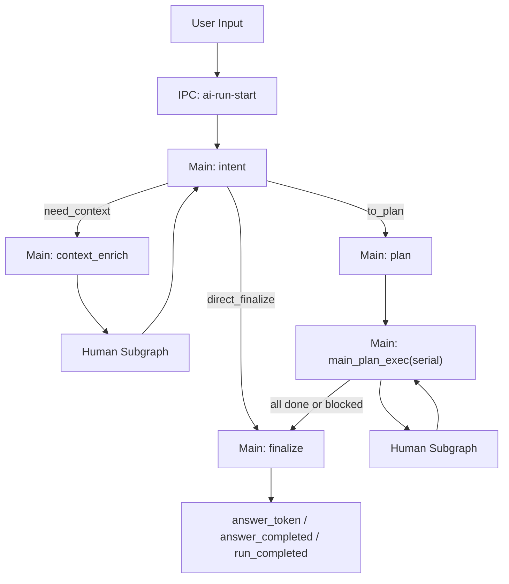
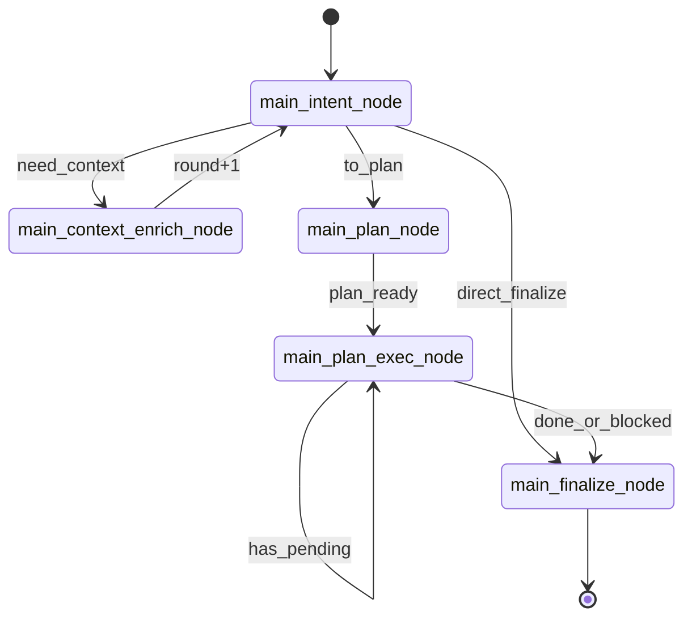
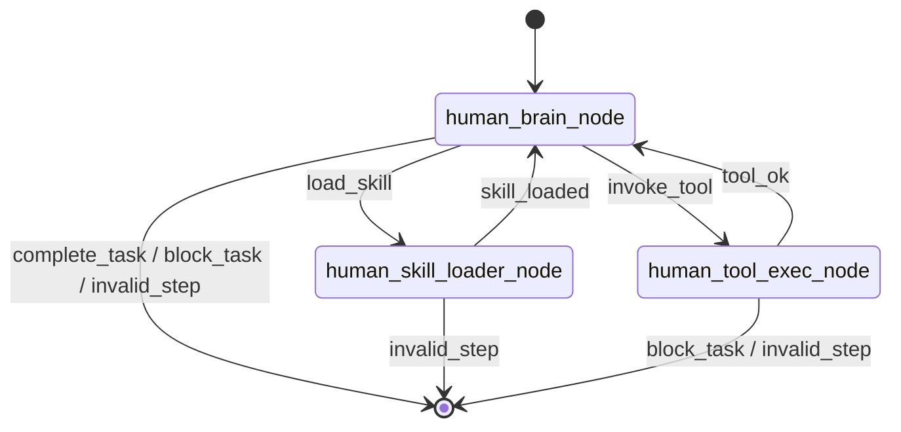

# NCurator-Desktop AI 架构（Main Graph + Human Subgraph）

## 1. 设计目标

- 主流程编排与单任务执行解耦，提升可维护性。
- 所有能力统一走 tool 机制，避免 capability 级 AI 循环。
- `brain` 严格按 step 推进，确保每一步都可观测、可回放。
- 降低运行态复杂度：移除 slot 体系，保留最小执行契约。
- 保留 workspace/approval 安全边界，不兼容旧 host 逻辑。

## 2. 分层边界

- Main Graph：系统编排层，负责阶段推进与最终收敛。
- Human Subgraph：单任务执行层，负责工具决策与执行循环。
- Capability Registry：工具聚合层，按 `tools/<capability>` 目录维护真实执行工具。
- Human Skill Catalog：能力加载层，向 brain 暴露轻量 skill cards，并在运行时按需展开 skill 内容与工具。

边界约束：

- Main 不直接执行 capability，仅调用 human runner。
- Human 不做自然语言终结，必须通过 `complete_task` 或 `block_task` 收敛。
- Capability 不再是 graph node，只作为 tool 提供原子执行能力。

## 3. 系统级流程图

## 4. Main Graph 状态机

节点：

1. `main_intent_node`
2. `main_context_enrich_node`
3. `main_plan_node`
4. `main_plan_exec_node`
5. `main_finalize_node`

关键规则：

- `intent` 三态输出：`need_context | to_plan | direct_finalize`。
- `contextRounds` 达到上限后强制降级到 `to_plan`（默认 `2`）。
- `dispatch` 串行执行任务；默认 `fail-fast`，任务阻塞立即收敛到 `finalize`。
- 最终答复只能由 `main_finalize_node` 生成。

## 5. Human Subgraph 状态机

节点：

1. `human_brain_node`
2. `human_skill_loader_node`
3. `human_tool_exec_node`

关键规则：

- brain 每步输出结构化决策：`load_skill | invoke_tool | complete_task | block_task`。
- brain 常驻只看 `availableSkillCards`；skill 内容与工具只在 `load_skill` 后进入运行态。
- `activeTools` 仅来自当前 `activeSkillIds`，默认最多保留 2 个 active skills。
- `load_skill` 对已加载 skill 视为幂等，允许仅更新 active skills 顺序。
- 可恢复失败（`failed`、`invalid_input`）回到 brain 继续探索，不立即结束任务。
- 不可恢复失败（`workspace_required`、`approval_denied`）应收敛为 `block_task`。
- 无效 decision / 未知 tool / 上下文缺失均触发 `block_task`。
- `maxSteps` 超限触发 `bounded_loop_error`。

## 6. 任务输出模型

- 移除 slot memory/slot commit 机制。
- human 结果统一收敛为：`status + summary + resultCode + resultData`。
- 任务间状态不共享隐式运行态，main 仅聚合任务级结果。

## 7. 运行时类型核心

- `AiRunState.mainStage`：Main 路由唯一来源。
- `AiRunState.contextRounds/contextObjective/contextEvidence`：上下文补充控制。
- `AiRunState.dispatchCursor`：串行调度游标。
- `AiRunContext.selectedDocumentIds`：已准备 document 的严格检索范围。
- `AiRunContext.selectedSourceScopes`：用户通过 `@` 显式选择的资料范围，保留工作空间/目录/文件/网页资料类型信息。
- `AiRunContext.selectedScopeSummary`：传给 prompt 的可读范围摘要，说明哪些范围已准备、哪些仍未准备。
- `AiRunContext.allowNonLocal`：用户是否已明确允许在本地不足时继续使用非本地信息。
- `HumanTaskInput`：最小任务输入（`taskId/objective`）。
- `HumanTaskOutput`：最小任务输出（`status/summary/resultCode/resultData`）。
- `HumanRunState.availableSkillCards/loadedSkills/activeSkillIds/activeTools`：human 渐进式能力加载核心状态。
- `HumanRunState.lastDecision/lastObservation/stepHistory`：brain 决策、执行观察与步骤回放核心状态。

## 8. 事件模型

主要事件：

- 运行级：`run_started/run_completed/run_failed/run_cancelled`
- 计划级：`plan_created/task_started/task_completed/task_failed/task_result`
- 步骤级：`tool_call_started/tool_call_result/human_step/human_diagnostic`
- 审批级：`workspace_required/approval_required/approval_decision`
- 来源级：`local_sources_status/non_local_permission_requested/runtime_issue`
- 答复级：`answer_token/answer_completed`

约束：

- 移除 `broker_decision` 与 `slot_commit`。
- `human_step` 面向 UI/用户可读性，必须包含 `publicNarrative`、active skills、active tools 与步骤结果状态。
- `human_diagnostic` 仅供内部调试，记录 rationale、skill/tool 选择与 observation 摘要。
- `answer_token/answer_completed` 仅在 finalize 结果流出后发送。
- 可编辑运行在全部编辑任务完成后，若存在可提交草稿，必须额外发送 `draft_review_ready` 作为统一审阅入口；运行中不得发出逐块确认请求。

## 9. 代码落点

- Main 图入口：`src/main/services/ai/graph/mainGraph.ts`
- Human 子图：`src/main/services/ai/graph/humanGraph.ts`
- 状态 Schema：`src/main/services/ai/state/stateSchemas.ts`
- Main 节点：`src/main/services/ai/node/main/*`
- Human 节点：`src/main/services/ai/node/human/*`
- Prompt Registry：`src/main/services/ai/prompts/*`
- Tool 聚合：`src/main/services/ai/tools/registry.ts`
- Tool 分组：`src/main/services/ai/tools/<capability>/*`

## 10. 安全边界

- `terminal_exec` / `docx` 未绑定 workspace 时必须拒绝执行。
- 聊天模式下，`@` 只是 AI 的优先参考范围，不是强制工具选择器；已准备内容优先走本地知识库检索，未准备本地文件可在工作空间边界内按需读取。
- 本地资料不足时不得直接混入非本地信息，必须先通过 `non_local_permission_requested` 收敛并等待用户同意。
- 命中审批策略时必须先走 `approval_required -> approval_decision`。
- 审批拒绝返回结构化失败，不进入隐式重试循环。

## 11. AI 测试架构边界（Script-first）

- capability 测试必须直连生产 tool 入口（`src/main/services/ai/tools/**`），验证真实链路行为。
- integration 测试用于验证跨模块运行时契约、scope 语义、迁移与 prompt contract，不以单一 capability 为边界。
- human 测试必须直连 `humanGraph` runner，只验证 human 子图，不通过 main graph。
- 测试上下文通过 harness 注入 workspace、审批策略与事件采集，避免侵入生产实现。
- 所有 case 必须输出标准化报告（`events.jsonl/assertions.json/metrics.json/summary.md`），供后续 AI 诊断与优化建议使用。
- live 配置统一从根目录 `.env` 读取（模板 `.env-example`），缺失时 fail-fast 并输出可定位信息。

## 12. 统一工作台与草稿审阅语义

- 首页工作台统一承载 `AI 对话` 与 `纯搜索` 两种模式。
- `纯搜索` 不进入 main/human graph，只复用本地检索能力，并在 Renderer 投影层映射成统一时间线与检查器。
- AI 编辑运行期间只允许生成草稿快照、预览与审阅引用，不允许直接写回真实文件。
- `docx_open / outline / get_block / search / apply_ops / rollback / render_preview / validate` 在同一运行内默认基于当前最新草稿快照继续执行；当工具输入省略 `docId` 时，必须解析到最新草稿身份，而不是退回源文件。
- `draft_review_ready` 只能在整次运行完成后发出；用户逐块接受/拒绝、提交前校验和最终写盘属于独立的草稿审阅 IPC 阶段，不属于运行中断点。
- 最终提交前必须校验源文件新鲜度；若源文件已变化，审阅阶段必须进入冲突态并阻止写回。
