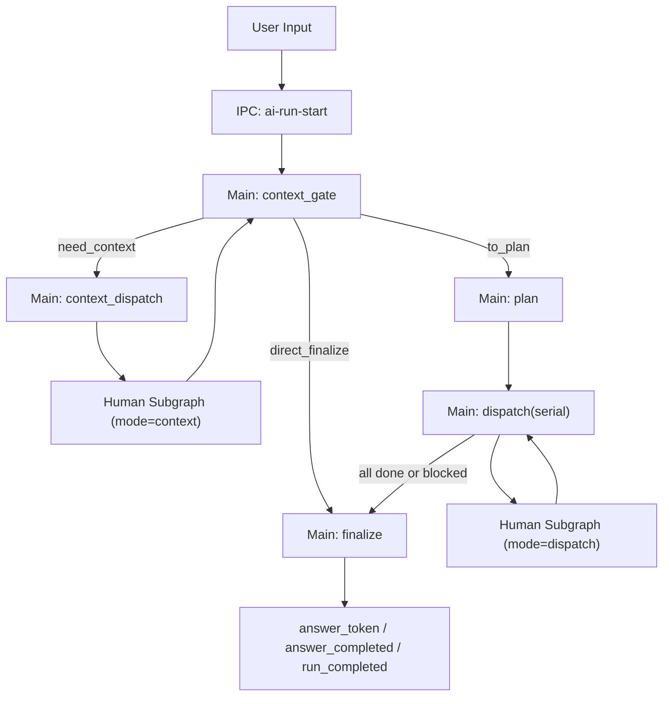
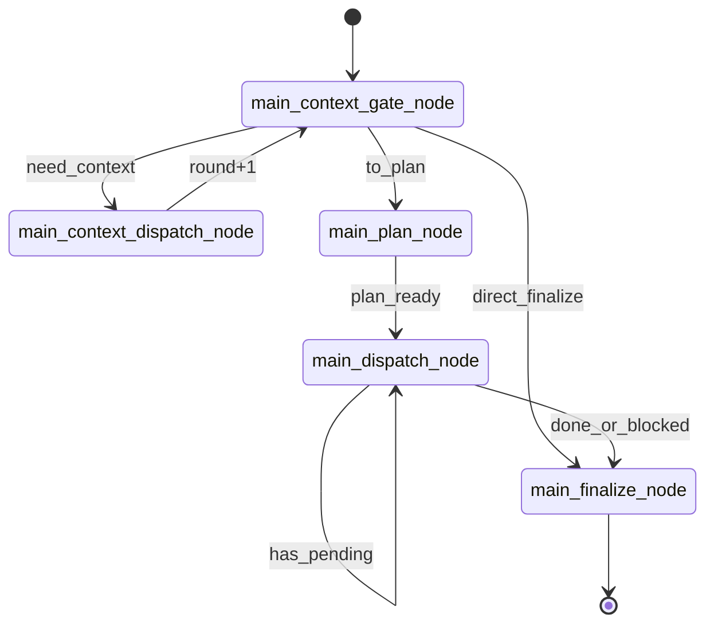
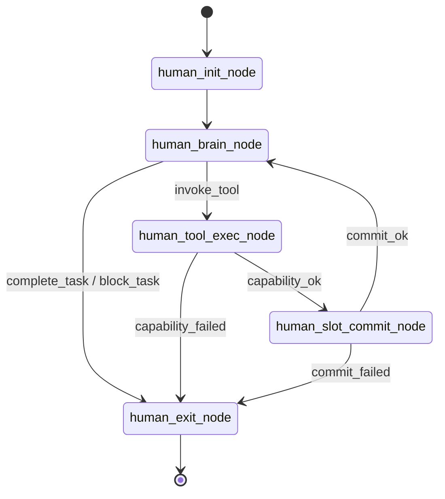

# NCurator-Desktop AI 架构（Main Graph + Human Subgraph）

## 1. 设计目标

- 主流程编排与单任务执行解耦，提升可维护性。
- 所有能力统一走 tool 机制，避免 capability 级 AI 循环。
- `brain` 严格按 step 推进，确保每一步都可观测、可回放。
- 保留 workspace/approval 安全边界，不兼容旧 host 逻辑。

## 2. 分层边界

- Main Graph：系统编排层，负责阶段推进与最终收敛。
- Human Subgraph：单任务执行层，负责逐步工具调用与状态提交。
- Capability Registry：工具聚合层，按 `tools/<capability>` 目录维护、运行时平铺暴露。

边界约束：

- Main 不直接执行 capability，仅调用 human runner。
- Human 不做自然语言终结，必须通过 `complete_task` 或 `block_task`。
- Capability 不再是 graph node，只作为 tool 提供原子执行能力。

## 3. 系统级流程图

## 4. Main Graph 状态机

节点：

1. `main_context_gate_node`
2. `main_context_dispatch_node`
3. `main_plan_node`
4. `main_dispatch_node`
5. `main_finalize_node`

关键规则：

- `context_gate` 三态输出：`need_context | to_plan | direct_finalize`。
- `contextRounds` 达到上限后强制降级到 `to_plan`（默认 `2`）。
- `dispatch` 串行执行任务；默认 `fail-fast`，任务阻塞立即收敛到 `finalize`。
- 最终答复只能由 `main_finalize_node` 生成。

## 5. Human Subgraph 状态机

节点：

1. `human_init_node`
2. `human_brain_node`
3. `human_tool_exec_node`
4. `human_slot_commit_node`
5. `human_exit_node`

关键规则：

- 每步必须是 tool call（strict tool-call only）。
- 工具集合固定为「全量 capability tools + control tools」。
- 无 tool call / 未知 tool / 上下文缺失均触发 `block_task`。
- `maxSteps` 超限触发 `bounded_loop_error`。

## 6. Slot 提交流程

`slot_commit` 是 task 内状态写入的唯一入口：

1. 校验 `consume` 均可读。
2. 基于快照计算 `produce`。
3. 校验 `expect.requiredOutputs`。
4. 全部通过后原子提交；失败不产生部分写入。
5. 大结果以 `ref + summary` 形式写入 `slotArtifacts`。

## 7. 运行时类型核心

- `AiRunState.mainStage`：Main 路由唯一来源。
- `AiRunState.contextRounds/contextDecision`：上下文补充控制。
- `AiRunState.dispatchCursor`：串行调度游标。
- `AiRunState.taskSlots/slotArtifacts`：任务级状态与大对象引用。
- `HumanTaskInput.mode`：`context | dispatch`。
- `HumanTaskOutput.terminalState`：`completed | blocked`。

## 8. 事件模型

主要事件：

- 运行级：`run_started/run_completed/run_failed/run_cancelled`
- 计划级：`plan_created/task_started/task_completed/task_failed/task_result`
- 步骤级：`tool_call_started/tool_call_result/human_step/slot_commit`
- 审批级：`workspace_required/approval_required/approval_decision`
- 答复级：`answer_token/answer_completed`

约束：

- 移除 `broker_decision`。
- `answer_token/answer_completed` 仅在 finalize 结果流出后发送。

## 9. 代码落点

- Main 图入口：`src/main/services/ai/graph/mainGraph.ts`
- Human 子图：`src/main/services/ai/graph/humanGraph.ts`
- 状态 Schema：`src/main/services/ai/state/stateSchemas.ts`
- Main 节点：`src/main/services/ai/node/main/*`
- Human 节点：`src/main/services/ai/node/human/*`
- Tool 聚合：`src/main/services/ai/tools/registry.ts`
- Tool 分组：`src/main/services/ai/tools/<capability>/*`

## 10. 安全边界

- `terminal_exec` / `docx` 未绑定 workspace 时必须拒绝执行。
- 命中审批策略时必须先走 `approval_required -> approval_decision`。
- 审批拒绝返回结构化失败，不进入隐式重试循环。
