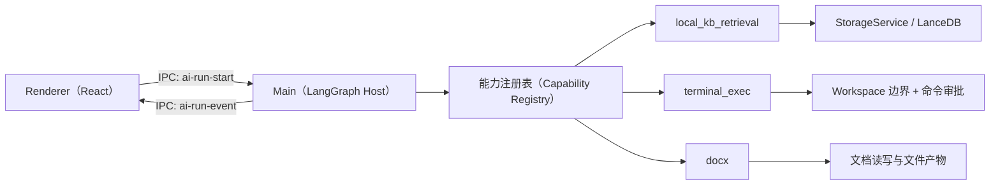
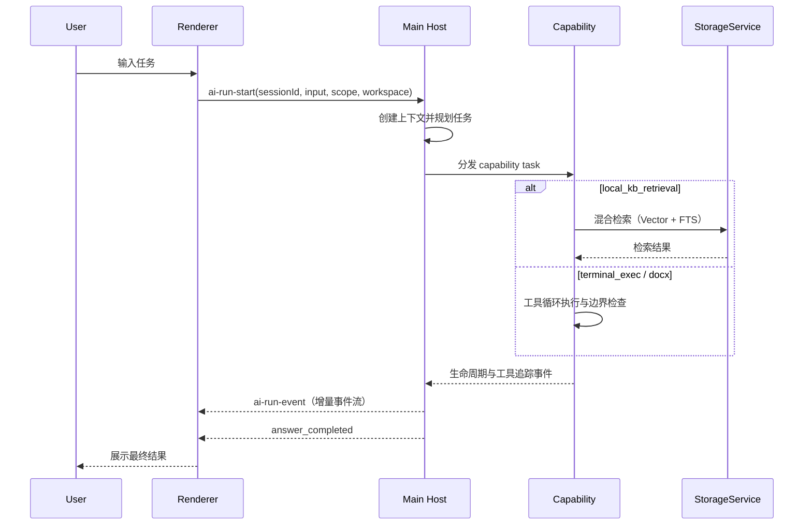

# NCurator-Desktop AI 架构

## 概览

NCurator-Desktop 当前的 AI 运行时采用基于能力（Capability）的 LangGraph 架构。

- 入口：Main 进程的 IPC `ai-run-start`
- 编排核心：`src/main/services/ai/graph.ts` 中的 Host 主导图
- 能力节点：`local_kb_retrieval`、`terminal_exec`、`docx`
- 事件通道：通过 IPC `ai-run-event` 推送到 Renderer
- 执行边界：可执行任务必须绑定工作区（workspace-bound）

旧版 writing workflow 已下线，不属于当前有效架构。

## 架构总览图

## 进程职责

### Main 进程

- 负责运行时编排、检索、存储访问、模型调用
- 执行各能力任务并发出结构化 run events
- 对终端命令执行 workspace 边界检查与风险命令审批

### Renderer 进程

- 发起运行请求（`sessionId`、`input`、可选文档范围、可选 workspace）
- 消费事件并渲染计划进度、活动流、工具追踪、终端追踪
- 不承载重型检索或编排逻辑

## 运行时流程

1. Renderer 调用 `ai-run-start`
2. Main 创建 run context 并启动 LangGraph
3. Host 规划能力任务
4. 运行时通过能力注册表分发任务
5. 各能力发出生命周期/工具/终端/activity/file-artifact 事件
6. Host 汇总并输出最终答案，run 进入完成/取消/失败

## 运行时时序图

## 能力契约

### `local_kb_retrieval`

- 使用本地知识库工具（hybrid/vector/fts/list）
- 支持按 run context 的 document-id 范围约束
- 必须受重试次数/循环上限约束

### `terminal_exec`

- 接收自然语言目标（Host 不再依赖原始 shell bootstrap 命令）
- 内部必须走工具驱动循环：`terminal_run_command` + `terminal_finish`
- 必须绑定工作区（`workspaceId`、`rootPath`）
- 在工具执行阶段逐条做边界校验和风险分级
- 中高风险命令执行前必须请求审批
- 命令产出/更新文件时，需发出终端追踪与 `file_artifact` 元数据
- 达到上限（`max steps` / `timeout`）后必须显式失败退出

### `docx`

- Node.js-first 的工具驱动能力（不以 Python/系统工具为基线前置）
- 使用结构化工具：`docx_inspect`、`docx_apply_edits`、`docx_save_output`、`docx_finish`
- 写入路径必须受 workspace 边界检查；覆盖写入要有审批门禁
- 需发出 inspect/apply/save activity 追踪及 `file_artifact` 元数据
- 达到上限（`max steps` / `timeout`）后必须显式失败退出

## 事件模型

核心事件族如下：

- 运行生命周期：`run_started`、`run_completed`、`run_failed`、`run_cancelled`
- 计划/任务生命周期：`plan_created`、`task_started`、`task_completed`、`task_failed`、`task_result`
- 工具追踪：`tool_call_started`、`tool_call_result`
- 终端追踪：`terminal_step_started`、`terminal_step_result`、`terminal_step_error`
- 面向 UI 的活动流：`activity`
- 文件产物：`file_artifact`
- 门禁事件：`workspace_required`、`approval_required`、`approval_decision`
- 答案流式输出：`answer_token`、`answer_completed`

## 存储边界

- 当前 AI 运行时通过 `StorageService` 使用 document/chat/llm store
- 业务代码不得绕过 store 层直接访问 LanceDB 内部连接或表
- 当前运行时不使用写作域（writing-domain）存储

## 扩展规则

新增能力节点时必须满足：

1. 新增 capability kind 与类型化 task contract
2. 在 capability registry 中注册 executor
3. 发出标准生命周期与追踪事件
4. 对可执行动作保持一致的 workspace/policy 约束
5. 有文件产出时发出 `file_artifact` 事件
6. 同步更新本文件与对应 agent/skill 约束文档

## 非目标

- 不重新引入旧版 writing-workflow runtime
- 不允许绕过 workspace 边界执行无限制 shell 命令
