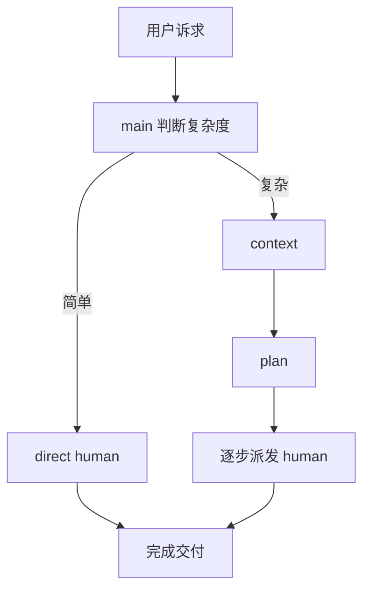
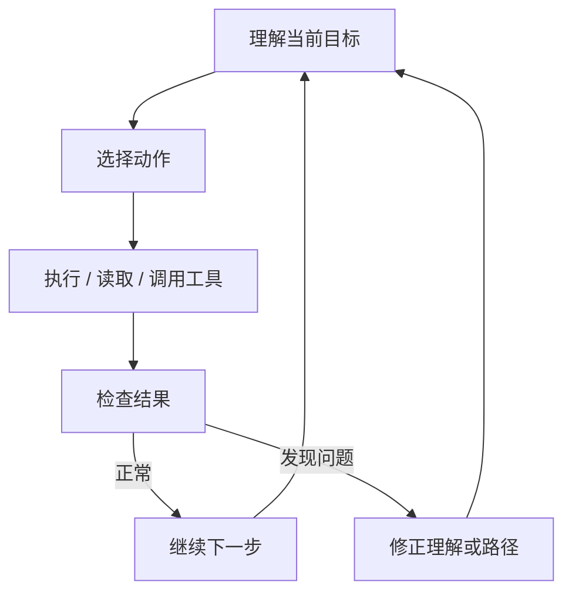
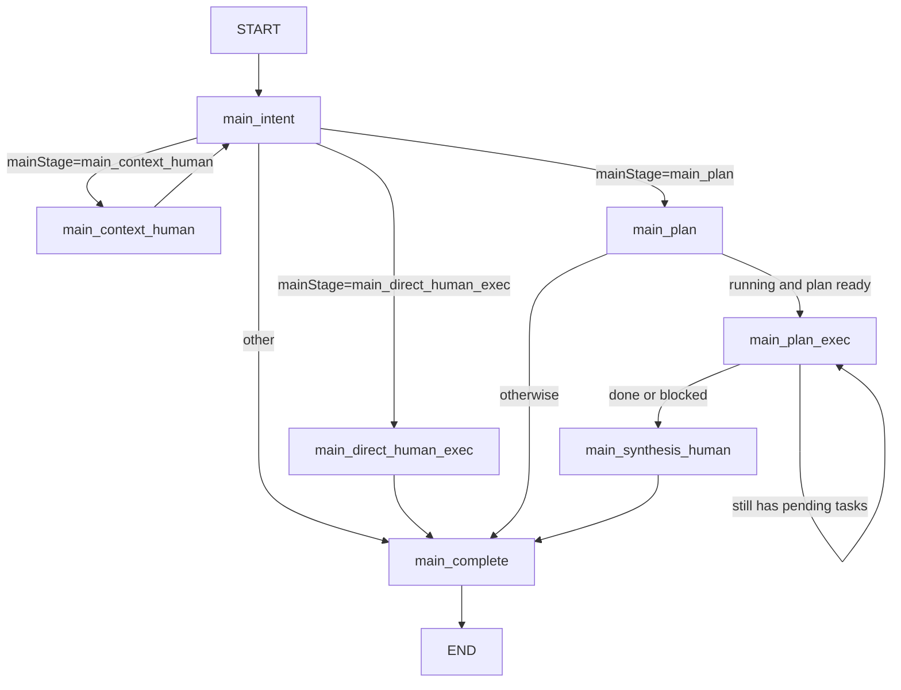
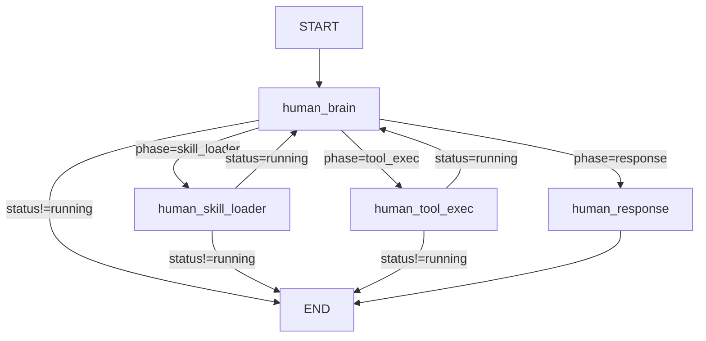

# NCurator-Desktop AI Design

## 1. 设计目标

- `main` 只做编排，不直接承担复杂问题求解和最终业务执行。
- `human` 是整个 AI 设计的核心执行体，目标是可以独立完成用户的任何诉求。
- 简单诉求直接走 `direct human`。
- 复杂诉求走 `context + plan + 执行 + synthesis`。
- 整个运行过程允许边做边分析、边分析边修正，而不是要求第一次判断就完全正确。

## 2. 设计思路

- `main` 的职责是决定怎么走，而不是替代 `human` 把事情做完。
- 当用户诉求复杂时，先通过 `context` 补足理解任务所需的关键信息，再通过 `plan` 把问题拆成可执行步骤。
- 当用户诉求不复杂时，不引入额外拆解，直接交给 `human` 完成。
- `human` 不是被动执行器，而是主动的问题求解者。它需要在每一步里持续判断：
  - 当前目标是否理解正确
  - 现有证据是否足够
  - 上一步结果是否暴露了新的问题
  - 是否需要修正路径、回退判断或切换策略

## 3. 角色分工

### `main`

- 判断当前请求走哪条路径
- 管理运行状态、任务列表和执行顺序
- 在复杂任务中负责上下文补充、规划和收尾
- 不直接替代 `human` 进行真实分析、工具使用和正式交付

### `human`

- 独立分析目标
- 读取 skill、调用工具、处理结果
- 逐步发现问题并修正路径
- 输出最终交付或中间交付

## 4. 路径选择

### 简单诉求

- 单个 `human` 可以闭环完成。
- 不需要额外上下文补充，也不需要额外任务拆解。
- `main` 只负责派发和收尾。

### 复杂诉求

- 目标跨度大、依赖多、信息不完整，或者明显需要分阶段推进。
- 先进入 `context`，补足理解任务所需的关键证据。
- 再进入 `plan`，把目标拆成可顺序执行的步骤。
- 每一步仍由 `human` 执行，`main` 只负责推进顺序和整体编排。

## 5. Human 的核心设计

`human` 是整个 AI 架构设计的核心。它的设计初衷不是“完成某一个固定节点动作”，而是“像真正的执行者一样，把用户诉求做成”。

它必须具备以下能力：

- 自主分析任务，而不是只按既定脚本机械执行。
- 逐步解决问题，把复杂目标拆成当前可执行的动作。
- 主动发现问题，包括目标理解偏差、证据不足、工具结果异常、执行路径错误。
- 主动修正问题，而不是把错误一直带到最后。
- 在每一步之后重新判断当前状态，再决定下一步怎么做。

可以把 `human` 理解成一个持续循环的执行体：

这个循环决定了它即使前面走错了，后面也可以随着每一步分析继续修正，而不是整轮失败。

## 6. 当前实际主工作流

当前实现对应 `src/main/services/ai/graph/mainGraph.ts`：

### 流程说明

- `main_intent`
  - 判断当前请求走 `context`、`direct human`、`plan` 还是直接结束
- `main_context_human`
  - 先让 `human` 补充上下文，再回到 `main_intent`
- `main_direct_human_exec`
  - 直接派发一个 `human` 完成简单任务
- `main_plan`
  - 生成任务列表
- `main_plan_exec`
  - 顺序执行计划中的任务；如果还有待执行任务就继续留在当前节点
- `main_synthesis_human`
  - 对计划执行结果做最终汇总交付
- `main_complete`
  - 负责运行收尾

## 7. 当前实际 Human 子工作流

当前实现对应 `src/main/services/ai/graph/humanGraph.ts`：

### Human 的实际循环

1. `human_brain` 判断下一步要做什么
2. 需要加载 skill 时进入 `human_skill_loader`
3. 需要调用工具时进入 `human_tool_exec`
4. 需要正式交付时进入 `human_response`
5. 每次加载 skill 或执行工具后都会回到 `human_brain` 重新判断

## 8. 设计原则

- `main` 负责编排，`human` 负责解决问题
- `human` 不是一次性执行器，而是持续分析和纠偏的执行体
- 前面判断出错后，可以在后续步骤中重新修正
- 复杂任务通过上下文补充和计划拆解降低执行风险

## 9. 代码真相源

文档与实现不一致时，以以下代码为准：

1. `src/main/services/ai/graph/mainGraph.ts`
2. `src/main/services/ai/graph/humanGraph.ts`
3. `src/main/services/ai/node/main/*`
4. `src/main/services/ai/node/human/*`
5. `src/main/services/ai/state/stateSchemas.ts`
6. `src/shared/types.ts`
