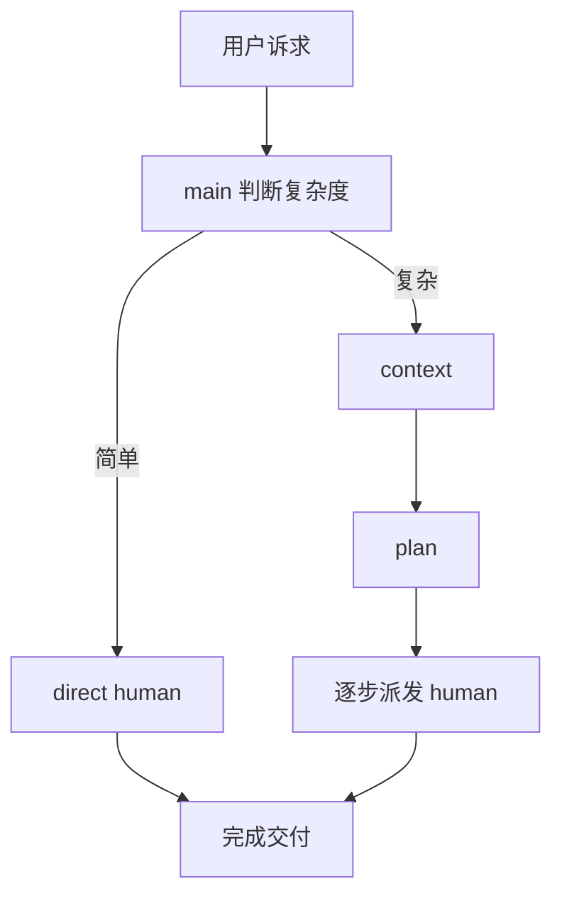
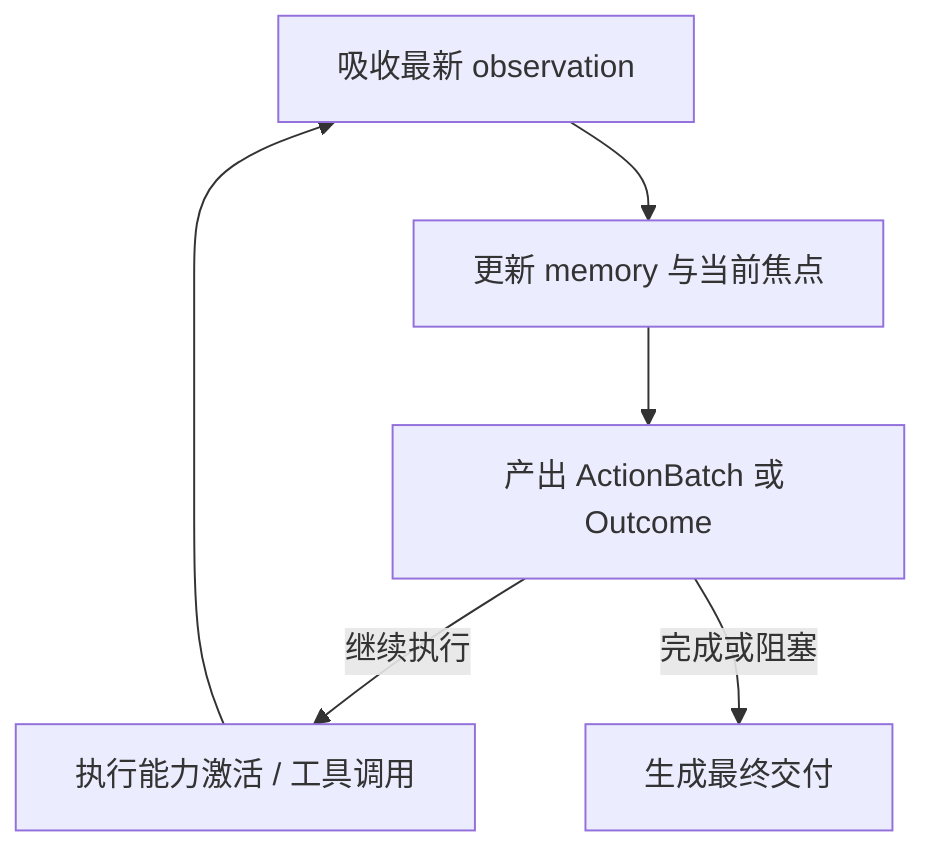
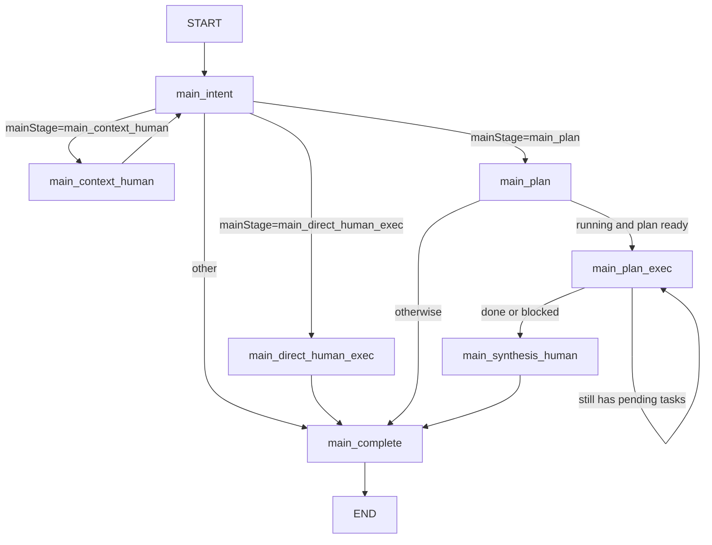
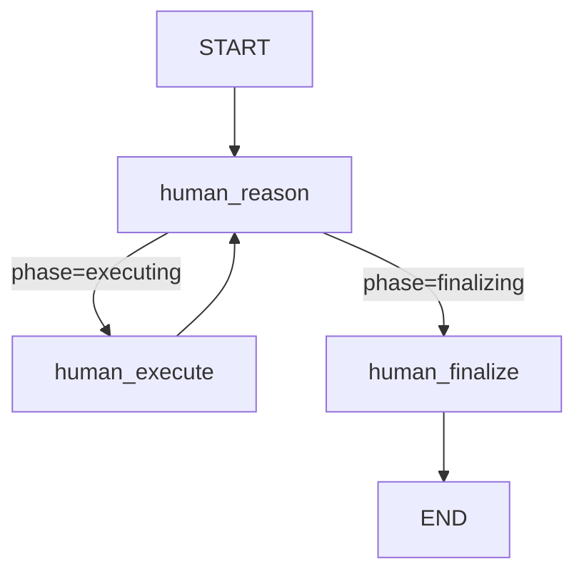

# NCurator-Desktop AI Design

## 1. 设计目标

- `main` 只做编排，不直接承担复杂问题求解和最终业务执行。
- `human` 是整个 AI 设计的核心执行体，目标是可以独立完成用户的任何诉求。
- 简单诉求直接走 `direct human`。
- 复杂诉求走 `context + plan + 执行 + synthesis`。
- 整个运行过程允许边做边分析、边分析边修正，而不是要求第一次判断就完全正确。

## 2. 设计思路

- `main` 的职责是决定怎么走，而不是替代 `human` 把事情做完。
- 当用户诉求复杂时，先通过 `context` 补足理解任务所需的关键信息，再通过 `plan` 把问题拆成可执行步骤。
- 当用户诉求不复杂时，不引入额外拆解，直接交给 `human` 完成。
- `human` 不是被动执行器，而是主动的问题求解者。它需要在每一步里持续判断：
  - 当前目标是否理解正确
  - 现有证据是否足够
  - 上一步结果是否暴露了新的问题
  - 是否需要修正路径、回退判断或切换策略

## 3. 角色分工

### `main`

- 判断当前请求走哪条路径
- 管理运行状态、任务列表和执行顺序
- 在复杂任务中负责上下文补充、规划和收尾
- 不直接替代 `human` 进行真实分析、工具使用和正式交付

### `human`

- 独立分析目标
- 读取 skill、调用工具、处理结果
- 逐步发现问题并修正路径
- 输出最终交付或中间交付

## 4. 路径选择

### 简单诉求

- 单个 `human` 可以闭环完成。
- 不需要额外上下文补充，也不需要额外任务拆解。
- `main` 只负责派发和收尾。

### 复杂诉求

- 目标跨度大、依赖多、信息不完整，或者明显需要分阶段推进。
- 先进入 `context`，补足理解任务所需的关键证据。
- 再进入 `plan`，把目标拆成可顺序执行的步骤。
- 每一步仍由 `human` 执行，`main` 只负责推进顺序和整体编排。

## 5. Human 的核心设计

当前 `human` 已经从“prompt 驱动的弱结构化循环”重构成“显式记忆 + durable focus + 结构化 ReAct”的执行内核。

它的目标不是只判断“下一个工具是什么”，而是持续维护：

- 当前任务到底要完成什么
- 已经确认了哪些事实
- 当前焦点是什么
- 下一轮是继续执行、收敛完成，还是明确阻塞

这版 `human` 的核心原则是：

- `human` 只有一个真正的思考节点，不把认知过程切碎成过多子节点
- 不提前写很长的固定子任务链，只维护 durable focus
- 显式记录 `memory`，不再把 `trace` 当主要推理记忆
- 支持保守并行读取，但只允许只读动作小批量并行
- `human_reason` 输出强约束 contract，统一收敛为 `actionBatch | outcome`
- 通过 watchdog 监督空转、重复 action batch 和长时间无新增事实

可以把它理解成下面这个循环：

这个循环的关键不是“多调用一次模型”，而是每一轮都把状态明确写回 `memory / turn / outcome`，让下一轮判断建立在显式状态上，而不是重新从历史日志里猜。

## 6. 当前实际主工作流

当前实现对应 `src/main/services/ai/graph/mainGraph.ts`：

### 流程说明

- `main_intent`
  - 判断当前请求走 `context`、`direct human`、`plan` 还是直接结束
- `main_context_human`
  - 先让 `human` 补充上下文，再回到 `main_intent`
- `main_direct_human_exec`
  - 直接派发一个 `human` 完成简单任务
- `main_plan`
  - 生成任务列表
- `main_plan_exec`
  - 顺序执行计划中的任务；如果还有待执行任务就继续留在当前节点
- `main_synthesis_human`
  - 对计划执行结果做最终汇总交付
- `main_complete`
  - 负责运行收尾

## 7. 当前实际 Human 子工作流

当前实现对应 `src/main/services/ai/graph/humanGraph.ts`：

### Human 的实际循环

1. `human_reason`
   - 读取 `task / memory / turn.incoming / trace`
   - 吸收最新 observation
   - 更新显式 memory
   - 决定输出 `actionBatch` 还是终态 `Outcome`
2. `human_execute`
   - 执行 `activate_capability` 或 `invoke_tool`
   - 把单次或批量执行结果汇总成 `ObservationBatch`
   - 记录 `trace.steps`
3. `human_finalize`
   - 基于 `outcome + memory + trace` 生成最终 markdown 交付
   - 补齐本地资料使用说明

### Human 的目录分层

- `src/main/services/ai/node/human/index.ts`
  - Human 内部统一入口，供 graph 组装阶段节点与共享能力
- `shared/`
  - 放 `state / runtime / events / watchdog` 这类跨阶段共享逻辑
- `registry/`
  - 放 skill 定义与 tool prompt 目录这类静态注册表
- `reason/`
  - 放 observation 吸收、contract 校验与 memory/state 变换
- `execute/`
  - 放 action batch 校验、能力激活和工具调用执行逻辑
- `finalize/`
  - 放最终交付生成与 provenance 补齐

### Human 的状态模型

当前 human graph state 统一收敛为六层：

- `task`
  - 当前任务契约，只包含 `taskId` 与 `objective`
- `progress`
  - 图内部路由状态，当前只使用 `phase=reasoning|executing|finalizing`
- `memory`
  - human 的显式记忆，包含 `constraints / facts / evidence / openQuestions / focus / capabilityFocus`
- `turn`
  - 当前一轮的输入输出缓冲，包含 `incoming / analysis / actionBatch / watchdogHint`
- `outcome`
  - 终态结果，只保留 `completed | blocked`
- `trace`
  - 执行轨迹，仅用于审计、时间线和复盘

其中：

- `focus.current`
  - durable 的当前执行焦点，只保留一个
- `analysis.summary`
  - 当前轮的审计摘要，不承担路由状态职责
- `actionBatch`
  - 当前轮待执行动作批次；只能是单能力激活、单工具动作，或最多 2 个只读并行工具动作
- `Observation.id`
  - 当前 run 内唯一的 observation 锚点，供 `facts.evidenceIds` 与 `memory.evidence` 显式引用

### 受约束并行

当前 `human_execute` 支持小批量并行，但只允许保守并行：

- 同一批次默认最多 `2` 个动作
- 只允许 `read_only && parallelSafe` 的动作进入同一 batch
- `docx_apply_ops / save / rollback / render_preview` 这类写动作必须串行
- terminal 命令只有在 `low risk + read_only + 无 artifact candidate` 时才允许并行

并行的目标是减少无意义的串行读取，不是让执行器替 planner 做重排和猜测。

### Watchdog 侧车

当前 watchdog 不在主 graph 内，而是作为 `human_reason` 前的监督侧车：

- 硬保险丝始终开启，防止无限循环和长时间空转
- 模型 watchdog 由设置控制：`off / auto / aggressive`
- 只有风险升高时才触发模型 watchdog，不是每轮都调用
- watchdog 只提供 `watchdogHint`，最终是否继续或 blocked 仍由 `human_reason` 决定

对应实现同时在主进程存储和设置页中暴露 `watchdogMode`，并把 `watchdog_signal` 投影到 workbench 时间线。

## 8. 设计原则

- `main` 负责编排，`human` 负责解决问题
- `human` 不是一次性执行器，而是带显式记忆和 durable focus 的执行体
- 前面判断出错后，可以在后续 observation 中重新修正
- 复杂任务通过上下文补充和计划拆解降低执行风险
- 交付风格通过 `objective` 表达，不再依赖独立的 `deliveryKind`
- `human_reason` 必须满足强 contract；非法输出统一 fail-closed 为 blocked
- watchdog 负责监督空转风险，但不接管最终业务判断

## 9. 代码真相源

文档与实现不一致时，以以下代码为准：

1. `src/main/services/ai/graph/mainGraph.ts`
2. `src/main/services/ai/graph/humanGraph.ts`
3. `src/main/services/ai/node/main/*`
4. `src/main/services/ai/node/human/*`
5. `src/main/services/ai/node/human/{shared,registry,reason,execute,finalize}/**`
6. `src/main/services/ai/state/stateSchemas.ts`
7. `src/shared/types.ts`
8. `src/main/services/storage/domains/AiRuntimeSettingsStore.ts`
9. `src/renderer/src/utils/workbenchProjection.ts`
