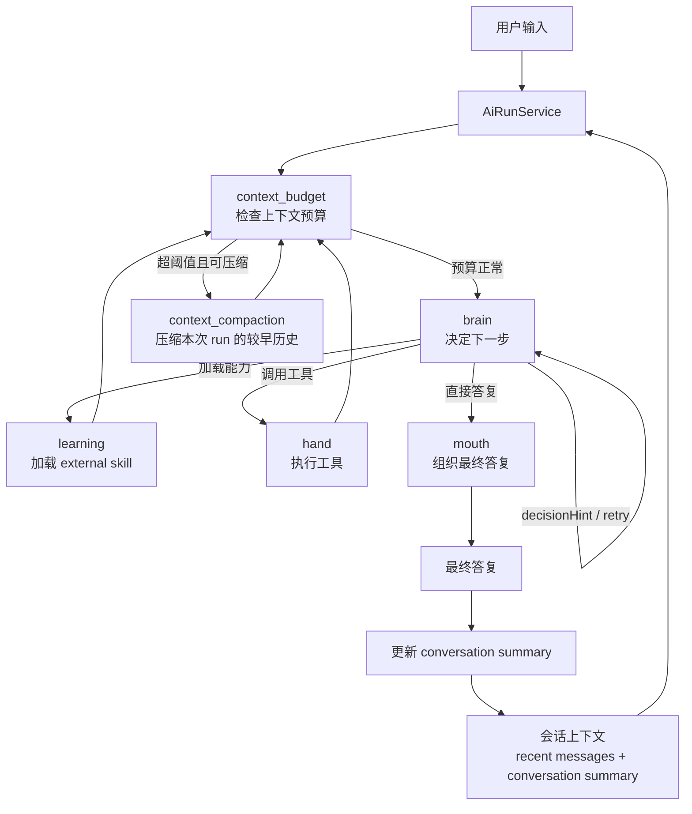

# NCurator-Desktop AI 架构设计

本文只描述 AI 的总体架构主线：一次请求如何运行、run 内闭环如何推进，以及会话总结如何承接下一次对话。不展开字段、事件与状态细节。

## 1. 系统主流程

## 2. 简要说明

### 2.1 主流程

- 每次用户请求都会启动一个 `run`。
- `run` 进入 `human` 后，不是直接去 `brain`，而是先做 `context_budget` 检查。
- 预算正常时才进入 `brain` 决策下一步。

### 2.2 run 内闭环

- `brain` 只决定下一步是 `learning`、`hand` 还是 `mouth`。
- `learning` 负责加载 external skill。
- `hand` 负责执行工具。
- `learning` 和 `hand` 完成后，都会先回到 `context_budget`，再决定是否继续推进。

### 2.3 run 内压缩

- 如果当前 prompt 过长，但较早的任务历史仍可压缩，就进入 `context_compaction`。
- 它压缩的是当前 `run` 的较早过程历史，只服务当前 `run` 的继续推进。
- 这部分压缩信息不会直接作为长期记忆保留到下一次对话。

### 2.4 会话连续性

- `mouth` 负责组织最终答复，当前正式实现里它会直接完成本次 `run`。
- `run` 完成后，系统会基于本轮用户输入、最终答复和产物更新 `conversation summary`。
- 下一次 `run` 会读取最近消息和这份 `summary`，形成跨轮连续性。
