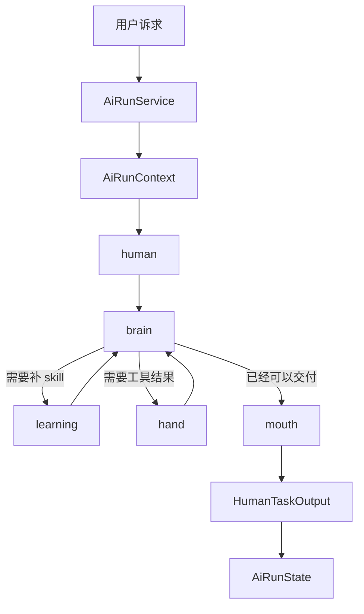

# NCurator-Desktop AI 架构设计

本文定义当前正式 AI 架构。当前系统由 runtime shell 与单个 `human` 执行链组成：run 入口负责生命周期管理，`human` 负责完整任务闭环执行。

## 1. 系统主流程

## 2. 角色职责

### `AiRunService`

- 创建 `AiRunContext`。
- 启动一次 `human` 运行。
- 收口 `AiRunState`，并负责取消、失败和最终结果整理。

### `brain`

- 是唯一推理节点。
- 读取任务输入、稳定记忆、过程历史、已学习 skill 与收敛提示。
- 决定下一步进入 `learning`、`hand` 还是 `mouth`。

### `learning`

- 只负责让本轮请求的 external skill 生效。
- 更新 `learnedSkillIds`、`lastLearningOutcome` 与相关过程历史。

### `hand`

- 只负责执行工具计划。
- 写回标准化工具结果、artifact 和过程历史。

### `mouth`

- 只负责组织最终用户交付。
- 基于当前任务笔记、最终决策、最近过程和 artifacts 生成最终 markdown。

## 3. 运行约束

- 每次 run 只启动一个 `human` 闭环。
- `taskId` 直接由当前 `runId` 提供，`userInput` 直接使用用户原始输入。
- 用户可见过程反馈统一基于 `human_step`、工具事件、blocker 事件和最终答案事件。
