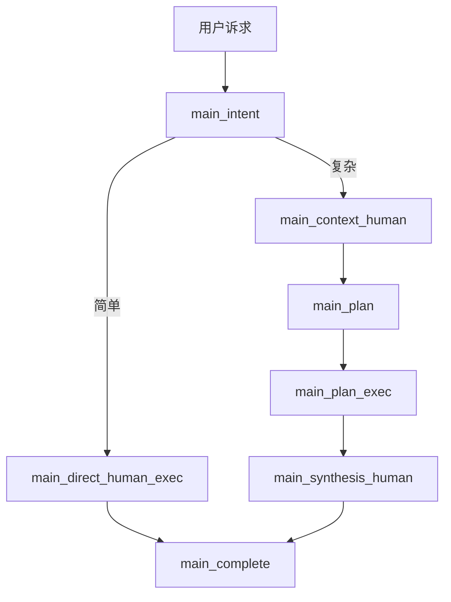
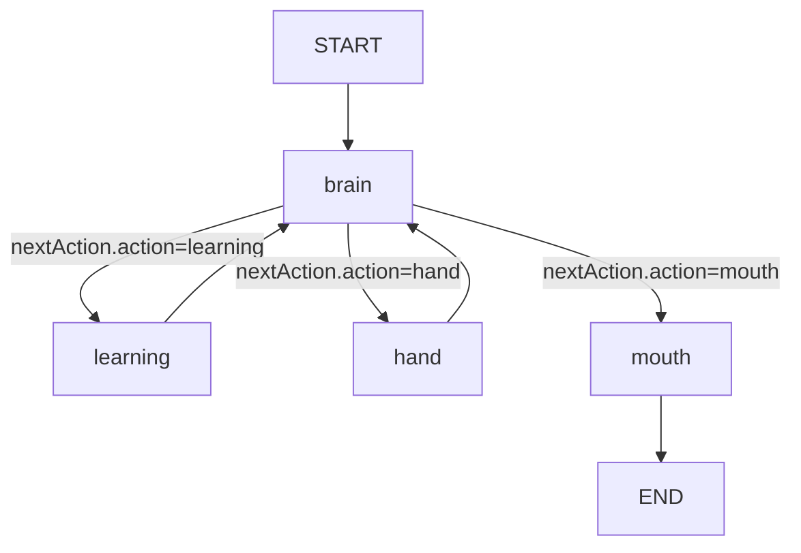

# NCurator-Desktop AI 架构设计

## 1. 设计目标

- `main` 只做编排，不直接承担复杂求解和最终业务执行。
- `human` 是 AI 执行核心，负责独立理解任务、使用技能、调用工具和完成交付。
- 普通正常直接走 `direct human`。
- 复杂诉求走 `context + plan + human + synthesis`。
- `human` 内部只保留一个真正的思考节点，其他节点都应保持执行型、确定性和可追踪。

## 2. 角色分工

### `main`

- 判断请求是直接执行还是需要补充上下文与计划。
- 管理 run 生命周期、计划列表、任务顺序和最终汇总。
- 把单个任务派发给 `human`，但不代替 `human` 做细粒度推理。
- 根据当前阶段为 `human` 选择合适的交付模式，例如最终答复、子任务交接文档或上下文补充记录。

### `human`

- 接收 `taskId + userInput`。
- 维护 `brainMemory`，并明确区分 `inside` 与 `outside`。
- 通过 `brain` 决定下一步是加载技能、发起并行工具调用，还是直接输出。
- 在 `mouth` 节点按交付模式整理最终答复、子任务交接文档或上下文补充记录。

## 3. `main` 总体路径

### 简单诉求

- 不额外引入 context 或 plan。
- `main` 直接派发一个 `human` 完成任务并收尾。

### 复杂诉求

- 先通过 `context` 补齐关键信息。
- 再通过 `plan` 拆成可执行任务。
- 每个子任务仍由 `human` 闭环执行。

## 4. `human` 新架构

human设计核心
使用ReAct范式，让human能独立自主地完成任务，并根据当前所配置的 skill 推进

`human` 子工作流为四个节点：

- `brain`
  - 唯一推理节点。
  - 常规输入只包括 `task / brainMemory / lastParallelCallToolResults / 最近决策历史摘要 / watchHint`。
  - 最近决策历史摘要只读取 `decision + nextAction + createdAt`，用于让 `brain` 知道最近几轮做过什么判断，以及这些判断的时间顺序。
  - 输出新的 `lastBrainDecision`，并同步把该决策追加到 `brainDecisions` 历史中。
  - 只通过 `memoryOps` 更新 `brainMemory.inside`。
- `learning`
  - 只负责按 `wantLearnSkillIds` 维护学习状态。
  - `skillCatalog` 在 run 开始时已注入，供 `brain` 先判断要不要学习某个 skill。
  - 读取 `lastBrainDecision.nextAction.wantLearnSkillIds`。
  - 更新 `brainMemory.outside.learnedSkillIds`；skill 详细说明在 prompt 拼装阶段按 id 动态展开，不持久化到 state。
  - 如果请求的是已学习过的 skill，则写入 `watchHint` 并返回 `brain` 重决策。
- `hand`
  - 只负责执行工具调用，可以承接一个或多个并行工具调用参数。
  - 读取 `lastBrainDecision.nextAction.parallelCallToolParam`。
  - 写入 `lastParallelCallToolResults`。
  - 由 `human` 内部统计工具调用次数；超过临时上限后写入 `watchHint`，下一轮交给 `brain` 判断是否收敛。
- `mouth`
  - 读取 `lastBrainDecision.nextAction.status`、最后一次正式决策、已确认事实/证据/未决项。
  - 不读取最近决策历史，也不重新判断最终状态。
  - 默认不额外引入 hint / digest 文本层；如后续确实需要交付物引用，再单独补充结构化 `artifacts`。
  - 按 `deliveryMode` 整理 `deliveryMarkdown`，典型模式包括 `user_answer`、`task_handoff`、`context_note`。

## 5. `human` 设计原则

- `brain` 是唯一认知节点，不把思考分散到 `learning / hand / mouth`。
- `brainMemory.inside` 与 `brainMemory.outside` 的写权限必须明确。
- 工具原始大结果不直接堆进 `brainMemory`，只保留提炼后的 `evidences` 和可复用的 `facts`。
- `lastBrainDecision` 是当前分发快照，`brainDecisions` 是历史决策日志，二者职责必须分离。
- `brain` 回看时读取的是格式化后的 `brainDecisions` 历史摘要，而不是直接读取 `lastBrainDecision`。
- `skillCatalog` 是预注入目录摘要，`learnedSkillIds` 是已学习 skill 集合，二者职责必须分离。
- `human` 内部只保留一个简单的调用保险机制：当工具调用次数超过临时上限、重复学习已学 skill、或记忆编辑失败时，写入 `watchHint` 并要求 `brain` 优先考虑收敛或纠偏。
- `watchHint` 是当前 `human` 内部统一的轻量收敛提示，不再存在独立 `watchdog` 子系统。
- `deliveryMarkdown` 是正式信息载体；在计划链路中，它还承担串行任务交接文档的角色。
- `contextEvidence` 应从上下文补充记录中的“可复用证据”提取，而不是直接复用整段交付文档。

### 5.实现细节补充
- `brain` prompt 在拼装时根据 `learnedSkillIds` 动态展开技能详情。
- `brainDecisions` 最多保留最近 10 条。
- `brain` 每轮都会更新 `lastBrainDecision`，供 `learning / hand / mouth` 读取当前 `nextAction`。
- `brain` 每轮也会向 `brainDecisions` 追加一条带 `createdAt` 的历史记录。
- `brain` 在下一轮加载时读取的是最近决策历史的精简摘要文本，只保留 `decision`、`nextAction`、`createdAt`，而不是直接读取 `lastBrainDecision`。

## 6. 代码真相源

文档与实现不一致时，以以下代码和后续重构结果为准：

1. `src/main/services/ai/main/graph/mainGraph.ts`
2. `src/main/services/ai/human/graph/humanGraph.ts`
3. `src/main/services/ai/main/node/*`
4. `src/main/services/ai/human/node/*`
5. `src/main/services/ai/main/state/schema.ts`
6. `src/main/services/ai/human/state/schema.ts`
7. `src/main/services/ai/human/types.ts`
8. `src/shared/types.ts`
