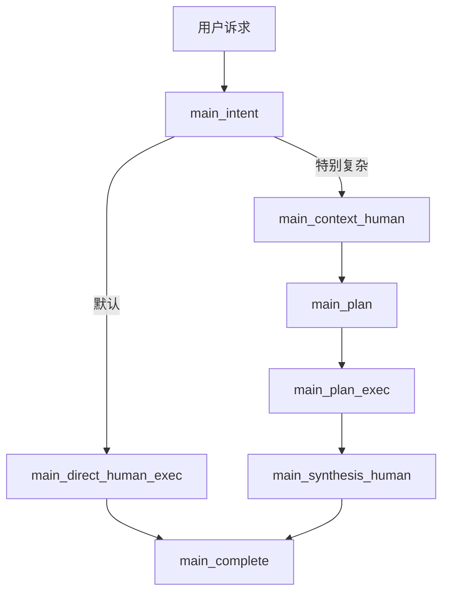
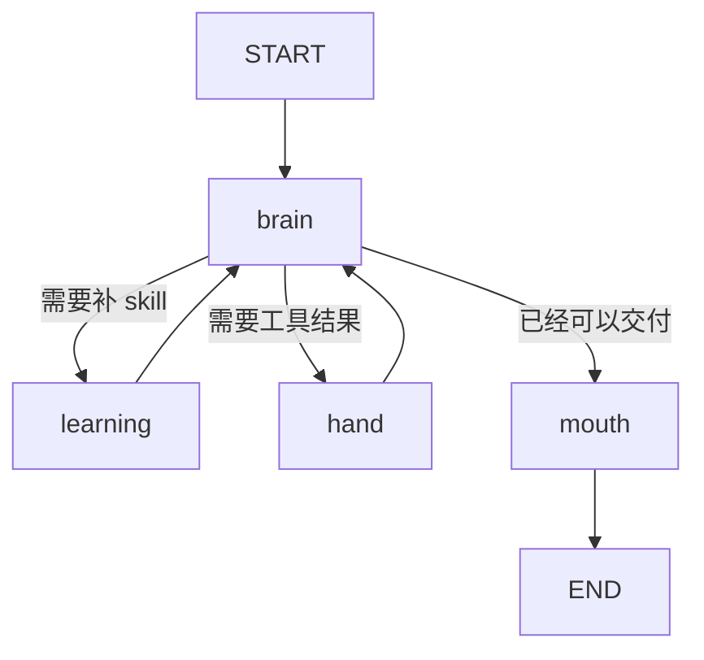

# NCurator-Desktop AI 架构设计

本文定义整套 AI 系统的总体架构。核心前提是：`human` 是系统真正的执行核心，`main` 是围绕 `human` 展开的编排层。

## 1. 核心目标

- `human` 是系统的 canonical execution unit。
- `human` 的目标是在项目能力边界内，面向自然语言诉求，自主逐步推进并完成任务。
- 系统默认走 `human-first`，只有在特别复杂的情况下，`main` 才加上额外的上下文、规划与汇总包装。
- `main` 的职责是 orchestration，不是成为第二个求解核心。
- 未来如果引入多任务并行或 multi-agent，也优先建模为多个 `human` 实例的调度。

## 2. 核心分层

### `main`

- 负责 run 级路由、调度、上下文包装、任务拆分和最终汇总。
- 管理多个 `human` 任务之间的顺序与协作。
- 不替代 `human` 做单任务内部推理。

### `human`

- 负责单任务闭环执行。
- 直接面向自然语言诉求推进任务。
- 通过 `brain / learning / hand / mouth` 完成理解、学习、执行与交付。

## 3. 系统主流程

- 默认路径：`main_intent -> main_direct_human_exec -> main_complete`
- 增强路径：`main_intent -> main_context_human -> main_plan -> main_plan_exec -> main_synthesis_human -> main_complete`
- 两条路径的共同点是：真正执行任务的始终是一个或多个 `human`。

## 4. `human` 内部流程

- `brain` 是唯一推理节点，负责决定下一步动作。
- `learning` 只负责补技能说明。
- `hand` 只负责执行工具调用。
- `mouth` 只负责整理正式交付。

## 5. 演进方向

- `human` 越强，`main` 越薄。
- 可稳定下沉到单 `human` 的复杂度，长期都应尽量从 `main` 收回。
- 多任务并行和 multi-agent 优先基于多个 `human` 实例扩展，而不是重新定义另一套核心执行体。
