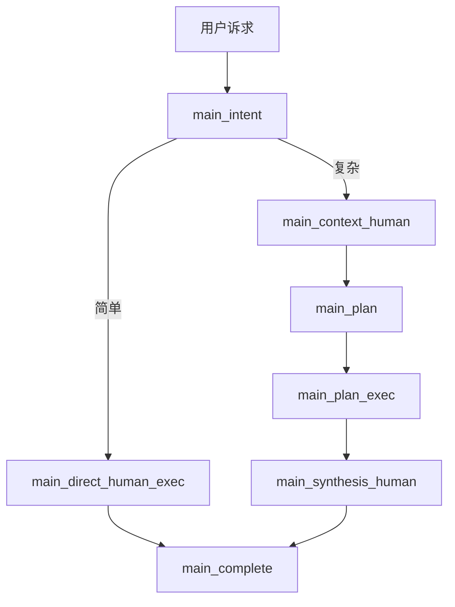
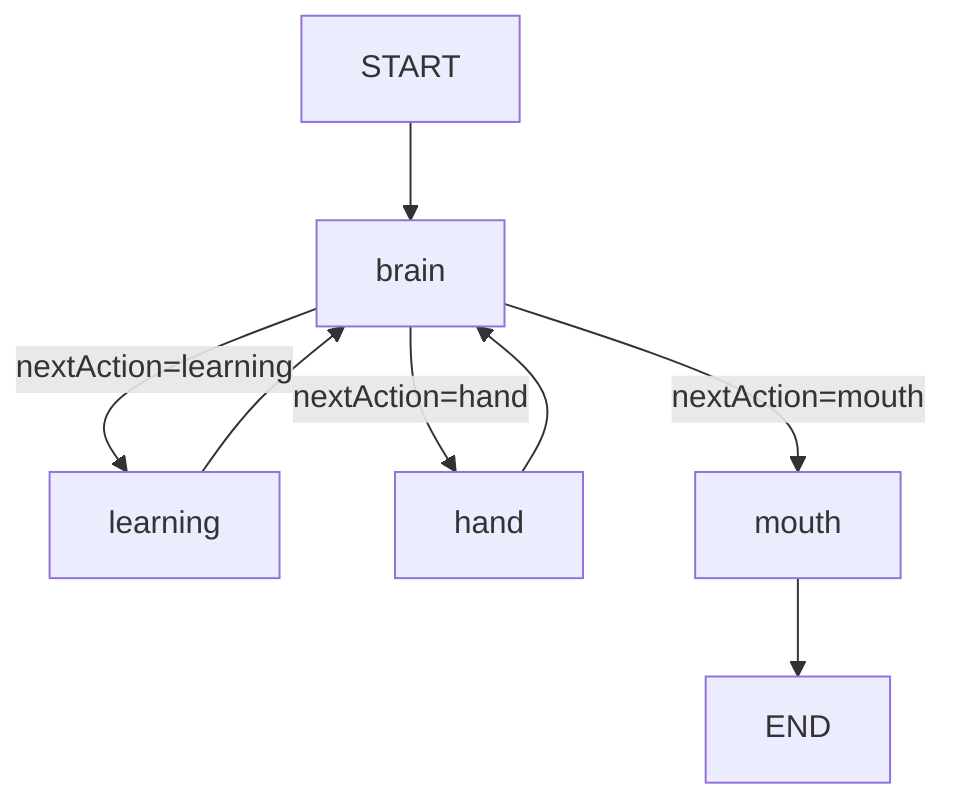

# NCurator-Desktop AI 架构设计

## 1. 设计目标

- `main` 只做编排，不直接承担复杂求解和最终业务执行。
- `human` 是 AI 执行核心，负责独立理解任务、使用技能、调用工具和完成交付。
- 简单诉求直接走 `direct human`。
- 复杂诉求走 `context + plan + human + synthesis`。
- `human` 内部只保留一个真正的思考节点，其他节点都应保持执行型、确定性和可追踪。

## 2. 角色分工

### `main`

- 判断请求是直接执行还是需要补充上下文与计划。
- 管理 run 生命周期、计划列表、任务顺序和最终汇总。
- 把单个任务派发给 `human`，但不代替 `human` 做细粒度推理。

### `human`

- 接收 `taskId + userInput`。
- 维护 `brainMemory`，并明确区分 `inside` 与 `outside`。
- 通过 `brain` 决定下一步是加载技能、发起并行工具调用，还是直接输出。
- 在 `mouth` 节点完成最终面向用户的交付。

## 3. `main` 总体路径

### 简单诉求

- 不额外引入 context 或 plan。
- `main` 直接派发一个 `human` 完成任务并收尾。

### 复杂诉求

- 先通过 `context` 补齐关键信息。
- 再通过 `plan` 拆成可执行任务。
- 每个子任务仍由 `human` 闭环执行。

## 4. `human` 新架构

新的 `human` 子工作流收敛为四个节点：

- `brain`
  - 唯一推理节点。
  - 常规输入只包括 `task / brainMemory / lastParallelCallToolResults / lastBrainDecision.decision`。
  - 当 `hand` 调用次数超过临时上限后，额外接收 `watchHint`，用于提醒本轮优先收敛。
  - 输出新的 `lastBrainDecision` 对象，并只通过 `memoryOps` 更新 `brainMemory.inside`。
- `learning`
  - 只负责加载 skill 详细信息。
  - 更新 `brainMemory.outside.skillCatalog / learnedSkillIds / learnedSkills`。
- `hand`
  - 只负责执行工具调用，可以承接一个或多个并行工具调用参数。
  - 写入 `lastParallelCallToolResults`。
  - 由 `human` 内部统计 `hand` 触发次数；超过临时上限后写入 `watchHint`，下一轮交给 `brain` 判断是否收敛。
- `mouth`
  - 只负责生成最终 `deliveryMarkdown` 和结果摘要。

## 5. `human` 设计原则

- `brain` 是唯一认知节点，不把思考分散到 `learning / hand / mouth`。
- `brainMemory.inside` 与 `brainMemory.outside` 的写权限必须明确。
- 工具原始大结果不直接堆进 `brainMemory`，只保留提炼后的 `evidences` 和可复用的 `facts`。
- `lastBrainDecision` 是最近一次 brain 决策快照，`brainDecisions` 是历史决策日志，二者职责必须分离。
- `human` 内部仍保留一个简单的调用保险机制：当 `hand` 触发次数超过临时上限时，写入 `watchHint` 并要求 `brain` 优先考虑收敛。
- `watchHint` 不是独立 watchdog 子系统，而是当前 `human` 内部的轻量收敛提示。

## 6. 代码真相源

文档与实现不一致时，以以下代码和后续重构结果为准：

1. `src/main/services/ai/graph/mainGraph.ts`
2. `src/main/services/ai/graph/humanGraph.ts`
3. `src/main/services/ai/node/main/*`
4. `src/main/services/ai/node/human/*`
5. `src/main/services/ai/state/stateSchemas.ts`
6. `src/shared/types.ts`
