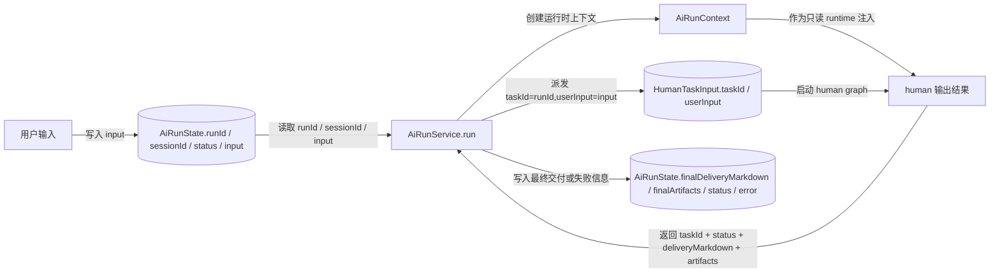
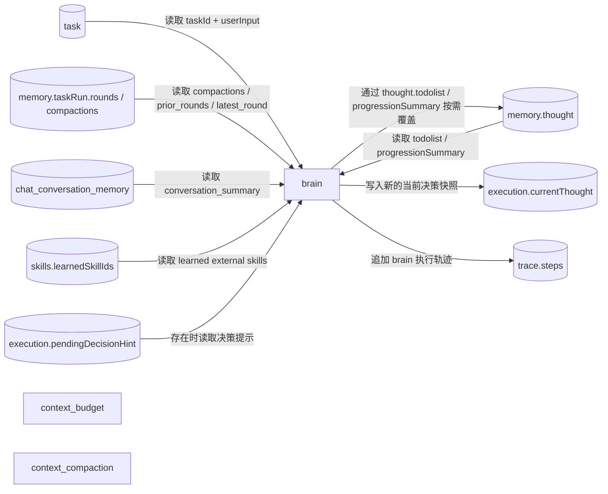
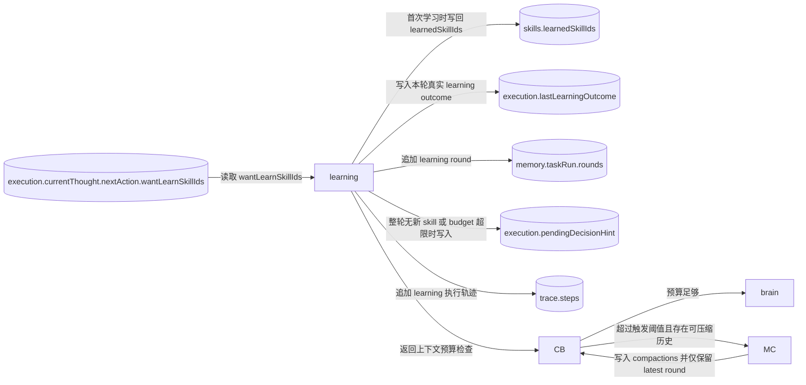
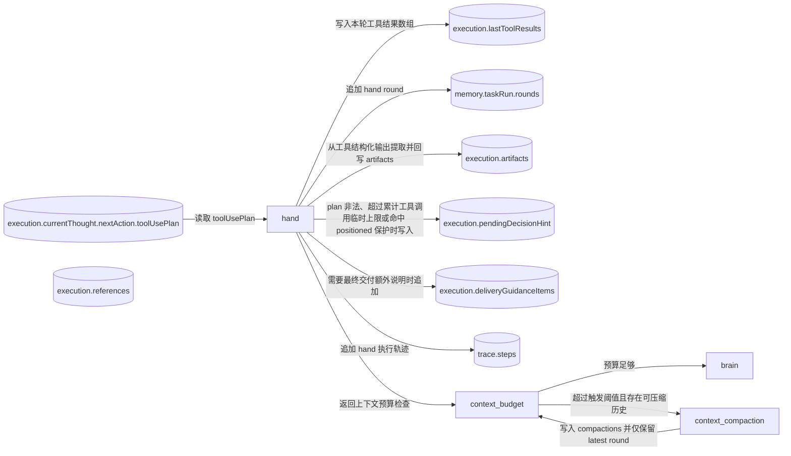
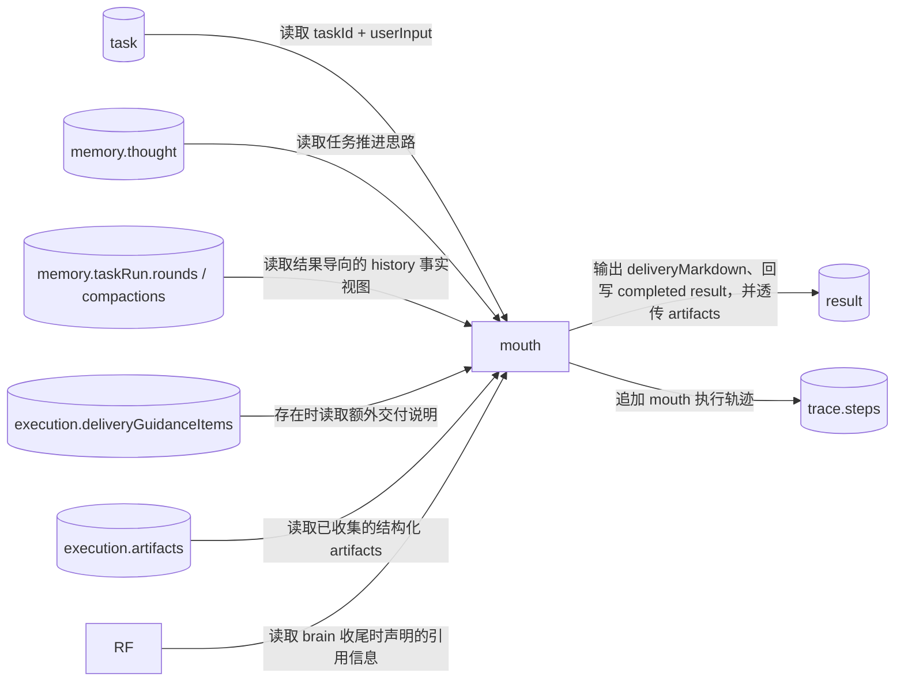

# NCurator-Desktop AI 数据定义与流转图

## 1. 总览

本设计分为两层：

- runtime shell 负责 run 级启动、上下文注入与状态收口。
- `human` 负责单任务闭环执行。
- 节点行为、技术实现约束与跨层规则见 `implementation-spec.md`。
- 本文只定义状态、契约与数据流转，不展开架构动机与阅读导引。

### 1.1 `AiRunContext`

`AiRunContext` 是运行时注入给 `human` 的只读上下文，不持久化进 `AiRunState` 或 `HumanState`。下面的注释只说明字段作用，不重复实现规则。

```ts
interface AiRunContext {
  // 当前 run 的唯一标识；事件、日志和 activity 都通过它关联到同一次运行。
  runId: string

  // 规范化后的工作区与参考资料范围；brain 与工具层通过它判断当前可默认使用的资料边界。
  referenceScope: {
    // 当前 reference scope 绑定的工作区；缺失表示当前 run 没有工作区上下文。
    workspace?: {
      // 工作区 ID；用于存储与检索层关联当前工作区。
      workspaceId: string
      // 工作区名称；主要用于 prompt 和 UI 展示。
      workspaceName: string
      // 工作区根目录；本地路径相关工具默认基于它理解相对路径。
      rootPath: string
      // 工作区策略档位；给后续权限或范围控制预留。
      policyProfile?: string
    }
    // 用户本轮显式选中的参考资料；prompt 会按它渲染当前资料范围。
    selectedReferences: SelectedReference[]
    // 用户是否明确选过参考资料；为 false 时，不能假设用户主动缩圈过。
    hasExplicitSelectedReferences: boolean
    // 是否已经通过直接文档指代把范围收窄到具体文档。
    hasDirectDocumentNarrowing: boolean
    // 默认知识范围；无显式资料时决定是否允许回退到当前工作区知识库。
    defaultKnowledgeScope: 'current_workspace' | 'unavailable'
  }

  // human 运行时的可选覆盖项；主要用于临时调整执行上限等保护参数。
  humanRuntimeOverrides?: {
    // 当前 human 允许的工具调用上限；缺失时使用系统默认值。
    hardActionLimit?: number
    // 当前 human 使用的模型上下文窗口 token 数；缺失时默认 200_000。
    modelContextWindowTokens?: number
  }

  // 当前绑定的工作区；供工具层和 prompt 直接读取基础工作区信息。
  workspace?: {
    // 工作区 ID。
    workspaceId: string
    // 工作区名称。
    workspaceName: string
    // 工作区根目录。
    rootPath: string
    // 工作区策略档位。
    policyProfile?: string
  }

  // 节点统一在入口处调用的取消检查；一旦抛错，当前 run 会立刻终止后续动作。
  checkCancelled: () => void

  // brain 统一通过 runtime 提供的结构化 LLM 入口调用模型。
  chatStructured<T>(input: {
    // 调用方标识；用于 activity、日志和排障定位。
    caller: string
    // 当前 human taskId。
    taskId?: string
    // 最终 system prompt。
    system: string
    // 最终 user prompt。
    user: string
    // 结构化输出 schema。
    schema: z.ZodType<T>
    // schema 名称；用于日志、activity 和问题排查。
    schemaName: string
    // 本次调用的可选温度。
    temperature?: number
  }): Promise<T>

  // mouth 统一通过 runtime 提供的文本 LLM 入口调用模型。
  chatText(input: {
    // 调用方标识；用于 activity、日志和排障定位。
    caller: string
    // 当前 human taskId。
    taskId?: string
    // 最终 system prompt。
    system: string
    // 最终 user prompt。
    user: string
    // 文本调用的逻辑 schema 名称；用于日志和 activity 对齐。
    schemaName: string
    // 本次调用的可选温度。
    temperature?: number
    // 若需要向外发送流式文本增量，则通过这里回调。
    onTextDelta?: (text: string) => void
  }): Promise<string>

  // 统一派发运行事件；tool result、answer event、activity 等都通过这里发出。
  sendEvent: (event: AiRunEvent) => void

  // 可选记录完整 LLM IO；主要用于排障、审计与回放。
  recordLlmIo?: (record: AiLlmIoRecord) => void

  // hand 在 serial 计划里统一请求批量审批；所有未命中正式只读指令集的 terminal 命令先进入同一审批批次。
  requestApprovalBatch: (request: AiApprovalBatchRequest) => Promise<AiApprovalBatchResult>

  // 统一读取历史摘要与最近对话；brain 通过它拿到压缩后的历史上下文。
  loadConversationContext(limits?: {
    // 最近对话最大轮数。
    recentTurns?: number
    // 最近对话文本最大字符数。
    maxRecentTurnsChars?: number
    // 会话摘要最大字符数。
    maxSummaryChars?: number
  }): Promise<{
    // 最近若干轮对话拼接后的文本。
    recentTurnsText: string
    // 更长期历史的摘要文本。
    conversationSummaryText: string
  }>

  // 读取当前会话的持久 conversation memory；brain prompt 使用完整结构渲染 conversation_summary。
  loadConversationMemory(): Promise<ChatConversationMemory | null>

  // docx 打开后记录当前 worker docId、源路径与 replay session；具体语义见 docx-design 文档。
  trackDocxOpen: (input: { docId: string; sourcePath: string; replaySession?: DocxReplaySession }) => void

  // docx 修改后记录改动摘要与最新 replay session；具体语义见 docx-design 文档。
  trackDocxChanges: (input: {
    previousDocId: string
    nextDocId: string
    op: DocxOp
    changedBlocks: DocxChangedBlock[]
    createdBlocks: DocxCreatedBlock[]
    replaySession?: DocxReplaySession
  }) => void

  // docx 打开前把源路径解析成运行时可用的打开目标；docx 三视图规则见 docx-design 文档。
  resolveDocxOpenTarget: (sourcePath: string) => Promise<ResolvedDocxOpenTarget>

  // human task 开始前注册本次 run 的 docx 草稿审阅上下文。
  beginDocxReviewRun: () => void

  // human task 完成后汇总本次 run 的 docx 改动并生成对应视图 artifact。
  // 当前返回单文件 FileReviewDetail[]；未来其他格式接入时应复用同一外壳。
  finalizeDocxReviewRun: () => Promise<FileReviewDetail[]>

  // human task 中断或失败后丢弃本次 run 尚未收口的 docx 草稿审阅状态。
  discardDocxReviewRun: () => void

  // 当前 workspace 文档存储；知识检索和网页资料读取依赖它。
  documentsStore: DocumentsStore

  // 当前 embedding 能力；知识检索工具依赖它做向量查询。
  embeddingService: EmbeddingService
}

interface AiRuntimeSettings {
  // 全局 LLM 流式传输策略；控制本次运行默认偏向流式还是非流式。
  llmStreamingMode: 'force_stream' | 'force_non_stream'
}

interface LLMConfig {
  // 配置唯一标识。
  id: string
  // 服务商适配类型。
  providerKind: 'openai' | 'deepseek' | 'openai-compatible'
  // 模型服务基地址。
  base_url: string
  // 当前配置使用的 API key。
  api_key: string
  // 是否为当前可用配置。
  is_active: boolean
}

interface LlmRuntimeConfig extends LLMConfig {
  // 本次运行实际调用的模型名，由 workbench 在当前激活配置的模型列表中选择。
  model_name: string
}
```

## 2. run 数据定义

### `AiRunState`

```ts
interface AiRunState {
  // 当前 run 的唯一标识；与 AiRunContext.runId 对齐。
  runId: string
  // 当前会话标识；用于关联消息、历史与本次运行。
  sessionId: string
  // run 级运行状态；表示整个 run 是否仍在推进、已完成、失败或被取消。
  status: 'running' | 'completed' | 'failed' | 'cancelled'
  // 用户本轮原始输入；是本次 human 运行的源任务目标。
  input: string
  // run 级错误信息；只在失败路径上写入。
  error?: string
  // 最终对用户输出的 markdown；完成路径会写入它。
  finalDeliveryMarkdown?: string
  // run 结束时可供系统继续消费的结构化交付物引用。
  finalArtifacts: AiArtifactRef[]
}

type AiArtifactRef =
  | {
      // artifact 类型；表示一个真实存在的文件类产物。
      kind: 'file'
      // 产物由哪个能力域生成；便于后续按能力域做展示或处理。
      capability: 'terminal_exec' | 'docx'
      // 文件绝对路径；系统据此定位实际产物。
      path: string
      // 文件名；主要用于 UI 展示。
      fileName: string
      // 这次操作是创建新文件还是更新已有文件。
      operation: 'created' | 'updated'
      // 产物角色；区分 draft、committed 等不同交付阶段。
      artifactRole?: 'draft' | 'committed'
      // 若来自 draft review，则记录 reviewId。
      reviewId?: string
      // 若是 docx draft，则记录 draft snapshotId。
      draftSnapshotId?: string
      // 面向 AI、日志和 UI 的简洁说明。
      summary: string
    }
  | {
      // artifact 类型；表示一次 draft review 的聚合结果，而不是单个文件。
      kind: 'draft_review'
      review: {
        // review 唯一标识。
        reviewId: string
        // 本次 review 涉及的修改数。
        changeCount: number
      }
      // 面向 AI、日志和 UI 的简洁说明。
      summary: string
    };

interface HumanTaskInput {
  // 当前 human 任务 ID；当前正式实现里直接使用 runId。
  taskId: string
  // 派发给当前 human 的自然语言任务输入；当前正式实现里直接使用用户原始输入。
  userInput: string
}

interface HumanRunDispatchOptions {
  // 是否向外发送最终答案增量事件；只影响 answer 事件，不改变底层 transport 策略。
  emitAnswerEvents?: boolean
}

type AiRunEventStage =
  | 'human_brain'
  | 'human_learning'
  | 'human_hand'
  | 'human_mouth'
```

### `ChatConversationMemory`

`ChatConversationMemory` 持久化在 `chat_conversation_memory.memory_json`，用于同一会话内跨 human task 延续上下文。它只保存任务完成后的连续性信息，不保存单次 run 内的压缩块。

```ts
type ChatConversationMemory = {
  // 由 AI 在 run 成功后重写的跨任务滚动摘要。
  summary: string
}
```

## 3. `human` 数据定义

### `HumanState`

```ts
// human 当前所在的节点；context_budget 负责预算路由，context_compaction 负责 run 内历史压缩。
type HumanStage = 'context_budget' | 'context_compaction' | 'brain' | 'learning' | 'hand' | 'mouth'

// human 当前运行状态；目前基线只区分运行中和已完成。
type HumanStatus = 'running' | 'completed'

interface HumanTodoItem {
  item: string
  status: 'todo' | 'done' | 'obsolete'
}

interface HumanThought {
  // 每轮 brain 必填；描述当前现状、当前判断和下一步要做什么。
  next: string
  // 可选；行动路径初始化或调整时输出，输出时全量覆盖 memory.thought.todolist。
  todolist?: HumanTodoItem[]
  // 可选；推进理解、证据、失败原因或修正结论变化时输出，输出时全量覆盖 memory.thought.progressionSummary。
  progressionSummary?: string
}

type BrainNextAction =
  | {
      // 下一跳需要先学习 external skill。
      action: 'learning'
      // 本轮希望学习的 skill id 列表。
      wantLearnSkillIds: string[]
    }
  | {
      // 下一跳需要执行工具调用。
      action: 'hand'
      // 本轮工具调用计划。
      toolUsePlan: ToolUsePlan
    }
  | {
      // 下一跳直接进入 mouth 组织交付。
      action: 'mouth'
      // 若本轮收尾引用了资料或外部知识，则由 brain 在此显式列出，并说明 usedFor。
      references?: Array<{
        label: string
        path: string
        kind: 'internal' | 'external'
        usedFor: string
      }>
    }

interface HumanThoughtDecision {
  // 本轮 brain 的正式任务推进思路。
  thought: HumanThought
  // 下一跳动作对象；决定本轮之后去 learning、hand 还是 mouth。
  nextAction: BrainNextAction
}

interface HumanExecution {
  // 当前 human 所在节点。
  stage: HumanStage
  // 当前 human 运行状态；与 task 是否已经结束对应。
  status: HumanStatus
  // 当前动作快照；learning / hand / mouth 都通过它读取本轮 brain 的最新决策。
  currentThought?: HumanThoughtDecision
  // 收敛或纠偏提示；当 learning / hand / brain 触发保护逻辑时写入。
  decisionHint?: HumanDecisionHint
  // 最终交付时必须吸收的额外说明项；由 brain 或 hand 追加，mouth 负责转成用户可理解的话术。
  deliveryGuidanceItems?: Array<{
    // 说明项来自 hand；用于补充执行结果相关说明。
    source: 'hand'
    // 交给 mouth 的自然语言收口要求。
    text: string
  }>
  // 最近一次 hand 工具执行结果；主要供 runtime 排障与回放使用。
  lastToolResults?: ToolCallResult[]
  // 最近一次 learning 的真实执行结果；主要供 runtime 排障与回放使用。
  lastLearningOutcome?: HumanLearningOutcome
  // 最近一次进入 brain 前的上下文预算快照；只用于压缩路由、日志与 LLM 调用关联，不进入 prompt。
  contextBudget?: {
    evaluationId: string
    basis: 'initial' | 'usage_plus_delta' | 'post_compaction' | 'usage_unavailable'
    budgetTokens: number
    contextWindowTokens: number
    compactionTriggerTokens: number
    hasCompressibleHistory: boolean
    usageAvailable: boolean
    lastBrainInputTokens?: number
    deltaTokenEstimate?: number
  }
  // 运行时收集到的结构化交付物引用；由 hand 写入，mouth 只透传。
  artifacts: AiArtifactRef[]
  // brain 在决定 nextAction=mouth 时声明的引用资料列表；供 mouth 最终交付时按 usedFor 披露。
  references?: Array<{
    label: string
    path: string
    kind: 'internal' | 'external'
    usedFor: string
  }>
}

interface HumanTaskRunMemory {
  // 当前 run 内未压缩的正式过程历史；latest history 始终保留原文。
  rounds: HumanRoundRecord[]
  // 当前 run 内由 context_compaction 生成的历史压缩块；不持久化到 conversation memory。
  compactions: Array<{
    id: string
    kind: 'rounds'
    summary: string
    source: {
      roundIds: number[]
    }
    createdAt: number
    tokenEstimateBefore?: number
    tokenEstimateAfter?: number
  }>
}

interface HumanState {
  // 当前 task 的输入。
  task: HumanTaskInput
  // 当前 task 的执行态字段。
  execution: HumanExecution
  memory: {
    // 当前 run 内可展示的任务推进记忆。
    thought: HumanThought
    // 过程历史与 run 内压缩块。
    history: HumanMemoryHistory
  }
  skills: {
    // 已学习的 external skill 列表；builtin skill 不写入这里。
    learnedSkillIds: string[]
  }
  // task 完成后的内部结果快照；只在完成后写入。
  result?: HumanResult
  trace: {
    // 面向外部事件、审计和回放的轨迹步骤列表。
    steps: HumanTraceStep[]
  }
}
```

### `rounds` 与 `compactions`

```ts
interface HumanHistoryToolResult {
  // 工具名；用于后续筛选、回放和排障。
  toolName: string
  // 这次工具调用是否成功。
  ok: boolean
  // 标准化后的结果码；与 ToolCallResult.code 对齐。
  code: ToolCallResult['code']
  // 对本次工具结果的简短摘要。
  summary: string
  // 本次工具调用的原始结构化返回；作为 history 的 canonical evidence 保存。
  data?: JsonValue
  // 诊断信息的文本化摘要。
  diagnosticText?: string
  // 本次工具调用附带生成的 artifact 引用。
  artifactRefs?: AiArtifactRef[]
  // 资源上下文；作为运行态归因、日志与 history 检索文本的一部分保留，不直接进入 brain/mouth prompt 视图。
  resourceContext?: ToolResourceContext
}

type HumanRoundExecution =
  | {
      // 表示执行前就被保护逻辑拦住，没有真正进入 learning / hand / mouth。
      kind: 'pre_execution_blocked'
      // 这次阻塞对应的 decision hint。
      decisionHint: HumanDecisionHint
    }
  | {
      // 表示本轮真正执行了 learning。
      kind: 'learning'
      // 本轮 learning 的真实执行结果。
      learningOutcome: HumanLearningOutcome
      // 若 learning 触发了纠偏提示，则在这里补充。
      decisionHint?: HumanDecisionHint
    }
  | {
      // 表示本轮真正执行了 hand。
      kind: 'hand'
      // 本轮执行的工具计划。
      toolUsePlan: ToolUsePlan
      // 本轮工具结果的原始历史版本；prompt/search 在读取 history 时再实时渲染。
      toolResults: HumanHistoryToolResult[]
      // 若 hand 触发了纠偏提示，则在这里补充。
      decisionHint?: HumanDecisionHint
      // 本轮 hand 追加的 artifact 引用。
      artifactRefs?: AiArtifactRef[]
    }
  | {
      // 表示本轮真正执行了 mouth。
      kind: 'mouth'
      // mouth 这一轮交付的简短摘要。
      summary: string
      // 本轮 mouth 是否已经把 task 收敛为 completed。
      completed: boolean
    }

interface HumanRoundRecord {
  // round 序号；用于按顺序回放当前 task 的过程。
  roundId: number
  // 本轮记录的创建时间。
  createdAt: number
  // 本轮 brain 产出的正式判断。
  thought: HumanThoughtDecision
  // 本轮随后真正发生的执行结果。
  execution: HumanRoundExecution
}

interface HumanLoadedHistoryContext {
  filters: {
    // 按关键词搜索历史时使用的查询词。
    query?: string
    // 可选的 round 起始边界。
    startRoundId?: number
    // 可选的 round 结束边界。
    endRoundId?: number
    // 本次主动回看最多带回多少条 round。
    limit?: number
  }
  // 根据 filters 实际取回的 round 列表。
  rounds: HumanRoundRecord[]
}
```

### `ToolUsePlan`、decision hint、result 与 trace

```ts
interface ToolCallParam {
  // 要调用的工具名。
  toolName: string
  // 传给该工具的结构化参数。
  args: JsonObject
}

interface ToolUsePlan {
  // 执行模式；parallel 表示并行执行，serial 表示按顺序执行。
  mode: 'parallel' | 'serial'
  // 本轮要执行的工具调用列表；正式实现要求总长度不超过 HUMAN_TOOL_USE_PLAN_LIMIT。
  calls: ToolCallParam[]
}

interface ToolCallResult {
  // 工具名。
  toolName: string
  // 这次工具调用是否成功。
  ok: boolean
  // 标准化结果码；brain 会基于它判断后续怎么处理。
  code:
    | 'ok'
    | 'failed'
    | 'workspace_required'
    | 'approval_denied'
    | 'invalid_input'
  // 工具返回的结构化数据；成功时通常在这里。
  data?: JsonValue
  // 失败或特殊情况的诊断信息。
  diagnostic?: ToolCallDiagnostic
}

interface ToolCallDiagnostic {
  // 原始错误文本；优先保留 schema 校验或运行时返回的 message。
  message: string
}

// brain 结构化输出的唯一真实来源是 humanDecisionSchema；
// prompt 中的输出 shape 应由该 schema 自动导出，而不是再维护一份手写结构模板。

interface HumanLearningOutcome {
  // 本轮原始请求学习的 skill id 列表。
  requestedSkillIds: string[]
  // 本轮实际新加载成功的 skill id 列表。
  loadedSkillIds: string[]
  // 本轮发现已经学过，因此跳过的 skill。
  skippedDuplicateSkillIds: string[]
  // 本轮发现未知，因此跳过的 skill。
  skippedUnknownSkillIds: string[]
  // 本轮因 active tool budget 等原因被移出的 skill。
  evictedSkillIds: string[]
  // 当前有效工具数；用于控制 active tool budget。
  activeToolCount: number
}

type HumanDecisionHint =
  | {
      // learning 没有产生实际效果；例如全是重复或未知 skill。
      code: 'learning_no_effect'
      detail: {
        // 本轮请求学习的 skill。
        requestedSkillIds: string[]
        // 其中重复的 skill。
        duplicateSkillIds: string[]
        // 其中未知的 skill。
        unknownSkillIds: string[]
      }
    }
  | {
      // learning 请求了 builtin skill；builtin 始终可用，不进入 learned external skill 集。
      code: 'learning_builtin_skill_requested'
      detail: {
        // 本轮请求学习的 skill。
        requestedSkillIds: string[]
        // 被识别为 builtin 的 skill。
        builtinSkillIds: string[]
      }
    }
  | {
      // learning 后有效工具数超限。
      code: 'learning_tool_budget_exceeded'
      detail: {
        // 本轮请求学习的 skill。
        requestedSkillIds: string[]
        // 当前有效工具数。
        activeToolCount: number
        // 允许上限。
        limit: number
      }
    }
  | {
      // hand 收到非法工具计划；例如总长度超限、并行批次不满足只读要求，或 docx 串行写超出单轮上限。
      code: 'hand_plan_invalid'
      detail: {
        // 原始计划模式。
        mode: 'parallel' | 'serial'
        // 非法原因。
        reason:
          | 'tool_use_plan_limit_exceeded'
          | 'parallel_requires_read_only'
          | 'parallel_limit_exceeded'
          | 'docx_single_file_write_limit_exceeded'
        // 导致非法的工具名。
        offendingToolNames: string[]
        // 若是数量超限，则记录本次调用数。
        callCount?: number
        // 若是数量超限，则记录允许上限。
        limit?: number
      }
    }
  | {
      // hand 的工具调用次数超过本轮允许上限。
      code: 'hand_tool_limit_exceeded'
      detail: {
        // 当前累计工具调用数。
        toolCallCount: number
        // 允许上限。
        limit: number
      }
    }
  | {
      // brain 试图直接去 mouth，但 todolist 里仍有未完成事项。
      code: 'brain_todolist_incomplete'
      detail: {
        pendingItems: string[]
      }
    }

interface MouthOutput {
  // mouth 生成的正式 markdown；若模型空输出，node 会先做 fallback，再写入 result。
  deliveryMarkdown: string
}

interface HumanResult {
  // human 内部结果目前只存在 completed 这一种终态。
  status: 'completed'
  // 对当前 task 最终完成情况的简短摘要。
  summary: string
  // 最终正式 markdown 交付。
  deliveryMarkdown: string
  // 最终透传的 artifact 列表。
  artifacts?: AiArtifactRef[]
}

interface HumanTaskOutput {
  // 返回给 runtime shell 的 taskId；与当前 human task 对齐。
  taskId: string
  // 当前跨层输出的状态；目前只返回 completed。
  status: 'completed'
  // 返回给 runtime shell 的正式 markdown 交付。
  deliveryMarkdown: string
  // 返回给 runtime shell 的 artifact 列表。
  artifacts?: AiArtifactRef[]
}

interface HumanTraceStep {
  // 当前 trace 的顺序号。
  step: number
  action:
    // 本步记录了一次 brain 决策。
    | 'brain_decision'
    // 本步记录了一次 skill 学习。
    | 'learn_skill'
    // 本步记录了一次工具调用。
    | 'call_tool'
    // 本步记录了一次正式交付。
    | 'deliver_result'
  // 面向外部轨迹的叙述；给 UI 与日志看的一句话说明。
  publicNarrative: string
  // 当前步骤的结果状态。
  resultStatus?: 'ok' | 'error'
  // 若本步与 skill 有关，则记录 skillId。
  skillId?: string
  // 若本步与 tool 有关，则记录 toolName。
  toolName?: string
  // 当前步骤摘要；供内部调试与审计使用。
  summary: string
}
```

### 关键运行事件与结构化模型日志

```ts
interface AiRunEventEnvelope {
  // 该事件是否仅供内部调试、日志与排障使用。
  internal?: boolean
  // 统一阶段标记；当前正式实现只保留 human 四阶段。
  stage?: AiRunEventStage
}

// 当前正式实现里，外发事件统一采用 “具体 payload + AiRunEventEnvelope” 的组合形式。
interface RunStartedEvent {
  type: 'run_started'
  runId: string
  sessionId: string
  createdAt: number
  input: string
}

interface ToolCallStartedEvent {
  type: 'tool_call_started'
  runId: string
  taskId?: string
  toolCallId: string
  toolName: string
  input: IpcJsonObject
  createdAt: number
}

interface ToolCallResultEvent {
  // 事件类型。
  type: 'tool_call_result'
  // 所属 run。
  runId: string
  // 若来自 human task，则带 taskId。
  taskId?: string
  // 本次工具调用的唯一标识。
  toolCallId: string
  // 对应工具名。
  toolName: string
  // 轻量时间线展示使用的输出预览。
  outputPreview: IpcJsonValue
  // 标准化后的工具结果，供后续 AI 或排障直接消费。
  result?: AiToolCallResult
  // 若工具输出了 draft snapshot，可通过这里关联。
  draftRef?: AiDraftSnapshotRef
  // 工具调用完成时间。
  completedAt: number
  // 若调用失败，补充错误文本。
  error?: string
}

interface TerminalStepStartedEvent {
  type: 'terminal_step_started'
  runId: string
  taskId: string
  stepId: string
  stepIndex: number
  command: string
  cwd: string
  createdAt: number
}

interface TerminalStepResultEvent {
  type: 'terminal_step_result'
  runId: string
  taskId: string
  stepId: string
  stepIndex: number
  command: string
  outputPreview: string
  exitCode: number | null
  timedOut: boolean
  truncated: boolean
  completedAt: number
}

interface TerminalStepErrorEvent {
  type: 'terminal_step_error'
  runId: string
  taskId: string
  stepId: string
  stepIndex: number
  command: string
  error: string
  outputPreview?: string
  completedAt: number
}

interface ActivityEvent {
  type: 'activity'
  runId: string
  taskId?: string
  activityId: string
  actionType: string
  status: 'started' | 'completed' | 'failed'
  summary: string
  details?: AiActivityDetails
  createdAt: number
}

interface HumanStepEvent {
  // 事件类型。
  type: 'human_step'
  // 所属 run。
  runId: string
  // 当前 human taskId。
  taskId: string
  // 当前步骤序号。
  stepIndex: number
  // 当前步骤动作类型。
  action: 'brain_decision' | 'learn_skill' | 'call_tool' | 'deliver_result'
  // 若本步与 skill 有关，则记录 skillId。
  skillId?: RuntimeSkillId
  // 若本步与 tool 有关，则记录 toolName。
  toolName?: string
  // 面向用户的过程叙述。
  publicNarrative: string
  // 当前已学习 skill。
  learnedSkillIds: RuntimeSkillId[]
  // 当前有效 skill。
  effectiveSkillIds: RuntimeSkillId[]
  // 当前可用工具名。
  availableToolNames: string[]
  // 当前步骤结果状态。
  resultStatus?: 'ok' | 'error'
  // 当前步骤摘要。
  summary: string
  // 若步骤产生了 draft snapshot，可通过这里关联。
  draftRef?: AiDraftSnapshotRef
  // 事件创建时间。
  createdAt: number
}

interface DecisionHintEvent {
  type: 'decision_hint'
  runId: string
  taskId?: string
  source: DecisionHintSource
  code: string
  detail?: JsonObject
  summary: string
  createdAt: number
}

interface FileArtifactEvent {
  type: 'file_artifact'
  runId: string
  taskId: string
  artifactId: string
  capability: AiFileArtifactCapability
  path: string
  fileName: string
  operation: AiFileArtifactOperation
  artifactRole?: AiFileArtifactRole
  reviewId?: string
  draftSnapshotId?: string
  summary: string
  stepId?: string
  createdAt: number
}

interface DraftReviewReadyEvent {
  type: 'draft_review_ready'
  runId: string
  review: AiFileReviewRef
  createdAt: number
}

interface WorkspaceRequiredEvent {
  type: 'workspace_required'
  runId: string
  taskId: string
  reason: string
  requiredFields: Array<'workspaceId' | 'rootPath'>
  createdAt: number
}

interface ApprovalBatchRequiredEvent {
  type: 'approval_batch_required'
  runId: string
  taskId: string
  batchId: string
  items: AiApprovalBatchItem[]
  createdAt: number
}

interface ApprovalBatchDecisionEvent {
  type: 'approval_batch_decision'
  runId: string
  taskId: string
  batchId: string
  decisions: AiApprovalBatchDecision[]
  decidedAt: number
}

interface AnswerCompletedEvent {
  // 事件类型。
  type: 'answer_completed'
  // 所属 run。
  runId: string
  // 当前 human taskId。
  taskId?: string
  // 最终完整文本。
  text: string
}

interface AnswerTokenEvent {
  type: 'answer_token'
  runId: string
  taskId?: string
  token: string
}

interface AiActivityDetails {
  // 本次 activity 对应的 callId；用于把 activity 与 LLM/tool 调用关联起来。
  callId?: string
  // 谁发起了这次 activity；例如 human.brain。
  caller?: string
  // 本次结构化输出使用的 schema 名称。
  schemaName?: string
  // 本次调用使用的模型名。
  model?: string
  // 本次调用使用的 baseUrl host。
  baseUrlHost?: string
  // 调用重试序号。
  attempt?: number
  // 调用耗时。
  durationMs?: number
  // 结构化输出方法。
  method?: 'jsonSchema' | 'jsonMode' | 'promptJson' | 'scripted'
  // 使用的底层 transport。
  transport?: 'completions' | 'responses'
  // 最终选择的 profile。
  profile?:
    | 'completions:jsonSchema'
    | 'completions:jsonMode'
    | 'completions:promptJson'
    | 'responses:jsonSchema'
    | 'responses:promptJson'
    | 'scripted'
  // 这次调用可尝试的 fallback profile 链。
  fallbackChain?: Array<
    | 'completions:jsonSchema'
    | 'completions:jsonMode'
    | 'completions:promptJson'
    | 'responses:jsonSchema'
    | 'responses:promptJson'
    | 'scripted'
  >
  // 本次调用的全局流式策略。
  streamingMode?: 'force_stream' | 'force_non_stream'
  // 本次调用是否实际走了流式传输。
  streamed?: boolean
  // 本次调用收到的文本 chunk 数。
  chunkCount?: number
  // 首个 chunk 到达延迟。
  firstTokenLatencyMs?: number
  // 若出现 fallback 或失败，补充原因。
  reason?: string
}

interface LlmStreamDeltaEvent {
  // 事件类型。
  type: 'llm_stream_delta'
  // 所属 run。
  runId: string
  // 若来自 human task，则带 taskId。
  taskId?: string
  // 本次 LLM 调用的唯一标识。
  callId: string
  // 调用方；例如 human.brain 或 human.mouth。
  caller: string
  // 当前是第几个文本 chunk。
  chunkIndex: number
  // 当前文本增量。
  text: string
  // 事件创建时间。
  createdAt: number
}

interface RuntimeIssueEvent {
  type: 'runtime_issue'
  runId: string
  code: RuntimeIssueCode
  message: string
  taskId?: string
  workspaceId?: string
  scopeSourceId?: string
  createdAt: number
}

interface RunCompletedEvent {
  type: 'run_completed'
  runId: string
}

interface RunFailedEvent {
  type: 'run_failed'
  runId: string
  error: string
}

interface RunCancelledEvent {
  type: 'run_cancelled'
  runId: string
}

interface ContextBudgetEvaluatedEvent {
  type: 'context_budget_evaluated'
  runId: string
  taskId?: string
  stage: 'human_brain'
  decision: 'continue' | 'compact'
  snapshot: {
    evaluationId: string
    basis: 'initial' | 'usage_plus_delta' | 'post_compaction' | 'usage_unavailable'
    budgetTokens: number
    contextWindowTokens: number
    compactionTriggerTokens: number
    hasCompressibleHistory: boolean
    usageAvailable: boolean
    lastBrainInputTokens?: number
    deltaTokenEstimate?: number
  }
  createdAt: number
}

interface AiLlmIoRecord {
  // 本次 LLM 调用的唯一标识。
  callId: string
  // 所属 run。
  runId: string
  // 若来自 human task，则带 taskId。
  taskId?: string
  // 调用方；例如 human.brain 或 human.mouth。
  caller: string
  // 使用的 schema 名称。
  schemaName: string
  // 使用的模型名。
  model: string
  // 调用目标 host。
  baseUrlHost: string
  // 最终 system prompt。
  system: string
  // 最终 user prompt。
  user: string
  // 结构化输出结果；text 调用通常为空。
  output?: JsonValue
  // 最终聚合得到的原始文本。
  rawText?: string
  // 结构化输出方法。
  method?: 'jsonSchema' | 'jsonMode' | 'promptJson' | 'scripted'
  // 使用的底层 transport。
  transport?: 'completions' | 'responses'
  // 最终选择的 profile。
  profile?:
    | 'completions:jsonSchema'
    | 'completions:jsonMode'
    | 'completions:promptJson'
    | 'responses:jsonSchema'
    | 'responses:promptJson'
    | 'scripted'
  // 本次调用可尝试的 fallback profile 链。
  fallbackChain: Array<
    | 'completions:jsonSchema'
    | 'completions:jsonMode'
    | 'completions:promptJson'
    | 'responses:jsonSchema'
    | 'responses:promptJson'
    | 'scripted'
  >
  // 本次调用的全局流式策略。
  streamingMode?: 'force_stream' | 'force_non_stream'
  // 当 caller 为 human.brain 时，对应这次 brain 调用前的上下文预算快照；只用于排障与日志关联。
  contextBudgetSnapshot?: {
    evaluationId: string
    basis: 'initial' | 'usage_plus_delta' | 'post_compaction' | 'usage_unavailable'
    budgetTokens: number
    contextWindowTokens: number
    compactionTriggerTokens: number
    hasCompressibleHistory: boolean
    usageAvailable: boolean
    lastBrainInputTokens?: number
    deltaTokenEstimate?: number
  }
  // 本次调用是否实际走了流式传输。
  streamed?: boolean
  // 本次调用收到的文本 chunk 数。
  chunkCount?: number
  // 首个 chunk 到达延迟。
  firstTokenLatencyMs?: number
  // 开始时间。
  startedAt: number
  // 完成时间。
  completedAt: number
  // 调用总耗时。
  durationMs: number
  // 本次调用状态。
  status: 'completed' | 'failed'
  // 若失败或触发 fallback，补充原因。
  reason?: string
}
```

## 4. 数据流转图

下面的图按阶段拆开，每张图只表达一段数据读写。

### run 入口：`AiRunService -> human -> AiRunState`



### `human` 阶段一：`brain` 读取输入并产出决策



- `brain` 的 prompt 应分层表达 `principles / thought_contract / next_action_contract / context_block_guide / output_contract / output_shape / examples`，避免把工作方式、thought 语义、动作路由语义和输出层规则混写在同一块里。

### `human` 阶段二：`learning` 路径的数据流转



### `human` 阶段三：`hand` 路径的数据流转



### `human` 阶段四：`mouth` 路径的数据流转



- `mouth` 不直接消费 `brain` 的 `prior_rounds / latest_round` 决策视图；它基于 `rounds + compactions` 渲染成一套独立的结果导向 `history` 视图。
- `mouth` 的 prompt 输入仍以 `thought` 为优先事实来源；当 `thought` 过于概括或不足以支撑用户要求的细节时，再从结果导向的 `history`、`deliveryGuidanceItems` 与 `runtime_artifacts` 补足用户回答所需细节，而不是依赖额外的低层 tool 参数。
- `mouth` 不再依赖 `execution.currentThought` 的本轮 next 来组织最终交付；若 `thought` 与更具体的历史/产物依据存在张力，应以更具体、可追溯的依据为准。
- `references` 的正式来源是 `brain` 在 `nextAction.action='mouth'` 时的结构化输出；`mouth` 只负责消费并在 markdown 正文中披露这些引用及其 `usedFor`，不自行推断新的已引用来源。
