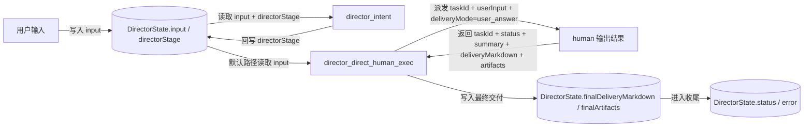
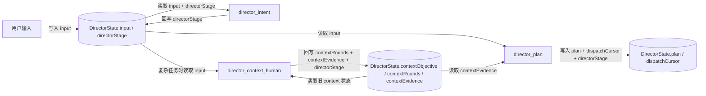
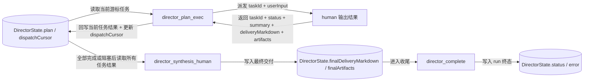
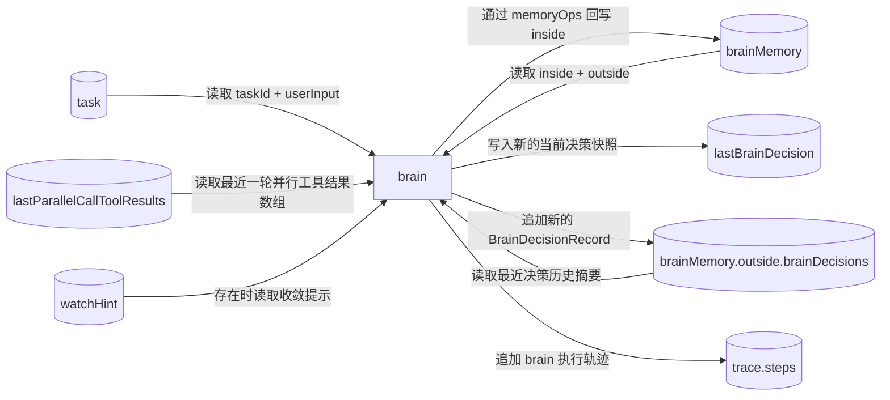
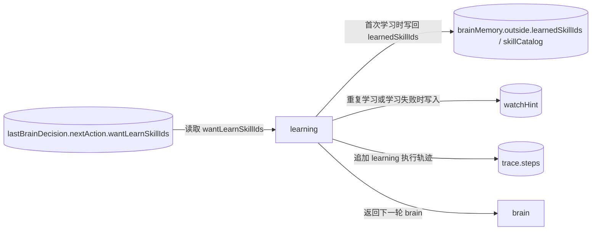
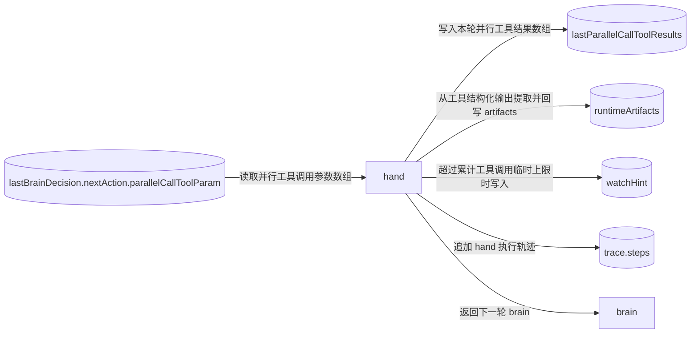
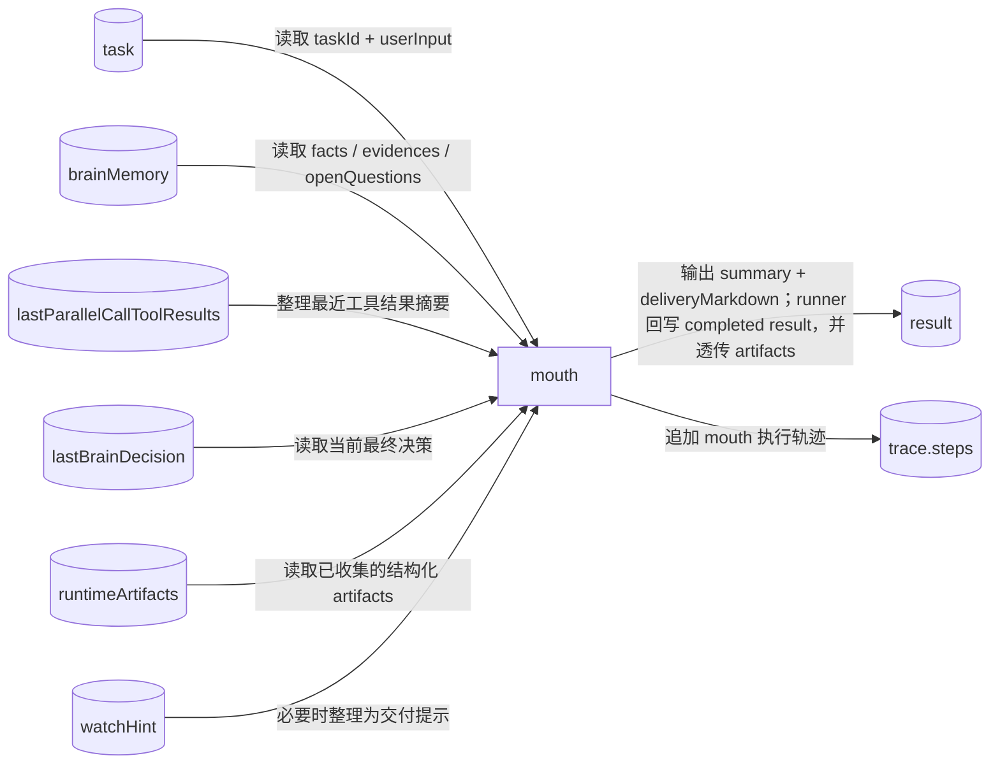

# NCurator-Desktop AI 数据定义与流转图

## 1. 总览

本设计分为 `director` 与 `human` 两层：

- `director` 负责 run 级编排、计划调度和最终汇总。
- `human` 负责单任务闭环执行。
- 节点行为、技术实现约束与跨层规则见 `implementation-spec.md`。
- 本文只定义状态、契约与数据流转，不展开架构动机与阅读导引。

### 1.1 `AiRunContext`

`AiRunContext` 是运行时注入给 `director` 与 `human` 的只读上下文，不持久化进 `DirectorState` 或 `HumanState`。

```ts
interface AiRunContext {
  // 当前 run 的唯一标识。
  runId: string
  // 当前会话标识，用于关联历史与消息落盘。
  sessionId: string
  // 当前绑定的工作区。
  // 正常 workbench 发送前会先完成工作区选择；这里保留 optional 仅用于内部防御式兜底。
  workspace?: {
    // 工作区唯一标识。
    workspaceId: string
    // 工作区名称，用于 AI 可读上下文。
    workspaceName: string
    // 工作区根路径，后续本地相对路径都以它为基准。
    rootPath: string
    // 可选的策略配置。
    policyProfile?: string
  }
  // runtime 根据 workspace + selectedReferences 推导出的最终 KB 范围。
  // 有显式 selectedReferences 时收口到这些 reference 的 kbDocumentIds；
  // 无显式 selectedReferences 但有 workspace 时，默认收口到当前工作区全部已索引文件；
  // 两者都没有时，不提供本地 KB 范围。
  selectedDocumentIds?: string[]
  // 唯一的“用户选择的参考资料”文本投影。
  // 固定包含当前工作区背景、参考资料类型说明和当前用户选择列表。
  selectedContextText: string
}
```

## 2. `director` 数据定义

### `DirectorState`

```ts
interface DirectorState {
  // 当前 run 的唯一标识。
  runId: string
  // 当前会话标识，用于关联消息和历史记录。
  sessionId: string
  // director 层运行状态。
  status: 'running' | 'completed' | 'failed' | 'cancelled'
  // 用户本轮原始输入。
  input: string
  // director 当前所在节点。
  directorStage:
    | 'director_intent'
    | 'director_context_human'
    | 'director_plan'
    | 'director_plan_exec'
    | 'director_direct_human_exec'
    | 'director_synthesis_human'
    | 'director_complete'
  // 已经进行过多少轮上下文补充。
  contextRounds: number
  // 当前上下文补充阶段派发给 context human 的任务目标。
  contextObjective?: string
  // context 阶段得到的关键证据摘要。
  contextEvidence: string[]
  // 计划任务列表，每一项都是后续派发给 human 的任务。
  plan: DirectorPlanTask[]
  // 当前指向下一项待派发任务的游标。
  dispatchCursor: number
  // run 级错误信息。
  error?: string
  // director 最终对用户输出的 markdown。
  finalDeliveryMarkdown?: string
  // run 结束时可供系统继续消费的结构化交付物引用。
  finalArtifacts: AiArtifactRef[]
}

interface DirectorPlanTask {
  // 计划任务 ID。
  id: string
  // 任务短标题，主要用于日志和 UI。
  title: string
  // 派发给 human 的任务输入。
  userInput: string
  // 任务状态。
  // ready 表示尚未派发；completed 表示已经完成当前可交付内容。
  status: 'ready' | 'running' | 'completed'
  // 该任务的正式交付内容。
  // 在 plan 链路中，通常是供后续任务与 synthesis 使用的 task_handoff 文档。
  deliveryMarkdown?: string
  // 该任务已经产生的结构化交付物引用。
  artifacts?: AiArtifactRef[]
}

type AiArtifactRef =
  | {
      kind: 'file'
      capability: 'terminal_exec' | 'docx'
      path: string
      fileName: string
      operation: 'created' | 'updated'
      artifactRole?: 'preview' | 'draft' | 'committed'
      reviewId?: string
      draftDocumentId?: string
      draftSnapshotId?: string
      summary: string
    }
  | {
      kind: 'draft_review'
      review: {
        reviewId: string
        documentCount: number
        changeCount: number
      }
      summary: string
    };

interface HumanTaskInput {
  taskId: string
  userInput: string
}

interface HumanRunDispatchOptions {
  deliveryMode?: 'user_answer' | 'task_handoff' | 'context_note'
}
```

## 3. `human` 数据定义

### `HumanState`

```ts
type HumanStage = 'brain' | 'learning' | 'hand' | 'mouth'
type HumanStatus = 'running' | 'completed'
type MemoryOpField = 'facts' | 'evidences' | 'openQuestions'

interface HumanState {
  // 当前 human 任务输入。
  task: HumanTaskInput
  runtime: {
    // 当前 human 所在节点。
    stage: HumanStage
    // 当前 human 运行状态。
    status: HumanStatus
  }
  brainMemory: {
    inside: {
      // 只允许 brain 通过 memoryOps 更新。
      // 已确认事实，必须能追溯到 evidences。
      facts: BrainFact[]
      // 只允许 brain 通过 memoryOps 更新。
      // 对工具结果的提炼摘要，不存放大段原始输出。
      evidences: BrainEvidence[]
      // 只允许 brain 通过 memoryOps 更新。
      // 当前仍影响推进的问题。
      openQuestions: string[]
    }
    outside: {
      // 由 learning / hand / runner 更新。
      // 技能目录，只放少量摘要信息，供 brain 判断要不要学习。
      skillCatalog: SkillCatalogItem[]
      // 由 learning / runner 更新。
      // 已学习的 skill 列表。
      learnedSkillIds: string[]
      // 由 brain 输出后原样推进写入，供回看和审计。
      brainDecisions: BrainDecisionRecord[]
    }
  }
  // 最近一次 hand 并行工具调用后的结果数组。
  lastParallelCallToolResults?: ToolCallResult[]
  // 最近一次 brain 输出的当前决策快照。
  // learning / hand / mouth 通过它读取当前 nextAction。
  lastBrainDecision?: LastBrainDecision
  // 收敛或纠偏提示；例如手部调用超限、重复学习已学 skill、记忆编辑失败。
  watchHint?: string
  // 运行时收集到的结构化交付物引用；由 hand 写入、mouth 透传。
  runtimeArtifacts: AiArtifactRef[]
  // 最终任务结果，只由 mouth 写入。
  result?: HumanResult
  trace: {
    // 执行轨迹，仅用于审计和回放。
    steps: HumanTraceStep[]
  }
}
```

### `brainMemory.inside`

```ts
interface BrainEvidence {
  // evidence 唯一标识。
  id: string
  // 这条 evidence 来源于哪个工具。
  toolName: string
  // 对原始工具结果的高价值提炼。
  summary: string
  // 指向原始结果或日志位置的引用。
  rawRef?: string
  // 当前固定为 tool_result，表示来源是工具执行结果。
  sourceType: 'tool_result'
}

interface BrainFact {
  // fact 唯一标识。
  id: string
  // 由 evidence 推断出来的事实摘要。
  summary: string
  // 支撑该 fact 的 evidence 引用列表。
  evidenceIds: string[]
}
```

### `brainMemory.outside`

```ts
interface SkillCatalogItem {
  // skill 唯一标识。
  skillId: string
  // skill 对应的工具实现域。
  familyId: 'terminal' | 'kb' | 'docx'
  // skill 标题。
  title: string
  // skill 的简要说明。
  summary: string
  // 该 skill 可提供的工具名列表。
  toolNames: string[]
  // 这个 skill 适合在什么情况下使用。
  whenToUse: string
}
```


### `lastBrainDecision` 与 `brainDecisions`

```ts
interface LastBrainDecision {
  // 本轮 brain 对 brainMemory.inside 的增量更新操作。
  memoryOps: BrainMemoryOp[]
  // 本轮 brain 的正式决策内容。
  decision: BrainDecision
  // 下一跳动作对象。
  // action 决定下一跳，附带该动作所需的数据。
  nextAction: BrainNextAction
}

interface BrainDecisionRecord extends LastBrainDecision {
  // 本条历史 brain 决策的写入时间。
  createdAt: number
}

type BrainNextAction =
  | {
      // 进入 learning 节点。
      action: 'learning'
      // 本轮希望补充学习的 skill 列表。
      wantLearnSkillIds: string[]
    }
  | {
      // 进入 hand 节点。
      action: 'hand'
      // 本轮需要执行的并行工具调用参数数组。
      parallelCallToolParam: ToolCallParam[]
    }
  | {
      // 进入 mouth 节点。
      action: 'mouth'
    };

type BrainMemoryOp =
  | {
      // 增量新增 facts 项。
      op: 'add'
      field: 'facts'
      value: BrainFact
    }
  | {
      // 按索引编辑 facts 项。
      op: 'edit'
      field: 'facts'
      index: number
      value: BrainFact
    }
  | {
      // 增量新增 evidences 项。
      op: 'add'
      field: 'evidences'
      value: BrainEvidence
    }
  | {
      // 按索引编辑 evidences 项。
      op: 'edit'
      field: 'evidences'
      index: number
      value: BrainEvidence
    }
  | {
      // 增量新增 openQuestions 项。
      op: 'add'
      field: 'openQuestions'
      value: string
    }
  | {
      // 按索引编辑 openQuestions 项。
      op: 'edit'
      field: 'openQuestions'
      index: number
      value: string
    }
  | {
      // 按索引删除 inside 中的某一项。
      op: 'remove'
      field: MemoryOpField
      index: number
    }

interface BrainDecision {
  // 对本轮决策的短摘要。
  summary: string
  // 做出该决策的原因。
  reason: string
  // 期望这一步带来的结果。
  expectedOutcome: string
}

interface ToolCallParam {
  // 要调用的工具名。
  toolName: string
  // 工具调用参数。
  args: JsonObject
}
```


### `lastParallelCallToolResults` 与 `result`

```ts
interface ToolCallResult {
  // 本次调用的工具名。
  toolName: string
  // 工具是否成功执行。
  ok: boolean
  // 工具结果码。
  code:
    | 'ok'
    | 'failed'
    | 'workspace_required'
    | 'approval_denied'
    | 'invalid_input'
  // 工具结果摘要。
  summary: string
  // 工具返回的结构化数据。
  data?: JsonValue
  // 对失败原因的结构化归因，帮助下一轮 brain 恢复。
  diagnostic?: ToolCallDiagnostic
}

interface ToolCallDiagnostic {
  // 失败归因类型。
  kind:
    | 'workspace_required'
    | 'invalid_input'
    | 'approval_denied'
    | 'path_unavailable'
  // 若失败原因能归约到缺字段，则给出最小字段名列表。
  missingArgs?: string[]
}

interface MouthOutput {
  // 面向用户或后续任务的一句简洁摘要。
  summary: string
  // 正式交付 markdown；允许为空，由 runner 做 fallback。
  deliveryMarkdown?: string
}

interface HumanResult {
  // human 最终状态。
  status: 'completed'
  // 最终结果摘要。
  summary: string
  // 最终对用户交付的 markdown。
  deliveryMarkdown?: string
  // 运行时附加的结构化交付物引用。
  artifacts?: AiArtifactRef[]
}

interface HumanTaskOutput {
  // 本次 human 执行所对应的任务 ID。
  taskId: string
  // 本次任务的最终状态。
  status: 'completed'
  // 任务结果摘要。
  summary: string
  // 正式交付 markdown。
  deliveryMarkdown?: string
  // 运行时附加的结构化交付物引用。
  artifacts?: AiArtifactRef[]
}

interface HumanTraceStep {
  // 当前步骤编号。
  step: number
  // 当前步骤动作类型。
  action:
    | 'brain_decision'
    | 'learn_skill'
    | 'call_tool'
    | 'deliver_result'
  // 面向外部轨迹的叙述。
  publicNarrative: string
  // 当前步骤的结果状态。
  resultStatus?: 'ok' | 'error'
  // 若本步与 skill 有关，则记录 skillId。
  skillId?: string
  // 若本步与 tool 有关，则记录 toolName。
  toolName?: string
  // 当前步骤摘要。
  summary: string
}
```

## 4. 数据流转图

下面的图按阶段拆开，每张图只表达一段数据读写。

### `director` 直接路径：`direct human`



### `director` 阶段一：输入进入 `context / plan`



### `director` 阶段二：计划派发、结果回写、最终收尾



### `human` 阶段一：`brain` 读取输入并产出决策



### `human` 阶段二：`learning` 路径的数据流转



### `human` 阶段三：`hand` 路径的数据流转



### `human` 阶段四：`mouth` 路径的数据流转


