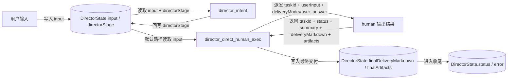
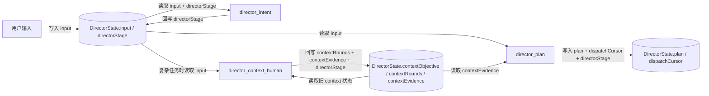
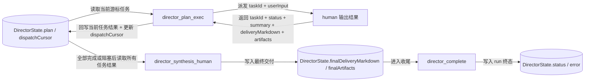
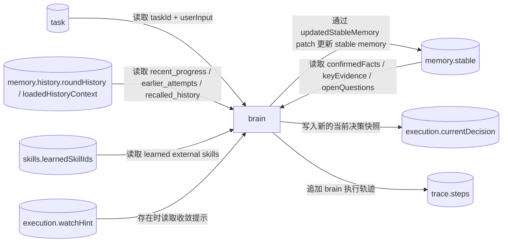
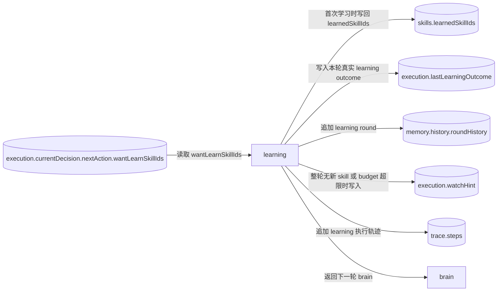
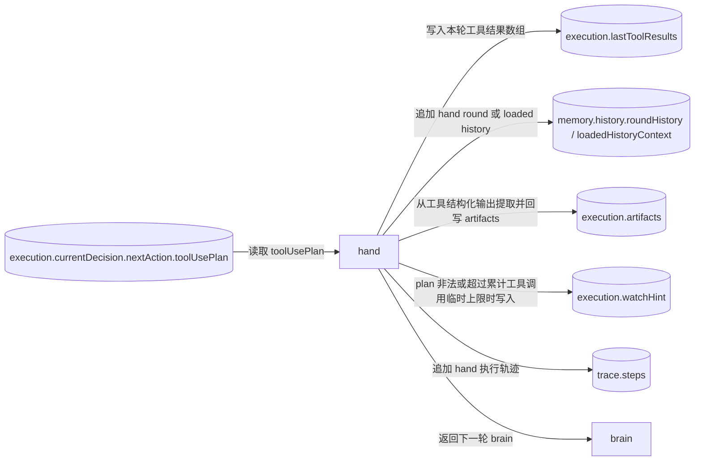
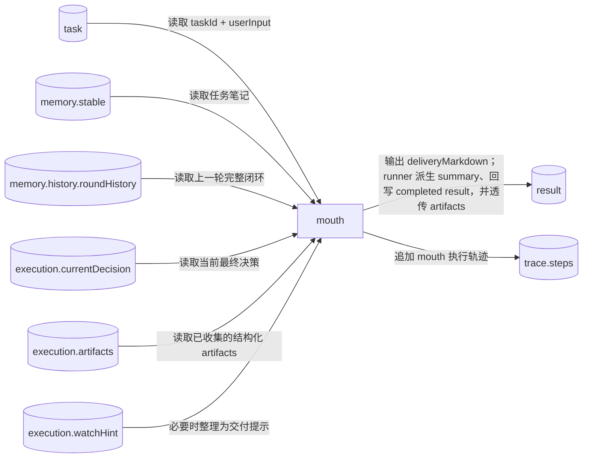

# NCurator-Desktop AI 数据定义与流转图

## 1. 总览

本设计分为 `director` 与 `human` 两层：

- `director` 负责 run 级编排、计划调度和最终汇总。
- `human` 负责单任务闭环执行。
- 节点行为、技术实现约束与跨层规则见 `implementation-spec.md`。
- 本文只定义状态、契约与数据流转，不展开架构动机与阅读导引。

### 1.1 `AiRunContext`

`AiRunContext` 是运行时注入给 `director` 与 `human` 的只读上下文，不持久化进 `DirectorState` 或 `HumanState`。下面的注释只说明字段作用，不重复实现规则。

```ts
interface AiRunContext {
  // 当前 run 的唯一标识；事件、日志和 activity 都通过它关联到同一次运行。
  runId: string

  // 规范化后的工作区与参考资料范围；director 与 brain 通过它判断当前可默认使用的资料边界。
  referenceScope: {
    // 当前 reference scope 绑定的工作区；缺失表示当前 run 没有工作区上下文。
    workspace?: {
      // 工作区 ID；用于存储与检索层关联当前工作区。
      workspaceId: string
      // 工作区名称；主要用于 prompt 和 UI 展示。
      workspaceName: string
      // 工作区根目录；本地路径相关工具默认基于它理解相对路径。
      rootPath: string
      // 工作区策略档位；给后续权限或范围控制预留。
      policyProfile?: string
    }
    // 用户本轮显式选中的参考资料；prompt 会按它渲染当前资料范围。
    selectedReferences: SelectedReference[]
    // 用户是否明确选过参考资料；为 false 时，不能假设用户主动缩圈过。
    hasExplicitSelectedReferences: boolean
    // 是否已经通过直接文档指代把范围收窄到具体文档。
    hasDirectDocumentNarrowing: boolean
    // 默认知识范围；无显式资料时决定是否允许回退到当前工作区知识库。
    defaultKnowledgeScope: 'current_workspace' | 'unavailable'
  }

  // human 运行时的可选覆盖项；主要用于临时调整执行上限等保护参数。
  humanRuntimeOverrides?: {
    // 当前 human 允许的工具调用上限；缺失时使用系统默认值。
    hardActionLimit?: number
  }

  // 当前绑定的工作区；供工具层和 prompt 直接读取基础工作区信息。
  workspace?: {
    // 工作区 ID。
    workspaceId: string
    // 工作区名称。
    workspaceName: string
    // 工作区根目录。
    rootPath: string
    // 工作区策略档位。
    policyProfile?: string
  }

  // 节点统一在入口处调用的取消检查；一旦抛错，当前 run 会立刻终止后续动作。
  checkCancelled: () => void

  // 节点统一通过 runtime 提供的结构化 LLM 入口调用模型。
  chatStructured<T>(input: {
    // 调用方标识；用于 activity、日志和排障定位。
    caller: string
    // 若来自 human 子任务，则带 taskId。
    taskId?: string
    // 最终 system prompt。
    system: string
    // 最终 user prompt。
    user: string
    // 结构化输出 schema。
    schema: z.ZodType<T>
    // schema 名称；用于日志、activity 和问题排查。
    schemaName: string
    // 本次调用的可选温度。
    temperature?: number
  }): Promise<T>

  // 节点统一通过 runtime 提供的文本 LLM 入口调用模型。
  chatText(input: {
    // 调用方标识；用于 activity、日志和排障定位。
    caller: string
    // 若来自 human 子任务，则带 taskId。
    taskId?: string
    // 最终 system prompt。
    system: string
    // 最终 user prompt。
    user: string
    // 文本调用的逻辑 schema 名称；用于日志和 activity 对齐。
    schemaName: string
    // 本次调用的可选温度。
    temperature?: number
    // 若需要向外发送流式文本增量，则通过这里回调。
    onTextDelta?: (text: string) => void
  }): Promise<string>

  // 统一派发运行事件；tool result、answer event、activity 等都通过这里发出。
  sendEvent: (event: AiRunEvent) => void

  // 可选记录完整 LLM IO；主要用于排障、审计与回放。
  recordLlmIo?: (record: AiLlmIoRecord) => void

  // 工具层统一请求审批的入口；高风险命令或写操作通过它获取用户批准。
  requestApproval: (request: AiApprovalRequest) => Promise<AiApprovalDecision>

  // 统一读取历史摘要与最近对话；director 与 brain 通过它拿到压缩后的历史上下文。
  loadHistory(limits?: {
    // 最近对话最大轮数。
    recentTurns?: number
    // 最近对话文本最大字符数。
    maxRecentTurnsChars?: number
    // 会话摘要最大字符数。
    maxSummaryChars?: number
  }): Promise<{
    // 最近若干轮对话拼接后的文本。
    recentTurnsText: string
    // 更长期历史的摘要文本。
    sessionSummaryText: string
  }>

  // docx 打开后记录 docId 与源路径的映射，便于后续链路追踪。
  trackDocxOpen: (input: { docId: string; sourcePath: string }) => void

  // docx 修改后记录前后快照与改动块，便于审计与回溯。
  trackDocxChanges: (input: {
    // 变更前文档快照 ID。
    previousDocId: string
    // 变更后文档快照 ID。
    nextDocId: string
    // 本次执行的 docx 操作。
    op: DocxOp
    // 本次操作影响到的 block 列表。
    changedBlocks: DocxChangedBlock[]
  }) => void

  // docx 打开前把源路径解析成运行时可用的打开目标。
  resolveDocxOpenTarget: (sourcePath: string) => Promise<ResolvedDocxOpenTarget>

  // 当前 workspace 文档存储；知识检索和网页资料读取依赖它。
  documentsStore: DocumentsStore

  // 当前 embedding 能力；知识检索工具依赖它做向量查询。
  embeddingService: EmbeddingService
}

interface AiRuntimeSettings {
  // 全局 LLM 流式传输策略；控制本次运行默认偏向流式还是非流式。
  llmStreamingMode: 'force_stream' | 'force_non_stream'
}

interface LLMConfig {
  // 配置唯一标识。
  id: string
  // 配置显示名称。
  name: string
  // 模型服务基地址。
  base_url: string
  // 实际调用的模型名。
  model_name: string
  // 当前配置使用的 API key。
  api_key: string
  // 是否为当前可用配置。
  is_active: boolean
  // 结构化输出路径最近一次成功的 profile；runtime 会优先复用它降低探测成本。
  preferredStructuredOutputProfile?:
    | 'completions:jsonSchema'
    | 'completions:jsonMode'
    | 'completions:promptJson'
    | 'responses:jsonSchema'
    | 'responses:promptJson'
  // 文本输出路径最近一次成功的 transport；runtime 会优先复用它。
  preferredTransport?: 'completions' | 'responses'
}
```

## 2. `director` 数据定义

### `DirectorState`

```ts
interface DirectorState {
  // 当前 run 的唯一标识；与 AiRunContext.runId 对齐。
  runId: string
  // 当前会话标识；用于关联消息、历史与本次运行。
  sessionId: string
  // director 层运行状态；表示整个 run 是否仍在推进、已完成、失败或被取消。
  status: 'running' | 'completed' | 'failed' | 'cancelled'
  // 用户本轮原始输入；是 director 路由与后续 objective builder 的基础输入。
  input: string
  // director 当前所在节点；用于 graph 路由与运行态展示。
  directorStage:
    | 'director_intent'
    | 'director_context_human'
    | 'director_plan'
    | 'director_plan_exec'
    | 'director_direct_human_exec'
    | 'director_synthesis_human'
    | 'director_complete'
  // 已经进行过多少轮上下文补充；用于限制 context 循环次数。
  contextRounds: number
  // 当前上下文补充阶段派发给 context human 的任务目标；只在 context 路径上有值。
  contextObjective?: string
  // context 阶段沉淀下来的关键证据摘要；供后续 intent、plan 和 synthesis 复用。
  contextEvidence: string[]
  // 计划任务列表；每一项都是后续可以派发给单个 human 的任务。
  plan: DirectorPlanTask[]
  // 当前指向下一项待派发任务的游标；plan 执行阶段据此推进。
  dispatchCursor: number
  // run 级错误信息；只在失败路径上写入。
  error?: string
  // director 最终对用户输出的 markdown；direct 或 synthesis 路径会写入它。
  finalDeliveryMarkdown?: string
  // run 结束时可供系统继续消费的结构化交付物引用。
  finalArtifacts: AiArtifactRef[]
}

interface DirectorPlanTask {
  // 计划任务 ID；在一次 run 内唯一。
  id: string
  // 任务短标题；主要用于日志、UI 和阅读计划时快速识别任务。
  title: string
  // 派发给 human 的任务输入；由 planner 或 objective builder 组织后写入。
  userInput: string
  // 任务状态；ready 表示尚未执行，running 表示当前执行中，completed 表示已有稳定交付。
  status: 'ready' | 'running' | 'completed'
  // 该任务的正式交付内容；在 plan 链路中通常是供后续任务和 synthesis 使用的 task_handoff。
  deliveryMarkdown?: string
  // 该任务已经产生的结构化交付物引用；例如 preview 文件或最终保存文件。
  artifacts?: AiArtifactRef[]
}

type AiArtifactRef =
  | {
      // artifact 类型；表示一个真实存在的文件类产物。
      kind: 'file'
      // 产物由哪个能力域生成；便于后续按能力域做展示或处理。
      capability: 'terminal_exec' | 'docx'
      // 文件绝对路径；系统据此定位实际产物。
      path: string
      // 文件名；主要用于 UI 展示。
      fileName: string
      // 这次操作是创建新文件还是更新已有文件。
      operation: 'created' | 'updated'
      // 产物角色；区分 preview、draft、committed 等不同交付阶段。
      artifactRole?: 'preview' | 'draft' | 'committed'
      // 若来自 draft review，则记录 reviewId。
      reviewId?: string
      // 若是 docx draft，则记录 draft documentId。
      draftDocumentId?: string
      // 若是 docx draft，则记录 draft snapshotId。
      draftSnapshotId?: string
      // 面向 AI、日志和 UI 的简洁说明。
      summary: string
    }
  | {
      // artifact 类型；表示一次 draft review 的聚合结果，而不是单个文件。
      kind: 'draft_review'
      review: {
        // review 唯一标识。
        reviewId: string
        // 本次 review 涉及的文档数。
        documentCount: number
        // 本次 review 涉及的修改数。
        changeCount: number
      }
      // 面向 AI、日志和 UI 的简洁说明。
      summary: string
    };

interface HumanTaskInput {
  // 当前 human 任务 ID；director 与 human 都用它识别当前 task。
  taskId: string
  // 派发给当前 human 的自然语言任务输入；是 human 的主任务目标。
  userInput: string
}

interface HumanRunDispatchOptions {
  // 当前 human 结果要按哪种交付模式组织；只影响 mouth 交付形态，不改变求解职责。
  deliveryMode?: 'user_answer' | 'task_handoff' | 'context_note'
  // 是否向外发送最终答案增量事件；只影响 answer 事件，不改变底层 transport 策略。
  emitAnswerEvents?: boolean
  // 这次交付是否标记为内部交付；例如 context_note 通常不直接面向最终用户。
  internalDelivery?: boolean
}
```

## 3. `human` 数据定义

### `HumanState`

```ts
// human 当前所在的节点；brain 负责推理，learning 负责学 skill，hand 负责调工具，mouth 负责交付。
type HumanStage = 'brain' | 'learning' | 'hand' | 'mouth'

// human 当前运行状态；目前基线只区分运行中和已完成。
type HumanStatus = 'running' | 'completed'

interface HumanStableMemory {
  // 已确认的任务事实；只放已经可以稳定复用的事实性内容。
  confirmedFacts: string
  // 当前关键依据；记录支撑结论的证据或来源摘要。
  keyEvidence: string
  // 仍未解决的问题；帮助下一轮 brain 判断是否继续执行。
  openQuestions: string
}

// brain 对 stable memory 的局部补丁；缺失字段表示保持原值。
type HumanStableMemoryPatch = Partial<HumanStableMemory>

interface BrainDecision {
  // 对本轮决策的短摘要；便于日志、轨迹和回放快速理解。
  summary: string
  // 做出该决策的原因；说明为什么这一步合理。
  reason: string
  // 期望这一步带来的结果；帮助后续判断本轮是否达到目标。
  expectedOutcome: string
}

type BrainNextAction =
  | {
      // 下一跳需要先学习 external skill。
      action: 'learning'
      // 本轮希望学习的 skill id 列表。
      wantLearnSkillIds: string[]
    }
  | {
      // 下一跳需要执行工具调用。
      action: 'hand'
      // 本轮工具调用计划。
      toolUsePlan: ToolUsePlan
    }
  | {
      // 下一跳直接进入 mouth 组织交付。
      action: 'mouth'
    }

interface HumanDecision {
  // 本轮对 stable memory 的局部覆盖更新；缺失表示不更新 stable memory。
  updatedStableMemory?: HumanStableMemoryPatch
  // 本轮 brain 的正式决策内容。
  decision: BrainDecision
  // 当前是否已经具备最终交付所需的信息、依据和产物。
  readyToDeliver: boolean
  // 下一跳动作对象；决定本轮之后去 learning、hand 还是 mouth。
  nextAction: BrainNextAction
}

interface HumanExecution {
  // 当前 human 所在节点。
  stage: HumanStage
  // 当前 human 运行状态；与 task 是否已经结束对应。
  status: HumanStatus
  // 当前动作快照；learning / hand / mouth 都通过它读取本轮 brain 的最新决策。
  currentDecision?: HumanDecision
  // 收敛或纠偏提示；当 learning / hand / brain 触发保护逻辑时写入。
  watchHint?: HumanWatchHint
  // 最近一次 hand 工具执行结果；主要供 runtime 排障与回放使用。
  lastToolResults?: ToolCallResult[]
  // 最近一次 learning 的真实执行结果；主要供 runtime 排障与回放使用。
  lastLearningOutcome?: HumanLearningOutcome
  // 运行时收集到的结构化交付物引用；由 hand 写入，mouth 只透传。
  artifacts: AiArtifactRef[]
}

interface HumanMemoryHistory {
  // 最近几轮正式过程历史；是 brain 主要消费的过程记录来源。
  roundHistory: HumanRoundRecord[]
  // 最近一次 history_recall 主动加载出来的旧历史；只作为补充上下文使用。
  loadedHistoryContext?: HumanLoadedHistoryContext
}

interface HumanState {
  // 当前 task 的输入。
  task: HumanTaskInput
  // 当前 task 的执行态字段。
  execution: HumanExecution
  memory: {
    // 已收敛下来的稳定任务笔记。
    stable: HumanStableMemory
    // 过程历史与主动回看历史。
    history: HumanMemoryHistory
  }
  skills: {
    // 已学习的 external skill 列表；builtin skill 不写入这里。
    learnedSkillIds: string[]
  }
  // task 完成后的内部结果快照；只在完成后写入。
  result?: HumanResult
  trace: {
    // 面向外部事件、审计和回放的轨迹步骤列表。
    steps: HumanTraceStep[]
  }
}
```

### `roundHistory` 与 `history_recall`

```ts
interface HumanHistoryToolResult {
  // 工具名；用于后续筛选、回放和排障。
  toolName: string
  // 这次工具调用是否成功。
  ok: boolean
  // 标准化后的结果码；与 ToolCallResult.code 对齐。
  code: ToolCallResult['code']
  // 对本次工具结果的简短摘要。
  summary: string
  // 面向 prompt 的轻量结果预览；避免把完整原始 data 全量塞入历史。
  dataPreview?: string
  // 诊断信息的文本化摘要。
  diagnosticText?: string
  // 本次工具调用附带生成的 artifact 引用。
  artifactRefs?: AiArtifactRef[]
}

type HumanRoundExecution =
  | {
      // 表示执行前就被保护逻辑拦住，没有真正进入 learning / hand / mouth。
      kind: 'pre_execution_blocked'
      // 这次阻塞对应的 watch hint。
      watchHint: HumanWatchHint
    }
  | {
      // 表示本轮真正执行了 learning。
      kind: 'learning'
      // 本轮 learning 的真实执行结果。
      learningOutcome: HumanLearningOutcome
      // 若 learning 触发了纠偏提示，则在这里补充。
      watchHint?: HumanWatchHint
    }
  | {
      // 表示本轮真正执行了 hand。
      kind: 'hand'
      // 本轮执行的工具计划。
      toolUsePlan: ToolUsePlan
      // 本轮工具结果的轻量历史版本。
      toolResults: HumanHistoryToolResult[]
      // 若 hand 触发了纠偏提示，则在这里补充。
      watchHint?: HumanWatchHint
      // 本轮 hand 追加的 artifact 引用。
      artifactRefs?: AiArtifactRef[]
    }
  | {
      // 表示本轮真正执行了 mouth。
      kind: 'mouth'
      // mouth 这一轮交付的简短摘要。
      summary: string
      // 本轮 mouth 是否已经把 task 收敛为 completed。
      completed: boolean
    }

interface HumanRoundRecord {
  // round 序号；用于按顺序回放当前 task 的过程。
  roundId: number
  // 本轮记录的创建时间。
  createdAt: number
  // 本轮 brain 产出的正式决策。
  decision: HumanDecision
  // 本轮随后真正发生的执行结果。
  execution: HumanRoundExecution
}

interface HumanLoadedHistoryContext {
  filters: {
    // 限定要回看的 round id。
    roundIds?: number[]
    // 限定要回看的执行类型。
    executionKinds?: Array<'pre_execution_blocked' | 'learning' | 'hand' | 'mouth'>
    // 限定要回看的工具名。
    toolNames?: string[]
    // 限定要回看的 watch hint 类型。
    watchHintCodes?: HumanWatchHint['code'][]
    // 本次主动回看最多带回多少条 round。
    limit?: number
  }
  // 根据 filters 实际取回的 round 列表。
  rounds: HumanRoundRecord[]
}
```

### `ToolUsePlan`、watch hint、result 与 trace

```ts
interface ToolCallParam {
  // 要调用的工具名。
  toolName: string
  // 传给该工具的结构化参数。
  args: JsonObject
}

interface ToolUsePlan {
  // 执行模式；parallel 表示并行执行，serial 表示按顺序执行。
  mode: 'parallel' | 'serial'
  // 本轮要执行的工具调用列表。
  calls: ToolCallParam[]
}

interface ToolCallResult {
  // 工具名。
  toolName: string
  // 这次工具调用是否成功。
  ok: boolean
  // 标准化结果码；brain 会基于它判断后续怎么处理。
  code:
    | 'ok'
    | 'failed'
    | 'workspace_required'
    | 'approval_denied'
    | 'invalid_input'
  // 工具返回的结构化数据；成功时通常在这里。
  data?: JsonValue
  // 失败或特殊情况的诊断信息。
  diagnostic?: ToolCallDiagnostic
}

interface ToolCallDiagnostic {
  // 诊断类别；帮助 brain 和 runtime 做标准化处理。
  kind:
    | 'workspace_required'
    | 'invalid_input'
    | 'approval_denied'
    | 'path_unavailable'
  // 若是参数问题，则记录缺失参数名。
  missingArgs?: string[]
}

interface HumanLearningOutcome {
  // 本轮原始请求学习的 skill id 列表。
  requestedSkillIds: string[]
  // 本轮实际新加载成功的 skill id 列表。
  loadedSkillIds: string[]
  // 本轮发现已经学过，因此跳过的 skill。
  skippedDuplicateSkillIds: string[]
  // 本轮发现未知，因此跳过的 skill。
  skippedUnknownSkillIds: string[]
  // 本轮因 active tool budget 等原因被移出的 skill。
  evictedSkillIds: string[]
  // 当前有效工具数；用于控制 active tool budget。
  activeToolCount: number
}

type HumanWatchHint =
  | {
      // learning 没有产生实际效果；例如全是重复或未知 skill。
      code: 'learning_no_effect'
      detail: {
        // 本轮请求学习的 skill。
        requestedSkillIds: string[]
        // 其中重复的 skill。
        duplicateSkillIds: string[]
        // 其中未知的 skill。
        unknownSkillIds: string[]
      }
    }
  | {
      // learning 后有效工具数超限。
      code: 'learning_tool_budget_exceeded'
      detail: {
        // 本轮请求学习的 skill。
        requestedSkillIds: string[]
        // 当前有效工具数。
        activeToolCount: number
        // 允许上限。
        limit: number
      }
    }
  | {
      // hand 收到非法工具计划；例如并行批次不满足只读要求。
      code: 'hand_plan_invalid'
      detail: {
        // 原始计划模式。
        mode: 'parallel' | 'serial'
        // 非法原因。
        reason: 'parallel_requires_read_only' | 'parallel_limit_exceeded'
        // 导致非法的工具名。
        offendingToolNames: string[]
        // 若是数量超限，则记录本次调用数。
        callCount?: number
        // 若是数量超限，则记录允许上限。
        limit?: number
      }
    }
  | {
      // hand 的工具调用次数超过本轮允许上限。
      code: 'hand_tool_limit_exceeded'
      detail: {
        // 本轮计划中的工具调用数。
        toolCallCount: number
        // 允许上限。
        limit: number
      }
    }
  | {
      // brain 试图直接去 mouth，但 readyToDeliver 仍为 false。
      code: 'brain_invalid_mouth_transition'
      detail: {}
    }

interface MouthOutput {
  // mouth 对本轮交付的简短摘要。
  summary: string
  // mouth 生成的正式 markdown；缺失时 runtime 会走 fallback builder 补足。
  deliveryMarkdown?: string
}

interface HumanResult {
  // human 内部结果目前只存在 completed 这一种终态。
  status: 'completed'
  // 对当前 task 最终完成情况的简短摘要。
  summary: string
  // 最终正式 markdown 交付。
  deliveryMarkdown?: string
  // 最终透传的 artifact 列表。
  artifacts?: AiArtifactRef[]
}

interface HumanTaskOutput {
  // 返回给 director 的 taskId；用于让上层知道是哪一个子任务完成了。
  taskId: string
  // 当前跨层输出的状态；目前只返回 completed。
  status: 'completed'
  // 返回给 director 的简短摘要。
  summary: string
  // 返回给 director 的正式 markdown 交付。
  deliveryMarkdown?: string
  // 返回给 director 的 artifact 列表。
  artifacts?: AiArtifactRef[]
}

interface HumanTraceStep {
  // 当前 trace 的顺序号。
  step: number
  action:
    // 本步记录了一次 brain 决策。
    | 'brain_decision'
    // 本步记录了一次 skill 学习。
    | 'learn_skill'
    // 本步记录了一次工具调用。
    | 'call_tool'
    // 本步记录了一次正式交付。
    | 'deliver_result'
  // 面向外部轨迹的叙述；给 UI 与日志看的一句话说明。
  publicNarrative: string
  // 当前步骤的结果状态。
  resultStatus?: 'ok' | 'error'
  // 若本步与 skill 有关，则记录 skillId。
  skillId?: string
  // 若本步与 tool 有关，则记录 toolName。
  toolName?: string
  // 当前步骤摘要；供内部调试与审计使用。
  summary: string
}
```

### `tool_call_result` 事件与结构化模型日志

```ts
interface ToolCallResultEvent {
  // 事件类型。
  type: 'tool_call_result'
  // 所属 run。
  runId: string
  // 若来自 human 子任务，则带 taskId。
  taskId?: string
  // 本次工具调用的唯一标识。
  toolCallId: string
  // 对应工具名。
  toolName: string
  // 轻量时间线展示使用的输出预览。
  outputPreview: IpcJsonValue
  // 标准化后的工具结果，供后续 AI 或排障直接消费。
  result?: ToolCallResult
  // 工具调用完成时间。
  completedAt: number
  // 若调用失败，补充错误文本。
  error?: string
}

interface AiActivityDetails {
  // 本次 activity 对应的 callId；用于把 activity 与 LLM/tool 调用关联起来。
  callId?: string
  // 谁发起了这次 activity；例如 human.brain。
  caller?: string
  // 本次结构化输出使用的 schema 名称。
  schemaName?: string
  // 本次调用使用的模型名。
  model?: string
  // 本次调用使用的 baseUrl host。
  baseUrlHost?: string
  // 调用耗时。
  durationMs?: number
  // 结构化输出方法。
  method?: 'jsonSchema' | 'jsonMode' | 'promptJson' | 'scripted'
  // 使用的底层 transport。
  transport?: 'completions' | 'responses'
  // 最终选择的 profile。
  profile?:
    | 'completions:jsonSchema'
    | 'completions:jsonMode'
    | 'completions:promptJson'
    | 'responses:jsonSchema'
    | 'responses:promptJson'
    | 'scripted'
  // 这次调用可尝试的 fallback profile 链。
  fallbackChain?: Array<
    | 'completions:jsonSchema'
    | 'completions:jsonMode'
    | 'completions:promptJson'
    | 'responses:jsonSchema'
    | 'responses:promptJson'
    | 'scripted'
  >
  // 本次调用的全局流式策略。
  streamingMode?: 'force_stream' | 'force_non_stream'
  // 本次调用是否实际走了流式传输。
  streamed?: boolean
  // 本次调用收到的文本 chunk 数。
  chunkCount?: number
  // 首个 chunk 到达延迟。
  firstTokenLatencyMs?: number
  // 若出现 fallback 或失败，补充原因。
  reason?: string
}

interface LlmStreamDeltaEvent {
  // 事件类型。
  type: 'llm_stream_delta'
  // 所属 run。
  runId: string
  // 若来自 human 子任务，则带 taskId。
  taskId?: string
  // 本次 LLM 调用的唯一标识。
  callId: string
  // 调用方；例如 human.brain 或 human.mouth。
  caller: string
  // 当前是第几个文本 chunk。
  chunkIndex: number
  // 当前文本增量。
  text: string
  // 事件创建时间。
  createdAt: number
}

interface AiLlmIoRecord {
  // 本次 LLM 调用的唯一标识。
  callId: string
  // 所属 run。
  runId: string
  // 若来自 human 子任务，则带 taskId。
  taskId?: string
  // 调用方；例如 human.brain 或 human.mouth。
  caller: string
  // 使用的 schema 名称。
  schemaName: string
  // 使用的模型名。
  model: string
  // 调用目标 host。
  baseUrlHost: string
  // 最终 system prompt。
  system: string
  // 最终 user prompt。
  user: string
  // 结构化输出结果；text 调用通常为空。
  output?: JsonValue
  // 最终聚合得到的原始文本。
  rawText?: string
  // 结构化输出方法。
  method?: 'jsonSchema' | 'jsonMode' | 'promptJson' | 'scripted'
  // 使用的底层 transport。
  transport?: 'completions' | 'responses'
  // 最终选择的 profile。
  profile?:
    | 'completions:jsonSchema'
    | 'completions:jsonMode'
    | 'completions:promptJson'
    | 'responses:jsonSchema'
    | 'responses:promptJson'
    | 'scripted'
  // 本次调用可尝试的 fallback profile 链。
  fallbackChain: Array<
    | 'completions:jsonSchema'
    | 'completions:jsonMode'
    | 'completions:promptJson'
    | 'responses:jsonSchema'
    | 'responses:promptJson'
    | 'scripted'
  >
  // 本次调用的全局流式策略。
  streamingMode?: 'force_stream' | 'force_non_stream'
  // 本次调用是否实际走了流式传输。
  streamed?: boolean
  // 本次调用收到的文本 chunk 数。
  chunkCount?: number
  // 首个 chunk 到达延迟。
  firstTokenLatencyMs?: number
  // 开始时间。
  startedAt: number
  // 完成时间。
  completedAt: number
  // 调用总耗时。
  durationMs: number
  // 本次调用状态。
  status: 'completed' | 'failed'
  // 若失败或触发 fallback，补充原因。
  reason?: string
}
```


## 4. 数据流转图

下面的图按阶段拆开，每张图只表达一段数据读写。

### `director` 直接路径：`direct human`



### `director` 阶段一：输入进入 `context / plan`



### `director` 阶段二：计划派发、结果回写、最终收尾



### `human` 阶段一：`brain` 读取输入并产出决策



### `human` 阶段二：`learning` 路径的数据流转



### `human` 阶段三：`hand` 路径的数据流转



### `human` 阶段四：`mouth` 路径的数据流转


