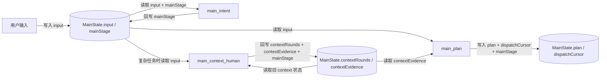
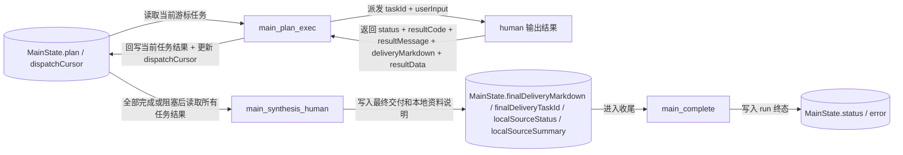
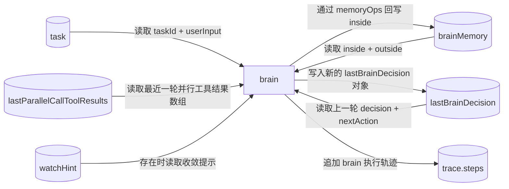
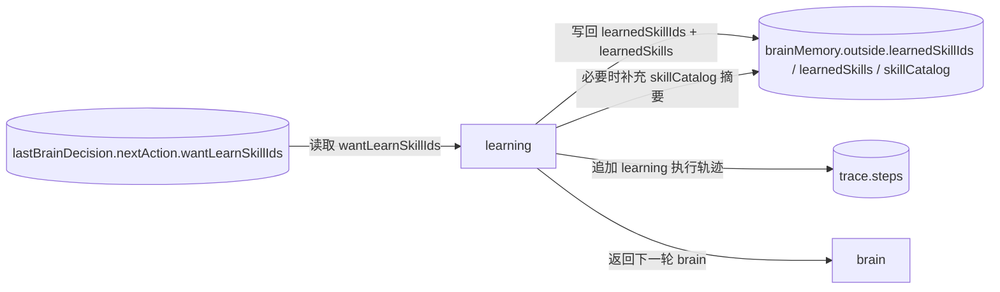
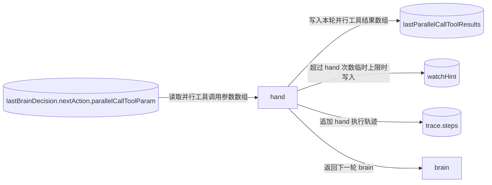
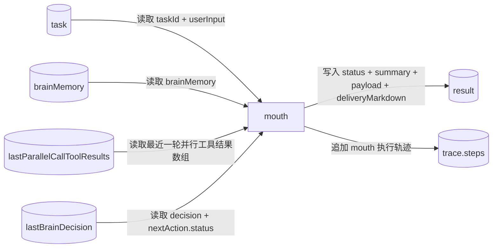

# NCurator-Desktop AI 数据定义与流转图

## 1. 总览

本设计分为 `main` 与 `human` 两层：

- `main` 负责 run 级编排、计划调度和最终汇总。
- `human` 负责单任务闭环执行。

阅读建议：

1. 先看 `main` 数据定义与两张 `main` 数据流转图。
2. 再看 `human` 数据定义。
3. 最后按 `brain -> learning/hand/mouth` 的顺序看 `human` 数据流转图。

## 2. `main` 数据定义

### `MainState`

```ts
interface MainState {
  // 当前 run 的唯一标识。
  runId: string
  // 当前会话标识，用于关联消息和历史记录。
  sessionId: string
  // main 层运行状态。
  status: 'running' | 'completed' | 'failed' | 'cancelled'
  // 用户本轮原始输入。
  input: string
  // main 当前所在节点。
  mainStage:
    | 'main_intent'
    | 'main_context_human'
    | 'main_plan'
    | 'main_plan_exec'
    | 'main_direct_human_exec'
    | 'main_synthesis_human'
    | 'main_complete'
  // 已经进行过多少轮上下文补充。
  contextRounds: number
  // context 阶段得到的关键证据摘要。
  contextEvidence: string[]
  // 计划任务列表，每一项都是后续派发给 human 的任务。
  plan: MainPlanTask[]
  // 当前指向下一项待派发任务的游标。
  dispatchCursor: number
  // run 级错误信息。
  error?: string
  // main 最终对用户输出的 markdown。
  finalDeliveryMarkdown?: string
  // 最终交付主要来自哪个 task。
  finalDeliveryTaskId?: string
  // 本地资料使用状态。
  localSourceStatus?: 'used' | 'not_used' | 'insufficient'
  // 本地资料使用情况说明。
  localSourceSummary?: string
}

interface MainPlanTask {
  // 计划任务 ID。
  id: string
  // 任务短标题，主要用于日志和 UI。
  title: string
  // 派发给 human 的任务输入。
  userInput: string
  // 任务状态。
  status: 'pending' | 'running' | 'completed' | 'failed'
  // 当前任务已尝试次数。
  attempts: number
  // 任务结果码。
  resultCode?:
    | 'ok'
    | 'failed'
    | 'workspace_required'
    | 'approval_denied'
    | 'bounded_loop_error'
    | 'invalid_input'
  // 任务结果摘要。
  resultMessage?: string
  // 该任务的正式交付内容。
  deliveryMarkdown?: string
  // 该任务的结构化结果。
  resultData?: JsonObject
}
```

## 3. `human` 数据定义

### `HumanState`

```ts
type HumanStage = 'brain' | 'learning' | 'hand' | 'mouth'
type HumanStatus = 'running' | 'completed' | 'blocked'
type MemoryOpField = 'facts' | 'evidences' | 'openQuestions'

interface HumanState {
  task: {
    // 当前 human 任务 ID。
    taskId: string
    // 当前 human 接收到的任务输入。
    userInput: string
  }
  runtime: {
    // 当前 human 所在节点。
    stage: HumanStage
    // 当前 human 运行状态。
    status: HumanStatus
  }
  brainMemory: {
    inside: {
      // 只允许 brain 通过 memoryOps 更新。
      // 已确认事实，必须能追溯到 evidences。
      facts: BrainFact[]
      // 只允许 brain 通过 memoryOps 更新。
      // 对工具结果的提炼摘要，不存放大段原始输出。
      evidences: BrainEvidence[]
      // 只允许 brain 通过 memoryOps 更新。
      // 当前仍影响推进的问题。
      openQuestions: string[]
    }
    outside: {
      // 由 learning / hand / runner 更新。
      // 技能目录，只放少量摘要信息，供 brain 判断要不要学习。
      skillCatalog: SkillCatalogItem[]
      // 由 learning / runner 更新。
      // 最近加载过的 skill 栈，最多保留少量项，先进后出。
      learnedSkillIds: string[]
      // 由 learning 更新。
      // 已加载技能详情的字符串聚合，按 skill 分段拼接。
      learnedSkills: string
      // 由 brain 输出后原样推进写入，供回看和审计。
      brainDecisions: BrainDecisionRecord[]
    }
  }
  // 最近一次 hand 并行工具调用后的结果数组。
  lastParallelCallToolResults?: ToolCallResult[]
  // 最近一次 brain 输出的完整决策对象。
  // brain 在下一轮加载时不会直接读取整个对象，
  // 而是只读取其中的 decision + nextAction 作为回看信息。
  lastBrainDecision?: LastBrainDecision
  // 调用保险提示；当 hand 次数超过临时上限后写入，提醒 brain 优先收敛。
  watchHint?: string
  // 最终任务结果，只由 mouth 写入。
  result?: HumanResult
  trace: {
    // 执行轨迹，仅用于审计和回放。
    steps: HumanTraceStep[]
  }
}
```

### `brainMemory.inside`

```ts
interface BrainEvidence {
  // evidence 唯一标识。
  id: string
  // 这条 evidence 来源于哪个工具。
  toolName: string
  // 对原始工具结果的高价值提炼。
  summary: string
  // 指向原始结果或日志位置的引用。
  rawRef?: string
  // 当前固定为 tool_result，表示来源是工具执行结果。
  sourceType: 'tool_result'
}

interface BrainFact {
  // fact 唯一标识。
  id: string
  // 由 evidence 推断出来的事实摘要。
  summary: string
  // 支撑该 fact 的 evidence 引用列表。
  evidenceIds: string[]
}
```

### `brainMemory.outside`

```ts
interface SkillCatalogItem {
  // skill 唯一标识。
  skillId: string
  // skill 标题。
  title: string
  // skill 的简要说明。
  summary: string
  // 该 skill 可提供的工具名列表。
  toolNames: string[]
  // 这个 skill 适合在什么情况下使用。
  whenToUse: string
}
```

### `lastBrainDecision`

```ts
interface LastBrainDecision {
  // 本轮 brain 对 brainMemory.inside 的增量更新操作。
  memoryOps: BrainMemoryOp[]
  // 本轮 brain 的正式决策内容。
  decision: BrainDecision
  // 下一跳动作对象。
  // action 决定下一跳，附带该动作所需的数据。
  nextAction: BrainNextAction
}

interface PreviousBrainDecisionContext {
  // 上一轮做出的正式判断。
  decision: BrainDecision
  // 上一轮决定进入的下一步动作，以及该动作的关键信息。
  nextAction: BrainNextAction
}

type BrainNextAction =
  | {
      // 进入 learning 节点。
      action: 'learning'
      // 本轮希望补充学习的 skill 列表。
      wantLearnSkillIds: string[]
    }
  | {
      // 进入 hand 节点。
      action: 'hand'
      // 本轮需要执行的并行工具调用参数数组。
      parallelCallToolParam: ToolCallParam[]
    }
  | {
      // 进入 mouth 节点。
      action: 'mouth'
      // mouth 节点最终对外输出的状态。
      status: 'completed' | 'blocked'
    };

type BrainMemoryOp =
  | {
      // 增量新增 facts 项。
      op: 'add'
      field: 'facts'
      value: BrainFact
    }
  | {
      // 按索引编辑 facts 项。
      op: 'edit'
      field: 'facts'
      index: number
      value: BrainFact
    }
  | {
      // 增量新增 evidences 项。
      op: 'add'
      field: 'evidences'
      value: BrainEvidence
    }
  | {
      // 按索引编辑 evidences 项。
      op: 'edit'
      field: 'evidences'
      index: number
      value: BrainEvidence
    }
  | {
      // 增量新增 openQuestions 项。
      op: 'add'
      field: 'openQuestions'
      value: string
    }
  | {
      // 按索引编辑 openQuestions 项。
      op: 'edit'
      field: 'openQuestions'
      index: number
      value: string
    }
  | {
      // 按索引删除 inside 中的某一项。
      op: 'remove'
      field: MemoryOpField
      index: number
    }

interface BrainDecision {
  // 对本轮决策的短摘要。
  summary: string
  // 做出该决策的原因。
  reason: string
  // 期望这一步带来的结果。
  expectedOutcome: string
}

interface ToolCallParam {
  // 要调用的工具名。
  toolName: string
  // 工具调用参数。
  args: JsonObject
}

interface BrainDecisionRecord extends LastBrainDecision {
  // 本条历史 brain 决策的写入时间。
  createdAt: number
}
```

### `lastParallelCallToolResults` 与 `result`

```ts
interface ToolCallResult {
  // 本次调用的工具名。
  toolName: string
  // 工具是否成功执行。
  ok: boolean
  // 工具结果码。
  code:
    | 'ok'
    | 'failed'
    | 'workspace_required'
    | 'approval_denied'
    | 'invalid_input'
  // 工具结果摘要。
  summary: string
  // 工具返回的结构化数据。
  data?: JsonValue
}

interface HumanResult {
  // human 最终状态。
  status: 'completed' | 'blocked'
  // 最终结果摘要。
  summary: string
  // 最终结构化结果。
  payload?: JsonObject
  // 最终对用户交付的 markdown。
  deliveryMarkdown?: string
}
```

## 4. 数据流转图

下面的图按阶段拆开，每张图只表达一段数据读写。

### `main` 阶段一：输入进入 `context / plan`



### `main` 阶段二：计划派发、结果回写、最终收尾



### `human` 阶段一：`brain` 读取输入并产出决策



### `human` 阶段二：`learning` 路径的数据流转



### `human` 阶段三：`hand` 路径的数据流转



### `human` 阶段四：`mouth` 路径的数据流转


