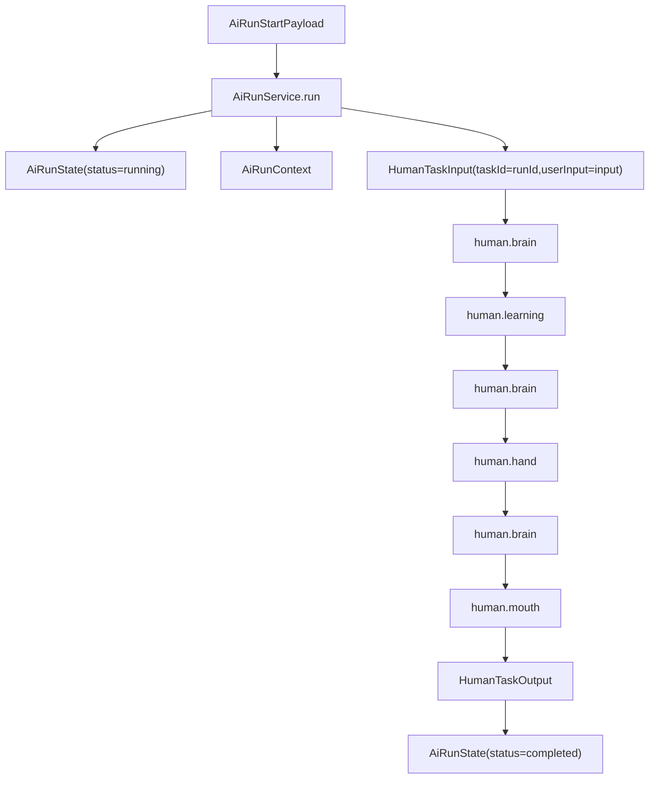
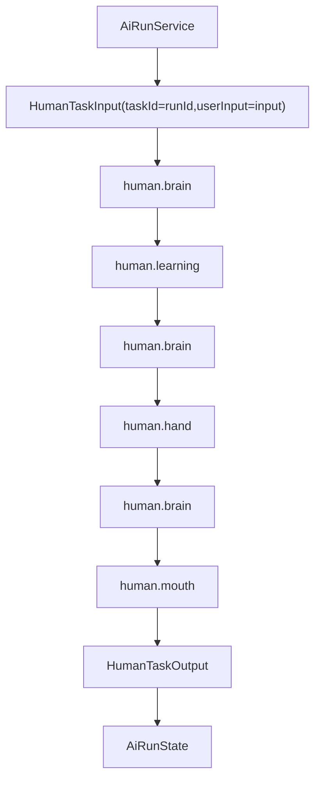

# NCurator-Desktop AI 简化样例

本文给一条最小真实样例，用来快速说明当前代码里 `AiRunService` 与 `human` 的每个环节是怎么处理输入、状态和交付的。

- 本文只覆盖当前正式路径：`AiRunService -> human -> AiRunState`
- 本文只覆盖 `human` 内部最常见闭环：`brain -> learning -> hand -> brain -> mouth`
- 本文不展开异常分支、审批阻断、history_recall 与 draft review 细节

字段名、节点名和状态转移都以当前代码实现为准；示例中的模型输出和工具结果是“符合当前契约的一组代表性样本”，不是固定字面值。

## 1. 先看这条样例要说明什么

这条样例只回答四个问题：

1. 一次 run 是怎么直接进入 `human` 的
2. `human` 怎么从“还不会做”走到“可以交付”
3. `learning / hand / mouth` 分别往状态里写什么
4. 最终答案是怎么从 `human` 回到 `AiRunState` 的

## 2. 用户请求

假设用户输入是：

> 基于已选知识范围，总结《发布说明模板》里对“发布日期”字段的写法要求，给我一个简短结论。

这个请求足够简单，因为：

- 不需要改 docx
- 不需要拆成多个子任务
- 单个 `human` 可以通过知识检索完成闭环

为了便于阅读，下文把 `ctx.referenceScope` 渲染后的参考资料上下文近似理解成：

```text
当前工作区：Alpha Workspace（本地工作目录）。

当前用户选择：
1. [网页资料] 发布说明模板
   地址：https://example.com/release-template
   知识库可用性：已索引
2. [网页资料] 品牌术语规范
   地址：https://example.com/brand-terms
   知识库可用性：已索引
```

## 3. 这次 run 是怎么开始的

### 3.1 `AiRunStartPayload`

`AiRunService.run()` 接收的输入可以近似理解成：

```ts
{
  runId: 'run-simple',
  sessionId: 'session-simple',
  input: '基于已选知识范围，总结《发布说明模板》里对“发布日期”字段的写法要求，给我一个简短结论。',
  selectedReferences: [
    {
      kind: 'web',
      workspaceId: 'ws-alpha',
      webSourceId: 'web-release-template',
      name: '发布说明模板',
      url: 'https://example.com/release-template',
      kbDocumentIds: ['doc-release-template'],
      kbAvailability: 'ready'
    },
    {
      kind: 'web',
      workspaceId: 'ws-alpha',
      webSourceId: 'web-brand-terms',
      name: '品牌术语规范',
      url: 'https://example.com/brand-terms',
      kbDocumentIds: ['doc-brand-terms'],
      kbAvailability: 'ready'
    }
  ],
  workspace: {
    workspaceId: 'ws-alpha',
    workspaceName: 'Alpha Workspace',
    rootPath: '/workspace/alpha'
  }
}
```

### 3.2 初始 `AiRunState`

`AiRunService` 先创建 run 级初始状态：

```ts
{
  runId: 'run-simple',
  sessionId: 'session-simple',
  status: 'running',
  input: '基于已选知识范围，总结《发布说明模板》里对“发布日期”字段的写法要求，给我一个简短结论。',
  finalArtifacts: []
}
```

### 3.3 运行时另外提供了什么

除了 `AiRunState` 以外，runtime 还会给这次执行注入：

- `ctx.referenceScope`：当前工作区与已选参考资料范围
- `ctx.loadHistory()`：最近对话和会话摘要
- `ctx.chatStructured / ctx.chatText`：统一的 LLM 调用入口
- `ctx.sendEvent`：统一事件出口

这些内容都是运行时上下文，不会直接持久化进 `AiRunState` 或 `HumanState`。

### 3.4 run 到 `human` 的完整链路



这里最关键的事实是：

- `taskId` 直接等于 `runId`
- `userInput` 直接使用用户原始输入
- 中间没有额外的 route、plan、synthesis 包装层

## 4. `human` 是怎么闭环完成任务的

### 4.1 `HumanTaskInput`

`AiRunService` 直接派发给 `human` 的输入是：

```ts
{
  taskId: 'run-simple',
  userInput: '基于已选知识范围，总结《发布说明模板》里对“发布日期”字段的写法要求，给我一个简短结论。'
}
```

### 4.2 初始 `HumanState`

每个 `human` 都从一个新的 task 级状态开始：

```ts
{
  task: {
    taskId: 'run-simple',
    userInput: '基于已选知识范围，总结《发布说明模板》里对“发布日期”字段的写法要求，给我一个简短结论。'
  },
  execution: {
    stage: 'brain',
    status: 'running',
    artifacts: []
  },
  memory: {
    stable: {
      currentUnderstanding: '',
      keyEvidence: '',
      checklist: ''
    },
    history: {
      roundHistory: []
    }
  },
  skills: {
    learnedSkillIds: []
  },
  trace: {
    steps: []
  }
}
```

这个初始状态说明了两件事：

- `human` 只处理当前这一个 task，不继承别的 task 内部状态
- 真正的执行闭环，从 `brain` 才刚刚开始

### 4.3 第一步：`brain` 先判断缺什么能力

`brain` 会读取：

- `task.userInput`
- `memory.stable`
- `memory.history.roundHistory`
- `execution.watchHint`
- `skills.learnedSkillIds`
- `ctx.referenceScope`

在这个样例里，第一轮 `brain` 会先判断“需要知识检索能力”，代表性输出可以是：

```json
{
  "decision": {
    "summary": "先学习知识证据检索能力。",
    "reason": "当前任务需要从已选知识范围中找到关于发布日期字段的直接依据。",
    "expectedOutcome": "拿到与发布日期写法相关的 chunk 证据。"
  },
  "readyToDeliver": false,
  "nextAction": {
    "action": "learning",
    "wantLearnSkillIds": ["kb-evidence-query"]
  }
}
```

这一轮 `brain` 做的事不是直接回答用户，而是把状态推进到下一跳：

- 写入 `execution.currentDecision`
- 视需要 patch `memory.stable`
- 追加一条 `trace.steps`
- 把 `execution.stage` 变成 `learning`

### 4.4 第二步：`learning` 加载 external skill

`learning` 不调用模型，只处理本轮要学的 skill。

在这个样例里，它会：

- 读取 `wantLearnSkillIds = ['kb-evidence-query']`
- 把该 skill 加入 `skills.learnedSkillIds`
- 记录本轮 learning outcome
- 把这一轮执行结果追加进 `roundHistory`
- 回到下一轮 `brain`

代表性结果：

```ts
{
  skills: {
    learnedSkillIds: ['kb-evidence-query']
  },
  execution: {
    stage: 'brain',
    status: 'running',
    currentDecision: {
      decision: {
        summary: '先学习知识证据检索能力。',
        reason: '当前任务需要从已选知识范围中找到关于发布日期字段的直接依据。',
        expectedOutcome: '拿到与发布日期写法相关的 chunk 证据。'
      },
      readyToDeliver: false,
      nextAction: {
        action: 'learning',
        wantLearnSkillIds: ['kb-evidence-query']
      }
    },
    lastLearningOutcome: {
      requestedSkillIds: ['kb-evidence-query'],
      loadedSkillIds: ['kb-evidence-query'],
      skippedDuplicateSkillIds: [],
      skippedUnknownSkillIds: [],
      evictedSkillIds: [],
      activeToolCount: 1
    },
    artifacts: []
  },
  memory: {
    history: {
      roundHistory: [
        {
          roundId: 1,
          decision: {
            decision: {
              summary: '先学习知识证据检索能力。',
              reason: '当前任务需要从已选知识范围中找到关于发布日期字段的直接依据。',
              expectedOutcome: '拿到与发布日期写法相关的 chunk 证据。'
            },
            readyToDeliver: false,
            nextAction: {
              action: 'learning',
              wantLearnSkillIds: ['kb-evidence-query']
            }
          },
          execution: {
            kind: 'learning',
            learningOutcome: {
              requestedSkillIds: ['kb-evidence-query'],
              loadedSkillIds: ['kb-evidence-query'],
              skippedDuplicateSkillIds: [],
              skippedUnknownSkillIds: [],
              evictedSkillIds: [],
              activeToolCount: 1
            }
          }
        }
      ]
    }
  }
}
```

### 4.5 第三步：`brain` 再决定去调工具

现在 `brain` 已经看到了可用的 `kb-evidence-query`，于是下一轮可以转向 `hand`：

```json
{
  "decision": {
    "summary": "检索发布说明模板里与发布日期字段相关的直接证据。",
    "reason": "已经具备知识检索能力，可以开始拿事实依据。",
    "expectedOutcome": "确认发布日期字段的推荐写法与边界说明。"
  },
  "readyToDeliver": false,
  "nextAction": {
    "action": "hand",
    "toolUsePlan": {
      "mode": "serial",
      "calls": [
        {
          "toolName": "kb_fts_search_chunks",
          "args": {
            "queryText": "发布日期 字段 写法 要求 发布说明模板",
            "limit": 5,
            "documentIds": ["doc-release-template"]
          }
        }
      ]
    }
  }
}
```

这时 `brain` 的职责仍然只是决策，不直接执行工具。

### 4.6 第四步：`hand` 调工具并沉淀运行结果

`hand` 会执行 `toolUsePlan` 里的工具调用，并把标准化结果写回状态。

代表性的工具结果可以近似理解成：

```json
[
  {
    "toolName": "kb_fts_search_chunks",
    "ok": true,
    "code": "ok",
    "data": [
      {
        "id": "chunk-release-date-1",
        "document_id": "doc-release-template",
        "document_name": "发布说明模板",
        "text": "发布日期字段应使用“预计发布日期”或“计划发布日期”表述；若日期未最终锁定，应同时补充待确认说明。"
      }
    ]
  }
]
```

这一轮 `hand` 会回写：

- `execution.lastToolResults`
- `memory.history.roundHistory`
- `execution.artifacts`
- `trace.steps`
- `execution.stage = 'brain'`

代表性的状态切片：

```ts
{
  execution: {
    stage: 'brain',
    status: 'running',
    lastToolResults: [
      {
        toolName: 'kb_fts_search_chunks',
        ok: true,
        code: 'ok',
        data: [
          {
            id: 'chunk-release-date-1',
            document_id: 'doc-release-template',
            document_name: '发布说明模板',
            text: '发布日期字段应使用“预计发布日期”或“计划发布日期”表述；若日期未最终锁定，应同时补充待确认说明。'
          }
        ]
      }
    ],
    artifacts: []
  },
  memory: {
    history: {
      roundHistory: [
        '...',
        {
          roundId: 2,
          decision: {
            decision: {
              summary: '检索发布说明模板里与发布日期字段相关的直接证据。',
              reason: '已经具备知识检索能力，可以开始拿事实依据。',
              expectedOutcome: '确认发布日期字段的推荐写法与边界说明。'
            },
            readyToDeliver: false,
            nextAction: {
              action: 'hand',
              toolUsePlan: {
                mode: 'serial',
                calls: [
                  {
                    toolName: 'kb_fts_search_chunks',
                    args: {
                      queryText: '发布日期 字段 写法 要求 发布说明模板',
                      limit: 5,
                      documentIds: ['doc-release-template']
                    }
                  }
                ]
              }
            }
          },
          execution: {
            kind: 'hand',
            toolUsePlan: {
              mode: 'serial',
              calls: [
                {
                  toolName: 'kb_fts_search_chunks',
                  args: {
                    queryText: '发布日期 字段 写法 要求 发布说明模板',
                    limit: 5,
                    documentIds: ['doc-release-template']
                  }
                }
              ]
            },
            toolResults: [
              {
                toolName: 'kb_fts_search_chunks',
                ok: true,
                code: 'ok',
                summary: '命中发布说明模板中与发布日期字段相关的证据。',
                dataPreview: '发布日期字段应使用“预计发布日期”或“计划发布日期”表述；若日期未最终锁定，应同时补充待确认说明。'
              }
            ]
          }
        }
      ]
    }
  }
}
```

### 4.7 第五步：`brain` 基于证据收敛，并转向 `mouth`

工具结果回来后，`brain` 会把关键内容整理进稳定记忆，并判断现在已经可以交付：

```json
{
  "updatedStableMemory": {
    "currentUnderstanding": "- 《发布说明模板》要求发布日期字段使用“预计发布日期”或“计划发布日期”这类未锁定表述。",
    "keyEvidence": "- 检索到的模板内容明确要求：如果日期尚未最终锁定，需要同时补充待确认说明。",
    "checklist": "- [done] 确认发布日期字段的写法要求\\n  - note: 已从模板正文中命中对应说明。"
  },
  "decision": {
    "summary": "信息已经足够，整理成简短结论返回给用户。",
    "reason": "已有直接证据，且当前任务只需要简短总结。",
    "expectedOutcome": "输出一段用户可直接阅读的简短答复。"
  },
  "readyToDeliver": true,
  "nextAction": {
    "action": "mouth"
  }
}
```

这一步说明：

- `brain` 是 `human` 内唯一推理节点
- 是否“已经可以交付”也是由 `brain` 判断
- `memory.stable` 里沉淀的是已经可以长期复用的任务事实与依据

### 4.8 第六步：`mouth` 组织正式交付

`mouth` 读取：

- `task`
- `memory.stable`
- `memory.history.roundHistory`
- `execution.currentDecision`
- `execution.artifacts`
- `execution.watchHint`

在本例中，它会输出面向最终用户的 markdown。代表性交付如下：

```md
# 处理结果

《发布说明模板》里，发布日期字段应优先使用“预计发布日期”或“计划发布日期”这类未锁定表述。

如果日期还没有最终确认，需要同时补充“待确认”说明，而不是把日期写成已经完全确定的口径。

## 关键依据
- 模板中明确要求：若日期未最终锁定，应同时补充待确认说明。
```

runtime 随后会基于这段 markdown 与当前决策生成 `summary`，并透传已有 artifacts。因为这个样例没有文件类产物，所以 `artifacts` 仍为空。

## 5. 最终结果怎么回到 run

### 5.1 `HumanTaskOutput`

`human` 完成后返回：

```ts
{
  taskId: 'run-simple',
  status: 'completed',
  summary: '已总结发布日期字段的写法要求。',
  deliveryMarkdown: '# 处理结果 ...',
  artifacts: []
}
```

### 5.2 最终 `AiRunState`

`AiRunService` 收到 `HumanTaskOutput` 后，只会把稳定结果回写到 run 级状态：

```ts
{
  runId: 'run-simple',
  sessionId: 'session-simple',
  status: 'completed',
  input: '基于已选知识范围，总结《发布说明模板》里对“发布日期”字段的写法要求，给我一个简短结论。',
  finalDeliveryMarkdown: '# 处理结果 ...',
  finalArtifacts: []
}
```

### 5.3 这条链路里会看到哪些代表性事件

如果 IPC 层启用了正式事件流，时间线可以近似理解成：

```text
run_started
human_step(stage=human_brain, action=brain_decision)
human_step(stage=human_learning, action=learn_skill)
human_step(stage=human_brain, action=brain_decision)
tool_call_started(toolName=kb_fts_search_chunks)
tool_call_result(toolName=kb_fts_search_chunks)
human_step(stage=human_hand, action=call_tool)
human_step(stage=human_brain, action=brain_decision)
answer_token(...)
answer_completed(...)
human_step(stage=human_mouth, action=deliver_result)
run_completed
```

## 6. 把这条链路压成一张回顾图



## 7. 这个样例最值得记住的几点

- run 入口直接启动 `human`，不会再额外包装任务目标
- `brain` 是唯一推理节点；`learning / hand / mouth` 都不是新的决策中心
- `learning` 只让 external skill 生效
- `hand` 只执行工具，并把标准化结果沉淀进运行状态
- `mouth` 只负责组织正式交付，不负责新增事实
- `AiRunService` 与 `human` 之间真正跨层传递的是 `HumanTaskInput -> HumanTaskOutput`，而不是 `HumanState`
