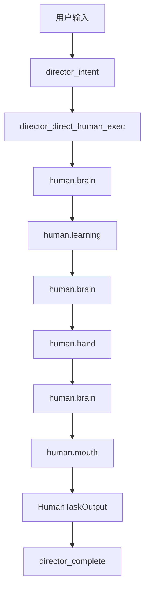

# NCurator-Desktop AI 简化样例

本文只给一条最小真实样例，用来快速说明当前代码里 `director` 与 `human` 的每个环节是怎么处理输入、状态和交付的。

- 本文只覆盖默认路径：`director_intent -> director_direct_human_exec -> human -> director_complete`
- 本文只覆盖 `human` 内部最常见闭环：`brain -> learning -> hand -> brain -> mouth`
- 本文不展开 `context`、`plan`、`synthesis`、异常分支与历史迁移说明

字段名、节点名、交付模式和状态转移都以当前代码实现为准；示例中的模型输出和工具结果是“符合当前契约的一组代表性样本”，不是固定字面值。

## 1. 先看这条样例要说明什么

这条样例只回答四个问题：

1. `director` 怎么判断这轮直接交给单个 `human`
2. `human` 怎么从“还不会做”走到“可以交付”
3. `learning / hand / mouth` 分别往状态里写什么
4. 最终答案是怎么从 `human` 回到 `director` 的

## 2. 用户请求

假设用户输入是：

> 基于已选知识范围，总结《发布说明模板》里对“发布日期”字段的写法要求，给我一个简短结论。

这个请求足够简单，因为：

- 不需要改 docx
- 不需要拆成多个子任务
- 单个 `human` 可以通过知识检索完成闭环

为了便于阅读，下文把 `ctx.referenceScope` 渲染后的参考资料上下文近似理解成：

```text
当前工作区：Alpha Workspace（本地工作目录）。

当前用户选择：
1. [网页资料] 发布说明模板
   地址：https://example.com/release-template
   知识库可用性：已索引
2. [网页资料] 品牌术语规范
   地址：https://example.com/brand-terms
   知识库可用性：已索引
```

## 3. 这次 run 是怎么开始的

### 3.1 初始 `DirectorState`

`AiRunService.run()` 会先创建 run 级初始状态：

```ts
{
  runId: 'run-simple',
  sessionId: 'session-simple',
  status: 'running',
  input: '基于已选知识范围，总结《发布说明模板》里对“发布日期”字段的写法要求，给我一个简短结论。',
  directorStage: 'director_intent',
  contextRounds: 0,
  contextEvidence: [],
  plan: [],
  dispatchCursor: 0,
  finalArtifacts: []
}
```

这时还没有任何 `human` 状态。`director` 先做的事，是判断当前这轮应该走哪条主路径。

### 3.2 运行时另外提供了什么

除了 `DirectorState` 以外，runtime 还会给节点注入：

- `ctx.referenceScope`：当前工作区与已选参考资料范围
- `ctx.loadHistory()`：最近对话和会话摘要
- `ctx.chatStructured / ctx.chatText`：统一的 LLM 调用入口

这些内容都是运行时上下文，不会直接持久化进 `DirectorState` 或 `HumanState`。

## 4. `director` 是怎么处理这条请求的

### 4.1 第一步：`director_intent`

`director_intent` 真实会读取：

- `state.input`
- `state.contextRounds`
- `state.contextEvidence`
- `ctx.loadHistory()` 返回的历史摘要
- `ctx.referenceScope` 渲染出的资料范围

在这个样例里，模型很可能给出这样的结构化结果：

```json
{
  "mode": "direct_human",
  "reason": "任务目标单一，已选知识范围足够明确，单个 human 可以通过知识检索直接闭环。"
}
```

于是 `director_intent` 回写：

```ts
{
  contextObjective: undefined,
  directorStage: 'director_direct_human_exec'
}
```

这里最关键的一点是：

- `director` 只做路由判断
- 它不会自己去查知识，也不会自己拼最终答案

### 4.2 第二步：`director_direct_human_exec`

进入默认路径后，`director` 会派发一个新的 `human`：

```ts
{
  taskInput: {
    taskId: 'direct-human',
    userInput: '# 直接执行任务 ...'
  },
  options: {
    deliveryMode: 'user_answer',
    emitAnswerEvents: true
  }
}
```

这里的 `userInput` 不是把用户原话直接丢给 `human`，而是由 `buildDirectHumanObjective()` 组织出的任务目标文本。它会把：

- 原始用户请求
- 当前参考资料范围
- 当前上下文证据

整理成 `human` 更容易直接执行的一段任务描述。

跨层传递时，`director` 只会派发：

- `HumanTaskInput`
- `HumanRunDispatchOptions`

它不会直接读写 `HumanState`。

## 5. `human` 是怎么闭环完成任务的

### 5.1 初始 `HumanState`

每个 `human` 都从一个新的 task 级状态开始：

```ts
{
  task: {
    taskId: 'direct-human',
    userInput: '# 直接执行任务 ...'
  },
  execution: {
    stage: 'brain',
    status: 'running',
    artifacts: []
  },
  memory: {
    stable: {
      confirmedFacts: '',
      keyEvidence: '',
      openQuestions: ''
    },
    history: {
      roundHistory: []
    }
  },
  skills: {
    learnedSkillIds: []
  },
  trace: {
    steps: []
  }
}
```

这个初始状态说明了两件事：

- `human` 只处理当前这个 task，不继承上一个 task 的内部状态
- 真正的执行闭环，从 `brain` 才刚刚开始

### 5.2 第一步：`brain` 先判断缺什么能力

`brain` 会读取：

- `task.userInput`
- `memory.stable`
- `memory.history.roundHistory`
- `execution.watchHint`
- `skills.learnedSkillIds`
- `ctx.referenceScope`

在这个样例里，第一轮 `brain` 会先判断“需要知识检索能力”，代表性输出可以是：

```json
{
  "decision": {
    "summary": "先学习知识证据检索能力。",
    "reason": "当前任务需要从已选知识范围中找到关于发布日期字段的直接依据。",
    "expectedOutcome": "拿到与发布日期写法相关的 chunk 证据。"
  },
  "readyToDeliver": false,
  "nextAction": {
    "action": "learning",
    "wantLearnSkillIds": ["kb-evidence-query"]
  }
}
```

这一轮 `brain` 做的事不是直接回答用户，而是把状态推进到下一跳：

- 写入 `execution.currentDecision`
- 视需要 patch `memory.stable`
- 追加一条 `trace.steps`
- 把 `execution.stage` 变成 `learning`

### 5.3 第二步：`learning` 加载 external skill

`learning` 不调用模型，只处理本轮要学的 skill。

在这个样例里，它会：

- 读取 `wantLearnSkillIds = ['kb-evidence-query']`
- 把该 skill 加入 `skills.learnedSkillIds`
- 记录本轮 learning outcome
- 把这一轮执行结果追加进 `roundHistory`
- 回到下一轮 `brain`

代表性结果：

```ts
{
  skills: {
    learnedSkillIds: ['kb-evidence-query']
  },
  execution: {
    lastLearningOutcome: {
      requestedSkillIds: ['kb-evidence-query'],
      loadedSkillIds: ['kb-evidence-query'],
      skippedDuplicateSkillIds: [],
      skippedUnknownSkillIds: [],
      evictedSkillIds: [],
      activeToolCount: 1
    },
    stage: 'brain'
  }
}
```

这一步最值得记住的是：

- `learning` 只负责让某个 external skill 生效
- 它不直接查知识，也不直接更新最终答案

### 5.4 第三步：`brain` 再决定去调工具

现在 `brain` 已经看到了可用的 `kb-evidence-query`，于是下一轮可以转向 `hand`：

```json
{
  "decision": {
    "summary": "检索发布说明模板里与发布日期字段相关的直接证据。",
    "reason": "已经具备知识检索能力，可以开始拿事实依据。",
    "expectedOutcome": "确认发布日期字段的推荐写法与边界说明。"
  },
  "readyToDeliver": false,
  "nextAction": {
    "action": "hand",
    "toolUsePlan": {
      "mode": "serial",
      "calls": [
        {
          "toolName": "kb_hybrid_search_chunks",
          "args": {
            "query": "发布日期 字段 写法 要求 发布说明模板",
            "topK": 5
          }
        }
      ]
    }
  }
}
```

这时 `brain` 的职责仍然只是决策，不直接执行工具。

### 5.5 第四步：`hand` 调工具并沉淀运行结果

`hand` 会执行 `toolUsePlan` 里的工具调用，并把标准化结果写回状态。

代表性的工具结果可以近似理解成：

```json
[
  {
    "toolName": "kb_hybrid_search_chunks",
    "ok": true,
    "code": "ok",
    "data": {
      "chunks": [
        {
          "documentTitle": "发布说明模板",
          "text": "发布日期字段应使用“预计发布日期”或“计划发布日期”表述；若日期未最终锁定，应同时补充待确认说明。"
        }
      ]
    }
  }
]
```

这一轮 `hand` 会回写：

- `execution.lastToolResults`
- `memory.history.roundHistory`
- `trace.steps`
- `execution.stage = 'brain'`

这一步通常还不会直接改 `memory.stable`。工具结果先原样进入运行记录，等下一轮 `brain` 再决定哪些事实要沉淀成正式任务笔记。

### 5.6 第五步：`brain` 基于证据收敛，并转向 `mouth`

工具结果回来后，`brain` 会把关键内容整理进稳定记忆，并判断现在已经可以交付：

```json
{
  "updatedStableMemory": {
    "confirmedFacts": "- 《发布说明模板》要求发布日期字段使用“预计发布日期”或“计划发布日期”这类未锁定表述。",
    "keyEvidence": "- 检索到的模板内容明确要求：如果日期尚未最终锁定，需要同时补充待确认说明。",
    "openQuestions": ""
  },
  "decision": {
    "summary": "信息已经足够，整理成简短结论返回给用户。",
    "reason": "已有直接证据，且当前任务只需要简短总结。",
    "expectedOutcome": "输出一段用户可直接阅读的简短答复。"
  },
  "readyToDeliver": true,
  "nextAction": {
    "action": "mouth"
  }
}
```

这一步说明：

- `brain` 是 `human` 内唯一推理节点
- 是否“已经可以交付”也是由 `brain` 判断

### 5.7 第六步：`mouth` 组织正式交付

`mouth` 读取：

- `task`
- `memory.stable`
- `memory.history.roundHistory`
- `execution.currentDecision`
- `execution.artifacts`
- 当前 `deliveryMode`

在本例中，`deliveryMode = user_answer`，所以它会输出面向最终用户的 markdown。代表性交付如下：

```md
# 处理结果

《发布说明模板》里，发布日期字段应优先使用“预计发布日期”或“计划发布日期”这类未锁定表述。

如果日期还没有最终确认，需要同时补充“待确认”说明，而不是把日期写成已经完全确定的口径。
```

runtime 随后会基于这段 markdown 与当前决策生成 `summary`，并透传已有 artifacts。因为这个样例没有文件类产物，所以 `artifacts` 仍为空。

最终 `HumanTaskOutput` 大致是：

```ts
{
  taskId: 'direct-human',
  status: 'completed',
  summary: '已总结发布日期字段的写法要求。',
  deliveryMarkdown: '# 处理结果 ...',
  artifacts: undefined
}
```

## 6. `director` 最后怎么收口

### 6.1 `director_direct_human_exec` 回写最终交付

`director` 收到 `HumanTaskOutput` 后，只会把稳定结果回写到 run 级状态：

```ts
{
  finalDeliveryMarkdown: '# 处理结果 ...',
  finalArtifacts: [],
  directorStage: 'director_complete'
}
```

### 6.2 `director_complete` 设置 run 终态

最后 `director_complete` 只做 run 级收尾：

```ts
{
  status: 'completed',
  directorStage: 'director_complete'
}
```

到这里，这条最小样例就完整结束了。

## 7. 把这条链路压成一张图



## 8. 这个样例最值得记住的几点

- `director` 只负责路由、派发和收尾，不负责单任务内部推理。
- `brain` 是 `human` 内唯一推理节点；`learning / hand / mouth` 都不是新的决策中心。
- `learning` 只让 external skill 生效。
- `hand` 只执行工具，并把原始结果沉淀进运行状态。
- `mouth` 只负责组织正式交付，不负责新增事实。
- `director` 与 `human` 之间真正跨层传递的是 `HumanTaskInput + HumanRunDispatchOptions -> HumanTaskOutput`，而不是 `HumanState`。
