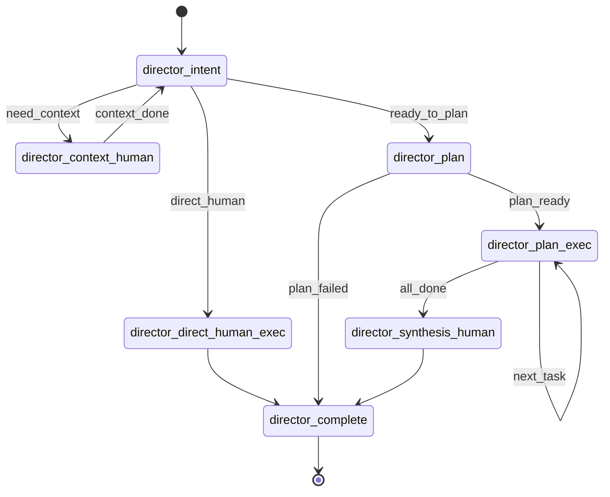
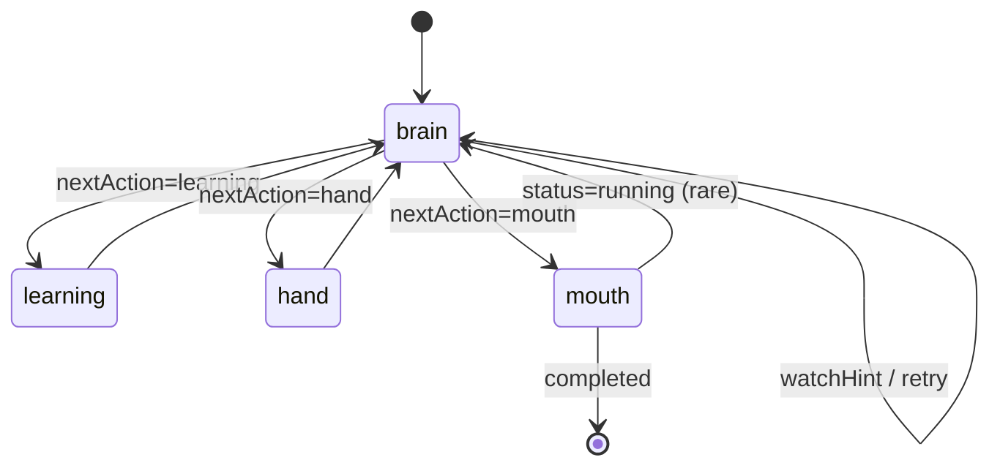

# NCurator-Desktop AI 实现规范

本文定义 `director + human` 的当前实现契约。代码实现应优先对齐本文档。

## 1. `director`

### 1.1 运行模型

**What**

- `director` 是 run 级编排层，负责路由、上下文补充、任务拆分、串行派发、最终汇总与 run 收尾。

**Why**

- `human` 是系统核心执行体，但 run 级调度、多任务串联、最终汇总仍需要单独一层来承接。
- 把 run 级 orchestration 放在 `director`，可以避免 `human` 被迫承担跨任务调度职责。
- 这样未来即使 `human` 继续变强，`director` 也可以收缩，而不是反过来把 `human` 的能力做散。

**How**

- 运行骨架：使用 `@langchain/langgraph` 的 `StateGraph`。
- 状态载体：使用 `director/state/schema.ts` 提供的 state schema。
- 节点返回：每个节点返回 `Partial<AiRunState>` 形式的 state patch，由 graph 负责推进。
- 条件路由：由 `DirectorState.directorStage` 与 `DirectorState.status` 决定，不在 graph 外额外维护控制循环。
- 状态转移：

**Not**

- `director` 不替代 `human` 做单任务内部推理。
- `director` 不直接读写 `HumanState`。
- `director` 不绕过 graph 自己维护一套脱离 `LangGraph` 的主循环。

**Data Mapping**

- 状态字段：`DirectorState`、`DirectorPlanTask`、`AiArtifactRef`
- 跨层契约：`HumanTaskInput`、`HumanRunDispatchOptions`、`HumanTaskOutput`
- 流转图：`director` 直接路径、`director` 阶段一、`director` 阶段二

### 1.2 `director_intent`

**What**

- `director_intent` 是 run 的入口路由节点，负责判断当前诉求是直接进入 `human`，还是先走上下文补充、规划或直接进入规划链路。

**Why**

- `director` 需要一个只负责“复杂度判断”的入口，避免一上来就把所有任务都送进 plan。
- 默认优先 `direct_human`，符合 `human-first` 的总目标。
- 把路由判断集中在单节点，可以让 direct/context/plan 的进入条件保持统一。

**How**

- 触发：graph 起点，或 `director_context_human` 返回后再次路由。
- 读取：`DirectorState.input`、`DirectorState.contextRounds`、`DirectorState.contextEvidence`、历史摘要、最近对话、`ctx.selectedContextText`。
- 回写：`DirectorState.directorStage`；必要时回写 `DirectorState.contextObjective`。
- 下一跳：`director_direct_human_exec`、`director_context_human`、`director_plan`。
- 实现约束：
  - `direct_human` 是默认路径；只要单个 `human` 可闭环，即使过程中需要本地工具，也优先走 direct。
  - `need_context` 只用于缺少关键指代、范围或关键证据，导致当前无法稳定判断的场景。
  - `to_plan` 只用于明确需要多个可独立执行子任务，或后续必然需要 synthesis 汇总的复杂任务。
  - 节点入口先执行 `ctx.checkCancelled()`。
  - 超过上下文补充轮次上限时，直接进入 `director_plan`。
  - 模型输出必须通过 `ctx.chatStructured`。
  - prompt 必须通过 `buildIntentPrompt` 组织。
  - 节点返回值保持为 `Partial<AiRunState>`。

**Not**

- 不直接生成计划任务。
- 不直接派发 `human`。
- 不把 routing 理由写入 `contextEvidence`。
- 不在这里处理 run 最终收尾。

**Data Mapping**

- 状态字段：`DirectorState.input`、`DirectorState.contextRounds`、`DirectorState.contextObjective`、`DirectorState.directorStage`
- 流转图：`director` 直接路径、`director` 阶段一

### 1.3 `director_context_human`

**What**

- `director_context_human` 负责派发一个专门的 context human 任务，用来补充当前 run 还缺失的上下文证据。

**Why**

- 有些任务暂时不适合直接求解，但也不值得立刻拆 plan。
- 用一次受控的 context human 补充证据，比让 `director` 自己承担上下文求解更符合职责边界。
- 先沉淀 `contextEvidence`，可以让后续 direct/plan/synthesis 使用统一的高价值摘要。

**How**

- 触发：`DirectorState.directorStage = director_context_human`
- 读取：`DirectorState.input`、`DirectorState.contextObjective`、`DirectorState.contextEvidence`、`DirectorState.contextRounds`
- 调用：派发一个 `human` 任务；`deliveryMode = context_note`；`internalDelivery = true`
- 回写：`DirectorState.contextRounds += 1`、`DirectorState.contextEvidence`、`DirectorState.contextObjective = undefined`、`DirectorState.directorStage = director_intent`
- 下一跳：`director_intent`
- 实现约束：
  - `taskId` 使用 `context-${contextRounds + 1}` 形式。
  - `userInput` 通过 `buildContextHumanObjective` 生成，不直接把原始输入原样派发。
  - `contextEvidence` 优先从 `context_note` 的“可复用证据”区块提取。
  - 提取结果通过去重/追加逻辑合并进现有 `contextEvidence`。

**Not**

- 不代替最终交付。
- 不把整段 `context_note` 原样存入 `DirectorState`。
- 不直接生成计划任务。

**Data Mapping**

- 状态字段：`DirectorState.contextObjective`、`DirectorState.contextRounds`、`DirectorState.contextEvidence`
- 交接契约：`HumanTaskInput`、`HumanTaskOutput`
- 流转图：`director` 阶段一

### 1.4 `director_direct_human_exec`

**What**

- `director_direct_human_exec` 负责走默认路径，直接把本轮任务派发给一个 `human` 闭环完成。

**Why**

- 这是 `human-first` 的默认执行方式。
- 对大多数单任务诉求，直接让 `human` 闭环比先做 plan 更短、更稳。
- 保留这一节点可以让 direct 路径与 plan/synthesis 路径在 graph 上保持清晰分离。

**How**

- 触发：`DirectorState.directorStage = director_direct_human_exec`
- 读取：`DirectorState.input`、`DirectorState.contextEvidence`
- 调用：派发一个 `human` 任务；`deliveryMode = user_answer`；`streamAnswer = true`
- 回写：`DirectorState.finalDeliveryMarkdown`、`DirectorState.finalArtifacts`、`DirectorState.directorStage = director_complete`
- 下一跳：`director_complete`
- 实现约束：
  - `taskId` 使用 direct human 专用任务 id。
  - `userInput` 通过 `buildDirectHumanObjective` 生成。
  - `director` 只消费 `HumanTaskOutput`，不直接读取 `human` 内部状态。

**Not**

- 不再进入 `director_plan`。
- 不自己组织最终答案内容。
- 不绕过 `human` 直接做用户交付。

**Data Mapping**

- 状态字段：`DirectorState.finalDeliveryMarkdown`、`DirectorState.finalArtifacts`
- 交接契约：`HumanTaskOutput`
- 流转图：`director` 直接路径

### 1.5 `director_plan`

**What**

- `director_plan` 负责把当前 run 拆成一组可交给单个 `human` 执行的计划任务。

**Why**

- 复杂任务需要显式拆分，才能让后续执行和综合都保持稳定。
- plan 的职责是“拆成 human-executable tasks”，而不是自己求解。
- 单独保留 `director_plan`，可以把规划失败、规划校验、计划事件发送收敛在一个节点里。

**How**

- 触发：`DirectorState.directorStage = director_plan`
- 读取：`DirectorState.input`、`DirectorState.contextEvidence`、历史摘要、最近对话、`ctx.selectedContextText`
- 输出：计划任务列表
- 回写：`DirectorState.plan`、`DirectorState.dispatchCursor = 0`、`DirectorState.directorStage = director_plan_exec`；失败时回写 `DirectorState.status = failed` 与 `DirectorState.error`
- 下一跳：`director_plan_exec` 或 `director_complete`
- 实现约束：
  - 模型输出必须通过 `ctx.chatStructured`。
  - prompt 必须通过 `buildPlanPrompt` 组织。
  - 计划结果必须先经过 `validatePlannerTasks` 的基础结果校验，再转换为 `DirectorPlanTask`。
  - `validatePlannerTasks` 只负责结构性兜底，例如是否产出任务、任务是否为空；不在这里承担上游上下文传递纠错。
  - runtime 会自动追加 synthesis human；planner 不得把“最终总结/综合答复”再写成单独计划任务。
  - 每个计划任务都必须能交给单个 `human` 闭环执行。

**Not**

- 不直接执行计划任务。
- 不直接输出最终用户答案。
- 不生成无法单个 `human` 闭环的任务。

**Data Mapping**

- 状态字段：`DirectorState.plan`、`DirectorState.dispatchCursor`、`DirectorPlanTask`
- 流转图：`director` 阶段一

### 1.6 `director_plan_exec`

**What**

- `director_plan_exec` 负责按当前游标串行派发计划任务，把 `human` 子任务结果稳定回写到计划状态中。

**Why**

- plan 产出的只是任务清单，真正的执行需要单独节点来承接。
- 任务执行与结果回写是 run 中最容易失控的部分，单独节点更利于约束串行推进、best-effort 收敛和任务事件。
- 让 `director_plan_exec` 只做“当前任务派发 + 当前任务回写”，可以保持状态推进简单可追踪。

**How**

- 触发：`DirectorState.directorStage = director_plan_exec`
- 读取：`DirectorState.plan`、`DirectorState.dispatchCursor`、`DirectorState.input`、`DirectorState.contextEvidence`、之前任务的 `deliveryMarkdown`、`ctx.selectedContextText`
- 调用：按 `dispatchCursor` 串行派发 `human`；`deliveryMode = task_handoff`
- 回写：当前任务 `status`、`deliveryMarkdown`、`artifacts`，以及 `DirectorState.dispatchCursor`、`DirectorState.directorStage`
- 下一跳：`director_plan_exec` 或 `director_synthesis_human`
- 实现约束：
  - 当前策略是串行执行，直到没有剩余 `ready` task。
  - 没有待执行任务时直接进入 `director_synthesis_human`。
  - 任务派发前先把当前任务标记为 `running`。
  - 回写时只更新当前已派发任务，不重写其他任务结果。

**Not**

- 不并行派发计划任务。
- 不跳过 `dispatchCursor` 直接执行后续任务。
- 不把“结果有限”误写成额外状态字段。

**Data Mapping**

- 状态字段：`DirectorState.plan`、`DirectorState.dispatchCursor`、`DirectorPlanTask.status`、`DirectorPlanTask.deliveryMarkdown`、`DirectorPlanTask.artifacts`
- 交接契约：`HumanTaskOutput`
- 流转图：`director` 阶段二

### 1.7 `director_synthesis_human`

**What**

- `director_synthesis_human` 负责把 context 和 plan 阶段沉淀下来的结果重新交给一个 `human` 做最终用户交付。

**Why**

- 计划链路最终仍应回到 `human` 产出正式答案，保持“执行核心始终是 human”。
- synthesis 独立成节点，可以把计划阶段的 `task_handoff` 和最终用户交付明确分开。
- 这样 final answer 的组织能力始终复用 `human` 的交付机制，而不是在 `director` 中另写一套。

**How**

- 触发：`DirectorState.directorStage = director_synthesis_human`
- 读取：`DirectorState.input`、`DirectorState.contextEvidence`、`DirectorState.plan`、`ctx.selectedContextText`
- 调用：派发一个 `human` 任务；`deliveryMode = user_answer`；`streamAnswer = true`
- 回写：`DirectorState.finalDeliveryMarkdown`、`DirectorState.finalArtifacts`、`DirectorState.directorStage = director_complete`
- 下一跳：`director_complete`
- 实现约束：
  - synthesis 只面向最终用户输出，不再生成新的计划任务。
  - `finalArtifacts` 需要合并计划阶段已有 artifacts 与 synthesis 输出 artifacts。
  - `userInput` 通过 `buildSynthesisHumanObjective` 组织。

**Not**

- 不重新规划任务。
- 不直接绕过 `human` 拼最终答案。
- 不丢弃计划阶段已经产生的 artifacts。

**Data Mapping**

- 状态字段：`DirectorState.plan`、`DirectorState.finalDeliveryMarkdown`、`DirectorState.finalArtifacts`
- 交接契约：`HumanTaskOutput`
- 流转图：`director` 阶段二

### 1.8 `director_complete`

**What**

- `director_complete` 是 run 级收尾节点，负责把 run 终态收束到稳定完成态。

**Why**

- 即使前面的 direct / synthesis 都已经拿到结果，run 级生命周期仍需要统一收尾点。
- 独立的 complete 节点可以让正常完成、失败、取消三类终态在 graph 中有一致出口。

**How**

- 触发：`DirectorState.directorStage = director_complete`
- 读取：`DirectorState.status`、`DirectorState.finalDeliveryMarkdown`、`DirectorState.finalArtifacts`
- 回写：正常路径下回写 `DirectorState.status = completed`，并保持 `DirectorState.directorStage = director_complete`
- 下一跳：`END`
- 实现约束：
  - `director_complete` 只负责 run 级收尾，不再派发模型节点。
  - 已处于 `failed / cancelled / completed` 的 run 不应被二次覆盖。

**Not**

- 不再进入其他 `director` 节点。
- 不再派发 `human`。
- 不在这里补写业务内容。

**Data Mapping**

- 状态字段：`DirectorState.status`、`DirectorState.finalDeliveryMarkdown`、`DirectorState.finalArtifacts`
- 流转图：`director` 直接路径、`director` 阶段二

## 2. `human`

### 2.1 运行模型

**What**

- `human` 是 task 级 autonomous execution unit，负责把一个自然语言任务在单次执行链路内推进到完成或稳定阻塞。

**Why**

- `human` 是系统真正的执行核心，单任务求解、学习、工具执行、结果交付都应围绕它展开。
- 让 `human` 维持独立闭环，后续无论是 direct、plan、multi-task 还是 multi-agent，都能复用同一个执行抽象。
- 保持 `human` graph 独立，也便于把推理、执行、交付与审计统一收口。

**How**

- 运行骨架：使用 `@langchain/langgraph` 的 `StateGraph`。
- 状态载体：使用 `human/state/schema.ts` 提供的 state schema。
- runner：由 `createHumanGraphRunner` 创建 graph、注入 `deliveryMode` 与 runtime cache，并把最终 `HumanState` 转为 `HumanTaskOutput`。
- 保护：使用固定 recursion limit 防止 graph 漂移。
- 状态转移：

**Not**

- `human` 不承担 run 级 orchestration。
- `human` 不直接维护 `DirectorState`。
- `human` 不在 graph 外手写主循环替代现有 graph 调度。

**Data Mapping**

- 状态字段：`HumanState`、`BrainEvidence`、`BrainFact`、`LastBrainDecision`、`BrainDecisionRecord`、`ToolCallResult`、`HumanResult`、`HumanTaskOutput`、`HumanTraceStep`
- 流转图：`human` 四张流转图

### 2.2 `brain`

**What**

- `brain` 是 `human` 内唯一推理节点，负责基于当前任务、记忆、最近工具结果与收敛提示，产出新的 `LastBrainDecision`。

**Why**

- 把推理集中在单节点，可以避免 `learning / hand / mouth` 各自偷偷扩张成新的决策中心。
- `brainMemory.inside` 的写权限必须集中，否则事实、证据和未决项很容易失控。
- 决策集中也让 trace、watchHint 和最近决策历史更容易审计。

**How**

- 触发：`runtime.stage = brain`
- 读取：`HumanState.task`、`HumanState.brainMemory`、`HumanState.lastParallelCallToolResults`、`HumanState.watchHint`、最近决策历史摘要，以及 runtime 提供的“用户选择的参考资料”文本
- 输出：`LastBrainDecision`
- 回写：`HumanState.brainMemory.inside`、`HumanState.brainMemory.outside.brainDecisions`、`HumanState.lastBrainDecision`、`HumanState.runtime.stage`、`HumanState.watchHint`、`HumanState.trace.steps`
- 下一跳：`learning`、`hand`、`mouth`；当 memory reducer 产出 `watchHint` 时留在 `brain`
- 实现约束：
  - 模型输出必须通过 `ctx.chatStructured`。
  - prompt 必须通过 `buildBrainPromptContext`。
  - `buildBrainPromptContext` 的输入来源是 `state + ctx`；参考资料上下文统一来自 `ctx.selectedContextText`，知识库检索约束来自 `ctx.selectedDocumentIds`，这些运行时投影都不持久化进 `HumanState`。
  - 输出必须先经过 `parseBrainDecisionOutput`。
  - `brainMemory.inside` 的修改必须经过 `reduceBrainMemory`，它的设计初衷就是这类信息将之用于brain的提示词记忆之中，且由brain进行输出修改。
  - `brainDecisions` 只保留最近 10 条。
  - `brain` 回看历史时只消费摘要，不直接把 `lastBrainDecision` 重新喂回。

**Not**

- 不直接执行工具。
- 不直接学习 skill。
- 不直接生成最终交付。
- 不绕过 `memoryOps` 直接修改 `brainMemory.inside`。

**Data Mapping**

- 状态字段：`HumanState.brainMemory.inside`、`HumanState.brainMemory.outside.brainDecisions`、`LastBrainDecision`、`BrainDecisionRecord`、`BrainMemoryOp`
- 流转图：`human` 阶段一

### 2.3 `learning`

**What**

- `learning` 是 skill 学习节点，负责把本轮 `brain` 指定的 skill 装入当前 human 运行上下文，并更新已学习 skill 集合。

**Why**

- skill 学习是执行型动作，不应与 `brain` 推理混在一起。
- 单独保留 `learning`，可以把“是否需要学”与“如何加载 skill 及工具”明确拆开。
- 这样既能保持 `brain` 轻量，又能让 skill 装载过程稳定可控。

**How**

- 触发：`lastBrainDecision.nextAction.action = learning`
- 读取：`lastBrainDecision.nextAction.wantLearnSkillIds`、`brainMemory.outside.learnedSkillIds`、`skills.ts`、`skillLoader`
- 回写：`brainMemory.outside.learnedSkillIds`、`runtime.stage = brain`、必要时回写 `watchHint`、`trace.steps`
- 下一跳：`brain`
- 实现约束：
  - `learning` 不调用模型。
  - 未知 skill 或重复学习必须写 `watchHint` 并返回 `brain`。
  - `ensureSkillTools` 负责根据 `skills.ts` 与 family tool builder 把 skill 对应工具装入 runtime cache。
  - `learning` 只更新已学习 skill 集合，不扩张为新推理节点。

**Not**

- 不负责判断“该不该学习”。
- 不直接执行工具。
- 不把 skill 详细正文持久化进状态。

**Data Mapping**

- 状态字段：`SkillCatalogItem`、`HumanState.brainMemory.outside.learnedSkillIds`、`HumanTraceStep`
- 流转图：`human` 阶段二

### 2.4 `hand`

**What**

- `hand` 是工具执行节点，负责承接 `brain` 已经明确决定的工具调用批次，执行并回写工具结果与 artifacts。

**Why**

- 工具执行属于确定性动作，不应继续让模型参与推理。
- 把工具调用集中在 `hand`，可以统一处理批次校验、工具权限、tool limit、result trace 和 artifacts 提取。
- 这样 `brain` 只决定“做什么”，`hand` 负责“把动作做完”。

**How**

- 触发：`lastBrainDecision.nextAction.action = hand`
- 读取：`lastBrainDecision.nextAction.parallelCallToolParam`、`brainMemory.outside.learnedSkillIds`、runtime cache 中已装载的工具
- 回写：`lastParallelCallToolResults`、`runtimeArtifacts`、`runtime.stage = brain`、必要时回写 `watchHint`、`trace.steps`
- 下一跳：`brain`
- 实现约束：
  - `hand` 不调用模型。
  - 工具批次先经过 `validateParallelToolCalls`。
  - 工具执行通过 `executeToolCall` 并行完成。
  - `executeToolCall` 会把常见失败归一成结构化 `diagnostic`，供下一轮 `brain` 恢复与纠偏。
  - tool call count 超限时只写 `watchHint`，由下一轮 `brain` 决定是否收敛。
  - `runtimeArtifacts` 只从工具结构化结果提取并合并。

**Not**

- 不决定是否该调用工具。
- 不直接生成最终结论。
- 不在这里改写 `brainMemory.inside`。

**Data Mapping**

- 状态字段：`ToolCallParam`、`ToolCallResult`、`HumanState.runtimeArtifacts`、`AiArtifactRef`、`HumanTraceStep`
- 流转图：`human` 阶段三

### 2.5 `mouth`

**What**

- `mouth` 是交付节点，负责把当前已经确定的状态整理成正式交付内容，并回写 `HumanResult`。

**Why**

- 把交付单独收口，可以避免 `brain` 一边判断一边直接输出最终结果。
- `mouth` 只负责“说出来”，这样 `deliveryMode` 的差异就能集中管理。
- 独立的交付节点也更方便做 fallback、streaming、trace 和统一结果透传。

**How**

- 触发：`runtime.stage = mouth`
- 读取：`HumanState.task`、`HumanState.brainMemory.inside`、`HumanState.lastBrainDecision`、`HumanState.runtimeArtifacts`、`deliveryMode`
- 输出：`MouthOutput`
- 回写：`HumanState.result`、`HumanState.runtime.status`、`HumanState.runtime.stage = mouth`、`HumanState.trace.steps`
- 下一跳：当前实现下正常结束；只有 `mouth` 把 `runtime.status` 保持为 `running` 时 graph 才会回到 `brain`
- 实现约束：
  - 当前实现下 `mouth` 统一收敛为 `completed`，限制与未决项通过交付内容表达，不新增额外终态。
  - 模型输出必须通过 `ctx.chatStructured`。
  - prompt 必须通过 `buildMouthPromptContext`。
  - `deliveryMarkdown` 为空时，必须使用 fallback builder 补足。
  - `artifacts` 由 runtime 透传到 `result`，不是由 `mouth` 生成。

**Not**

- 不新增事实。
- 不扩张 artifacts。
- 不重新做任务级推理。

**Data Mapping**

- 状态字段：`MouthOutput`、`HumanResult`、`HumanTaskOutput`、`AiArtifactRef`
- 流转图：`human` 阶段四

### 2.6 `human` 共享状态规则

**What**

- 这一节定义 `human` 执行过程中几个跨节点共享状态的职责边界，包括 `lastBrainDecision`、`brainDecisions`、`watchHint`、`runtimeArtifacts` 和 `trace.steps`。

**Why**

- `human` 节点很多，但关键运行态不能没有统一解释。
- 如果这些共享字段的职责不稳定，节点很容易互相越界读写。
- 明确共享状态语义，可以让节点实现和测试都更可控。

**How**

- `lastBrainDecision`：当前动作分发快照，供 `learning / hand / mouth` 读取。
- `brainDecisions`：最近决策历史，只保留最近 10 条，用于回看和审计。
- `watchHint`：轻量纠偏信号，不单独形成新节点。
- `runtimeArtifacts`：只在 `hand` 阶段增长，在 `mouth` 阶段透传。
- `trace.steps`：由各节点持续追加，供事件、审计与回放使用。

**Not**

- `lastBrainDecision` 不作为下一轮 `brain` 的直接回看输入。
- `brainDecisions` 不保存无限历史。
- `watchHint` 不扩张成新的 watchdog 子系统。

**Data Mapping**

- 状态字段：`LastBrainDecision`、`BrainDecisionRecord`、`HumanState.watchHint`、`HumanState.runtimeArtifacts`、`HumanTraceStep`

## 3. 跨层实现规则

### 3.1 `director` 与 `human` 的派发契约

**What**

- 这一节定义 `director` 与 `human` 之间唯一稳定的交接边界。

**Why**

- 只要跨层边界稳定，内部实现才能继续演进而不互相穿透。
- 如果 `director` 直接依赖 `HumanState` 内部结构，后续重构会非常脆弱。

**How**

- 输入边界：`HumanTaskInput + HumanRunDispatchOptions`
- 输出边界：`HumanTaskOutput`
- `director` 只调用 `HumanTaskRunner`，不直接读写 `HumanState`
- `human` runner 负责把最终 `HumanState` 收口为稳定的 `HumanTaskOutput`

**Not**

- `director` 不直接读 `human` graph 的中间 state。
- `human` 不直接回写 `DirectorState`。

**Data Mapping**

- 交接契约：`HumanTaskInput`、`HumanRunDispatchOptions`、`HumanTaskOutput`

### 3.2 `deliveryMode`

**What**

- `deliveryMode` 是 `director` 派发给 `human` 的运行时交付模式，用来约束 `mouth` 生成什么形态的正式交付。

**Why**

- 同一个 `human` 需要服务 direct、plan、context、synthesis 多种场景。
- 把交付差异收敛成 `deliveryMode`，比为每条路径单独建一套 mouth 逻辑更稳。

**How**

- `director_direct_human_exec` 与 `director_synthesis_human` 使用 `user_answer`
- `director_plan_exec` 使用 `task_handoff`
- `director_context_human` 使用 `context_note`
- `deliveryMode` 只影响 `mouth` 的交付组织方式，不改变前置节点职责

**Not**

- 不作为 `brain` 的决策输入。
- 不单独决定任务状态。
- 不要求持久化到 `DirectorState`。

**Data Mapping**

- 状态字段：`HumanRunDispatchOptions.deliveryMode`、`HumanResult.deliveryMarkdown`

### 3.3 `contextEvidence`

**What**

- `contextEvidence` 是 `director` 侧可复用的上下文证据摘要集合。

**Why**

- `director` 需要一个轻量、可复用的上下文载体，供后续 routing、planning、synthesis 使用。
- 直接保存整段 `context_note` 会带入大量低价值噪音。

**How**

- 来源优先是 `context_note` 中的“可复用证据”区块
- 提取失败时，才 fallback 到 `HumanTaskOutput.summary`
- intent / routing 的判定理由不写入 `contextEvidence`
- `contextEvidence` 通过追加与去重逻辑逐轮累积

**Not**

- 不保存整段 `context_note`
- 不保存 route decision 的说明文字
- 不作为 `human` 内部记忆结构的一部分

**Data Mapping**

- 状态字段：`DirectorState.contextEvidence`、`HumanTaskOutput.summary`、`HumanTaskOutput.deliveryMarkdown`

### 3.4 `artifacts`

**What**

- `artifacts` 是运行时稳定引用的结构化交付物集合，用来承接文件、审阅结果等非纯文本产物。

**Why**

- 文本交付不足以稳定表达文件、draft review、preview 等运行时产物。
- 把 artifacts 作为独立结构透传，可以减少让 `mouth` 反复复述路径或 review id 的负担。

**How**

- 产生源头：工具结构化输出
- `hand`：提取并合并到 `runtimeArtifacts`
- `mouth`：只透传 `runtimeArtifacts` 到 `HumanResult`
- `director_plan_exec`：回写到 `DirectorPlanTask.artifacts`
- `director_synthesis_human / director_complete`：合并并收口到 `DirectorState.finalArtifacts`

**Not**

- 不要求 `mouth` 模型生成 artifacts 元数据
- 不让 `director` 自己凭空构造 artifacts
- 不把 artifacts 当作 `brainMemory.inside` 的一部分

**Data Mapping**

- 状态字段：`AiArtifactRef`、`HumanState.runtimeArtifacts`、`HumanResult.artifacts`、`DirectorPlanTask.artifacts`、`DirectorState.finalArtifacts`

### 3.5 技术实现约束

**What**

- 这一节定义 AI 实现的底层技术约束，避免后续代码实现偏离当前工程基线。

**Why**

- 只定义节点职责还不够；如果技术实现方式失控，AI 很容易写出另一套风格完全不同的代码。
- 把工程层面的做法写清楚，文档才能真正约束实现而不是只约束意图。

**How**

- `director` 与 `human` 的运行编排必须基于 `@langchain/langgraph` 的 `StateGraph`
- graph 的状态 schema 必须通过各自目录下的 `state/schema.ts` 定义和约束
- graph 路由必须通过 `addConditionalEdges` 或等价 graph 路由表达，不要在 graph 外另写一套手工循环替代
- 模型结构化输出必须统一通过 `ctx.chatStructured`，由 runtime 封装的 `invokeStructuredChat` 承接
- `ctx.chatStructured` 必须统一产出 `llm_structured_output` activity；`details` 至少携带 `callId / caller / schemaName / model / durationMs / method / fallbackChain`
- 如果后续需要引入非结构化模型调用，也应先补 runtime 级封装，不在 node 内直接拼接底层模型调用
- 节点内部不要直接调用 `model.withStructuredOutput`，也不要散落手写 schema parse 逻辑
- prompt 必须通过 `build*Prompt` 或 `build*PromptContext` 组织，不在 node 内联堆大段 prompt 文本
- `human` 的 skill 元数据统一来自 `skills.ts`，tool 元数据统一来自 `tools/<family>/toolSpecs.ts` 与 `tools/registry.ts`
- `learning`、`hand`、`complete` 这类确定性节点默认不引入额外模型调用
- 节点入口先执行取消检查，再进行模型调用、工具调用或状态写入
- 文档中的状态转移用于约束 graph 结构，不应用来反向实现一套脱离 `LangGraph` 的伪循环

**Not**

- 不在 node 内直接接底层模型实例
- 不在 graph 外维护第二套控制流
- 不把 prompt builder、runtime 封装、schema 校验逻辑绕开

**Data Mapping**

- 关联实现：`director/graph/*`、`human/graph/*`、`director/state/schema.ts`、`human/state/schema.ts`、`runtime.ts`、`structuredOutput.ts`

### 3.6 与数据文档的联动

**What**

- 这一节定义 `implementation-spec.md` 与 `data-definition-and-flow.md` 的配套使用方式。

**Why**

- 只有实现规范，没有数据契约，AI 容易写出行为正确但字段不对的代码。
- 只有数据契约，没有实现规范，AI 又容易写出字段对齐但职责越界的代码。
- 两份文档联动，才能同时约束“做什么”和“数据长什么样”。

**How**

- `director` 侧实现时，先对照 `data-definition-and-flow.md` 中的 `DirectorState`、`DirectorPlanTask` 与 `director` 三张流转图
- `human` 侧实现时，先对照 `HumanState`、`brainMemory.inside`、`brainMemory.outside`、`lastBrainDecision` 与 `brainDecisions`、`lastParallelCallToolResults` 与 `result`，以及 `human` 四张流转图
- 跨层派发与交付时，重点对照 `HumanTaskInput`、`HumanRunDispatchOptions`、`HumanTaskOutput`、`AiArtifactRef`
- 实现时应先用本文档判断职责，再用数据文档校验字段、状态结构与流转落点

**Not**

- 不把 `implementation-spec` 当成 schema 文档
- 不把 `data-definition-and-flow` 当成节点职责文档
- 不允许只看其中一份就直接落实现

**Data Mapping**

- 配套文档：`data-definition-and-flow.md`

### 3.7 全局不变量

**What**

- 这一节定义整套 AI 实现的全局不变量。

**Why**

- 节点级规则之外，还需要一组跨节点、跨层都必须满足的硬边界。
- 这些不变量是后续代码 review、测试设计和 AI 自动实现时的兜底标准。

**How**

- `director` 只负责 run 级 orchestration
- `human` 只负责 task 级 autonomous execution
- `brain` 是唯一推理节点
- `brainMemory.inside` 只允许通过 `brain` 的 `memoryOps` 修改
- `lastBrainDecision` 只表示当前动作快照，`brainDecisions` 只表示最近历史
- `deliveryMode` 只影响交付组织，不改变求解职责
- `mouth` 不新增事实，不扩张 artifacts
- `director` 与 `human` 之间只通过稳定交接契约通信，不直接穿透内部状态

**Not**

- 不允许多节点共同承担任务级推理
- 不允许跨层直接改写对方内部状态
- 不允许把交付组织规则扩张成求解规则

**Data Mapping**

- 关联字段：`DirectorState`、`HumanState`、`LastBrainDecision`、`BrainDecisionRecord`、`HumanRunDispatchOptions`、`AiArtifactRef`
