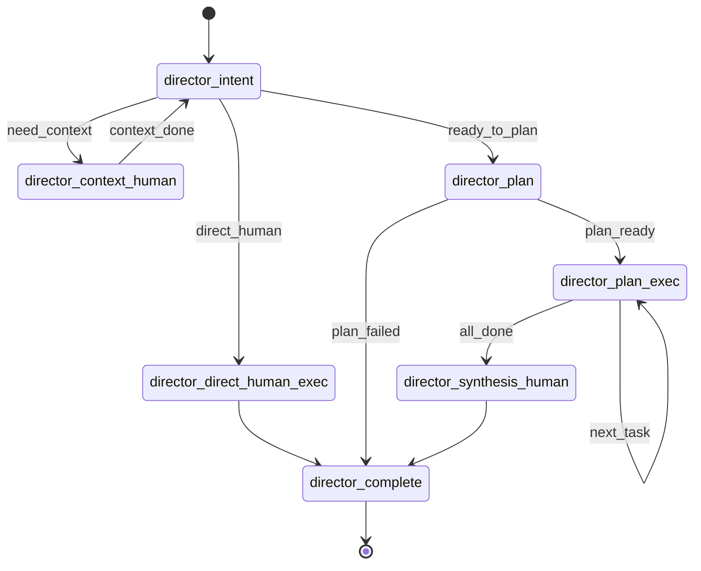
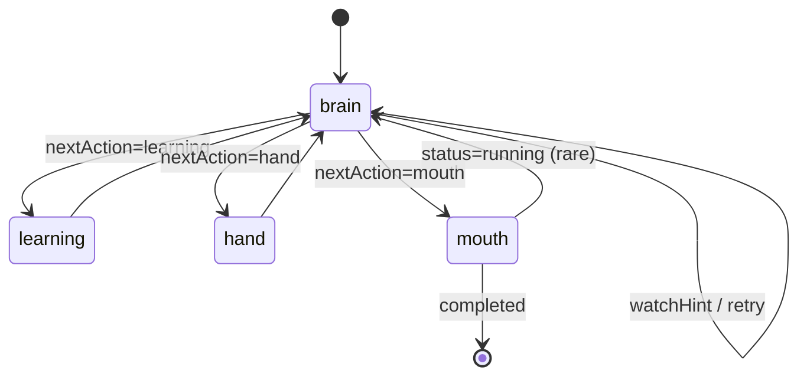

# NCurator-Desktop AI 实现规范

本文定义 `director + human` 的当前实现边界。代码实现应优先对齐本文档。

## 1. 文档定位

- 本文只负责说明节点职责、跨层边界与实现约束。
- 当需要确认字段、状态结构、事件内容或流转落点时，请阅读 `doc/ai-design/data-definition-and-flow.md`。
- 当需要查看真实运行样例时，请阅读 `doc/ai-design/example.md`。
- 当需要查看 `human` 的 skill 与 tool 组织方式时，请阅读 `doc/ai-design/human-skill-design.md`。
- 当需要查看 prompt 设计时，请阅读 `doc/ai-design/prompt-design.md`。
- 实现时应先用本文判断“谁负责做什么”，再用数据文档校验“字段长什么样、结果落在哪里”。

## 2. 全局不变量与技术约束

### 2.1 全局不变量

- `director` 只负责 run 级 orchestration，不承担单任务内部推理。
- `human` 只负责 task 级 autonomous execution，不承担 run 级编排。
- `brain` 是 `human` 内唯一推理节点。
- `brainMemory.inside` 只允许通过 `brain` 的 `memoryOps` 修改。
- `lastBrainDecision` 只表示当前动作快照；正式过程历史由 `processMemory.roundHistory` 承接。
- `deliveryMode` 只影响交付组织方式，不改变求解职责。
- `mouth` 不新增事实，不扩张 artifacts。
- `director` 与 `human` 之间只通过稳定交接契约通信，不直接穿透对方内部状态。

### 2.2 不跨层直读内部 state

**规则**

- `director` 只通过 `HumanTaskInput + HumanRunDispatchOptions` 派发 `human`，只通过 `HumanTaskOutput` 消费结果。
- `director` 不直接读取 `HumanState` 内部字段，例如 `brainMemory`、`lastBrainDecision`、`watchHint`、`runtimeArtifacts`、`trace.steps`。
- `human` 不直接回写 `DirectorState`，例如 `plan`、`dispatchCursor`、`contextEvidence`、`finalDeliveryMarkdown`。
- 跨层需要新增信息时，应先扩展稳定契约，而不是临时读取对方内部 state。

**为什么**

- 这样可以保持 `human` 内部可重构，不会因为上层依赖内部字段而被锁死。
- 这样可以保持职责清晰，避免 `director` 偷偷理解 `human` 的内部推理过程。
- 这样可以让测试分层成立，`director` 与 `human` 的问题能分别定位。
- 这样可以为后续替换执行体保留空间，`director` 只依赖稳定输入输出，而不依赖某一版 `HumanState` 细节。

**明确禁止**

- 不允许把 `watchHint`、`brainMemory`、`lastBrainDecision` 当成 `director` 的路由输入。
- 不允许让 `human` 节点直接改写 `DirectorState` 的计划、游标或最终交付字段。
- 不允许为了“方便调试”在跨层直接共享 graph 中间 state。

### 2.3 技术约束

- `director` 与 `human` 的运行编排必须基于 `@langchain/langgraph` 的 `StateGraph`。
- graph 的状态 schema 必须通过各自目录下的 `state/schema.ts` 定义与约束。
- graph 路由必须通过 `addConditionalEdges` 或等价 graph 表达，不在 graph 外另写第二套控制循环。
- 模型结构化输出必须统一通过 `ctx.chatStructured`，不在 node 内自行切换 `completions / responses` transport 或结构化方法。
- `ctx.chatStructured` 的 transport 探测、profile 选择、fallback 和缓存都属于 runtime 责任，不属于 node 责任。
- `ctx.chatStructured` 必须统一产出 `llm_structured_output` activity；详细字段以数据文档为准。
- 节点内部不要直接调用底层模型实例，也不要散落手写 schema parse 逻辑。
- prompt 必须通过 `build*Prompt` 或 `build*PromptContext` 组织，不在 node 内联堆大段 prompt 文本。
- `learning`、`hand`、`director_complete` 这类确定性节点默认不引入额外模型调用。
- 节点入口先执行取消检查，再进行模型调用、工具调用或状态写入。
- 文档中的状态图用于约束 graph 结构，不应用来反向实现一套脱离 `LangGraph` 的伪循环。

## 3. `director` 总览

- `director` 是 run 级编排层，负责路由、上下文补充、任务拆分、串行派发、最终汇总与 run 收尾。
- 默认优先 `direct_human`；只要单个 `human` 可以闭环，即使过程中需要工具，也优先 direct。
- 只有当缺少关键指代、范围或证据，导致当前无法稳定判断时，才进入 `director_context_human`。
- 只有当任务明确需要多个可独立执行子任务，或后续必然需要 synthesis 汇总时，才进入 `director_plan`。

相关字段与流转落点详见 `doc/ai-design/data-definition-and-flow.md` 中的 `DirectorState`、`DirectorPlanTask` 与 `director` 流转图。

## 4. `director` 节点规范

### 4.1 `director_intent`

- 职责：run 入口路由，决定 direct、context 或 plan。
- 主要输入：`input`、`contextRounds`、`contextEvidence`、历史摘要、最近对话、`ctx.selectedContextText`。
- 主要回写：`directorStage`，必要时 `contextObjective`。
- 下一跳：`director_direct_human_exec`、`director_context_human`、`director_plan`。
- 特有约束：
  - 默认优先 `direct_human`。
  - 只有当缺少关键指代、范围或关键证据，导致当前无法稳定判断时，才进入 `director_context_human`。
  - 只有当任务明确需要多个可独立执行子任务，或后续必然需要 synthesis 汇总时，才进入 `director_plan`。
  - 超过上下文补充轮次上限后，直接进入 `director_plan`。
  - 模型输出必须通过 `ctx.chatStructured`。
  - prompt 必须通过 `buildIntentPrompt` 组织。
  - routing 理由不写入 `contextEvidence`。

### 4.2 `director_context_human`

- 职责：派发一个专门的 context human 任务，用来补充当前 run 缺失的上下文证据。
- 主要输入：`input`、`contextObjective`、`contextEvidence`、`contextRounds`。
- 主要回写：`contextRounds`、`contextEvidence`、`contextObjective`、`directorStage`。
- 下一跳：`director_intent`。
- 特有约束：
  - `taskId` 使用 `context-${contextRounds + 1}`。
  - `deliveryMode = context_note`，`internalDelivery = true`。
  - `userInput` 必须通过 `buildContextHumanObjective` 生成，不直接把原始输入原样派发。
  - `contextEvidence` 优先从 `context_note` 的“可复用证据”区块提取。
  - 提取结果通过去重与追加逻辑合并，不保存整段 `context_note`。

### 4.3 `director_direct_human_exec`

- 职责：直接派发单个 `human`，让当前任务按默认路径闭环完成。
- 主要输入：`input`、`contextEvidence`。
- 主要回写：`finalDeliveryMarkdown`、`finalArtifacts`、`directorStage`。
- 下一跳：`director_complete`。
- 特有约束：
  - `deliveryMode = user_answer`。
  - `streamAnswer = true`。
  - `userInput` 必须通过 `buildDirectHumanObjective` 生成。
  - `director` 只消费 `HumanTaskOutput`，不读取 `human` 内部状态。

### 4.4 `director_plan`

- 职责：把当前 run 拆成一组可交给单个 `human` 执行的计划任务。
- 主要输入：`input`、`contextEvidence`、历史摘要、最近对话、`ctx.selectedContextText`。
- 主要回写：`plan`、`dispatchCursor`、`directorStage`；失败时回写 `status`、`error`。
- 下一跳：`director_plan_exec` 或 `director_complete`。
- 特有约束：
  - planner 只产出 human-executable tasks。
  - runtime 自动追加 synthesis，不由 planner 生成最终总结任务。
  - 模型输出必须通过 `ctx.chatStructured`。
  - prompt 必须通过 `buildPlanPrompt` 组织。
  - 计划结果必须先经过 `validatePlannerTasks` 的基础结构校验，再转换为 `DirectorPlanTask`。
  - `validatePlannerTasks` 只负责结构性兜底，不承担上游上下文传递纠错。

### 4.5 `director_plan_exec`

- 职责：按当前游标串行执行计划任务，并把 `human` 子任务结果稳定回写到计划状态中。
- 主要输入：`plan`、`dispatchCursor`、`input`、`contextEvidence`、之前任务结果、`ctx.selectedContextText`。
- 主要回写：当前任务的 `status`、`deliveryMarkdown`、`artifacts`，以及 `dispatchCursor`、`directorStage`。
- 下一跳：`director_plan_exec` 或 `director_synthesis_human`。
- 特有约束：
  - 当前策略只串行执行，直到没有剩余 `ready` task。
  - 派发前先把当前任务标记为 `running`。
  - 只更新当前已派发任务，不重写其他任务结果。
  - 没有待执行任务时，直接进入 `director_synthesis_human`。

### 4.6 `director_synthesis_human`

- 职责：把 context 与 plan 阶段沉淀下来的结果重新交给一个 `human`，产出最终用户交付。
- 主要输入：`input`、`contextEvidence`、`plan`、`ctx.selectedContextText`。
- 主要回写：`finalDeliveryMarkdown`、`finalArtifacts`、`directorStage`。
- 下一跳：`director_complete`。
- 特有约束：
  - `deliveryMode = user_answer`。
  - `streamAnswer = true`。
  - synthesis 只面向最终用户交付，不再生成新的计划任务。
  - `userInput` 必须通过 `buildSynthesisHumanObjective` 组织。
  - `finalArtifacts` 需要合并计划阶段已有 artifacts 与 synthesis 输出 artifacts。

### 4.7 `director_complete`

- 职责：统一收束 run 终态。
- 主要输入：`status`、`finalDeliveryMarkdown`、`finalArtifacts`。
- 主要回写：正常路径下 `status = completed`。
- 下一跳：`END`。
- 特有约束：
  - 不再派发模型或 `human`。
  - 不覆盖已处于 `failed / cancelled / completed` 的 run。

## 5. `human` 总览

- `human` 是 task 级 autonomous execution unit，负责把一个自然语言任务在单次执行链路内推进到完成或稳定阻塞。
- `brain` 负责决策，`learning` 负责装载 skill，`hand` 负责执行工具，`mouth` 负责组织正式交付。
- `human` 只处理单任务闭环，不承担 run 级 orchestration。

相关字段与流转落点详见 `doc/ai-design/data-definition-and-flow.md` 中的 `HumanState`、`HumanTaskOutput` 与 `human` 流转图。

## 6. `human` 节点规范

### 6.1 `brain`

- 职责：`human` 内唯一推理节点，负责基于当前任务、稳定记忆、过程历史与收敛提示，产出新的 `LastBrainDecision`。
- 主要读取：`task`、`brainMemory.inside`、`brainMemory.outside`、`processMemory.roundHistory`、`processMemory.loadedHistoryContext`、`watchHint`、`ctx.selectedContextText`、`ctx.workspace`。
- 主要回写：`brainMemory.inside`、`brainDecisions`、`lastBrainDecision`、`processMemory.loadedHistoryContext`、`runtime.stage`、`watchHint`、`trace.steps`。
- 特有约束：
  - 模型输出必须通过 `ctx.chatStructured`。
  - prompt 必须通过 `buildBrainPromptContext`。
  - 输出必须先经过 `parseBrainDecisionOutput`。
  - `brainMemory.inside` 只能通过 `reduceBrainMemory` 修改。
  - `brain` 的主输入块固定为 `user_request`、`user_selected_context`、`your_stable_memory`、`your_capabilities`、`last_round_focus`、`history_chain`、`loaded_history_context`、`convergence_hint`。
  - `brain` 回看历史时不再依赖 `recent_*` 拼接块，而是统一消费 `roundHistory` 渲染结果。

### 6.2 `learning`

- 职责：装载本轮 `brain` 指定的 external skill，并更新已学习 skill 集合。
- 主要读取：`wantLearnSkillIds`、`learnedSkillIds`、`skills.ts`、`skillLoader`。
- 主要回写：`learnedSkillIds`、`lastLearningOutcome`、`processMemory.roundHistory`、`runtime.stage`、必要时 `watchHint`、`trace.steps`。
- 特有约束：
  - 不调用模型。
  - `learning` 采用 partial success：有新 skill 时只加载新 skill，并把重复 / 未知 skill 写入 `lastLearningOutcome`。
  - 只有当整轮 learning 完全没有新 skill，或 active tool budget 超限时，才写 `watchHint` 并返回 `brain`。
  - builtin skill 始终可用，不进入 learning，不计入 active tool budget。
  - `ensureSkillTools` 负责根据 `skills.ts` 与 family tool builder 把 skill 对应工具装入 runtime cache。

### 6.3 `hand`

- 职责：承接 `brain` 已经明确决定的工具调用批次，执行并回写工具结果、过程历史与 artifacts。
- 主要读取：`toolUsePlan`、`learnedSkillIds`、runtime cache 中已装载的工具、`processMemory.roundHistory`。
- 主要回写：`lastToolUseResults`、`processMemory.roundHistory`、`processMemory.loadedHistoryContext`、`runtimeArtifacts`、`runtime.stage`、必要时 `watchHint`、`trace.steps`。
- 特有约束：
  - 不调用模型。
  - `toolUsePlan.mode=parallel` 只允许 `read_only && parallelSafe=true` 的调用，且数量受并行上限限制。
  - `toolUsePlan.mode=serial` 允许任意调用组合，但必须按顺序逐条执行。
  - 工具执行通过 `executeToolCall` 完成。
  - `history_recall` 作为 internal family 的只读 builtin 工具，通过 `hand` 进入真实执行链，并把结果写入 `loadedHistoryContext`。
  - tool call count 超限时只写 `watchHint`，由下一轮 `brain` 决定是否收敛。
  - `runtimeArtifacts` 只从工具结构化结果提取并合并。

### 6.4 `mouth`

- 职责：把当前已经确定的状态整理成正式交付内容，并回写 `HumanResult`。
- 主要读取：`task`、`brainMemory.inside`、`lastBrainDecision`、`runtimeArtifacts`、`deliveryMode`。
- 主要回写：`result`、`runtime.status`、`runtime.stage`、`trace.steps`。
- 特有约束：
  - 模型输出必须通过 `ctx.chatStructured`。
  - prompt 必须通过 `buildMouthPromptContext`。
  - `deliveryMarkdown` 为空时，必须使用 fallback builder 补足。
  - artifacts 由 runtime 透传到 `result`，不是由 `mouth` 生成。
  - `mouth` 当前实现通常收敛为 `completed`；只有极少数需要继续运行时才会回到 `brain`。

### 6.5 共享状态规则

- `lastBrainDecision`
  - 当前动作分发快照，供 `learning / hand / mouth` 读取。
  - 不作为下一轮 `brain` 的主要历史输入。
- `brainDecisions`
  - 最近决策历史，只保留最近 10 条，用于审计和兼容期辅助排查；prompt 主路径不再直接消费它。
- `processMemory.roundHistory`
  - `human` 的正式过程历史。
  - 每轮统一记录 `decision + execution`，由 `brain / learning / hand / mouth` 共同回填。
- `processMemory.loadedHistoryContext`
  - `history_recall` 主动加载出来的旧历史结果，只用于下一轮或最近几轮 `brain` 判断。
- `watchHint`
  - 轻量纠偏信号，不扩张成新的 watchdog 子系统。
  - 采用结构化 `{ code, detail }` 契约；自然语言文案由 `prompts/watchHints.ts` 统一渲染。
- `lastLearningOutcome`
  - 记录最近一轮 learning 的真实执行结果，便于 runtime 排查；prompt 主路径改由 `roundHistory` 消费。
- `lastToolUseResults`
  - 记录最近一次 hand 的原始 runtime 结果，便于 runtime 排查；prompt 主路径改由 `roundHistory` 消费。
- `runtimeArtifacts`
  - 只在 `hand` 阶段增长，在 `mouth` 阶段透传到结果。
- `trace.steps`
  - 由各节点持续追加，供事件、审计与回放使用。
- 其他补充规则
  - `brain` 是唯一推理节点；`learning`、`hand`、`mouth` 不扩张为新的决策中心。
  - `ctx.selectedContextText` 与 `ctx.workspace` 是 runtime 投影，不持久化进 `HumanState`。

## 7. 共享契约

### 7.1 `HumanTaskInput + HumanRunDispatchOptions -> HumanTaskOutput`

- 这是唯一稳定的跨层交接边界。
- `director` 负责派发，`human` 负责收口。
- `director` 不直接读取 `human` graph 中间 state。
- `human` 不直接回写 `DirectorState`。

### 7.2 `deliveryMode`

- 生产方：`director`。
- 消费方：`mouth`。
- 使用规则：
  - `director_direct_human_exec` 与 `director_synthesis_human` 使用 `user_answer`。
  - `director_plan_exec` 使用 `task_handoff`。
  - `director_context_human` 使用 `context_note`。
- 它只影响交付组织，不改变求解职责。

### 7.3 `contextEvidence`

- 生产方：`director_context_human` 汇总。
- 消费方：`director_intent`、`director_plan`、`director_synthesis_human`。
- 使用规则：
  - 优先从 `context_note` 的“可复用证据”区块提取。
  - 提取失败时才 fallback 到 `HumanTaskOutput.summary`。
  - 不保存整段 `context_note`。
  - 不保存 route decision 理由。

### 7.4 `artifacts`

- 生产方：工具结构化输出，经 `hand` 提取。
- 消费方：`mouth`、`director_plan_exec`、`director_synthesis_human`、`director_complete`。
- 使用规则：
  - `hand` 合并到 `runtimeArtifacts`。
  - `mouth` 只透传，不生成 artifacts 元数据。
  - `director` 只合并与收口，不凭空构造 artifacts。

## 8. 相关文档

- 字段、状态结构、流转图、活动与文件格式：`doc/ai-design/data-definition-and-flow.md`
- 真实运行样例：`doc/ai-design/example.md`
- `human` 的 skills 与 tools 组织方式：`doc/ai-design/human-skill-design.md`
- prompt 设计：`doc/ai-design/prompt-design.md`
- 后续重构方向：`doc/ai-design/refactor-plan.md`
