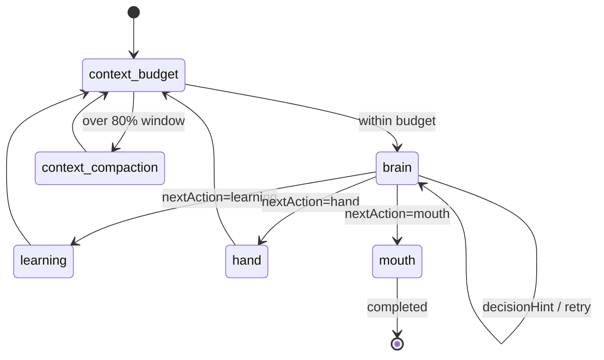

# NCurator-Desktop AI 实现规范

本文定义当前 `human-only` AI 实现边界。代码实现应优先对齐本文档。

## 1. 文档定位

- 本文只负责说明运行入口、节点职责、跨层边界与实现约束。
- 当需要确认字段、状态结构、事件内容或流转落点时，请阅读 `doc/ai-design/data-definition-and-flow.md`。
- 当需要查看 `human` 的 skill 与 tool 组织方式时，请阅读 `doc/ai-design/human-skill-design.md`。
- 当需要查看 prompt 设计时，请阅读 `doc/ai-design/prompt-design.md`。

## 2. 全局不变量与技术约束

### 2.1 全局不变量

- `human` 是唯一执行核心。
- `AiRunService` 只负责 run 生命周期，不承担任务求解。
- `brain` 是 `human` 内唯一推理节点。
- `memory.thought` 只允许通过 brain 输出的 `thought.todolist` 与 `thought.progressionSummary` 按需全量覆盖对应字段。
- `execution.currentThought` 只表示当前动作快照；正式过程历史由 `memory.taskRun.rounds` 承接。
- `mouth` 只负责最终用户交付，不新增事实，不扩张 artifacts。
- `human` 的最终输出固定为最终用户答复，不再存在内部交接格式。

### 2.2 跨层边界

- run 入口只通过 `HumanTaskInput + emitAnswerEvents` 启动 `human`。
- run 入口只通过 `HumanTaskOutput` 收口最终结果，不读取 `HumanState` 内部字段。
- `human` 不直接改写 run state；run state 的 completed / failed / cancelled 由 runtime shell 统一整理。
- 需要新增跨层信息时，应先扩展稳定 contract，而不是直接穿透 `HumanState`。

### 2.3 技术约束

- `human` 的运行编排必须基于 `@langchain/langgraph` 的 `StateGraph`。
- `human` graph 的状态 schema 必须通过 `src/main/services/ai/human/state/schema.ts` 定义。
- 模型结构化输出必须统一通过 `ctx.chatStructured`。
- 面向最终交付的自由文本输出必须统一通过 `ctx.chatText`。
- `ctx.chatStructured / ctx.chatText` 的 transport、profile、streaming、fallback 与缓存属于 runtime 责任，不属于 node 责任。
- prompt 必须通过 `build*Prompt` 组织，不在 node 内联堆大段 prompt 文本。
- `learning` 与 `hand` 这类确定性节点默认不引入额外模型调用。
- 节点入口先执行取消检查，再进行模型调用、工具调用或状态写入。

## 3. Runtime Shell

- `AiRunService` 是 run 入口。
- 负责创建 `AiRunContext`、启动 `human`、处理取消、处理失败、整理 `AiRunState`。
- `AiRunService` 不做 route、context enrich、plan、plan exec 或 synthesis。
- run 成功时只回写 `finalDeliveryMarkdown` 与 `finalArtifacts`。

## 4. `human` 总览

- `human` 是 task 级 autonomous execution unit，负责把一个自然语言任务推进到完成或稳定阻塞。
- `brain` 负责决策，`learning` 负责装载 skill，`hand` 负责执行工具，`mouth` 负责组织正式交付。
- `human` 不依赖外部 orchestrator。

## 5. `human` 节点规范

### 5.1 `brain`

- 职责：`human` 内唯一推理节点，负责基于当前任务、任务推进思路、过程历史与决策提示产出新的 `HumanThoughtDecision`。
- 主要读取：`task`、`memory.thought`、`memory.taskRun.rounds`、`memory.taskRun.compactions`、`execution.pendingDecisionHint`、`skills.learnedSkillIds`、`ctx.loadConversationContext()`、`ctx.referenceScope`、`ctx.workspace`。
- 主要回写：`memory.thought`、`execution.currentThought`、`execution.stage`、`execution.pendingDecisionHint`、必要时 `execution.deliveryGuidanceItems`、`trace.steps`。
- 约束：输出必须通过 `ctx.chatStructured` 与 schema 校验；`memory.thought` 只能通过本轮 `thought.todolist` 与 `thought.progressionSummary` 的可选输出更新。
- brain prompt 推荐按 `principles / thought_contract / next_action_contract / context_block_guide / output_contract / output_shape / examples` 组织：`principles` 承载工作方式与自主性边界，`thought_contract` 承载任务推进思路语义，`next_action_contract` 承载动作路由语义，`output_contract` 只承载输出层规则。
- 当前可直接调用的工具说明必须由 `registry -> tool spec` 统一供给；brain prompt 中的工具输入结构应来自 tool schema 的自动导出文本，并附带 tool spec examples。
- brain prompt 中的输出 shape 应直接来自 `humanThoughtDecisionSchema` 的自动导出文本；基于 todolist 的收口约束与 action 选择语义规则继续手写维护，不单独定义 display schema。

### 5.2 `learning`

- 职责：装载本轮 `brain` 指定的 external skill，并更新已学习 skill 集合。
- 主要读取：`execution.currentThought.nextAction.wantLearnSkillIds`、`skills.learnedSkillIds`、`skills.ts`、`skillLoader`。
- 主要回写：`skills.learnedSkillIds`、`execution.lastLearningOutcome`、`memory.taskRun.rounds`、`execution.stage`、必要时 `execution.pendingDecisionHint`、`trace.steps`。
- 约束：不调用模型；builtin skill 始终可用，不进入 learning。若 `brain` 仍请求学习 builtin skill，learning 应直接产出明确的无效学习信号，而不是把它当作已学习 external skill 写回状态。

### 5.3 `hand`

- 职责：承接 `brain` 已经明确决定的工具调用批次，执行并回写工具结果、过程历史与 artifacts。
- 主要读取：`execution.currentThought.nextAction.toolUsePlan`、`skills.learnedSkillIds`、runtime cache 中已装载的工具、`memory.taskRun.rounds`。
- 主要回写：`execution.lastToolResults`、`memory.taskRun.rounds`、`execution.artifacts`、`execution.stage`、必要时 `execution.pendingDecisionHint`、`trace.steps`。
- 约束：不调用模型；`parallel` 只允许只读且并行安全的工具。对 `terminal_run` 来说，是否只读且并行安全必须由统一正式只读指令集决定。
- 对 `serial` hand 计划，正式实现需要先做 approval preflight：遍历本轮 `toolUsePlan.calls`，收集所有未命中正式 readonly 指令集的 `terminal_run`，生成一个批量审批事件并暂停本轮执行；只要该批次未全部 `approve`，本批命令一条都不执行，并通过 `hand_approval_blocked` 回到 `brain`。
- hand 对 `toolUsePlan` 先执行总长度保护；当前正式实现要求单轮计划总调用数不超过 `HUMAN_TOOL_USE_PLAN_LIMIT`，超过时直接返回 `hand_plan_invalid(reason=tool_use_plan_limit_exceeded)`，而不是继续进入串行/并行细分校验。
- 对 docx 串行写，hand 需要执行单轮批次保护；docx 写调用数仍受独立的 docx batch limit 约束，超过时直接返回 `hand_plan_invalid(reason=docx_batch_write_limit_exceeded)`，而不是继续落工具。docx 写工具会在结果中返回 `postWriteReadback.regions` 作为写后复核区域，brain 可基于该结果判断是否继续编辑或额外读取。
- tool 执行失败时，hand 应优先保留原始校验/运行时错误文本，并通过 `diagnostic.message` 回流给 brain 与历史渲染层；不要把错误再压缩成额外的预设分类。

### 5.4 `mouth`

- 职责：围绕 `task_goal` 把当前已经确定的状态组织成最终用户交付，并回写 `HumanResult`。
- 主要读取：`task`、`reference_scope`、`memory.thought`、`memory.taskRun.rounds`、`memory.taskRun.compactions`、`execution.deliveryGuidanceItems`、`execution.runtimeArtifacts`、`execution.references`。
- 主要回写：`result`、`execution.status`、`execution.stage`、`trace.steps`。
- 约束：模型输出必须通过 `ctx.chatText`；输出面向最终用户，但必须忠实于当前整体状态；`mouth` 优先吸收 `reference_scope`、`memory.thought`、结果导向的 `history` 视图、`deliveryGuidanceItems`、changed-files 视图的 `runtimeArtifacts` 与由 `brain(nextAction=mouth)` 明确产出的 `references`，不再直接消费 review 内部结构；`mouth` 必须在 markdown 正文中显式说明引用了哪些资料完成了哪些内容，且说明这些资料分别支撑了交付中的哪些位置；若补充了外部知识，也必须通过 `references(kind=external)` 明示；若开启 `emitAnswerEvents`，增量文本通过 `answer_token` 发出，完成后通过 `answer_completed` 收口。当前正式实现里，`mouth` 输出后直接完成 task，不存在已命中的 `mouth -> context_budget` 继续推进路径。

### 5.5 `context_budget`

- 职责：在每次进入 `brain` 前根据最近一次 `human.brain` 服务端返回的 `usage.inputTokens` 与新增 history 增量决定继续推理或触发压缩。
- 主要读取：`memory.taskRun.rounds`、运行时缓存中的最近一次 brain input tokens、`ctx.humanRuntimeOverrides.modelContextWindowTokens`。
- 主要回写：`execution.contextBudget`、`execution.stage`。
- 约束：默认上下文窗口为 `200_000 tokens`，`budgetTokens=lastBrainInputTokens + deltaTokenEstimate` 超过 `80%` 且存在可压缩的非 latest history 时进入 `context_compaction`；首次进入、usage 缺失或压缩后需要重新校准时直接继续到 `brain`。每次预算评估都要生成一份 `BrainContextBudgetSnapshot`，写入 `execution.contextBudget`，并通过 `context_budget_evaluated` 事件落到日志；这份快照仅用于诊断和 LLM IO 关联，不进入 brain prompt。`human.brain` 调用未返回 `usage.inputTokens` 时发送 `runtime_issue(llm_usage_unavailable)`，但不阻塞任务。

### 5.6 `context_compaction`

- 职责：单独调用 AI，把当前 run 内可压缩历史压缩为 `compactions(kind=rounds)`，并与已有的 `rounds` compaction block 做滚动合并。
- 主要读取：`memory.taskRun.rounds`、`execution.contextBudget`。
- 主要回写：`memory.taskRun.compactions`、`memory.taskRun.rounds`、`execution.stage`。
- 约束：`latest_round` 永远保留原文；压缩成功后只保留最新一轮 `rounds`；`kind='rounds'` 在任意时刻只保留一个有效 compaction block，新一轮压缩必须带入上一轮 `rounds` 摘要并替换旧块；这一步压缩的是当前 run 的历史上下文，不是会话长期记忆；压缩块不持久化，任务完成后依赖 conversation memory 延续跨任务信息。

## 6. 事件与交付

- 正式过程事件统一使用 `human_step`、`tool_call_*`、`decision_hint`、`context_budget_evaluated`、`context_compaction_started`、`context_compaction_completed`、`file_artifact`、`draft_review_ready`、`answer_token`、`answer_completed`。
- 不再保留旧任务编排事件。
- `HumanTaskOutput` 只包含：
  - `taskId`
  - `status`
  - `deliveryMarkdown`
  - `artifacts`
