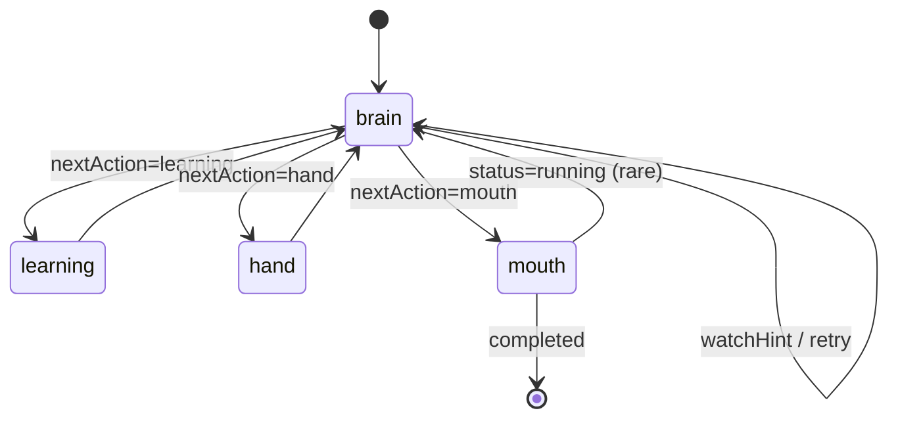

# NCurator-Desktop AI 实现规范

本文定义当前 `human-only` AI 实现边界。代码实现应优先对齐本文档。

## 1. 文档定位

- 本文只负责说明运行入口、节点职责、跨层边界与实现约束。
- 当需要确认字段、状态结构、事件内容或流转落点时，请阅读 `doc/ai-design/data-definition-and-flow.md`。
- 当需要查看真实运行样例时，请阅读 `doc/ai-design/example.md`。
- 当需要查看 `human` 的 skill 与 tool 组织方式时，请阅读 `doc/ai-design/human-skill-design.md`。
- 当需要查看 prompt 设计时，请阅读 `doc/ai-design/prompt-design.md`。

## 2. 全局不变量与技术约束

### 2.1 全局不变量

- `human` 是唯一执行核心。
- `AiRunService` 只负责 run 生命周期，不承担任务求解。
- `brain` 是 `human` 内唯一推理节点。
- `memory.stable` 只允许通过 `brain.updatedStableMemory` 局部 patch 修改。
- `execution.currentDecision` 只表示当前动作快照；正式过程历史由 `memory.history.roundHistory` 承接。
- `mouth` 只负责最终用户交付，不新增事实，不扩张 artifacts。
- `human` 的最终输出固定为最终用户答复，不再存在内部交接格式。

### 2.2 跨层边界

- run 入口只通过 `HumanTaskInput + emitAnswerEvents` 启动 `human`。
- run 入口只通过 `HumanTaskOutput` 收口最终结果，不读取 `HumanState` 内部字段。
- `human` 不直接改写 run state；run state 的 completed / failed / cancelled 由 runtime shell 统一整理。
- 需要新增跨层信息时，应先扩展稳定 contract，而不是直接穿透 `HumanState`。

### 2.3 技术约束

- `human` 的运行编排必须基于 `@langchain/langgraph` 的 `StateGraph`。
- `human` graph 的状态 schema 必须通过 `src/main/services/ai/human/state/schema.ts` 定义。
- 模型结构化输出必须统一通过 `ctx.chatStructured`。
- 面向最终交付的自由文本输出必须统一通过 `ctx.chatText`。
- `ctx.chatStructured / ctx.chatText` 的 transport、profile、streaming、fallback 与缓存属于 runtime 责任，不属于 node 责任。
- prompt 必须通过 `build*Prompt` 组织，不在 node 内联堆大段 prompt 文本。
- `learning` 与 `hand` 这类确定性节点默认不引入额外模型调用。
- 节点入口先执行取消检查，再进行模型调用、工具调用或状态写入。

## 3. Runtime Shell

- `AiRunService` 是 run 入口。
- 负责创建 `AiRunContext`、启动 `human`、处理取消、处理失败、整理 `AiRunState`。
- `AiRunService` 不做 route、context enrich、plan、plan exec 或 synthesis。
- run 成功时只回写 `finalDeliveryMarkdown` 与 `finalArtifacts`。

## 4. `human` 总览

- `human` 是 task 级 autonomous execution unit，负责把一个自然语言任务推进到完成或稳定阻塞。
- `brain` 负责决策，`learning` 负责装载 skill，`hand` 负责执行工具，`mouth` 负责组织正式交付。
- `human` 不依赖外部 orchestrator。

## 5. `human` 节点规范

### 5.1 `brain`

- 职责：`human` 内唯一推理节点，负责基于当前任务、稳定记忆、过程历史与收敛提示产出新的 `HumanDecision`。
- 主要读取：`task`、`memory.stable`、`memory.history.roundHistory`、`memory.history.loadedHistoryContext`、`execution.watchHint`、`skills.learnedSkillIds`、`ctx.referenceScope`、`ctx.workspace`。
- 主要回写：`memory.stable`、`execution.currentDecision`、`execution.stage`、`execution.watchHint`、`trace.steps`。
- 约束：输出必须通过 `ctx.chatStructured` 与 schema 校验；`memory.stable` 只能通过 patch 修改。
- 当前可直接调用的工具说明必须由 `registry -> tool spec` 统一供给；brain prompt 中的工具输入结构应来自 tool schema 的自动导出文本，并附带 tool spec examples。
- brain prompt 中的输出 shape 应直接来自 `humanDecisionSchema` 的自动导出文本；`readyToDeliver`、stableMemory patch、action 选择约束等语义规则继续手写维护，不单独定义 display schema。

### 5.2 `learning`

- 职责：装载本轮 `brain` 指定的 external skill，并更新已学习 skill 集合。
- 主要读取：`execution.currentDecision.nextAction.wantLearnSkillIds`、`skills.learnedSkillIds`、`skills.ts`、`skillLoader`。
- 主要回写：`skills.learnedSkillIds`、`execution.lastLearningOutcome`、`memory.history.roundHistory`、`execution.stage`、必要时 `execution.watchHint`、`trace.steps`。
- 约束：不调用模型；builtin skill 始终可用，不进入 learning。

### 5.3 `hand`

- 职责：承接 `brain` 已经明确决定的工具调用批次，执行并回写工具结果、过程历史与 artifacts。
- 主要读取：`execution.currentDecision.nextAction.toolUsePlan`、`skills.learnedSkillIds`、runtime cache 中已装载的工具、`memory.history.roundHistory`。
- 主要回写：`execution.lastToolResults`、`memory.history.roundHistory`、`memory.history.loadedHistoryContext`、`execution.artifacts`、`execution.stage`、必要时 `execution.watchHint`、`trace.steps`。
- 约束：不调用模型；`parallel` 只允许只读且并行安全的工具。
- tool 执行失败时，hand 应优先保留原始校验/运行时错误文本，并通过 `diagnostic.message` 回流给 brain 与历史渲染层；不要把错误再压缩成额外的预设分类。

### 5.4 `mouth`

- 职责：围绕 `task_goal` 把当前已经确定的状态组织成最终用户交付，并回写 `HumanResult`。
- 主要读取：`task`、`memory.stable`、`memory.history.roundHistory`、`memory.history.loadedHistoryContext`、`execution.currentDecision`、`execution.artifacts`。
- 主要回写：`result`、`execution.status`、`execution.stage`、`trace.steps`。
- 约束：模型输出必须通过 `ctx.chatText`；输出面向最终用户，优先直接完成用户原始诉求；可使用自由段落或列表组织，不要求固定报告模板；若开启 `emitAnswerEvents`，增量文本通过 `answer_token` 发出，完成后通过 `answer_completed` 收口。

## 6. 事件与交付

- 正式过程事件统一使用 `human_step`、`tool_call_*`、`watch_hint`、`file_artifact`、`draft_review_ready`、`answer_token`、`answer_completed`。
- 不再保留旧任务编排事件。
- `HumanTaskOutput` 只包含：
  - `taskId`
  - `status`
  - `summary`
  - `deliveryMarkdown`
  - `artifacts`
