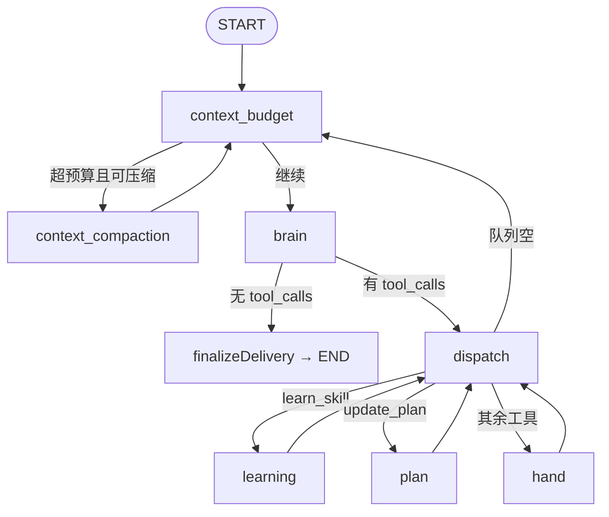
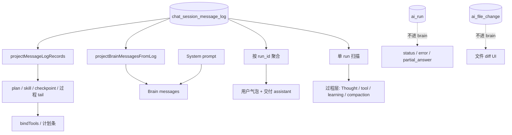

# Human Harness

human graph 的消息与上下文设计约束。修改 `src/main/services/ai/human/**` 的 graph、消息写入、投影、compaction、resume、brain 上下文时必读。

---

## 1. Graph 流转

human graph 是单次 AI run 的 LangGraph 编排；**每轮调主模型前必过 `context_budget`**。节点只通过 `AiRunContext.appendMessageLog` 写 transcript，通过 `HumanRuntimeCache.messages` 维护 brain 侧运行时消息序。

### 1.1 流转图



graph 从 `context_budget` 进入；首次进入才写本轮 `user`。

**循环主干**：`context_budget → brain → dispatch → (learning | plan | hand) → dispatch →（队列空）context_budget`。

### 1.2 节点职责

原则：**谁产出事实，谁写对应 log**（详见第 2.2 节「写入分工」）。

| 节点 | 调模型 | 写 log | 改 runtime cache |
|------|--------|--------|------------------|
| `context_budget` | 否 | 本轮首次进循环时写 `user`（压缩前也会写） | 判定 compaction；不拼消息 |
| `context_compaction` | 是（压缩模型） | `compaction_checkpoint`（含摘要） | **整段替换** messages 为 System + 合成 Compact User + tail 原文（第 5 节） |
| `brain` | 是（主模型） | `thinking_*`；**仅当有 `toolCalls`（或截断 / 内容安全）时写 `assistant`** | 有 tool 时 append assistant；**不** refresh build user |
| `dispatch` | 否 | 否 | 消费 `tool_calls` 队列，路由下一 stage |
| `learning` | 否 | `learning_*` + `tool` + **`skill_state_updated`** | 加载 skill 工具；**不**改 build user |
| `plan` | 否 | `tool` + `plan_updated` | 更新 state.plan；**不**改 build user |
| `hand` | 否 | `tool`（+ 可选 `images[]`）+ 审批后 `approval_batch_resolved` | append ToolMessage；`read_image` 后 append 多模态 HumanMessage |

交付收尾由 brain 内的 `finalizeDelivery` 完成（**不是**独立图节点）：docx/ppt 落盘 side effect → `finalizing_started` → 写交付 `assistant`（`toolCalls: []`）→ 立即 `answer_completed` / `run_completed`。下一轮同伙伴发送可立刻创建。
无 `tool_calls` 的正常交付路径上，**brain 不向 log 写 `assistant`**（流式 Answer 只走事件 / `partial_answer`）。

### 1.3 dispatch 路由

`dispatch` 是 **`tool_calls` 队列的唯一消费者**，严格按模型返回顺序处理：

| `toolName` | 目标节点 | 批处理 |
|------------|----------|--------|
| `learn_skill` | `learning` | 单次仅处理队首一条 |
| `update_plan` | `plan` | 连续同类 call 合并一批 |
| 其余 | `hand` | 连续同类 call 合并一批 |

`learning` / `plan` / `hand` 执行完后先回 `dispatch` 继续消费队列；**队列空**才 `stage → context_budget`（不是直接回 brain）。
`brain` 在 schema 校验前对全部 call 做 `normalizeToolCallArgs`；`learn_skill` / `update_plan` 的参数校验由各节点负责。

### 1.4 启动与 cache 初始化

新 run 启动时：

1. 读 `chat_session_message_log` → `projectMessageLogRecords` 得 tail + plan + `compaction_checkpoint` / `historyFloorSeq`。
2. 拼 runtime messages：`[System] + projectBrainMessagesFromLog(...)`。
3. `graph.invoke` 从 `context_budget` 进入循环；首次进循环时把本轮 `user` 写入。

### 1.5 runtime cache 要点

| 字段 | 用途 |
|------|------|
| `messages` | brain 请求的 LangChain 消息序 |
| `currentUserMessageIndex` | 当前 run 的 build user 下标（同 run refresh；resume 时为末尾） |
| `currentUserLogAppended` | 本 run 是否已写 log `user` |
| `lastBrainInputTokens` | 预算估算；compaction 后需 fresh usage |

Conversation 行（`user` / `assistant` / `tool`）进 `cache.messages` 只经 `messagesFromLogEntries`，与新 run 投影同一入口。System、Compact User、当前 build User 除外。禁止 push 流式 AIMessage；`context_budget` 已写入的 log `user` 不得再投影一遍。

---

## 2. 数据源

human harness 涉及的数据从哪来、到哪去。只有 **`chat_session_message_log`** 是 transcript 真相源（表名保留，行挂 `partner_id`）；其余存储与运行时注入见各小节。

### 2.1 总览

数据源写入与消费方总览见 [`doc/architecture.md`](../architecture.md) 「AI 运行时」「AI 数据源与消费方」。

- **伙伴消息记录**走 human harness。Composer 已删除搜索模式；不存在 `chat_search_turn`。
- **实现**：UI 对话轮次由 `chat_session_message_log` + `ai_run` 投影；技能由 `skill_state_updated` annotation 投影。

### 2.2 Transcript：`chat_session_message_log`

append-only 伙伴消息转录；模型上下文、UI、resume 均由此投影。Compaction 与 resume **只读、不改**已有行。

**表字段**

| 列 | 含义 |
|----|------|
| `partner_id` | 所属伙伴 |
| `run_id` | 写入时所属 AI run |
| `seq` | 伙伴内单调递增；`compaction_checkpoint.throughSeq` / 投影按 `seq` |
| `entry_json` | `ChatMessageLogEntry` |
| `created_at` | 写入时间 |

**写入入口**：graph 节点 → `AiRunContext.appendMessageLog` → `ChatMessageLogStore.appendBatch`（同 batch 内 `seq` 连续分配）。

#### 四种 `kind`

| `kind` | 存什么 | 谁写 |
|--------|--------|------|
| `user` | 发给模型的 build 全文 + `context` | **`context_budget`**（本轮首次进 brain；压缩前也会写） |
| `assistant` | 文本 + `toolCalls[]`（交付另含 `linkAccess`） | **brain**（过程决策 / 截断 / 内容安全 fallback）或 **`finalizeDelivery`**（正常交付）；**同一轮交付正文不叠写** |
| `tool` | 工具反馈正文 + 可选 `images[]` | **`hand` / `plan` / `learning`**（执行结果；不写 assistant） |
| `annotation` | 过程与状态事件 | 见下表 |

#### `annotation` 事件

| `eventType` | `payload` | 投影用途 |
|-------------|-----------|----------|
| `thinking_started` / `thinking_completed` | `{}` | UI 过程层 |
| `learning_started` / `learning_completed` | `{ skillId }` | UI 过程层 |
| `skill_state_updated` | `{ learnedSkillIds: string[] }` | 同 run 只驱动 bindTools；新 run 从图启动扫描该伙伴剩余 log 最新一条 |
| `plan_updated` | `{ plan: [{ title, status }] }` | UI 计划条；新 run 从图启动扫描该伙伴剩余 log 最新一条 |
| `compaction_checkpoint` | `{ compactBlockId, throughSeq, sourceMessageCount, summary }` | 压缩书签 + 摘要正文；`seq <= historyFloorSeq` 的原文不再进 brain；发给主模型时再合成 Compact User |
| `finalizing_started` | `{}` | 投影时**清空** plan |
| `approval_batch_resolved` | `{ batchId, items: [{ toolCallId, toolName, command, commandExplanation?, action, message? }] }` | UI Activity：走过审批的工具行图标 / 悬停揭示文案；`hand` 在审批决策后写入 |

#### `entry_json` 示例

**`user`** — `content` 是发给模型的 build 全文；`input` 是人打的字。只表示人说的那次。气泡文案用 `ai_run.input`，不读 `content`。

```json
{
  "kind": "user",
  "content": "用户诉求：\n按模板写本周周报，不要封面页。",
  "input": "按模板写本周周报，不要封面页。",
  "context": {
    "selectedReferences": [
      {
        "kind": "file",
        "name": "周报模板.docx",
        "absolutePath": "/Users/me/workspace/周报模板.docx",
        "kbAvailability": "indexed",
        "kbDocumentIds": ["doc-abc"]
      }
    ],
    "attachments": []
  }
}
```

**`assistant`（过程）** — brain 在有 `toolCalls` 时写入；`toolCalls` 非空。按模型顺序写原始 `args`（schema 失败也不得写成 `{}`）。

```json
{
  "kind": "assistant",
  "content": "我先读取模板结构，再写入本周内容。",
  "toolCalls": [
    {
      "id": "call_01",
      "name": "learn_skill",
      "args": { "skillIds": ["docx-read"] }
    }
  ]
}
```

**`assistant`（交付）** — 仅 `finalizeDelivery`（或内容安全 fallback）写入；`toolCalls` 为空数组；正常交付含 `linkAccess` sidecar（不改写 `content`）。

```json
{
  "kind": "assistant",
  "content": "结论见 [周报模板](/Users/me/workspace/周报模板.docx)。",
  "toolCalls": [],
  "linkAccess": [
    {
      "href": "/Users/me/workspace/周报模板.docx",
      "resourceType": "file",
      "accessStatus": "accessible"
    }
  ]
}
```

**`tool`** — 模型可见的工具结果文本；图片只存 ref，不存 Base64。

```json
{
  "kind": "tool",
  "toolCallId": "call_02",
  "toolName": "docx_read_nodes",
  "ok": true,
  "content": "<file path=\"/Users/me/workspace/周报模板.docx\">…</file>",
  "images": [
    {
      "path": "/Users/me/AppData/Roaming/ncurator/partners/{id}/runtime/assets/read_image-cache/abc…-v1.webp",
      "mimeType": "image/webp",
      "sizeBytes": 81920,
      "width": 800,
      "height": 600
    }
  ]
}
```

**`annotation` 示例**

```json
{ "kind": "annotation", "eventType": "skill_state_updated", "payload": { "learnedSkillIds": ["docx-read", "docx-write"] } }
```

```json
{
  "kind": "annotation",
  "eventType": "plan_updated",
  "payload": {
    "plan": [
      { "title": "读取模板与上周周报", "status": "done" },
      { "title": "写入本周周报并落盘", "status": "todo" }
    ]
  }
}
```

```json
{
  "kind": "annotation",
  "eventType": "compaction_checkpoint",
  "payload": {
    "compactBlockId": "550e8400-e29b-41d4-a716-446655440000",
    "throughSeq": 42,
    "sourceMessageCount": 18,
    "summary": "## 目标\n…"
  }
}
```

#### 写入分工与闭环

按「谁产出事实，谁写」落库；**禁止**为对称在多个节点重复写同一语义正文（尤其正常交付不得 brain + `finalizeDelivery` 各写一条空 `toolCalls` 的 `assistant`，否则续跑会出现连续重复 AI）。

| 节点 / 步骤 | 写入 `kind` / `eventType` | 说明 |
|-------------|---------------------------|------|
| `context_budget` | `user` | 本轮首次进循环时写 **build 全文**（`content`）与人打的字（`input`）；压缩前也会写；brain **不**写 `user` |
| `brain`（有 tool_calls） | `thinking_started` → `assistant`（含 `toolCalls`）→ `thinking_completed` | 固化主模型过程决策；须在 hand/plan/learning **之前**落库 |
| `brain`（正常交付） | `thinking_started` → `thinking_completed` | **不**写 log `assistant`；Answer 草稿仅事件 / `partial_answer` |
| `brain`（截断） | 半截 `assistant` | `finish_reason=length`：先写再失败，可 resume |
| `brain`（内容安全） | `assistant`（`toolCalls: []`） | fallback 交付；走 `completeDelivery`，**不**再经 `finalizeDelivery` 叠写 |
| `dispatch` → `learning` | `learning_started` → `tool`（`learn_skill`）→ `learning_completed` → **`skill_state_updated`** | 成功写完整 `learnedSkillIds`；重复学习 / 失败只写 `tool` |
| `dispatch` → `plan` | `tool`（`update_plan`）+ `plan_updated` | 参数合法时同批写；**不**写 assistant |
| `dispatch` → `hand` | `tool`（+ 可选 `images[]`） | 每个 call 一条；审批拒绝写失败 `tool`；**不**写 assistant |
| `context_compaction` | `compaction_checkpoint` | 书签 + 摘要正文；发给主模型时再合成 User |
| `finalizeDelivery` | `finalizing_started` → `assistant`（`toolCalls: []` + `linkAccess`） | 正常交付正文的**唯一** writer（落盘与链接访问检查之后）；清空 plan 投影 |

```text
用户发送
  → context_budget ──→ user（首次进 brain）
  → brain
       ├─ 有 tool_calls ──→ thinking_* + assistant(toolCalls)
       │     → dispatch → learning / plan / hand ──→ tool + annotation
       │     → context_budget → brain（循环）
       └─ 无 tool_calls ──→ thinking_*（不写 assistant）
             → finalizeDelivery ──→ finalizing_started + assistant（交付）
  → context_compaction ──→ compaction_checkpoint
```

同一次 `appendMessageLog([…])` 可 batch 多条（如 `plan` 的 `tool` + `plan_updated`），共享连续 `seq`。

### 2.3 Run 编排：`ai_run`

单次 AI run 的生命周期与 UI 运行态；**不是 transcript**，不参与 brain 上下文投影。

| 字段（要点） | 用途 |
|--------------|------|
| `status` | `running` / `waiting_approval` / `completed` / `failed` / `cancelled` |
| `input` | 本轮用户输入原文 |
| `partial_answer` / `partial_answer_role` | 流式 UI 草稿；**不参与** resume 与下次 brain |
| `final_answer` / `error` / `failure_code` / `failure_raw_message` | 终态展示（短标题 + 原文详情） |
| `pending_approval` | 等待批量审批 |
| `artifacts` | run 级产物引用（Workbench 展示） |
| `selectedReferences` / `attachments` | run 创建时 Composer 快照（与 log `user.context` 对应） |

**写入**：`ChatRunService` 创建/更新 run。
**读取**：Renderer 伙伴 snapshot、`activeRuns`、审批 UI。
**与 log 关系**：同一 `run_id` 关联 log 行；resume 时新建 run，读**该伙伴** log 投影（`historyFloorSeq = compaction_checkpoint.throughSeq ?? -1`，只保留 `seq > historyFloorSeq`）。

### 2.4 文件域：`ai_file_change`

工具写文件产生的修改记录与 diff artifact；服务 Workbench 预览、红绿 diff、回退。

| 字段（要点） | 用途 |
|--------------|------|
| `run_id` / `partner_id` | 归属 |
| `path` / `fileName` / `operation` | 文件身份与操作类型 |
| `capability` | `text_file` / `docx` / `ppt` / `terminal_exec` 等（`source` 才是 `terminal_tool`） |
| `status` | `applied` / `failed` / `reverted` 等 |
| `changeCount` / `insertCount` / `deleteCount` | 改动统计 |
| `previewArtifactHash` 等 | diff 预览对象 |

**不进 brain prompt**；工具结果摘要已在 log 的 `tool.content` 中。
**run 失败不丢记录**：已 `applied` 的修改保持，供 Workbench 展示与回退。

### 2.5 运行时注入（不进库）

新 run 的参考资料和附件来自 **Composer 当前 `@` 引用与附件**，由 `buildBrainUserMessage` 分别渲染进 build user 的「用户@的参考资料」「用户添加的附件」段。工作地址列表不进这两段，单独渲染为 build user 的「默认工作区」（位于资料段之上），按设置页现表快照，不进 System。

| | log 里的 `user.context` | Composer → build user |
|--|-------------------------|------------------------|
| 作用 | 审计「当时用户说了什么、配了什么」 | 驱动**当前 run** brain 输入 |
| 同 run | 首条 build user 的资料段 | 来自发送时 Composer（仅 `@` 与附件） |
| resume | 每条 log `user` 各存各的 snapshot | **append** 新 build user 在末尾；资料段用**当前** Composer |

---

## 3. 投影设计

只投影 **`chat_session_message_log`**。已经压进摘要的旧对话，主模型不再看到原文；还没处理掉的 `user.content` 原样发给模型。本轮新 User 由 `buildBrainUserMessage` 构造后 append。

投影分两路：`projectMessageLogRecords` 产出 plan / skill / checkpoint / 过程 tail（**过滤掉 user**）；`projectBrainMessagesFromLog` 再拼 Compact User、历史 build user 与本轮 build user。

`historyFloorSeq = compaction_checkpoint.throughSeq ?? -1`，只投影 `seq > historyFloorSeq`。graph 再拼 System。前缀缓存 / Compaction / Resume 见第 4–6 节。

**组装路径**：

| 时机 | 谁拼 messages | 形态 |
|------|---------------|------|
| **新 run / resume 启动** | `projectBrainMessagesFromLog` + graph 包 System | `[System] + [Compact User]? + [seq > historyFloorSeq 原文] + [Current User]` |
| **同 run 刚压完** | `projectBrainMessagesFromLog`（`appendCurrentUser=false`）+ graph 包 System | `[System] + [Compact User]? + [seq > historyFloorSeq 原文]`；本轮 user 若 `seq > throughSeq` 出现在原文里，不再末尾 append 一条 |



### 3.1 投影产物

| 产物 | 消费方 | 规则 |
|------|--------|------|
| Brain messages | 主模型 | 第 3.2–3.3 节；第 4 节缓存；第 5–6 节边界事件 |
| UI 对话轮次 | Renderer | 按 `run_id` 聚合 log 中的 `user` + 交付 `assistant` |
| UI 过程层 | Renderer | 单 run 的 log → `projectProcessGroups`（第 3.4 节） |
| 历史 user 审计 | UI / 测试 | log 中 `user` 条目（含 `context` 快照） |

### 3.2 Brain messages 标准形态

发给模型的消息由 **System + 若干 User（log `content`）+ 过程（assistant/tool）** 组成。log 里每条 `user.content` 就是当时发给模型的全文。

**同 run 内（稳态）**——单条 User 紧跟 System，过程在其后：

```text
[System]
[User]                ← 本 run 的 build 全文；同 run 内不改
[Assistant / Tool …]  只许末尾 append
```

**跨 run resume**——在已有历史末尾再 append 一条新 User；不替换、不改写前面的 User 与过程（第 6 节）。

```text
[System]
[User]                ← run-1 的 build 全文（log content，保持不变）
[Assistant / Tool …]  run-1 过程
[User]                ← run-2 续发，append 在末尾
```

| 段 | 含义 |
|----|------|
| System | 系统提示 |
| User（人说的） | log `user.content`；当时的 build 全文。图里叫 `[History User]` / `[Current User]` |
| User（Compact User） | 投影时由 `compaction_checkpoint.summary` 套 `<summary>` 外壳合成；不是 log user |
| 过程 | assistant / tool / 多模态合成 HumanMessage |
| User（续发） | 新 run 末尾 append 的 build 全文 |

**build user 块**（各字段来源见第 3.3 节；`偏好` / `默认工作区` / `用户@的参考资料` / `用户添加的附件` 无内容时整块省略）：

```text
用户诉求：
…

偏好：
…          ← 仅非 default

默认工作区：
…          ← 仅有工作地址时

用户@的参考资料：
…          ← 仅有 @ 时

用户添加的附件：
…          ← 仅有附件时

当前时间：
…
```

**稳态行为**（同 run、未触发 第 5–6 节）：

- 首次 brain：`[System, User]`，过程为空；log 写入这条 `user` 的 content。
- brain → 工具 → 再 brain：过程末尾 append；**当前 User 一字不改**（技能/计划只在 tool 结果与 `bindTools` 中可见）。
- 前缀 `[System, User, …已发送过程]` 字节序不变 → 第 4 节缓存命中。System **跨 run 稳定**（无 `current_time`）。

### 3.3 稳态投影规则

从 log 投影发给模型的数组（**新 run / resume 启动**路径；同 run 压完见第 5 节 runtime 替换）。

**怎么拼发给主模型的数组**（新 run / resume 启动；同 run 压完见第 5 节）

1. 取出这个伙伴的消息 log，按 `seq` 排序。
2. `historyFloorSeq = compaction_checkpoint.throughSeq ?? -1`。
3. 只保留 `seq > historyFloorSeq`。有 checkpoint 则先合成 Compact User。
4. 其余 conversation 行走 `messagesFromLogEntries`（第 1.5 节；图片见第 3.5 节）。
5. 末尾加上这一次的 `buildBrainUserMessage`。
6. `repairInterruptedToolCalls`：每个 AIMessage 的 `tool_call_id` 若无对应 ToolMessage，插入
   `Error: The run was interrupted before this tool call could be executed.`

**build 各块**

| 块 | 来源 |
|----|------|
| `用户诉求` | 当时那条 User 对应 run 的 `input` |
| `偏好` | 当时 Composer；`default` 时整块省略 |
| `默认工作区` | 当时设置页工作地址现表（发送时快照；不进 System，以保护 System 缓存）；空列表时整块省略 |
| `用户@的参考资料` | 当时 Composer 的 `@`（第 2.5 节）；空时整块省略 |
| `用户添加的附件` | 当时 Composer 的附件（第 2.5 节）；空时整块省略 |
| `当前时间` | 当时 run 的 `runStartedAt`（历史行不再改） |

annotation 扫描该伙伴**全部**剩余 log（不受 `historyFloorSeq` 限制）：技能从最新 `skill_state_updated` 恢复。计划仍按 `plan_updated` / `finalizing_started` 扫描。清空消息记录会物理删除 log，因此技能 / 计划不会从已删除的历史恢复。

**组装**

- **同 run 首次 brain**：`[System] + [User]` + 过程（可空）。
- **同 run 后续 brain**：当前 User 不变；过程 append。
- **compaction**：同 run 走 runtime 替换；新 run 走 log 投影（第 3 节两条路径、第 5 节）。禁止 System 后面直接接 AI/tool。
- **resume**：新 run 启动投影后再 append 本轮 User（第 6 节）。
- **清空消息记录之后下次发送**：log 为空，没有可拼的会话，`[System] + [Current User]`。

**同 run 刷新**：固定 `currentUserMessageIndex`；compaction 整段替换见第 5 节。

**投影不做的事**：`ai_run.partial_answer`、`ai_file_change` 不进 brain。新 User 不抄 Compact User。`seq <= historyFloorSeq` 的原文不会和 Compact User 一起再发一遍（可与 **retained** 原文 User 并排，见第 5 节）。

### 3.4 UI 投影

UI **不读** `ai_run.partial_answer` 作历史；对话与过程均从 log 投影。AI 伙伴气泡由 `projectAiConversationMessages` 生成。不存在搜索模式轮次。

#### 对话轮次（按 run 切分）

| UI 元素 | log 来源 | 规则 |
|---------|----------|------|
| 用户气泡 | `ai_run.input`；该 run 的 `user` 行只提供时间与 `context` | 不展示 `user.content`（那是模型稿）；Compact User 不当气泡 |
| 助手气泡 | 该 run 最后一条交付 `assistant`（`toolCalls: []`） | 经 `finalizeDelivery` 写入；展示 Markdown 正文 |
| 运行态 / 错误 | `ai_run` | `status`、`error`、`failure_code`、`failure_raw_message`、审批、流式草稿 |
| 文件改动 | `ai_file_change` | Workbench diff / 回退；不进对话正文 |

同一伙伴多 run：按 `run_id` + `seq` 排序；resume 产生新 run，用户可见**多条** user 气泡，对应 brain 侧多条 build user（第 6 节）。

#### 过程层（单 run）

`projectProcessGroups({ runId, records })` 扫描**该 run** 的 log 记录（使用 `seq` / `createdAt` 保证顺序与时间基）：

| log 信号 | UI 过程组 |
|----------|-----------|
| `thinking_started` … `thinking_completed` 之间的 `assistant` | Thought 文本流（`processThoughts`） |
| `compaction_checkpoint` | compaction 组（单独成行） |
| `tool`（排除 `update_plan`；**含** `learn_skill`） | tool 组；展示 toolName + 入参 snapshot；两次 Thought 之间在 UI 合并为 Activity 面板 |
| `plan_updated` | 计划条（非过程组；run snapshot 扫描 annotation） |
| `finalizing_started` | 清空计划条（不渲染过程层） |
| `learning_started` / `learning_completed` | 仅 harness / 状态注解；**不**投影为独立学习过程组 |

`update_plan` **不出** tool 过程组。`learn_skill` 与其它工具一样进入 Activity。

Live 运行中的 Thought 由 `assistant_process_thought` 事件写入 `processThoughts`（不依赖中途重投影 log）；凡 brain 本轮有正文且带 tool_calls（含全部不可执行），都必须发出该事件，避免流式缓冲被下一轮清空后正文从 UI 消失。伙伴恢复时再由 log 投影补齐。

#### 流式与终态

- brain 流式：`assistant_brain_stream_*` 事件；收到 tool 分片后归类为 Thought。
- 无 tool_calls 且流正常关闭 → Answer，触发 `finalizeDelivery`。
- 网络中断等：草稿仅 `ai_run.partial_answer`；**不进 log、不参与 resume**（第 6.5 节）。

### 3.5 多模态投影

图片**不进 ToolMessage**；log 的 `tool.images[]` 只存路径引用，brain 请求前再投影。

#### 写入（hand / read_image）

1. 工具执行成功 → `buildModelToolResultDelivery` 得文本 → 写 log `tool`（`content` + 可选 `images[]`）。
2. runtime cache：同一批 log `tool` append 进 `cache.messages`（第 1.5 节；有图则紧随 ToolMessage 之后）。
3. `read_image`：本地源按 SHA-256 缓存为 `userData/partners/{id}/runtime/assets/read_image-cache/<hash>-v1.webp`；log 存缓存路径 ref。

#### 读路径（发给主模型）

`projectMessagesForMainModel(messages)` 在每次 brain 请求前执行：

1. 扫描含 `ncurator-image-ref:` 的多模态 HumanMessage。
2. 本地路径 → 临时读盘转 `data:` URL；`http(s)` 保留原 URL。
3. **配额裁剪**（减少前缀抖动）：
   - 最多保留 **600** 张 inline 图；
   - 本地 data URL 估算体积最多 **20 MiB**；
   - 数量超限：从最旧起按 ≥20 张批次 evict；
   - 体积超限：一次至少释放 10 MiB。
4. 被 evict 的位置保留文本占位，提示可再调 `read_image`。

log 投影 tail 时：`tool.images[]` 在对应 ToolMessage **之后** flush 为多模态 HumanMessage（与 runtime 一致）。

#### 约束摘要

| 项 | 值 |
|----|-----|
| `read_image` 单次 | 1–10 路径 |
| 源图上限 | 20 MiB / 8192 边 / 6400 万像素 |
| 请求图上限 | 64 万像素 / 1 MiB（webp 转换后） |
| ToolMessage 携带图片 | **不支持**；必须合成 HumanMessage |

---

## 4. 前缀缓存

主模型 provider 的前缀缓存要求：**多次请求中，已发送的前缀字节序一致**。
human harness 通过 **过程只 append、resume 只 append 新 User（历史 User 取 log `content`）、System 不含易变时间** 满足这一点。

### 4.1 什么算「前缀」

一次 brain 请求里，**本轮新内容之前**的全部消息，例如：

```text
[System] + [User built₁] + … + tail 已发送段 + （resume 时已有的 User built₂ 之前）
```

- System 跨 run **字节稳定**（platform / paths / 技能目录；**不含** `current_time`）。
- tail 只许 **末尾 append** assistant/tool（过程 `toolCalls.args` 见第 2.2 节）。
- 同 run 内：**不改** 当前 build user；「当前时间」取本 run `runStartedAt`。
- resume：**append** 新 User 在整段末尾；历史 User / 过程 **一字不改**（来自 log `content`）。

### 4.2 稳态下如何保持命中

| 操作 | 对前缀的影响 |
|------|--------------|
| brain → hand → 再 brain | 已发送段不变；tail 末尾 append；当前 build user 不变 |
| `update_plan` / `learn_skill` | 只改 state + tool 结果 + bindTools；**不改** build user |
| **resume** | 历史段 **不变**（log content）；末尾 **append** 新 User（第 6 节） |

### 4.3 打破前缀缓存的操作

仅 **Compaction**（第 5 节）改写已建立的前缀。Compaction：合成 Compact User，被折掉的消息从 runtime 去掉，`seq > historyFloorSeq` 的原文留下——**可含多条边界 User，因而可与 Compact User 并排**。压完当次 brain 前缀 miss；之后只 append 可再命中。

**resume / learn_skill / update_plan 不属于打破**：resume 只在末尾追加；同 run 内技能与计划不改写 user。
设计约束：除 compaction 外，不得 rewrite 已发送的 User 与过程。

---

## 5. Compaction

进入 brain 前，因上下文预算触发。执行后 **整段替换** runtime messages 为 `[System, Compact User, …tail]`，并 **打破第 4 节前缀缓存**。

`historyFloorSeq = compaction_checkpoint.throughSeq ?? -1`。

三个判定分开：

- **渲染进 `<conversation>`：要。** Compact User 从 floor checkpoint 读出，按 conversation 里的一条 `[user]` 渲染。
- **切点：不算。** Compact User 不是 log 行；真 User 只认 `kind === 'user'`。避免残留 AI/tool 被当成「这一轮」而把整份文本送进半截压缩。
- **`hasCompressibleCompactionHistory`（防空转）：不算 synthetic。** 可见 log 行里去掉 tail 之后若没有 `user|assistant|tool`，不调压缩模型。

**并排是正式规则**（摘要占位 + 切点后原文保留）。tail 含边界 User 时出现 `[Compact User][History User]`；半轮切点把该轮 User 折进摘要时则是 `[Compact User][AI/Tool…]`。禁止的是「摘要与 **已被压进 Compact User** 的全文」同时发送，不是禁止与 retained User 相邻。Compact User 只在发给主模型时合成，不是 log `user`。新 run 续发时新 User 只在末尾 append。压完 runtime 是 `[System] + [Compact User] + tail`，下次再压只见 Compact User。

### 5.1 触发

`context_budget` 节点判定（默认窗口 256k token）：

- 预算 > 窗口 × **80%**（`CONTEXT_COMPACTION_TRIGGER_RATIO`）。没到线不压。有真实 brain usage 时用 `usage + delta`；compaction 后需等下一轮真实 usage（`post_compaction`）。
- 去掉从末尾留下的 tail 之后，还剩更早的原文可折。folded 里若只有 Compact User、没有别的原文，视为不可折，避免空转。
- 仅当前 build user 自身超窗 → `input_too_long`，不 compaction、不写 log user。
- 无 LLM usage 时 brain 发 `run_warning`（`code: llm_usage_unavailable`），预算改用消息 token estimate；estimate 超触发线且有可折历史时仍可 compaction。
- 去掉 tail 后没有可折内容，或单组已大于 keep 且前面没有可折跨度 → 不压。

### 5.2 Tail 切点

只认伙伴 log。可见行：`seq > historyFloorSeq` 且 `kind` 为 `user | assistant | tool`。已压进 checkpoint 的原文不再进压缩模型。按 **组**（一条 `user` 一组，或一条 `assistant` 带上紧随的 `tool`，含挂在 tool 上的图）从末尾往回累加 token；一条 `tool` 若带 `images[]`，按「ToolMessage + 图片 Human」估，与 `messagesFromLogEntries` 一致。

- 额度：`floor(触发线 × 10%)`（`CONTEXT_COMPACTION_TAIL_RATIO`）。生产窗口 256k 时触发 204_800、tail 20_480。测试 / live 只 override 窗口，tail 由同一比例算出。历史压缩无上限。
- 真 User = `kind === 'user'`。图片不是 log 行，Compact User 不是 log 行，都不能当切点。碰到 User **不停**（整组可留在 tail）。
- 切断必须落在完整组上，禁止拆开一对 tool_call / result。单轮自己大于 keep 时允许切在轮中间（split）。
- 刀落在 `user`：只做历史压缩（该 user 起为 tail）。刀落在 `assistant|tool`：往前最近 `user` 到刀 = 当前轮压缩；再往前 = 历史压缩。
- 压缩对象是切点之前的那一段。按消息顺序拼成纯文本：一轮内部不要空行；只在下一轮 `[user]` 前空一行。User 原文整段进去。这里的 tool 正文 **从头 2000 字符**；主模型 tail 里的 tool **不截**。已有 Compact User 从 floor checkpoint 读出，作为历史压缩 `<conversation>` 里的一条 `[user]`，没有单独标签。
- 切点落在一轮中间时：**两次**压缩。第一次压该轮 User **之前**的历史；第二次压该轮被切掉的前半（含 User）。无更早历史则第一次省略。已有 Compact User 时，旧摘要作为 conversation 里的一条 `[user]` 送进历史那次，不再使用 `<previous-summary>`。

### 5.3 执行

1. `context_budget` **先** append 本轮 `user`（若尚未写入），再 load 伙伴 log 判断有无可折、是否 compact。当前 User 必须已经在 log 里再切。
2. 压缩模型：system 只锁角色（不要继续对话，只出摘要）。格式指令在 user 侧。切点前的原文进 `<conversation>`。历史压缩只用六栏提示词；半截压缩用三栏提示词。不要 `<previous-summary>`。各栏保持简短，保留精确路径、函数名和报错原文。
3. **先**算 `throughSeq`（全量 log 里 `< firstKept.seq` 的最大 seq，可以是 annotation；tail 为空时取全量最大 seq）。对不上则 **硬停** `compaction_bookmark_unresolved`：不调压缩模型、不发 started、不写 checkpoint。
4. 再调压缩模型；只 append **一条** `compaction_checkpoint`（`throughSeq`、`summary` 等）。`summary` 是压缩模型原文，不含英文外壳。`context_compaction_started` / `completed` 带切点：`throughSeq`、`firstKeptSeq`、`historyFloorSeq`、`historyFloorKind`（`compaction` / `none`）、`isSplitTurn`、`foldedCount`、`tailCount`。`targetMessageCount` / `sourceMessageCount` 仍等于 `foldedCount`。
5. 写完 checkpoint 后整段重投影：`projectBrainMessagesFromLog({ appendCurrentUser: false })`，再 `[System, …projection]`。同 run 压完时本轮 user 已在 log：若它 `seq > throughSeq` 会出现在 tail；若半截把它折进摘要，则不会再投影出来，也不得再 append 一条当前 User。
6. `stage → context_budget`（与图边 `context_compaction → context_budget` 一致），再由 budget 进 brain。同 run 过程继续 `appendLogEntriesToCache`，不每次全量重投影。

压缩 system：

```text
你是上下文摘要助手。阅读用户与 AI 助手之间的对话，按指定格式输出结构化摘要。

不要继续对话。不要回答对话里的任何问题。只输出结构化摘要。
```

历史栏目（示意；实现侧每栏有更细填充说明。旧 checkpoint 作为 conversation 里的 `[user]` 一起压）：

```text
## 目标
## 约束与偏好
## 进度
### 已完成
### 进行中
### 阻塞
## 关键决策
## 下一步
## 关键上下文
```

半轮前缀栏目：

```text
## 原始请求
## 前期进展
## 后缀所需上下文
```

空栏目写「无」（部分栏提示词写明「若没有则写无」）。各栏简短；保留精确路径、函数名和报错原文。

半轮落库的 `summary`：

```text
（历史摘要或「无更早历史」）

---

**Turn Context (split turn):**

（前半轮摘要）
```

Compact User 外壳（发给主模型时套上，不入库）：

```text
The conversation history before this point was compacted into the following summary:

<summary>
…
</summary>
```

### 5.4 示例

**整轮保留在 tail**（常见；允许并排）：

```text
压缩前：
[System]
[User1][AI][Tool]
[User2][AI][Tool]…   从末尾按组累加到 keep

压缩后：
[System]
[Compact User]   外壳 + 摘要
[User2][AI][Tool]…  tail（可含边界 User）
```

**半轮切点**（该轮 User 进摘要；checkpoint 后直接过程）：

```text
压缩后：
[System]
[Compact User]   含历史六栏 + Turn Context
[AI][Tool]…         该轮后缀（无该轮原始 User）
```

log 行 append-only 保留；`seq <= compaction_checkpoint.throughSeq` 的行不再进入下次 brain 投影。新 run 再发时走第 3 节「新 run」路径：Compact User + retained 原文 + 末尾新 User。

---

## 6. Resume 机制

上一 run 未正常完成；用户在同伙伴 **继续发送消息**。不自动重试 failed run，**新建 run**，在**已有历史末尾 append 新 User**。

### 6.1 触发

用户停止、网络错误、超时、`process_interrupted`（重启）、`output_truncated`、`runtime_limit`、其他失败。
重启：`failInterruptedRuns` 标记活动 run，不自动调模型。

### 6.2 核心规则

1. **log**：进 brain 前 append 新 `user` 行（`content` = 当次 build 全文；`input` = 人打的字；含 Composer `context`）。
2. **brain**：在已有历史末尾 append 新 User（新 run 的 input + Composer + 本 run `current_time`）；**不替换**前面的 User，**不改写**中间过程。
3. 历史 User = 对应 log 行的 `content`。
4. 新诉求只出现在 **末尾** 那条 User 的「用户诉求」段。新 User 不抄 Compact User。
5. 符合 第 4 节：历史前缀不变 → 缓存可命中；打破前缀的是 compaction。
6. **tools**：`bindTools` 按该伙伴剩余 log 最新 `learnedSkillIds` 重绑，不是冻住进程内 tool 对象。

### 6.3 示例

**续跑前**（run-1 中断后）：

```text
[System]                 ← 无 current_time
[User]         content=当时 build 全文
[Assistant]    …（含未闭合 tool_calls 时由 repair 补 ToolMessage）
[Tool]         …
[Tool]         Error: The run was interrupted…
```

**续跑后**（用户发送「继续把周报写完」）：

```text
[System]                 ← 与续跑前一致
[User]         …         ← log content，不替换、不重算
[Assistant]    …
[Tool]         …
[Tool]         Error: The run was interrupted…
[User]         用户诉求=继续把周报写完                  ← append
               当前时间=本 run
```

log 侧（示意）：

```text
seq …  user      content=用户诉求：…
seq …  assistant / tool / …
seq N  user      content=用户诉求：继续把周报写完…
```

压过后再说话：

```text
[System]
[Compact User]         由 summary 合成外壳 + <summary>
[User / Assistant / Tool …]   seq > historyFloorSeq 原文（可空；可与 Compact User 并排）
[Current User]         新任务                                 ← append
```

### 6.4 构建步骤

1. 从 log 投影：`seq > historyFloorSeq` 的 `user / assistant / tool`；有 compaction checkpoint 则先合成 Compact User。
2. System 重渲染但内容跨 run 稳定。
3. append 新 User = `buildBrainUserMessage`（新 `input`、当前 Composer、本 run `current_time`）。
4. `context_budget` 将本轮 human user 写入 log（若尚未写入；压缩前也会写）→ brain 或 compaction。
5. `buildAvailableTools(learnedSkillIds)`：从最新 `skill_state_updated` 恢复技能后绑定工具。

### 6.5 边界

| 情况 | 行为 |
|------|------|
| 多次 resume | 每次 append 新 build user 在末尾；首条 `User built₁` 保留原始用户诉求 |
| `output_truncated` / `runtime_limit` | 可继续；半截 assistant 已在 log/tail |
| `input_too_long` | 不写 log user，不调 brain |
| 编辑重发 | 删除该 `runId` 的 `ai_run` 与全部 message log。已写入文件与 `ai_file_change` 不回滚 |
| 伙伴隔离 | 只读本伙伴 log |
| `partial_answer` | 仅 UI 草稿，不参与 resume |
| 已落盘文件 | `ai_file_change` 不因 run 失败丢失 |

---

## 7. Skill 与 Plan

### 7.1 概念

| 概念 | 含义 |
|------|------|
| **Skill** | 能力包；`builtin` 默认可 bind；`external` 需 `learn_skill` 后才进入 bindTools |
| **Tool** | 具体执行入口；归属一个或多个 skill |
| **agent-control** | 内置 skill，承载 `learn_skill`、`update_plan`、`read_image` |

skill / tool 的 prompt **只声明边界**，不写固定调用顺序（细节见 `tool-design.md` 第 1 节）。

### 7.2 learn_skill 流程

```text
brain 返回 learn_skill
  → dispatch → learning
  → learning_started（annotation）
  → 加载 skill 工具定义到 cache
  → tool 反馈（loaded / duplicate / unknown / 超限）
  → learning_completed（annotation）
  → skill_state_updated（annotation，完整 learnedSkillIds 快照）
  → context_budget → brain   （bindTools 用最新 learnedSkillIds；不改 build user）
```

**active tool 上限**：`HUMAN_MAX_ACTIVE_TOOLS = 25`（含 builtin / agent-control 工具）。新 skill 超限时 **FIFO 淘汰**最早学习的 external skill，写 tool 反馈说明 `evicted=…`。

| 结果 | log | brain |
|------|-----|-------|
| 新 skill 加载成功 | `tool` + `skill_state_updated` | 下轮 bindTools 含新工具；**不改** build user |
| 重复 / unknown / 超限 | 仅 `tool` | 技能块不变 |
| 审批 / 取消 | 按 hand 规则 | — |

### 7.3 update_plan 流程

```text
brain 返回 update_plan
  → dispatch → plan
  → 校验 UPDATE_PLAN_SCHEMA
  → tool 反馈 + plan_updated（同 batch）
  → state.memory.plan 更新
  → context_budget → brain   （不改 build user；计划在 tool 结果中可见）
```

计划项：`{ title, status }`，`status ∈ todo | done`。
扫描该伙伴剩余 log：**最后**一条 `plan_updated` 生效；`finalizing_started` 后投影清空 plan。

参数非法：写失败 `tool`，plan 不变，回 dispatch 继续队列。

### 7.4 bindTools 集合

每轮 brain 前 `buildAvailableTools`：

- 始终包含 **agent-control** 三工具；
- 加上 `state.skills.learnedSkillIds` 对应 skill 的全部 tool；
- 受 active tool 上限约束（第 7.2 节）。

### 7.5 read_image（agent-control）

- 一次 1–10 路径；不调用第二模型。
- 成功：`tool` + `images[]` ref；runtime append 多模态 HumanMessage（第 3.5 节）。
- 不预判主模型是否支持 vision；由 provider 处理。
- 缓存与 evict 规则见第 3.5 节。

---

## 8. 交付与失败

### 8.1 Thought 与 Answer

| 阶段 | UI 角色 | log |
|------|---------|-----|
| brain 流式中、尚无 tool_calls | Answer 草稿（可转 Thought） | **尚未**写 `assistant` |
| 收到 tool_calls 分片 | Thought | 本轮结束由 **brain** 写 `assistant` + `toolCalls` |
| 无 tool_calls、流正常关闭 | Answer → 交付 | **仅** `finalizeDelivery` 写交付 `assistant`（brain 本轮不写 log `assistant`） |

**判定顺序**：Provider 无 `finish_reason` 时，仍等流关闭后再按完整响应判定。
Main **不**强制计划全部 `done` 才允许交付。

与第 2.2 节一致：过程 `assistant` 与交付 `assistant` 语义不同、writer 不同，**同一轮交付不得双写**。

### 8.2 finalizeDelivery

无 tool_calls 时 brain 调用（交付正文的**唯一**正常 log writer）：

```text
applyDeliverySideEffects
  → docx/ppt 落盘、汇总 ai_file_change
  → finalizing_started（annotation，清空 plan 投影）
  → 扫描交付 markdown 链接、去重检查访问，写入 `linkAccess` sidecar（不改写正文）
  → append 交付 assistant（toolCalls: []，含 linkAccess）
  → ai_run.status = completed
```

交付正文进 log **与** `ai_run.final_answer`；Workbench 展示 artifacts / file changes。
brain 在进入本路径前**不得**再 `appendMessageLog(assistant)`，否则续跑 `projectBrainMessagesFromLog` 会出现连续重复 AI。

### 8.3 内容安全

`content_filter` / 内容安全错误：

- 写 fallback 交付 `assistant`（说明限制 + 已保存文件列表 + 重试提示）；
- run 仍尽量 `completed`，已 `applied` 的文件变更保留。

### 8.4 失败、告警与重试

统一出口：`throw` → `createAiRunFailure` / `classifyThrownErrorToAiRunFailure` → **唯一** `run_failed`（`AiRunService`；`ChatRunService` 外层 catch 仅兜底未进入图的异常）。用户停止走 `cancelled`，不并入 `failed`。

#### 失败码（互斥）

| `failure_code` | 短标题（气泡 / toast） | `rawMessage` | 说明 |
|----------------|------------------------|--------------|------|
| `user_cancelled` | 已取消 | 可空 | 用户停止；事件为 `run_cancelled` |
| `process_interrupted` | 任务已中断，可继续对话推进 | 可空 | 进程/重启打断 |
| `llm_request_failed` | 模型请求失败 | **必留原文** | 超时/断网/余额/鉴权/5xx 等，重试耗尽或不可重试后定案 |
| `output_truncated` | 模型输出达到长度限制，可发送「继续」接着完成 | 可选 | `finish_reason=length` |
| `input_too_long` | 当前输入超过模型上下文限制，请缩短后重试 | 可空 | 当前 user alone 超窗；**不写** log user，不调 brain |
| `runtime_limit` | 已达到运行上限，可继续对话推进 | 可空 | 图递归上限 |
| `internal_error` | 运行遇到内部错误 | **必留 detail** | 主动断言（如 compaction bookmark `undefined`） |
| `unexpected_error` | 运行失败，请重试 | **必留**异常原文 | 未知兜底 |

落库：`ai_run.error` = 短标题；`ai_run.failure_raw_message` = 原文；UI：气泡「失败：{title}」+「查看详情」展开 `rawMessage`（及 HTTP / providerCode）。

`run_failed` 后：**零自动重试**。Resume（第 6 节）：新建 run；log append `user`；不自动重试 failed run。

#### LLM 调用层重试

仅 `classifyLlmRetry`（`llmRetry.ts`）驱动 `runLlmCallWithActivity`；**不再**盲信 `LlmProviderError.retryable` 旧戳。

| 优先级 | 信号 | 判定 |
|--------|------|------|
| 1 | HTTP status | 401/402/403 → 不重试；408/429/5xx 等 → 可重试（有上限）；**429 / rate limit / ResourceExhausted 使用指数退避**（2s 起、上限 15s） |
| 2 | providerCode / type | `insufficient_balance`、`quota_exceeded`、`invalid_api_key`… → 不重试；`rate_limit_exceeded`、`timeout`、`server_error`… → 可重试 |
| 3 | 短文案白名单 | 弱补充 |
| 4 | unknown | **不重试** |


#### 告警（不停跑）

| 场景 | 行为 |
|------|------|
| brain 无 usage、资料校验等 | `run_warning`（原 `runtime_issue`）；**不改** `ai_run.status`，不结束 run |
| 审批拒绝 | hand 写失败 `tool`；可发 `run_warning`（`approval_denied`）；继续 dispatch / brain |

#### 场景对照

| 场景 | `failure_code` / 行为 | log / brain |
|------|------------------------|-------------|
| 用户停止 | `user_cancelled` / `cancelled` | 已写段保留；repair 悬空 tool_calls |
| 应用重启 | `process_interrupted` | 活动 run 标记 failed；不自动调模型 |
| 输出截断 | `output_truncated` | 写半截 `assistant` 后失败；可 resume |
| 图递归上限 | `runtime_limit` | 可 resume |
| 当前 user 超窗 | `input_too_long` | **不写** log user，不调 brain |
| 模型请求失败 | `llm_request_failed` | 可 resume；详情保留原文 |
| compaction bookmark 丢失 | `internal_error` | **硬停**，禁止回 budget 空转 |
| 审批拒绝 | hand 写失败 `tool` | 继续 dispatch / brain |

### 8.5 与存储的关系

| 数据 | run 失败后 |
|------|------------|
| `chat_session_message_log` | append-only，已写行保留 |
| `ai_file_change`（`applied`） | 保留，Workbench 可预览/回退 |
| `ai_run.partial_answer` | 仅 UI 草稿，丢弃不参与恢复 |
| docx apply 事务 | 失败 run discard；成功 apply 已在 finalize 前提交 |

---

## 附录：关键代码索引

| Concern | 路径 |
|---------|------|
| Graph | `src/main/services/ai/human/graph/humanGraph.ts` |
| Log 投影 | `src/main/services/ai/human/memory/brainMessageProjection.ts` |
| Log → 消息 | `src/main/services/ai/human/memory/conversationLogMessages.ts` |
| 过程 tail 投影 | `src/main/services/ai/human/memory/transcript.ts` |
| 多模态 | `src/main/services/ai/human/memory/multimodal.ts` |
| Build user | `src/main/services/ai/human/prompts/brain.ts` |
| Compaction | `src/main/services/ai/human/node/contextCompactionNode/` |
| Log 存储 | `src/main/services/storage/domains/ChatMessageLogStore.ts` |
| Resume | `src/main/services/ai/ChatRunService.ts` |
| 交付 | `src/main/services/ai/human/node/brainNode/finalizeDelivery.ts` |
| UI 过程投影 | `src/renderer/src/components/workbench/messageLogProjection.ts` |
| 工具 registry | `src/main/services/ai/human/tools/registry.ts` |
