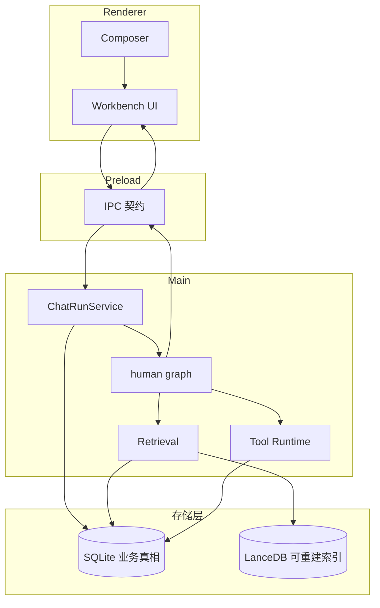
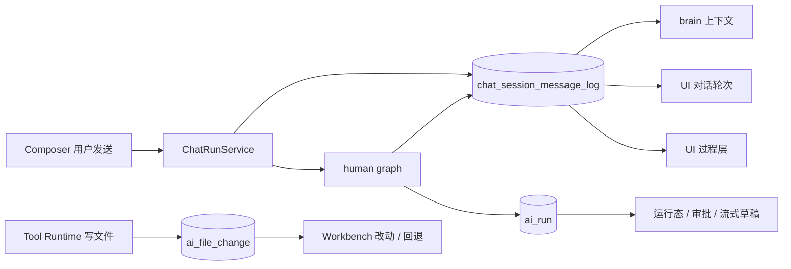

# NCurator-Desktop 架构

NCurator-Desktop 是支持 macOS 和 Windows 的本地优先 Electron 应用。文档解析、嵌入、索引、检索、AI 编排和持久化优先在本地完成。

## 技术栈

- Runtime：Electron v39；Language：TypeScript v5；Build：Electron-Vite v5；Package Manager：pnpm。
- Renderer：React v19、React Router DOM v7、Ant Design v5、Tailwind CSS v4、Less。
- Main：LangChain JS、LangGraph JS、@huggingface/transformers v3、better-sqlite3、LanceDB；文档解析使用 pdf-parse、mammoth，中文分词使用 @node-rs/jieba。

## 系统分层

| 层       | 职责与边界                                                                       |
| -------- | -------------------------------------------------------------------------------- |
| Renderer | UI、用户交互与展示态；未发送的文档选区、关联想法和定位状态保留在伙伴级内存       |
| Preload  | Renderer 与 Main 之间的安全桥接                                                  |
| Main     | AI 编排、数据库、文档处理、资料索引、文件写回与系统通知                          |
| Shared   | IPC、运行事件及跨进程共享类型                                                    |
| SQLite   | 业务与元数据真相，包含伙伴、消息、运行、文件修改、资料、定时任务、界面状态与配置 |
| LanceDB  | 可重建的向量与全文索引，不承担业务状态                                           |

伙伴界面和浏览器标签的可持久化状态由 Main 写入 SQLite。数据库 schema 向前演进，索引按文档版本更新；布局与生命周期见 [存储设计](storage/design.md)。

## 核心模块

| 模块                | 职责                                                          |
| ------------------- | ------------------------------------------------------------- |
| Application Shell   | 进程协作、窗口与页面、伙伴界面和资源面板                      |
| AI Runtime          | 请求的运行生命周期、human graph、事件、审批、子会话与最终交付 |
| Storage             | SQLite、LanceDB 及领域 Store                                  |
| Retrieval           | 文档索引、混合召回与结果融合                                  |
| Tool Runtime        | 文件、终端、网页和浏览器等能力的执行、权限与资源范围          |
| File Change Records | 受控文件写回、历史审核与回退；终端只执行，不扫描文件变化记账  |

## 主要数据流

### 请求与执行

Main 创建运行并读取伙伴上下文。human graph 决定检索、工具执行、用户交互和交付；结果通过事件及 IPC 回到 Renderer。运行完成后由 Main 收尾文件修改记录、保存终态并触发通知。

### AI 数据源与消费方

消息记录承担任务历史；运行记录承担编排状态；文件修改记录承担审核与回退。三个数据源各有消费方，流式草稿不替代持久化任务历史。

## 关键架构设计

### 工具包与 Skill 的能力扩展思路

- **工具包**：官方持续打磨网络搜索、DOCX 等高频、通用能力，通过 Tool 提供稳定的执行入口，以提升效果、减少重复指令和 token 消耗为目标。
- **Skill（规划）**：接入成熟的第三方 Skill 扩展能力，同时支持将用户自己的经验、流程与交付规范沉淀为可复用的 Skill，按任务组合使用工具包和其他执行能力。
- **差异化**：将开箱可用的常用工具与可持续积累的个性化经验结合，通过产品引导帮助普通用户把做事方法转为 AI 可遵循的规范，降低编写约束文档的门槛。

### 多语言与国内／国际发行

Main 解析安装包内只读发行标识，并管理持久化语言和官方服务线路。Renderer 启动前获取有效语言，以 i18next 与 react-i18next 读取内置类型化字典；Main 使用独立翻译实例处理系统通知。组件语言资源按同一语言初始化，提示词与模型内容不进入界面翻译。

发行标识仅初始化缺失的线路配置。官方 API 由 Main 根据已保存线路选择入口，每次操作固定入口，失败不跨域重放；自动更新独立使用发行包内固定配置。两种包共用应用资源，国内包发布 COS，国际包发布 R2；产品与技术标识见[品牌规范](brand.md)。

### 免费模型调用

免费模型目录由官网服务端常量和环境变量生成，桌面只缓存模型元数据与短时凭证。所有免费型号经官网 `/api/v1/free/chat/completions` 按精确型号转发，真实上游地址与 Key 不进入桌面。Main 统一负责请求签名与凭证续期；Renderer 仅消费不含凭证的目录投影。图片、工具消息和流式响应复用现有 AI 调用链路。

免费目录缓存具有协议版本；版本不匹配时重建缓存。已移除或型号不匹配的免费选择失效，不隐式映射到其他型号。

### AI 上下文与协作

主任务与子会话共用 human graph、消息投影和压缩机制，但历史按会话隔离。子任务的交付进入父任务，文件修改归本次主运行；未完成子会话可续接，完成后清理。

运行中追加消息由 Main 接收，在当前执行的安全边界交接；中断恢复重建上下文，不自动重放操作。具体流转与不变量见 [Human Harness](ai-harness/human-harness.md)。Toolset 管理预注册工具的装载与预算；用户 Skill 是共享文件资产，按伙伴绑定并加载说明，不注册工具。Tool 提供共用契约与执行管道，见 [Tool Design](ai-harness/tool-design.md)。

### 资料索引与检索

SQLite 管理文档来源及有效状态，LanceDB 管理可重建 chunk。检索结合向量语义搜索、全文关键词搜索和 RRF 融合，再补齐 SQLite 中的来源元数据。文件地址和全局网页共享该检索链路。

嵌入由 Main 统一选择本地 Jina 或用户配置的远程 OpenAI 兼容服务，选择立即影响后续请求，失败不自动回退。远程服务会接收需要嵌入的查询及正文块；已保存 API Key 只由 Main 使用，Renderer 负责用户输入并接收无 Key 的配置投影。模型设置和逐文档迁移状态保存在 SQLite，完整 chunk 按模型身份及维度分表。后台迁移复用已有正文，不依赖旧模型；待迁移资料仍可读取和全文检索，向量查询只使用当前模型，并向工具提供覆盖不足提示。模型迁移不进入普通文件／网页更新索引的检索门禁，关键词与列表不依赖嵌入就绪；存储、恢复及清理边界见 [存储设计](storage/design.md#3-索引存储)，用户操作见 [Settings PRD](prd/settings.md#46-向量模型管理)。

### 文档处理

| 领域  | 架构思路                                                                                                |
| ----- | ------------------------------------------------------------------------------------------------------- |
| DOCX  | 结构化内容树与稳定锚点读写；审核使用原始与最终文档的净比较                                              |
| PDF   | 页级读取、检索与图像；解析由 Worker 隔离                                                                |
| PPT   | 页与元素结构化编辑；普通预览和历史审核使用 SVG，历史资源独立保存                                        |
| Excel | 工作表及区域读写；普通预览与审核共用工作簿转换和公式引擎，历史审核使用固定结果                          |
| 文本  | 普通编辑保留现有编辑器，审核使用按需加载的 Monaco 双栏，左侧为 run 基线、右侧编辑实际文件，共用保存协调 |
| 图片  | 预注册工具包提供文件生成与更新，结果接入文件预览和修改记录                                              |

格式选区通过各自适配器接入共用资料引用，提交时 Main 校验引用；页面交互见 [Workbench PRD](prd/workbench.md)。具体工具契约由源码及按需生成的工具审计提供。

### 文件写盘与审核

受控工具写回正式文件后，后续操作即可读取。Main 管理文件会话、记录归属及收尾，Renderer 读取审核产物进行展示，不负责生成历史比较。

原始修改记录固定本次 A 到最终确认 B；Office 审核保持此历史，点击区域通过语义索引定位实际文件 C。文本审核以所选 run 的 A 对比可编辑的 C，原始 A/B 产物与计数仍固定。馆长默认打开应用由 Main 统一按扩展名解析，WPS 导航使用独立命令及结果回报，不进入写回刷新流程；按当前内存内容及原文／对象身份／表格上下文确认位置。导航、外部打开和写回刷新共享按组件区分的加载项状态与反馈，不用无连接推断未授权。运行中断时可从持久化输入补生成审核，无需继续执行 AI 或改写正式文件。资源版本、备份和清理规则见 [存储设计](storage/design.md#5-生命周期与一致性)。

### 浏览器与定时任务

浏览器网页运行态由 Main 管理，Renderer 负责面板呈现。网页运行与面板显隐分开，用户及 AI 操作同一应用内标签；工具资源范围由 Tool Runtime 控制。

定时任务保存配置并绑定伙伴，到点向该伙伴提交任务描述，执行读取伙伴当前 Composer 配置。任务记录的持久化由 Storage 负责，运行仍进入同一 AI 主链路。
