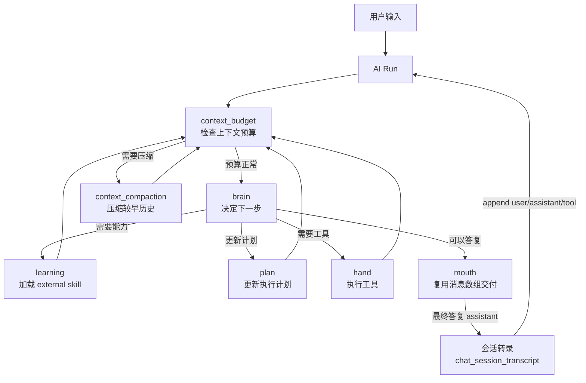

# NCurator-Desktop 架构

本文是项目唯一架构入口，只描述长期稳定的系统结构、模块职责和主流程。具体字段、工具 schema、底层实现细节以代码和测试为准。应用只支持 macOS 和 Windows。

## 技术栈

### 核心环境

- Runtime: Electron v39
- Language: TypeScript v5
- Build: Electron-Vite v5
- Package Manager: pnpm

### Renderer

- React v19
- React Router DOM v7
- Ant Design v5
- Tailwind CSS v4 + Less

### Main

- LangChain JS
- LangGraph JS
- @huggingface/transformers v3
- SQLite + better-sqlite3
- LanceDB v0.22.3
- pdf-parse
- mammoth
- @node-rs/jieba

## 整体架构

NCurator-Desktop 是本地优先的 Electron 桌面应用。文档解析、嵌入、索引、检索、AI 编排和持久化都优先在本地完成。

系统按进程和能力分层：

- Renderer 负责 UI 展示、用户交互和状态呈现。
- Main 负责 AI 编排、数据库访问、文档处理、资料索引和写回流程。
- Main 负责 AI 运行终态的系统通知；通知由 `SystemNotificationService` 统一适配 macOS 和 Windows，Renderer 只负责接收通知点击后的会话打开事件。
- Preload 负责 Renderer 与 Main 之间的安全桥接。
- Shared 负责 IPC 契约、事件类型和跨进程共享类型。

存储按职责分层：

- SQLite 是业务真相，保存会话、消息、AI run、审批、文件修改记录、文档元数据、网页源、工作区状态和配置。
- LanceDB 只保存可重建的 `vector_chunk` 向量索引。
- SQLite schema 通过 migration 向前演进，LanceDB 索引可按文档 generation 重建。

检索采用混合召回：

- 向量搜索负责语义召回。
- LanceDB FTS 负责关键词召回。
- RRF 负责融合结果。

## 核心模块

### Application Shell

Application Shell 由 Renderer、Main、Preload 和 Shared 组成：Renderer 负责界面与交互，Main 负责本地能力和任务编排，Preload 提供安全桥接，Shared 维护 IPC 契约和共享类型。

### AI Runtime

AI Runtime 负责一次用户请求的 run 生命周期、事件流、审批、工具调用和最终答复。它不直接承担所有任务逻辑，而是把具体能力交给 human graph、工具和领域服务。

### Storage

Storage 负责本地持久化：

- `SqliteCore` 负责 SQLite 连接、PRAGMA 和 migration。
- `LanceDbCore` 只负责 `vector_chunk` 表初始化、搜索和维护。
- 各领域 Store 负责对应业务数据读写。
- `WorkbenchUiStore` 保存会话 Composer、右侧面板、最后活动会话和未发送草稿；`BrowserTabStateStore` 保存浏览器标签的可恢复状态。

### Retrieval

Retrieval 负责文档索引、向量检索、全文检索和结果融合。检索前会先从 SQLite 读取当前有效的 `document.active_generation_id`，再到 LanceDB 搜索有效 generation。

### Tool Runtime

Tool Runtime 为 AI 提供文件、终端、浏览器等本地能力。工具实现位于 Main，由各领域服务负责具体操作；审批、命令安全策略和工作区变化追踪由运行时统一处理。工作区是默认路径、资料索引与变更追踪范围，不限制工具访问工作区外绝对路径。对 AI 的提示词中，工作区表述为「用户工作区域」：它是默认执行范围而非硬边界，模型默认在工作区域内完成任务，但安装编译器/运行时、全局工具链或系统级终端操作等场景可直接读写工作区域外绝对路径；文件工具的 `sourcePath`/`outputPath` 必须为本机绝对路径，系统不做任何路径拼接，相对路径直接返回错误。

内置浏览器由 Electron `WebContentsView` 承载，Stagehand 通过仅绑定本机回环地址的随机 CDP endpoint 精确连接对应 Tab，不依赖固定端口或 URL 猜测页面。

Workbench 的当前交互状态由 Renderer 管理，并按会话串行写入 SQLite。切换会话时，Main 一次返回消息、运行快照和 UI 快照；Renderer 完成加载后原子替换画面。浏览器服务按 `ownerId` 管理运行期 `WebContentsView`，同时把 URL、历史、缩放和顺序写入 SQLite。正常退出前 Main 会请求 Renderer 强制 flush，再释放浏览器和其他服务。

开发版默认使用独立的 `*-dev` user-data 目录，避免和安装版共享数据库、实例锁或 `DevToolsActivePort`；E2E
可以通过 `NCURATOR_USER_DATA_PATH` 显式提供隔离目录。

### Workspace Change Tracking

每个 Run 前后只扫描工作区，统一确认新增、修改、删除和重命名，并保存可回退的修改前对象。工作区外绝对路径允许由工具读写，但不进入当前修改记录、预览或回退能力。不同文件格式只负责提供对应的预览方式。

## AI 架构

AI 架构围绕一次 `run` 展开。每次用户请求都会创建一个 run，run 内由 `human` 推进任务。

### 主要职责

- `human` 是当前 AI run 的执行核心。
- `brain` 通过原生 function calling 决定下一步：调用 LLM 时绑定当前可用工具（builtin + agent-control + 已学习 external），根据返回的 `tool_calls` 生成有序分发队列（dispatch）。
- `dispatch` 按队列逐个把工具调用路由到对应节点：`learn_skill` → learning、`update_plan` → plan、`finish` → mouth、其余真实工具 → hand；队列清空后回 `context_budget`。
- `learning` 负责按需加载 external skill，执行 `learn_skill` 控制工具并把结果写回消息数组。
- `plan` 执行 `update_plan` 控制工具，把计划写入 `memory.plan` 并回写 `ToolMessage`。
- `hand` 负责执行真实工具，把结果以 `ToolMessage` 追加回消息数组。
- `mouth` 由 `finish` 控制工具（或无工具调用的自然收尾）触发，复用 brain/hand 已累积的消息数组，追加一条交付指令 user 消息后流式生成最终答复（`chatMessages`），并把最终答复作为 `assistant` 转录条目写回。
- `context_budget` 负责在每一步前检查上下文预算。
- `context_compaction` 把消息投影的较早区间压缩为一条摘要（`<compacted_history>`）并注入 `<current_state>`（完整 plan + learnedSkillIds），服务本次 run 继续推进。

### 原生 tool calling 与消息转录（唯一真相源）

brain 采用原生 function calling（`bindTools`），工具结果以 `ToolMessage`（按 `tool_call_id` 配对）追加到 append-only 的 `messages` 数组，不再把历史每轮重渲染成字符串。静态前缀（原则 + 技能目录 + 本地环境）与技能目录只标注「内置 / 需学习」，不随 learn 变化，保证缓存友好。非工具控制动作统一为 `agent-control` 内置技能的三个工具：`learn_skill`、`update_plan`、`finish`。

**模型上下文唯一真相源是会话级 append-only 的消息转录（`chat_session_transcript` 表）**：每条是 `user` / `assistant`（含真实 `tool_calls`）/ `tool`（含结果）/ `annotation`（压缩摘要等过程标记）。模型上下文从转录投影（`deriveTranscriptMessages`），中断恢复与跨 run 上下文都从转录重建后补一条 user 消息继续；UI 过程与模型记忆不再维护 `rounds`/`conversation` 副本。压缩只作用于「投影出的消息」（早段 → `<compacted_history>` + `<current_state>`，尾段保留），转录本身 append-only 不动。

### Skill 与 Tool

AI 能力通过 skill 和 tool 两层表达：

- builtin skill 默认可用，不需要 learning 加载。
- external skill 需要 learning 显式加载后才进入当前有效能力集合。
- `agent-control` 是内置被动技能，承载 `learn_skill` / `update_plan` / `finish` 三个任务控制工具。
- skill 描述能力边界和适用场景。
- tool 是具体执行入口，输入输出和限制以代码中的 schema 为准，schema 通过 `bindTools` 直接交给模型。

skill 不按目录强行拆分，也不等同于工具数量。一个 skill 可以对应多个 tool，多个 skill 也可以共享同一实现域。

### 结构化输出与服务重试

`brain` 不再使用结构化 JSON 决策，而是走原生 function calling（`bindTools` + `tool_calls`），工具参数由模型按工具 schema 生成、本地仍以 zod 校验兜底。其余需要结构化输出的调用仍统一使用 `prompt_json`：纯文本请求，不发送 `response_format`，模型按提示词中的 schema 描述输出 JSON，本地通过代码块剥离（`normalizePromptJsonText`）、`jsonrepair` 修复和 Schema 校验兜底。

LLM 调用失败严格分两层处理：

- 重试域只负责临时故障重连：HTTP 408/409/425/429/5xx、超时和 `ResourceExhausted` 触发重试，`ResourceExhausted` 使用指数退避（2/4/8/15 秒）避免放大服务端容量压力。
- 致命错误（401/402/403、鉴权、余额）直接失败，不重试；其余错误按失败信息透传，不触发任何降级。

官方 OpenAI（`api.openai.com`）固定使用 Responses API，其余服务商固定使用 Chat Completions，协议端点由服务商身份静态决定，不做运行期切换；用户地址配置错误通过请求错误信息反馈。

### 会话连续性

跨轮上下文由会话级 append-only 消息转录（`chat_session_transcript`）唯一承载，不再维护 conversation summary / `rounds` / `conversation` 副本。每次 run 开始时把当前用户消息作为 `user` 转录条目追加；brain 从转录投影消息、注入 `<current_state>`（完整 plan + learnedSkillIds）后继续推进。中断恢复同样是往转录尾部补一条 user 消息并把 `task.userInput` 指向新消息，原目标自然保留在转录首条 user 中。

未正常完成的智能模式任务另有一套按会话持久化的恢复快照。快照保存 plan、compactions、已学习技能和执行收尾态（delivery guidance / artifacts / finalizationReason）；同一会话的下一条用户消息会消费快照、启动新的 run 并补一条 user 转录条目。网络错误、超时、用户停止、进程中断、运行上限和未知异常都保留快照，只有任务正常完成或会话被删除时才清理。不同会话的恢复状态严格隔离。

文件 artifact 是预览、差异与回退所需的内部业务数据；传入模型时只投影必要语义，不暴露内部记录标识。运行失败或取消不会撤销已落地的工作区内修改，所有终态都保留可查看、可回退的工作区内修改记录。

## 存储架构

存储架构遵循一个原则：业务状态只有一个真相。

- SQLite 保存业务状态和元数据。
- Workbench 会话 UI 快照和浏览器可恢复状态也以 SQLite 为唯一持久化真相；`localStorage` 只保留侧栏宽度等全局界面设置。
- LanceDB 保存可重建索引。
- 业务查询先经过 SQLite 确认有效范围，再进入 LanceDB 检索。
- 详细数据库设计见 `doc/database.md`。

## 索引一致性

文件和网页索引通过 `generation_id` 原子切换当前有效版本；新索引失败时继续使用旧版本，检索只读取 active generation。详细规则见 `doc/database.md`。

## 主链路

1. Renderer 发起用户请求。
2. Main 创建 run，并读取会话上下文和工作区状态。
3. AI Runtime 通过 human graph 推进 brain、learning、hand、mouth。
4. 需要资料时进入 Retrieval，读取 SQLite 元数据并检索 LanceDB。
5. 需要本地能力时由 Tool Runtime 调用对应领域服务。
6. 工作区内文件写回后记录统一修改记录和对应预览，供 UI 展示和回退；工作区外写入不记录回退。
7. 最终答复和事件流通过 IPC 回到 Renderer 展示。
8. Run 持久化为 `completed`、`failed` 或 `cancelled` 后，Main 触发一次系统通知；通知点击通过 Preload IPC 打开对应会话。
