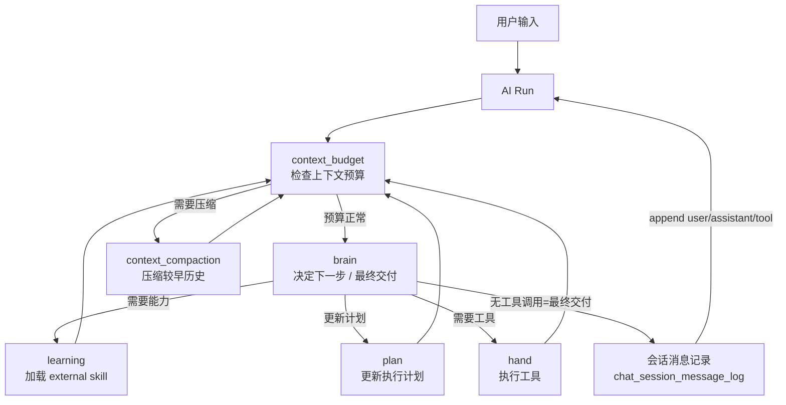

# NCurator-Desktop 架构

本文是项目唯一架构入口，只描述长期稳定的系统结构、模块职责和主流程。具体字段、工具 schema、底层实现细节以代码和测试为准。应用只支持 macOS 和 Windows。

## 技术栈

### 核心环境

- Runtime: Electron v39
- Language: TypeScript v5
- Build: Electron-Vite v5
- Package Manager: pnpm

### Renderer

- React v19
- React Router DOM v7
- Ant Design v5
- Tailwind CSS v4 + Less

### Main

- LangChain JS
- LangGraph JS
- @huggingface/transformers v3
- SQLite + better-sqlite3
- LanceDB v0.22.3
- pdf-parse
- mammoth
- @node-rs/jieba

## 整体架构

NCurator-Desktop 是本地优先的 Electron 桌面应用。文档解析、嵌入、索引、检索、AI 编排和持久化都优先在本地完成。

系统按进程和能力分层：

- Renderer 负责 UI 展示、用户交互和状态呈现。
- Main 负责 AI 编排、数据库访问、文档处理、资料索引和写回流程。
- Main 负责 AI 运行终态的系统通知；通知由 `SystemNotificationService` 统一适配 macOS 和 Windows，Renderer 只负责接收通知点击后的会话打开事件。
- Preload 负责 Renderer 与 Main 之间的安全桥接。
- Shared 负责 IPC 契约、事件类型和跨进程共享类型。

存储按职责分层：

- SQLite 是业务真相，保存会话、消息、AI run、审批、文件修改记录、文档元数据、网页源、工作区状态和配置。
- LanceDB 只保存可重建的 `vector_chunk` 向量索引。
- SQLite schema 通过 migration 向前演进，LanceDB 索引可按文档 generation 重建。

检索采用混合召回：

- 向量搜索负责语义召回。
- LanceDB FTS 负责关键词召回。
- RRF 负责融合结果。

## 核心模块

### Application Shell

Application Shell 由 Renderer、Main、Preload 和 Shared 组成：Renderer 负责界面与交互，Main 负责本地能力和任务编排，Preload 提供安全桥接，Shared 维护 IPC 契约和共享类型。

### AI Runtime

AI Runtime 负责一次用户请求的 run 生命周期、事件流、审批、工具调用和最终答复。它不直接承担所有任务逻辑，而是把具体能力交给 human graph、工具和领域服务。

### Storage

Storage 负责本地持久化：

- `SqliteCore` 负责 SQLite 连接、PRAGMA 和 migration。
- `LanceDbCore` 只负责 `vector_chunk` 表初始化、搜索和维护。
- 各领域 Store 负责对应业务数据读写。
- `WorkbenchUiStore` 保存会话 Composer、右侧面板、最后活动会话和未发送草稿；`BrowserTabStateStore` 保存浏览器标签的可恢复状态。

### Retrieval

Retrieval 负责文档索引、向量检索、全文检索和结果融合。检索前会先从 SQLite 读取当前有效的 `document.active_generation_id`，再到 LanceDB 搜索有效 generation。

### Tool Runtime

Tool Runtime 为 AI 提供文件、终端、浏览器等本地能力。工具实现位于 Main，由各领域服务负责具体操作；审批、命令安全策略和工作区变化追踪由运行时统一处理。工作区是默认路径、资料索引与变更追踪范围，不限制工具访问工作区外绝对路径。对 AI 的提示词中，工作区表述为「用户工作区域」：它是默认执行范围而非硬边界，模型默认在工作区域内完成任务，但安装编译器/运行时、全局工具链或系统级终端操作等场景可直接读写工作区域外绝对路径；文件工具的 `sourcePath`/`outputPath` 必须为本机绝对路径，系统不做任何路径拼接，相对路径直接返回错误。

内置浏览器由 Electron `WebContentsView` 承载，Stagehand 通过仅绑定本机回环地址的随机 CDP endpoint 精确连接对应 Tab，不依赖固定端口或 URL 猜测页面。

Workbench 的当前交互状态由 Renderer 管理，并按会话串行写入 SQLite。切换会话时，Main 一次返回消息、运行快照和 UI 快照；Renderer 完成加载后原子替换画面。浏览器服务按 `ownerId` 管理运行期 `WebContentsView`，同时把 URL、历史、缩放和顺序写入 SQLite。正常退出前 Main 会请求 Renderer 强制 flush，再释放浏览器和其他服务。

开发版默认使用独立的 `*-dev` user-data 目录，避免和安装版共享数据库、实例锁或 `DevToolsActivePort`；E2E
可以通过 `NCURATOR_USER_DATA_PATH` 显式提供隔离目录。

### Workspace Change Tracking

每个 Run 前后只扫描工作区，统一确认新增、修改、删除和重命名，并保存可回退的修改前对象。工作区外绝对路径允许由工具读写，但不进入当前修改记录、预览或回退能力。不同文件格式只负责提供对应的预览方式。

## AI 架构

AI 架构围绕一次 `run` 展开。每次用户请求都会创建一个 run，run 内由 `human` 推进任务。



### 主要职责

- `human` 是当前 AI run 的执行核心。
- `brain` 通过原生 function calling 决定下一步：调用 LLM 时绑定当前可用工具（builtin + agent-control + 已学习 external），根据返回的 `tool_calls` 生成有序分发队列（dispatch）。
- `dispatch` 是 `tool_calls` 队列的唯一消费者，严格按模型返回顺序分组路由：`learn_skill` → learning、`update_plan` → plan、其余真实工具 → hand；领域节点执行后统一返回 dispatch，队列清空后才回 `context_budget`。
- `learning` 负责按需加载 external skill，执行 dispatch 分配的 `learn_skill` 并把结果写回消息数组；它不推进或清空分发队列。
- `plan` 执行 dispatch 分配的 `update_plan`，先用 `UPDATE_PLAN_SCHEMA`（`zod`）校验参数（`status` 仅允许 `todo` / `in_progress` / `done`），通过后把计划写入 `memory.plan` 并回写 `ToolMessage`；校验失败也回写对应错误结果并继续剩余分发队列。
- `hand` 执行 dispatch 分配的真实工具，把结果以 `ToolMessage` 追加回消息数组；成功、失败或审批拒绝都必须为每个 `tool_call_id` 产生且只产生一条结果，并继续剩余分发队列。
- `brain` 交付：当 brain 的一轮返回没有任何 `tool_calls` 时，该轮 assistant 的 content 就是最终交付 markdown；brain 直接收尾（apply docx / commit ppt / 收集文件变更 / artifact / `answer_completed`），不再有独立的 mouth 节点与第二次交付 LLM 调用。交付与否由 brain 自主判断，Main 侧不做计划完成度的强制拦截。
- `context_budget` 负责在每一步前检查上下文预算。
- `context_compaction` 把消息投影的较早区间压缩为一条摘要（`<compacted_history>`）并注入 `<current_state>`（完整 plan + learnedSkillIds），服务本次 run 继续推进。

### 原生 tool calling 与消息转录（唯一真相源）

brain 采用原生 function calling（`bindTools`），工具结果以 `ToolMessage`（按 `tool_call_id` 配对）追加到 append-only 的 `messages` 数组，不再把历史每轮重渲染成字符串。静态前缀（身份 + 原则 + 技能目录 + 计划契约 + 交付契约 + 本地环境）与技能目录只标注「内置 / 需学习」，不随 learn 变化，保证缓存友好。技能目录按技能渲染工具数量与「最多同时激活 30 个工具」的动态上限，不硬编码。非工具控制动作统一为 `agent-control` 内置技能的两个工具：`learn_skill`、`update_plan`；任务结束由 brain 直接输出最终交付 markdown（无工具调用），不再有 `finish` 工具。

AI 推进遵循“最小可靠返回 × 最少连续决策轮次”：每次只读取当前决策所需的最小可靠范围，不做全量、重复定位或无新增价值的验证；互不依赖的调用尽量同轮分发，同类能力支持批量时一次提交。只有复杂或存在多项依赖的任务才维护 plan，不为进度展示单独更新 plan，目标满足且必要检查通过后可直接交付。工具与技能描述只声明能力、边界和参数语义，不写固定调用教程，保留模型自主组合能力。

每条工具结果独立执行大小守卫，不存在同一 dispatch 批次的总量额度。结果不超过 `TOOL_RESULT_INLINE_MAX_CHARS = 32_000` 字符时完整进入上下文；超过后把完整结果写入一次性 `runtime/toolresult` 文件，并只给模型返回最多 `TOOL_RESULT_HEAD_MAX_CHARS = 8_000` 字符的 head。截断信封只有 `truncated / filePath / totalChars / head`，因此一个大结果不会挤占同轮其他小结果的返回额度。

截断日志是 `JSON.stringify` 的紧凑单行内容（无真实换行），模型需要完整内容时通过 `text_file_read` 读取：`type=lines`（`startLine/lineCount`）按行、`type=chars`（`startOffset/charCount`）按字符分段。`text_file_read` 对 `runtime/toolresult` 目录下的文件执行单次返回上限守卫 `TEXT_FILE_READ_MAX_CHARS`（略低于截断上限，为 JSON 包装开销留余量）：本次读取内容超限时直接报错，保证分段读取的结果不会被 hand 层再次截断落盘，避免「读日志 → 再截断 → 再读日志」的递归；普通工作区文件不受此守卫限制。`text_file_search` 按 literal/regex 在文本中检索，返回每个命中的 1-based 行号与全文件字符偏移（与 `type=chars` 的 `startOffset` 对齐），单行超长日志的命中上下文按字段级上限裁剪并标记 `truncated`，模型可先用搜索定位关键词、再按偏移精确读取。

**模型上下文唯一真相源是会话级 append-only 的会话消息记录（`chat_session_message_log` 表）**：每条是 `user` / `assistant`（含真实 `tool_calls`）/ `tool`（含结果）/ `annotation`（思考/学习/压缩/收尾等过程标记）。模型上下文从会话消息记录投影（`deriveMessageLogMessages`），中断恢复与跨 run 上下文都从记录重建后补一条 user 消息继续；UI 过程展示与模型记忆不再维护 `rounds`/`conversation`/`ai_run_event` 副本。压缩只作用于「投影出的消息」（早段 → `<compacted_history>` + `<current_state>`，尾段保留），记录本身 append-only 不动。

**消息数组构建顺序（每次 run 首次 brain 重建时）**：`system` → 会话消息记录投影出的历史消息 → 尾部追加一条由 `buildBrainUserMessage` 构建的 user 消息（承载 `<task_goal>`、`<current_state>` 等当前任务上下文）。当前 run 的用户原文通过按位置跳过最后一条 `user` 条目避免重复出现（`skipLastUserEntry`），首条消息时历史为空，该 user 消息就是数组里唯一一条 user 消息。这条尾部 user 消息保留了 `<task_goal>` 结构，使 `system + 历史` 前缀在跨轮与跨 run 之间保持结构稳定，利于 KV 前缀缓存复用。

**悬空 tool_calls 修复**：若历史末条 `assistant` 声明了 `tool_calls` 但记录里没有对应 `tool` 结果（中断发生在 brain 落库后、工具执行前），重建投影时由 `repairInterruptedToolCalls` 在该轮缺失的 `tool_call_id` 位置补一条 `{ ok: false, code: 'interrupted', error: '运行意外中断，该工具调用未执行。' }` 的 `ToolMessage`，再接尾部 user 消息，保证每个 `tool_call_id` 有且仅有一条结果、且接口不因悬空调用报错。

**混合工具调用**：brain 一次返回的全部调用先完整进入 dispatch；只有 dispatch 可以从队列取出调用。learning、plan、hand 只执行当前分组并返回 dispatch，不得自行消费队列或因本组失败丢弃后续调用。连续 hand 调用可在同组内按资源串并行执行；`learn_skill` 每次只分发一个，避免单值 learning 状态漏掉调用。

**brain 交付指令不再单独成条**：brain 的最终交付就是无工具调用那一轮的 assistant content，直接作为最终答复 `assistant` 转录条目写回（不做第二次交付 LLM 调用，也不再追加「现在面向用户交付结果…」的 user 条目）。

**会话消息记录是「数据唯一、其他投影」的唯一真相源**：一次会话下的所有 run 的消息都写进同一张表（每条带 `run_id` 标识归属 run）。运行中的实时过程（思考、学习、工具调用、压缩、收尾）由节点即时写入 annotation 条目；UI 的「AI 消息 → 工具调用/技能学习 → 一步步展开」过程展示由渲染层从记录按 `seq` 投影重建（`projectProcessGroups`），不再依赖独立的 `ai_run_event` 过程事件副本。live 运行中的 `running → completed` 中间态与 `answer_token` 流式输出仍走瞬时广播，不落库；重开/恢复时从记录投影出 completed 态的完整过程。工具调用与失败不再通过独立的 decision hint 机制回传，而是统一作为该工具的 `ToolMessage` 结果（成功/失败/被拦都保证每个 `tool_call_id` 有且仅有一条结果）返回给模型。控制/反馈类工具结果统一由 `toolFeedback` 工厂生成，envelope 为成功 `{ ok: true, ...data }`、失败 `{ ok: false, code, error }`，`code` 取 `invalid_json` / `invalid_plan` / `approval_blocked` / `pending_items`；`ToolMessage` 的 `content` 与转录 `result` 始终是同一对象，保证恢复重放与 live 一致。`tool_call_id` 在领域类型中建模为必填（LLM 每个 tool call 必带 id），仅在模型响应异常缺 id 时由 brain 边界就地生成局部 id 回喂，不向领域类型传播可选。

### Skill 与 Tool

AI 能力通过 skill 和 tool 两层表达：

- builtin skill 默认可用，不需要 learning 加载。
- external skill 需要 learning 显式加载后才进入当前有效能力集合。
- `agent-control` 是内置被动技能，承载 `learn_skill` / `update_plan` 两个任务控制工具。
- skill 描述只说明能力边界，不重复写“遇到某类文件必须使用该技能”等全局规则。
- tool 是具体执行入口，输入输出和限制以代码中的 schema 为准，schema 通过 `bindTools` 直接交给模型。

Word、Excel、PPT、PDF 必须使用对应技能处理，terminal 只用于辅助定位、诊断和计算，不得直接修改这些文件。该规则集中在 system prompt 的 `special_notes`，不散落到各 skill 描述。

skill 不按目录强行拆分，也不等同于工具数量。一个 skill 可以对应多个 tool，多个 skill 也可以共享同一实现域。

### 工具 schema 设计规范

所有模型可调用的工具（builtin 与 external）都必须遵循以下 schema 设计准则。目标是让模型「简单、清晰、易懂」地生成参数，同时仍能「指哪打哪」地精准改动。DOCX 工具族是首个完整采用此规范的实现。

1. **参数扁平化，禁止递归 type 判别树进写入 schema**。动作用 `z.discriminatedUnion('type', ...)` 表达时，每个 variant 只允许少量扁平字段；不得出现「段落 → run → text / 表格 → row → cell → block」这类多级递归的 `z.lazy` 判别树。复杂内容应拆成「扁平内容 + 正交动作」，由模型多轮完成，而非要求模型一次生成整棵结构树。

2. **每个字段必须带 `.describe()`**。字段 `description` 是模型在原生 function calling 下唯一能读到的字段语义，必须说明「何时用、怎么选、示例」；不允许出现只有哑字段名、无任何说明的字段。

3. **读→写往返锚定，不重建结构**。写入只填 read 返回的稳定 `nodeId` 加最小 patch；工具返回变化后的完整局部节点或实体 ID，供模型继续定位。精确性来自「锚点 id + 小颗粒动作」，而不是让模型重述完整结构。

4. **同一领域使用一个工具和明确 operation**。不同元素的格式 patch 统一属于 `docx_format`，通过 `format_text`、`format_paragraph`、`format_table`、`format_row`、`format_cell` 等 operation 区分。不要为每个小能力新增 AI 工具。

5. **规范值 vs 呈现分离**。工具返回 handle/id 的规范 JSON（`outputSchema`），面向用户的散文交给结果渲染；不要让模型从散文里反解 id 或字段。

6. **运行期 zod 校验兜底**。模型生成参数后本地以 zod 校验，错配返回带「字段 + 期望值」的 `ToolMessage` 错误（宁可报错、绝不静默改错）。

7. **既有通用规则沿用**（见 AGENTS.md）：类型禁止 `any`/`unknown`；字段遵循最小必要原则，语义必然存在的值建模为 required，禁止「可选类型 + 运行时兜底占位」。

### DOCX 架构

#### 目标与边界

DOCX 使用“文档聚合模型 + story 内容树”，不再把正文切成业务 block，也没有 `blockId`。`.doc` 只读；创建和修改只支持 `.docx`。公开协议不兼容旧单一编辑工具、批量 `actions` 或 block 定位字段。

DOCX 写作技能加载全部 9 个工具：4 个读取工具和 5 个写入工具。它们合计低于 30 个活动工具上限，不做动态能力注册，也不为未来 operation 建注册层。新增能力时优先扩展现有领域工具的 discriminated operation。

#### 分层与数据流

```text
DOCX ZIP Package
├─ package parts / relationships / content types / media
├─ document aggregate
│  ├─ styles / numbering / settings / comments / revisions
│  └─ stories
│     ├─ body
│     ├─ header / footer
│     ├─ footnote / endnote
│     └─ textbox
└─ story content trees
   └─ paragraph / run / table / row / cell / hyperlink / field / bookmark /
      content_control / revision / drawing / math / text / tab / break / opaque

OOXML reader → document model → read tools
                         ↓ stable nodeId
SourcePackage/Model → editing session → WorkingPackage/Model → OOXML writer
                         ↓                         ↓
                    validation             Source ↔ Working Diff
```

代码职责按以下层次组织：

- model：文档聚合、story、节点、格式、媒体、批注和修订领域类型。
- OOXML reader：读取 package part、relationship 和 XML，投影语义树；不认识但必须保真的 XML 投影为 `opaque`。
- OOXML writer：只修改目标局部 XML、关系或 package part；不重建无关段落、表格或视觉内容。
- editing session：保存首次接触文件时的 Source 和连续写入的 Working；五个写工具共用同一会话。
- diff：比较 SourceModel 与最终 WorkingModel 的净变化，并生成审核视图、应用和回退材料。
- tools：4 个读工具和 5 个写工具，只负责编排明确的领域实现，不包含 operation 注册系统。

#### 节点、身份和路径

- paragraph、run、table、row、cell、hyperlink、field、bookmark、content control、revision、drawing、math 等可定位结构使用会话内稳定 `nodeId`。
- text、tab、break 是叶子值，不单独生成 ID。
- 样式继续使用 OOXML 的真实 `styleId`；批注和 Word 修订使用各自原生 ID。
- 修改、格式化、移动和同类型替换保持原 `nodeId`；新增节点生成新 ID；删除节点后 ID 消失。
- `nodeIndex` 只是 outline 当前顺序的临时值。重新打开文件后必须重新读取，不承诺跨会话复用 `nodeId`。
- parent、ancestor、flowIndex、lineageId 和重复路径不写入节点；outline、search 和 read 需要的顺序或路径按当前树计算。
- 未支持 OOXML 作为 `opaque` 返回。局部编辑时 writer 原样保留未命中的 opaque 子树；会造成视觉内容丢失的替换或删除必须显式设置 `allowVisualLoss:true`。
- 内部索引按各 story 的根节点维护为 `rootNodeIds`，不再使用会把页眉页脚混成正文的 `bodyNodeIds` 命名或位置假设。`document_end` 只表示正文末尾。

content control 是 Word 的结构化文档标签容器，常用于模板字段、表单区域、可重复区域和受控内容。修改它时操作内部 paragraph/run；空容器使用容器 `nodeId` 加 `insert_nodes(position:'inside_start'|'inside_end')`。

#### 公开工具

读取工具：

- `docx_read_outline`：按逻辑页返回自适应 segment map。每页 12 个 segment，`pageCount` 最多 4；逻辑页不是 Word 视觉页。
- `docx_search`：在完整原文中执行 literal 或 regex 搜索，返回可直接读取或写入的稳定 `nodeId`；可选返回同一 story 前后各 2 个节点的预览。
- `docx_read_nodes`：按 `nodeId` 或 `nodeIndex` 范围返回递归语义树；一次最多读取 20 个 nodeId 或连续 50 个根节点。
- `docx_read_visuals`：按 `visualId` 读取图片、图表、图形等视觉内容。

写入工具每次调用只执行一个 operation：

- `docx_content_edit`：`replace_text`、`insert_nodes`、`replace_node`、`delete_node`、`move_node`。
- `docx_format`：局部格式、重置格式、应用/创建/更新/删除命名样式、编号和 section 格式。局部格式一次最多原子处理 20 个目标，所有目标共享同一 patch；任一目标无效时整次不提交。
- `docx_table_edit`：表格创建/删除、行列增删、单元格合并/拆分。
- `docx_media_edit`：图片插入/替换/删除/属性更新；以后 shape、textbox、chart、SmartArt、OLE 继续扩展到此工具。
- `docx_comments_revisions`：批注新增/更新/回复/删除、修订模式开关、指定或全部修订接受/拒绝。

没有 `replace_content` 或 `replace_children`。AI 不应为局部修改重建完整递归树；容器内容通过其子节点逐个操作。

表格读写坐标统一从 1 开始。删除行、删除列、合并单元格等可能移除视觉内容的操作，也必须按需显式传入 `allowVisualLoss:true`。

#### 写入事务与保真

每次写入按固定事务执行：

1. 从 WorkingModel 解析 `nodeId`，同时验证节点类型和 operation 是否匹配。
2. 复制当前 working 状态，在副本上局部修改 OOXML。
3. 更新必要的 relationship、content type、media、style、numbering、comment 或 settings part。
4. 检查 XML 结构、悬空关系、视觉丢失和长文档完整性。
5. 只重读受影响区域，并让未修改逻辑节点继续绑定原 `nodeId`。
6. 全部成功后原子提交 WorkingPackage/WorkingModel；任一步失败都不提交部分结果。

`replace_text` 原位保留 run/paragraph 格式和视觉边界，可跨相邻 run，但不可跨 paragraph、tab、break 或 visual。同类型 `replace_node` 在调用未明确提供格式时保留兼容直接格式；跨类型替换只保留位置。命名样式和直接格式相互独立，`update_named_style` 修改全局定义并影响所有引用该 `styleId` 的节点。

写工具统一返回 `changes`。创建/更新节点返回局部完整节点；删除返回 `nodeId`；命名样式、批注和修订返回对应实体的稳定 ID 与最终状态，不只返回成功文字。

`docx_read_outline` 对所有 DOCX 使用同一套分段算法，不判断文档是否标准。每个 story 独立分段，每个根节点只属于一个 segment；普通段软目标为 20 个根节点，向后最多寻找 10 个节点的可靠结构边界，硬上限为 30 个根节点或 8,000 个可见字符。可靠边界只采用 section、显式分页/分栏、真实 `outlineLevel`、block content control、table 和视觉根节点，不根据字号、加粗、短文本或编号外观猜标题。table、block content control 和视觉根节点独立成段；超长单节点可独立成段。

公开 segment 只包含 `story / fromNodeIndex / toNodeIndex / textMap`，不返回 `nodeId`、完整正文或递归 children。`textMap` 最多 360 个 Unicode 字符：先放最多 120 字符的结构锚点，再用 Jieba/Unicode 分词与 TF-IDF 动态选择最多 96 字符的关键词，最后用“TF-IDF 质心 + MMR（0.7 相关性、0.3 多样性）”抽取带来源 `nodeIndex` 的原文代表句。不调用 LLM、不生成改写、不使用 embedding。分页随 Working 文档变化；需要编辑定位时使用 `docx_search`，或用 segment 的连续 `nodeIndex` 范围调用 `docx_read_nodes` 获取稳定 `nodeId`。

`docx_search` 的 literal 与 regex 都在完整原文上匹配，不做同义词、别名或 Unicode 字形改写。每个实际出现位置算一个 match，`totalMatchCount` 统计全部命中，公开最多返回前 10 个；`textContext` 最多 320 字符。`includeContext:true` 时返回同一 story 前后各 2 个节点，每个预览最多 160 字符。DOCX 不建立向量索引、embedding 或缓存；知识库语义检索不受影响。

`docx_format.format_text` 使用 `targets: [{ nodeId, text? }]`；省略 `text` 表示格式化该节点全部文字。其余局部格式 operation 使用 `nodeIds`，上限均为 20，拒绝重复 ID。编辑会话直接使用当前稳定 `nodeId` 定位；不保存文本指纹、邻近节点或表格坐标 locator，也不提供旧快照目标重新绑定层。

#### 净 Diff、Word 批注与修订

首次写入冻结 SourcePackage/SourceModel，后续五个写工具只推进 WorkingPackage/WorkingModel。Diff 永远比较 Source 与最终 Working，而不是累加工具调用：

- A→B→C 只显示 A→C。
- A→B→A 不产生 Diff。
- 新增后删除不产生 Diff。
- 新增后继续修改仍是一处新增。
- 移动显示原位置删除和新位置插入；表格、格式、媒体、全局样式、批注和修订设置都进入净比较。

NCurator Diff 与 Word 原生批注、`w:ins`、`w:del` 相互独立。读取和局部写入必须保留源文件已有批注及修订；`docx_comments_revisions` 操作的是 Word 原生实体，不能拿 NCurator Diff 代替。审核产物以 Working package 为壳，因此图片、关系、样式、批注和其他 package part 不会在生成 Diff 时丢失。

审核产物对 body、header、footer、footnote、endnote 和 textbox 各 story 都生成红绿净变化；命名样式、批注回复、修订接受/拒绝和修订模式等只有 package part 变化的操作，会在正文末尾增加绿色“文档级变更”摘要，避免出现有变更记录但审核页不可见的情况。

#### AI 调用原则

- 不知道位置：用 segment map 概览，或直接用 literal/regex 搜索完整原文；再通过 `docx_read_nodes` 精读并取得 `nodeId`，执行一个写 operation。
- 改一句话：读取目标 paragraph/run，调用 `docx_content_edit.replace_text`。
- 改一段且保留样式：优先 `replace_text`；只有结构确实改变时才 `replace_node`。
- 改容器内容：读取 content control/cell/header/footer 的内部节点，逐个修改；空容器用 `insert_nodes inside_*`。
- 表格文字、外观、结构分别使用 content、format、table 工具，避免一个 operation 同时承担三种职责。
- 图片、批注和修订使用各自领域工具。写工具成功返回的 `changes` 已完成 OOXML、关系、视觉丢失和受影响区域回读校验；只有结果缺失、冲突或用户明确要求时才重复读取。
- 同一路径可连续调用多个写工具；每次都基于最新 WorkingModel，旧节点未删除时 `nodeId` 保持可用。
- `move_node` 只允许在同一 OOXML part/story 内移动；跨 story 移动会涉及关系迁移，当前明确拒绝，AI 应在目标 story 插入新节点后再删除源节点，并按视觉丢失规则确认。

### 结构化输出与服务重试

`brain` 不再使用结构化 JSON 决策，而是走原生 function calling（`bindTools` + `tool_calls`），工具参数由模型按工具 schema 生成、本地仍以 zod 校验兜底。其余需要结构化输出的调用仍统一使用 `prompt_json`：纯文本请求，不发送 `response_format`，模型按提示词中的 schema 描述输出 JSON，本地通过代码块剥离（`normalizePromptJsonText`）、`jsonrepair` 修复和 Schema 校验兜底。

LLM 调用失败严格分两层处理：

- 重试域只负责临时故障重连：HTTP 408/409/425/429/5xx、超时和 `ResourceExhausted` 触发重试，`ResourceExhausted` 使用指数退避（2/4/8/15 秒）避免放大服务端容量压力。
- 致命错误（401/402/403、鉴权、余额）直接失败，不重试；其余错误按失败信息透传，不触发任何降级。

官方 OpenAI（`api.openai.com`）固定使用 Responses API，其余服务商固定使用 Chat Completions，协议端点由服务商身份静态决定，不做运行期切换；用户地址配置错误通过请求错误信息反馈。

### 会话连续性

跨轮上下文由会话级 append-only 会话消息记录（`chat_session_message_log`）唯一承载，不再维护 conversation summary / `rounds` / `conversation` 副本。每次 run 开始时把当前用户消息作为 `user` 记录条目追加；brain 从记录投影消息、注入 `<current_state>`（完整 plan + learnedSkillIds）后继续推进。中断恢复同样是往记录尾部补一条 user 消息并把 `task.userInput` 指向新消息，原目标自然保留在记录首条 user 中。

续接（跨会话与中断恢复）统一为：`system` + 会话消息记录投影出的完整历史 + 尾部 `buildBrainUserMessage` user 消息；不区分「恢复」与「新消息」，只靠是否消费恢复快照决定 `<current_state>` 里的 plan/skills 来源。压缩是唯一允许折叠移除旧消息的机制，且只作用于投影，记录本身 append-only 不动。

未正常完成的智能模式任务另有一套按会话持久化的恢复快照。快照保存 plan、compactions、已学习技能和执行收尾态（delivery guidance / artifacts）；同一会话的下一条用户消息会消费快照、启动新的 run 并补一条 user 转录条目。网络错误、超时、用户停止、进程中断、运行上限和未知异常都保留快照，只有任务正常完成或会话被删除时才清理。不同会话的恢复状态严格隔离。

文件 artifact 是预览、差异与回退所需的内部业务数据；传入模型时只投影必要语义，不暴露内部记录标识。运行失败或取消不会撤销已落地的工作区内修改，所有终态都保留可查看、可回退的工作区内修改记录。

## 存储架构

存储架构遵循一个原则：业务状态只有一个真相。

- SQLite 保存业务状态和元数据。
- Workbench 会话 UI 快照和浏览器可恢复状态也以 SQLite 为唯一持久化真相；`localStorage` 只保留侧栏宽度等全局界面设置。
- LanceDB 保存可重建索引。
- 业务查询先经过 SQLite 确认有效范围，再进入 LanceDB 检索。
- 详细数据库设计见 `doc/database.md`。

## 索引一致性

文件和网页索引通过 `generation_id` 原子切换当前有效版本；新索引失败时继续使用旧版本，检索只读取 active generation。详细规则见 `doc/database.md`。

## 主链路

1. Renderer 发起用户请求。
2. Main 创建 run，并读取会话上下文和工作区状态。
3. AI Runtime 通过 human graph 推进 brain、learning、hand，最终由 brain 输出交付。
4. 需要资料时进入 Retrieval，读取 SQLite 元数据并检索 LanceDB。
5. 需要本地能力时由 Tool Runtime 调用对应领域服务。
6. 工作区内文件写回后记录统一修改记录和对应预览，供 UI 展示和回退；工作区外写入不记录回退。
7. 最终答复和事件流通过 IPC 回到 Renderer 展示。
8. Run 持久化为 `completed`、`failed` 或 `cancelled` 后，Main 触发一次系统通知；通知点击通过 Preload IPC 打开对应会话。
