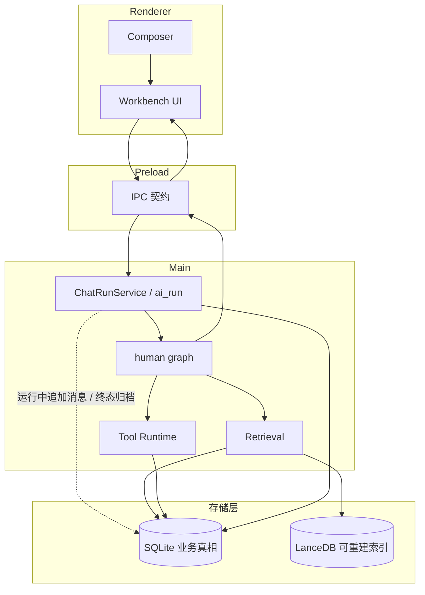
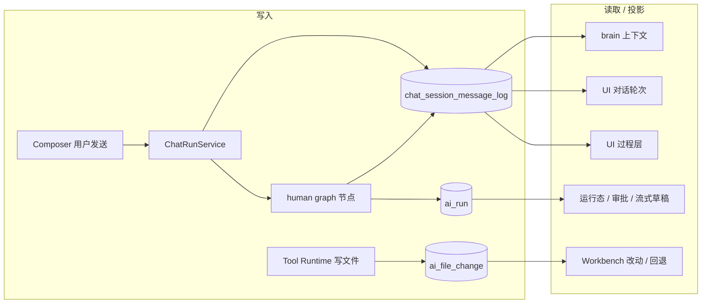

# NCurator-Desktop 架构

本文是项目唯一架构入口，只描述长期稳定的系统结构、模块职责和设计思路。Human harness 消息/投影/compaction/resume、工具契约与投递管道的详细约束见 `doc/ai-harness/`。具体字段、schema、阈值与实现细节以代码和测试为准。应用只支持 macOS 和 Windows。

## 技术栈

- Runtime: Electron v39 · Language: TypeScript v5 · Build: Electron-Vite v5 · Package Manager: pnpm
- Renderer: React v19 · React Router DOM v7 · Ant Design v5 · Tailwind CSS v4 + Less
- Main: LangChain JS · LangGraph JS · @huggingface/transformers v3 · SQLite + better-sqlite3 · LanceDB · pdf-parse · mammoth · @node-rs/jieba

PPT 普通预览与历史审核均由 `pptx-kit-preview` 生成 SVG，共用 Canvas 字体宽度测量和明确的中西文字体回退列表；Renderer 使用浏览器 Canvas，Main 使用本地 Canvas。历史审核保存生成后的 SVG，后续渲染只读取该产物。

## 系统分层

NCurator-Desktop 是本地优先的 Electron 桌面应用。文档解析、嵌入、索引、检索、AI 编排和持久化都优先在本地完成。

**进程层**

- Renderer：UI 展示、用户交互、状态呈现。
- Main：AI 编排、数据库、文档处理、资料索引、写回流程、系统通知。
- Preload：Renderer 与 Main 之间的安全桥接。
- Shared：IPC 契约、事件类型、跨进程共享类型。

**存储层**

- SQLite：业务真相（伙伴、伙伴消息记录、AI run、审批、文件修改记录、文档元数据、工作地址、全局网页、定时任务、浏览器 Tab、配置）。
- LanceDB：可重建的 `vector_chunk` 向量索引。
- SQLite 通过 migration 演进；LanceDB 可按文档 generation 重建，检索时库内只保留最新 chunk。

**检索**

向量搜索（语义）+ LanceDB FTS（关键词）+ RRF 融合。

### 分层与主链路

## 核心模块

| 模块                | 职责                                                                                  |
| ------------------- | ------------------------------------------------------------------------------------- |
| Application Shell   | Renderer / Main / Preload / Shared 协作；伙伴 UI 快照与浏览器 Tab 状态持久化到 SQLite |
| AI Runtime          | 一次用户请求的 run 生命周期：事件流、审批、工具调用、最终答复                         |
| Storage             | `SqliteCore` + `LanceDbCore` + 各领域 Store                                           |
| Retrieval           | 文档索引、混合召回、结果融合                                                          |
| Tool Runtime        | 文件、终端、浏览器等本地能力；审批、命令安全                                          |
| File Change Records | 只有受控文件工具写回才记修改、Diff 与回退；terminal 只执行，不扫描记账                |

工作地址是默认执行范围而非硬边界：模型默认在设置页现有文件地址内操作，系统级需求可访问地址外绝对路径。文件工具的 `sourcePath` / `outputPath` 必须为本机绝对路径；`read_image` 的 `paths` 接受本机绝对路径或 HTTP(S) 地址。内置浏览器由 Electron `WebContentsView` 承载；Stagehand 在操作网页时按 Tab 挂到本机回环 CDP 桥（`webContents.debugger`），不在进程启动时打开 `--remote-debugging-port`。对象存储在 `userData/partners/{id}/objects/sha256/<前 2 位>/<其余>`。

网页搜索由冻结的 Python sidecar 提供搜索与抓取；抓取 sidecar 只把隐藏 crawler view 登记进同一座 CDP 桥。`web_search` 只向 AI 返回结构化结果，不得自动展开右侧面板；右侧浏览器仅由 `browser_use` 或用户手动开标签触发。抓取细节见代码与 `ai-harness/tool-design.md`。

开发版使用独立 `*-dev` user-data 目录；E2E 可通过 `NCURATOR_USER_DATA_PATH` 提供隔离目录。

## AI 运行时

AI 架构围绕一次 `run` 展开，由 **`human` LangGraph** 推进任务：`context_budget ⇄ context_compaction → brain → dispatch → (human_interaction | learning | plan | hand) → …`，无工具调用时 `finalizeDelivery` 保存交付正文，再由主进程完成文件审核与 run 终态。Workbench 可在普通运行期间将追加消息写入当前 `ai_run`；human graph 在工具结果写入、dispatch 队列清空后的 `context_budget` 安全交接，或在最终交付后由 Main 继续下一轮。停止、失败或进程中断时追加消息进入 transcript，不自动启动续接。节点细节见 `ai-harness/human-harness.md`。

**设计文档（修改 AI 行为前必读）**

| 文档                                                             | 范围                                                                                     |
| ---------------------------------------------------------------- | ---------------------------------------------------------------------------------------- |
| [`doc/ai-harness/human-harness.md`](ai-harness/human-harness.md) | Graph 流转、log 数据源、brain 投影、前缀缓存、compaction、resume、skill/plan、交付与失败 |
| [`doc/ai-harness/tool-design.md`](ai-harness/tool-design.md)     | 工具九条原则、HumanToolSpec、参数规范化、统一投递、渲染格式族                            |

**稳定结构摘要**

- **子会话协作**：`delegate_to_subagent` 创建或续接持久子会话，调用同一 `AiRunService` / human graph；主子 SQLite transcript 按会话隔离，共用投影与 compaction。完成清理子会话，未完成保留供续接；过程和交付进入主任务日志，文件归本次主运行。不创建侧栏伙伴。
- **主任务 Transcript 真相源**：`chat_session_message_log`（append-only，行挂 `partner_id`）；字段见 `doc/db/tables.md`。压缩、恢复与投影细节见 `ai-harness/human-harness.md`。
- **Skill / Tool**：builtin skill 默认可 bind；external 需 `learn_skill`；`agent-control` 承载子任务查询/派发、技能加载、计划、用户提问和图像读取。
- **伙伴 UI 状态**：`partner_ui_state(partner_id PK)` 与 `workbench_ui_state.active_view_key` 保存伙伴 UI 快照与当前伙伴。存储边界见下文「存储与索引」，字段见 `doc/db/tables.md`。

### AI 数据源与消费方

细节（消息形态、resume append、compaction 范围、多模态配额、failure_code 等）一律以 human-harness 为准，本文不再重复。

## 领域能力（概要）

| 领域                  | 思路                                                                                                                                                                                                                  |
| --------------------- | --------------------------------------------------------------------------------------------------------------------------------------------------------------------------------------------------------------------- |
| DOCX                  | 文档聚合模型 + story 内容树；root、可编辑子节点和 visual 共用一个 `nodesById`，visual 只使用 `nodeId`；读写拆成两个 skill；首次基线 / 最终文件双态 + 独立首尾净比较；块级顺序、字符级 Diff 和局部格式标记共用比较结果 |
| PDF                   | `pdf_outline` 元数据与书签；页级读取与检索；Worker 隔离解析；读取页面同时返回 pageImagePath                                                                                                                           |
| PPT                   | 结构化页规格创建与整页替换，按 slideId / elementId 锚点编辑；`ppt_read_slides` 支持 `detail=full` 或 `detail=images`                                                                                                  |
| Excel                 | 工作表地图 + A1 范围；`excel_read` 四种 type（workbook / range / style / search）；`excel_edit` 一次一个 type；写回成功时结构化 `data` 多为 `{}`，模型侧另有 prose 确认                                               |
| KB                    | 混合召回检索全部已索引文件地址与全局网页                                                                                                                                                                              |
| Image                 | 外部 skill；需 `learn_skill`；按绝对路径生成或更新 PNG / JPEG / WebP                                                                                                                                                  |
| Text / Terminal / Web | 普通文本读写搜索、命令执行、网页抓取与内置浏览器操作                                                                                                                                                                  |
| 定时任务              | 独立主区配置与启用开关；到点向绑定伙伴追加任务描述，并读取伙伴最新 Composer 配置                                                                                                                                      |

各领域工具名、operation 与 OOXML / 事务 / Diff 细节以代码为准；工具契约见 `ai-harness/tool-design.md`，活例子按需生成（`pnpm doc:ai-tool-prompt-audit`，不入库）。

## 存储与索引

业务状态只有一个真相：SQLite 存业务与元数据，LanceDB 存可重建索引。检索在 LanceDB 上按 `workspace_id` / `document_id` / `source_type` 过滤，再用 SQLite 文档元数据补来源路径或 URL。Workbench 伙伴 UI 与浏览器 Tab 状态以 SQLite 为持久化真相；未发送的文档选区、关联想法、定位状态及 PPT 画面快照保留在 Renderer 的伙伴级内存。DOCX、PDF、Markdown/文本、PPT 与 Excel 通过各自的选区适配器接入共用的浮层、草稿、高亮与回跳交互；Excel 使用原生区域高亮，其他预览使用文本 Range 或位置矩形。提交时 Main 校验格式锚点，将 PPT PNG 快照写入伙伴内容寻址对象目录，消息仅保存对象路径和类型，不保存图片字节；无需新增数据库表。文本文件提交前等待当前自动保存完成。索引 generation、写后清理与检索过滤规则见 `doc/db/design.md`，表字段见 `doc/db/tables.md`。

## 主链路

1. Renderer 发起用户请求 → Main 创建 run，读取该伙伴消息记录与设置页文件地址；普通 run 运行期间的追加消息持久化到该 run。
2. AI Runtime 通过 human graph 推进 `context_budget`、brain、learning、plan、hand；需要压缩时走 `context_compaction`。追加消息在安全边界触发续接；无追加消息时 brain 输出最终交付并完成 run。
3. 需要资料时 → Retrieval（SQLite 元数据 + LanceDB 检索）。
4. 需要本地能力时 → Tool Runtime 调用领域服务。
5. 工作地址内写回 → 记录修改与预览，供 UI 展示和回退。
6. 最终答复与事件流经 IPC 回到 Renderer；run 终态后 Main 触发系统通知。

## 文件写盘与审核

`AiFileChangeService` 的文件会话统一管理 Word、PPT、Excel 和普通文本；图片沿用历史图片快照。会话以 partnerId、ownerRunId、规范化文件路径归属，由 `AiRunContext` 提供确认写盘、读取会话和收尾入口。工具先完整替换正式文件、立即回读校验，再持久化最新确认工作版本及结构身份；成功前不生成审核，失败不自动恢复正式文件。

首次原始字节 A 按内容寻址保留。主 run 真正完成、失败或取消时，等待在途写入结束，使用 A 与最后确认的 B 生成自包含审核，再保存统一记录并清理工作快照。子任务、yield 和追加消息续接共用 ownerRunId，不触发最终审核。启动从持久化会话为中断 run 补生成审核，不执行 AI、不修改正式文件。

Renderer 的历史审核只读取对应产物，当前文件预览读取正式路径；后续 C 不改变 A→B。Word 应用记录仅投影统一记录并复用统一撤销。目录与持久化字段见 `doc/db/design.md`、`doc/db/tables.md`，工具错误契约见 `doc/ai-harness/tool-design.md`。
