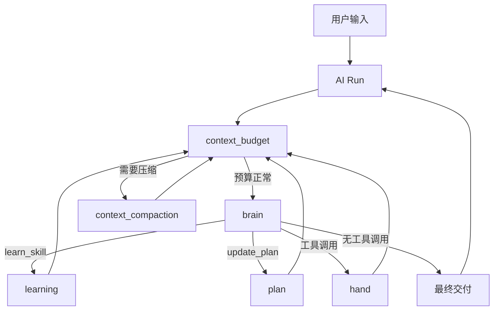

# NCurator-Desktop 架构

本文是项目唯一架构入口，只描述长期稳定的系统结构、模块职责和设计思路。具体字段、工具 schema、阈值与实现细节以代码和测试为准。应用只支持 macOS 和 Windows。

## 技术栈

- Runtime: Electron v39 · Language: TypeScript v5 · Build: Electron-Vite v5 · Package Manager: pnpm
- Renderer: React v19 · React Router DOM v7 · Ant Design v5 · Tailwind CSS v4 + Less
- Main: LangChain JS · LangGraph JS · @huggingface/transformers v3 · SQLite + better-sqlite3 · LanceDB · pdf-parse · mammoth · @node-rs/jieba

## 系统分层

NCurator-Desktop 是本地优先的 Electron 桌面应用。文档解析、嵌入、索引、检索、AI 编排和持久化都优先在本地完成。

**进程层**

- Renderer：UI 展示、用户交互、状态呈现。
- Main：AI 编排、数据库、文档处理、资料索引、写回流程、系统通知。
- Preload：Renderer 与 Main 之间的安全桥接。
- Shared：IPC 契约、事件类型、跨进程共享类型。

**存储层**

- SQLite：业务真相（会话、消息、AI run、审批、文件修改记录、文档元数据、工作区状态、配置）。
- LanceDB：可重建的 `vector_chunk` 向量索引。
- SQLite 通过 migration 演进；LanceDB 可按文档 generation 重建。

**检索**

向量搜索（语义）+ LanceDB FTS（关键词）+ RRF 融合。检索前先经 SQLite 确认有效 `document.active_generation_id`，再查 LanceDB。

## 核心模块

| 模块                      | 职责                                                                                       |
| ------------------------- | ------------------------------------------------------------------------------------------ |
| Application Shell         | Renderer / Main / Preload / Shared 协作；Workbench UI 快照与浏览器 Tab 状态持久化到 SQLite |
| AI Runtime                | 一次用户请求的 run 生命周期：事件流、审批、工具调用、最终答复                              |
| Storage                   | `SqliteCore` + `LanceDbCore` + 各领域 Store                                                |
| Retrieval                 | 文档索引、混合召回、结果融合                                                               |
| Tool Runtime              | 文件、终端、浏览器等本地能力；审批、命令安全、工作区变更追踪                               |
| Workspace Change Tracking | Run 前后扫描工作区，记录可回退的修改；工作区外路径可读写但不纳入变更记录                   |

工作区是默认执行范围而非硬边界：模型默认在工作区域内操作，系统级需求可访问工作区外绝对路径。文件工具的 `sourcePath` / `outputPath` 必须为本机绝对路径。内置浏览器由 Electron `WebContentsView` 承载，Stagehand 通过本机回环 CDP endpoint 精确连接对应 Tab。

开发版使用独立 `*-dev` user-data 目录；E2E 可通过 `NCURATOR_USER_DATA_PATH` 提供隔离目录。

## AI 运行时

AI 架构围绕一次 `run` 展开，由 `human` graph 推进任务。



**节点职责**

- `brain`：原生 function calling，绑定当前可用工具，决定下一步或最终交付。
- `dispatch`：`tool_calls` 队列的唯一消费者，按模型返回顺序路由至 learning / plan / hand。
- `learning` / `plan` / `hand`：执行分配的工具调用，写回 `ToolMessage`，继续剩余队列。
- `context_budget` / `context_compaction`：检查上下文预算；必要时压缩较早历史，注入 `<current_state>`（plan + learnedSkillIds）。

**消息与上下文**

- 会话级 append-only 的 `chat_session_message_log` 是唯一真相源；模型上下文从记录投影，UI 过程展示亦从记录重建。
- 每条记录为 `user` / `assistant`（含 `tool_calls`）/ `tool` / `annotation`；压缩只作用于投影，记录本身不动。
- 图片在记录中只保存路径、MIME、字节数和尺寸；本地图片在请求主模型前才临时投影为 data URL，HTTP(S) 图片保留原地址。工具消息不能携带图片时，紧随其后追加合成的 user 多模态消息。
- 单次请求最多保留最近 600 张图片，本地 data URL 估算体积最多 20 MiB。数量超限时从最旧图片开始按至少 20 张的批次裁剪；体积超限时一次至少释放 10 MiB，减少频繁改变消息前缀造成的缓存失效。原位置保留可重新调用 `read_image` 的路径占位。
- `read_image` 对本地源文件按 SHA-256 复用 `.ncurator/runtime/assets/read_image-cache/<64位哈希>-v1.webp`；不放大小图，大图等比压到最多 64 万像素和 1 MiB。运行时目录丢失后，历史消息保留路径占位，需要时重新读取。
- 中断恢复：补写缺失的 `ToolMessage`，尾部追加 user 消息继续；未正常完成的 run 保留恢复快照（plan、skills、artifacts）。

**Skill 与 Tool**

- **Skill**：能力包。builtin 默认可用；external 需 `learn_skill` 加载后才进入 bindTools 集合。
- **Tool**：具体执行入口，以 `HumanToolSpec` 定义 schema、执行与结果投影。
- `agent-control` 是内置技能，承载 `learn_skill`、`update_plan` 和 `read_image`；`read_image` 一次接受 1 至 10 个路径，将图片引用按顺序加入主模型下一轮多模态上下文，不调用第二个模型，也不预判主模型是否支持图片。
- skill / tool 描述只声明能力边界与参数语义，不写固定调用流程。

**交付**

`brain` 一轮返回无 `tool_calls` 时，assistant content 即为最终交付 markdown；Main 侧不做计划完成度强制拦截。结构化 JSON 输出（非 tool calling 场景）统一走 `prompt_json`，本地 jsonrepair + schema 校验兜底。

## 工具设计

AI 通过工具操作本地环境。工具应像「手」：模型指定**位置（锚点）**和**意图（动作）**，工具执行并返回**下一步决策所需的最小可靠反馈**。工具契约（schema + 结果形态）是模型唯一能依赖的语义来源。

**六条原则**

1. **锚点，非重建** — 读写通过稳定引用（nodeId、路径、行号等）定位；不要求模型一次生成深层结构树。
2. **读写分离、职责单一** — 发现用 read，变更用 write；同一领域少量工具 + `operation` 区分，不为小能力膨胀工具数。
3. **Schema 即契约** — 参数扁平、语义必填、字段带 describe；校验失败返回可修复错误，不静默改写。
4. **结果双通道** — 结构化结果是真相；面向模型的文本是投影，不承担 ID / 锚点解析职责。
5. **原子与可预期** — 一次调用一个 operation；成功或整次失败；同类输入语义稳定。
6. **描述声明边界，不教流程** — skill / tool 描述只说明能做什么、不能做什么、参数含义；组合策略由模型自主决定。

**运行时分层**

```text
Skill（builtin / external）
  └─ Tool（HumanToolSpec）
       ├─ inputSchema / outputSchema   本地校验 + 结构化真相
       ├─ promptSpec                   暴露给模型的最小契约
       └─ modelResult                  投影为模型可读文本（含超限策略）
```

prompt 措辞、渲染格式、超限阈值等实现细节见代码与测试。实现层类型与字段规范见 AGENTS.md。

DOCX 读写工具族已按上述原则落地，作为后续 Excel / PPT / PDF 等工具对齐的参考实现。

## 领域能力（概要）

| 领域                  | 思路                                                                                                                                                            |
| --------------------- | --------------------------------------------------------------------------------------------------------------------------------------------------------------- |
| DOCX                  | 文档聚合模型 + story 内容树；root、可编辑子节点和 visual 共用一个 `nodesById`，visual 只使用 `nodeId`；读写拆成两个 skill；Source / Working 双态 + 净 Diff 审核 |
| PDF                   | 页级读取与检索；Worker 隔离解析；读取页面同时返回 pageImagePath                                                                                                 |
| PPT                   | 受限 HTML 编译读写；读取页面同时返回 slideImagePath                                                                                                             |
| Excel                 | 工作簿 / 工作表 / 单元格范围读写                                                                                                                                |
| KB                    | 混合召回检索工作区已索引文档                                                                                                                                    |
| Text / Terminal / Web | 普通文本读写搜索、命令执行、网页抓取与内置浏览器操作                                                                                                            |

各领域工具名、operation 与 OOXML / 事务 / Diff 细节以代码为准。

## 存储与索引

业务状态只有一个真相：SQLite 存业务与元数据，LanceDB 存可重建索引；业务查询先经 SQLite 确认有效范围，再进入 LanceDB。Workbench 会话 UI 与浏览器 Tab 状态以 SQLite 为唯一持久化真相。详细 schema 见 `doc/database.md`。

文件和网页索引通过 `generation_id` 原子切换当前有效版本；新索引失败时继续使用旧版本。

## 主链路

1. Renderer 发起用户请求 → Main 创建 run，读取会话上下文与工作区状态。
2. AI Runtime 通过 human graph 推进 brain、learning、hand，brain 输出最终交付。
3. 需要资料时 → Retrieval（SQLite 元数据 + LanceDB 检索）。
4. 需要本地能力时 → Tool Runtime 调用领域服务。
5. 工作区内写回 → 记录修改与预览，供 UI 展示和回退。
6. 最终答复与事件流经 IPC 回到 Renderer；run 终态后 Main 触发系统通知。
