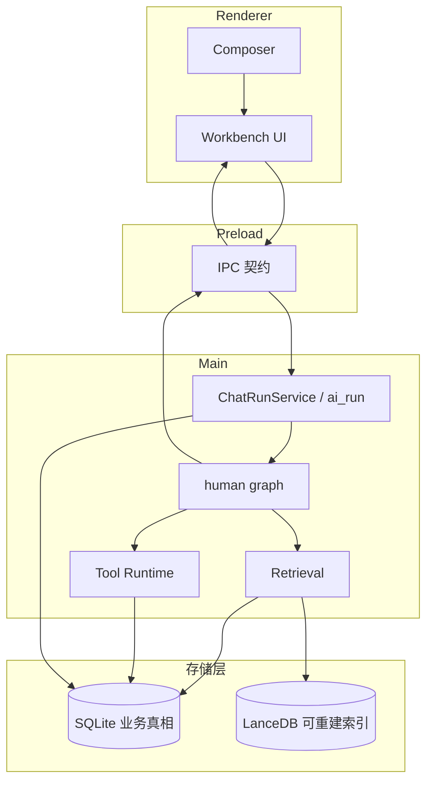
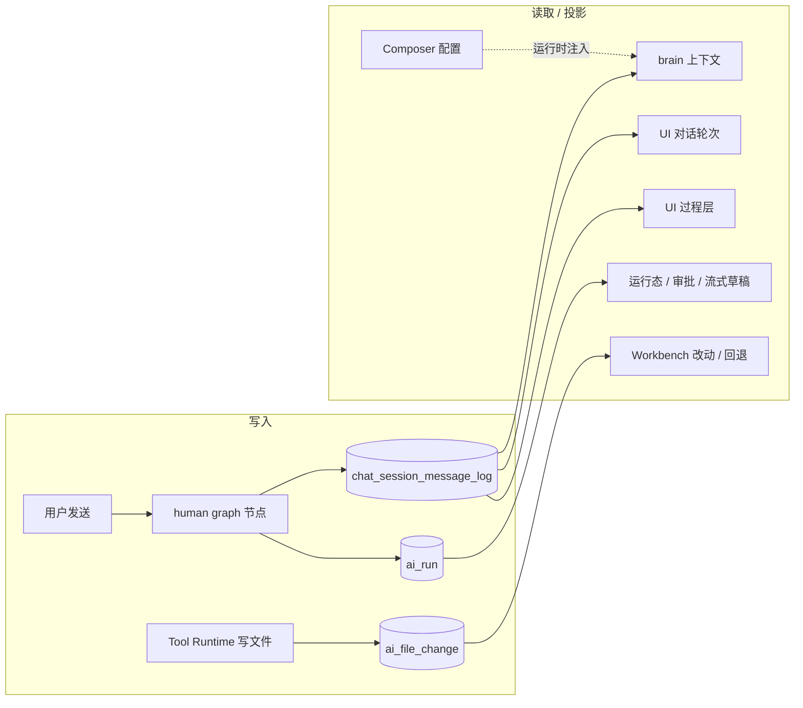

# NCurator-Desktop 架构

本文是项目唯一架构入口，只描述长期稳定的系统结构、模块职责和设计思路。Human harness 消息/投影/compaction/resume、工具契约与投递管道的详细约束见 `doc/ai-harness/`。具体字段、schema、阈值与实现细节以代码和测试为准。应用只支持 macOS 和 Windows。

## 技术栈

- Runtime: Electron v39 · Language: TypeScript v5 · Build: Electron-Vite v5 · Package Manager: pnpm
- Renderer: React v19 · React Router DOM v7 · Ant Design v5 · Tailwind CSS v4 + Less
- Main: LangChain JS · LangGraph JS · @huggingface/transformers v3 · SQLite + better-sqlite3 · LanceDB · pdf-parse · mammoth · @node-rs/jieba

## 系统分层

NCurator-Desktop 是本地优先的 Electron 桌面应用。文档解析、嵌入、索引、检索、AI 编排和持久化都优先在本地完成。

**进程层**

- Renderer：UI 展示、用户交互、状态呈现。
- Main：AI 编排、数据库、文档处理、资料索引、写回流程、系统通知。
- Preload：Renderer 与 Main 之间的安全桥接。
- Shared：IPC 契约、事件类型、跨进程共享类型。

**存储层**

- SQLite：业务真相（伙伴、伙伴消息记录、AI run、审批、文件修改记录、文档元数据、工作地址、全局网页、配置）。
- LanceDB：可重建的 `vector_chunk` 向量索引。
- SQLite 通过 migration 演进；LanceDB 可按文档 generation 重建。

**检索**

向量搜索（语义）+ LanceDB FTS（关键词）+ RRF 融合。检索前先经 SQLite 确认有效 `document.active_generation_id`，再查 LanceDB。

### 分层与主链路

## 核心模块

| 模块                      | 职责                                                                                       |
| ------------------------- | ------------------------------------------------------------------------------------------ |
| Application Shell         | Renderer / Main / Preload / Shared 协作；伙伴 UI 快照与浏览器 Tab 状态持久化到 SQLite |
| AI Runtime                | 一次用户请求的 run 生命周期：事件流、审批、工具调用、最终答复                              |
| Storage                   | `SqliteCore` + `LanceDbCore` + 各领域 Store                                                |
| Retrieval                 | 文档索引、混合召回、结果融合                                                               |
| Tool Runtime              | 文件、终端、浏览器等本地能力；审批、命令安全、工作区变更追踪                               |
| Workspace Change Tracking | terminal 只在开始 cwd 落在某个 `workspace_source.root_path` 内时才扫描该 cwd 子树；工作地址外路径可读写但不纳入变更记录 |

工作地址是默认执行范围而非硬边界：模型默认在设置页现有文件地址内操作，系统级需求可访问地址外绝对路径。文件工具的 `sourcePath` / `outputPath` 必须为本机绝对路径。内置浏览器由 Electron `WebContentsView` 承载，Stagehand 通过本机回环 CDP endpoint 精确连接对应 Tab。对象存储在 `userData/partners/{id}/objects/sha256`。

网页搜索继续由冻结的 Python sidecar 提供 DDG 搜索和 Crawl4AI 抓取。sidecar 保留 Python Playwright 和 Playwright 驱动 JavaScript，但不再携带 Playwright Chromium 或 Node；驱动通过 `PLAYWRIGHT_NODEJS_PATH` 和 `ELECTRON_RUN_AS_NODE=1` 复用当前 Electron 可执行文件中的 Node。`web_search` 的 fetch 首次使用时，Electron 在**专用隐藏 host 窗口**中创建非持久化 `WebContentsView` partition（`show: false`、`skipTaskbar`、`frame: false`、屏外坐标），sidecar 通过本机回环 CDP 连接该隔离 Chromium context，并按唯一 marker 选择页面。该 host 不得挂到主窗口，也不得进入任务栏或显示窗框。找不到唯一 context 时直接失败，禁止退回用户内置浏览器 context。`web_search` fetch 默认优先走 Crawl4AI；若抓取超时或失败，可降级为 Node 侧 HTTP 正文提取；E2E 对本机 loopback URL 可通过 `NCURATOR_WEB_SEARCH_LOOPBACK_FETCH=1` 跳过 CDP 直接 HTTP 读取。`web_search` 只向 AI 返回结构化结果，不得自动展开右侧搜索列表（该列表面板已不存在）；右侧 `browser` 仅由 `browser_use` 或用户手动开标签触发。

开发版使用独立 `*-dev` user-data 目录；E2E 可通过 `NCURATOR_USER_DATA_PATH` 提供隔离目录。

## AI 运行时

AI 架构围绕一次 `run` 展开，由 **`human` LangGraph** 推进任务：`context_budget → brain → dispatch → (learning | plan | hand) → …`，无工具调用时 `finalizeDelivery` 结束 run。

**设计文档（修改 AI 行为前必读）**

| 文档 | 范围 |
|------|------|
| [`doc/ai-harness/human-harness.md`](ai-harness/human-harness.md) | Graph 流转、log 数据源、brain 投影、前缀缓存、compaction、resume、skill/plan、交付与失败 |
| [`doc/ai-harness/tool-design.md`](ai-harness/tool-design.md) | 工具九条原则、HumanToolSpec、参数规范化、统一投递、渲染格式族 |

**稳定结构摘要**

- **Transcript 真相源**：`chat_session_message_log`（append-only，表名保留，行挂 `partner_id`）；投影先切最后一次 `context_cleared`，再跑现有 compaction。`ai_run` 管生命周期与 UI 运行态；`ai_file_change` 管文件域，不进 brain prompt。不存在 `chat_search_turn`。
- **Skill / Tool**：builtin skill 默认可 bind；external 需 `learn_skill`；`agent-control` 承载 `learn_skill`、`update_plan`、`read_image`。
- **伙伴 UI 状态**：`partner_ui_state(partner_id PK)` 保存 Composer 与右侧资源工作台快照；`workbench_ui_state` 只保存 `active_view_key`（当前伙伴 id）。

### AI 数据源与消费方

细节（消息形态、resume append、compaction 范围、多模态配额、failure_code 等）一律以 human-harness 为准，本文不再重复。

## 领域能力（概要）

| 领域                  | 思路                                                                                                                                                            |
| --------------------- | --------------------------------------------------------------------------------------------------------------------------------------------------------------- |
| DOCX                  | 文档聚合模型 + story 内容树；root、可编辑子节点和 visual 共用一个 `nodesById`，visual 只使用 `nodeId`；读写拆成两个 skill；Source / Working 双态 + 净 Diff 审核 |
| PDF                   | `pdf_outline` 元数据与书签；页级读取与检索；Worker 隔离解析；读取页面同时返回 pageImagePath                                                                 |
| PPT                   | 结构化页规格创建与整页替换，按 slideId / elementId 锚点编辑；`ppt_read_slides` 支持 `detail=full` 或 `detail=images` |
| Excel                 | 工作表地图 + A1 范围；`excel_read` 四种 type（workbook / range / style / search）；`excel_edit` 一次一个 type；写回成功时结构化 `data` 多为 `{}`，模型侧另有 prose 确认 |
| KB                    | 混合召回检索全部已索引文件地址与全局网页                                                                                                                        |
| Text / Terminal / Web | 普通文本读写搜索、命令执行、网页抓取与内置浏览器操作                                                                                                            |

各领域工具名、operation 与 OOXML / 事务 / Diff 细节以代码为准；工具契约见 `tool-design.md`，活例子按需生成（`pnpm doc:ai-tool-prompt-audit`，不入库）。

## 存储与索引

业务状态只有一个真相：SQLite 存业务与元数据，LanceDB 存可重建索引；业务查询先经 SQLite 确认有效范围，再进入 LanceDB。Workbench 伙伴 UI 与浏览器 Tab 状态以 SQLite 为唯一持久化真相。详细 schema 见 `doc/database.md`。

文件和网页索引通过 `generation_id` 原子切换当前有效版本；新索引失败时继续使用旧版本。

## 主链路

1. Renderer 发起用户请求 → Main 创建 run，读取该伙伴消息记录与设置页文件地址。
2. AI Runtime 通过 human graph 推进 brain、learning、hand，brain 输出最终交付。
3. 需要资料时 → Retrieval（SQLite 元数据 + LanceDB 检索）。
4. 需要本地能力时 → Tool Runtime 调用领域服务。
5. 工作地址内写回 → 记录修改与预览，供 UI 展示和回退。
6. 最终答复与事件流经 IPC 回到 Renderer；run 终态后 Main 触发系统通知。
