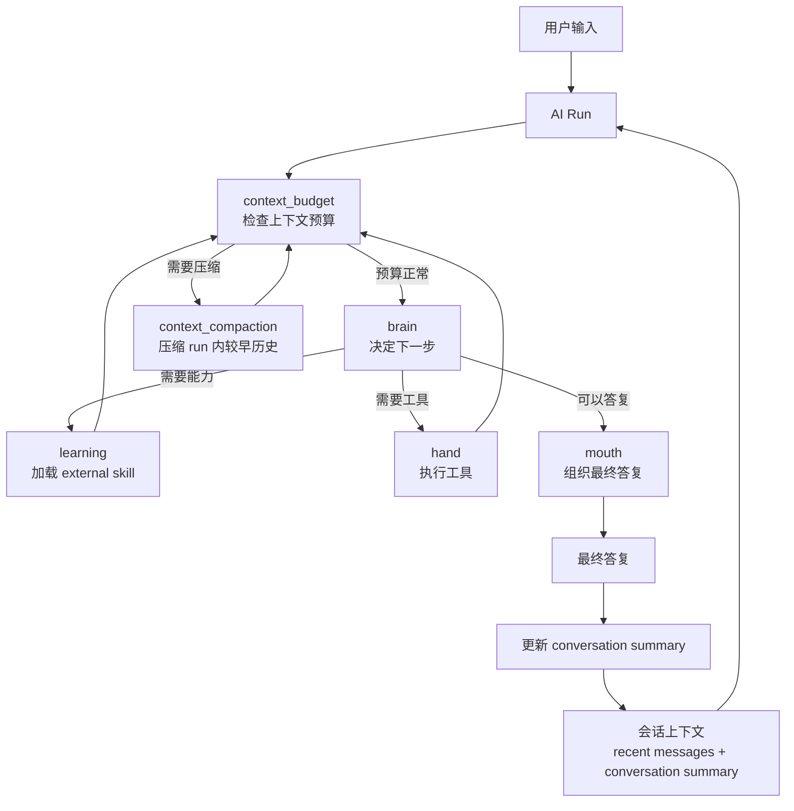
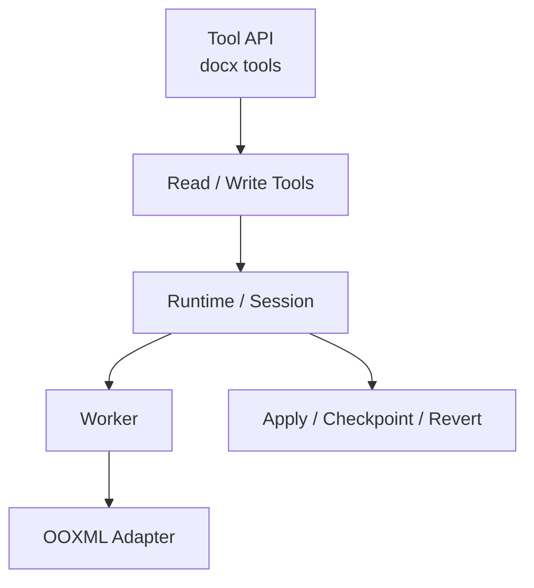

# NCurator-Desktop 架构

本文是项目唯一架构入口，只描述长期稳定的系统结构、模块职责和主流程。具体字段、工具 schema、底层实现细节以代码和测试为准。

## 技术栈

### 核心环境

- Runtime: Electron v39
- Language: TypeScript v5
- Build: Electron-Vite v5
- Package Manager: pnpm

### Renderer

- React v19
- React Router DOM v7
- Ant Design v5
- Tailwind CSS v4 + Less

### Main

- LangChain JS
- LangGraph JS
- @huggingface/transformers v3
- SQLite + better-sqlite3
- LanceDB v0.23
- pdf-parse
- mammoth
- @node-rs/jieba

## 整体架构

NCurator-Desktop 是本地优先的 Electron 桌面应用。文档解析、嵌入、索引、检索、AI 编排和持久化都优先在本地完成。

系统按进程和能力分层：

- Renderer 负责 UI 展示、用户交互和状态呈现。
- Main 负责 AI 编排、数据库访问、文档处理、资料索引和写回流程。
- Preload 负责 Renderer 与 Main 之间的安全桥接。
- Shared 负责 IPC 契约、事件类型和跨进程共享类型。

存储按职责分层：

- SQLite 是业务真相，保存会话、消息、AI run、审批、文件修改记录、文档元数据、网页源、工作区状态和配置。
- LanceDB 只保存可重建的 `vector_chunk` 向量索引。
- SQLite schema 通过 migration 向前演进，LanceDB 索引可按文档 generation 重建。

检索采用混合召回：

- 向量搜索负责语义召回。
- LanceDB FTS 负责关键词召回。
- RRF 负责融合结果。

## 核心模块

### AI Runtime

AI Runtime 负责一次用户请求的 run 生命周期、事件流、审批、工具调用和最终答复。它不直接承担所有任务逻辑，而是把具体能力交给 human graph、工具和领域服务。

### Storage

Storage 负责本地持久化：

- `SqliteCore` 负责 SQLite 连接、PRAGMA 和 migration。
- `LanceDbCore` 只负责 `vector_chunk` 表初始化、搜索和维护。
- 各领域 Store 负责对应业务数据读写。

### Retrieval

Retrieval 负责文档索引、向量检索、全文检索和结果融合。检索前会先从 SQLite 读取当前有效的 `document.active_generation_id`，再到 LanceDB 搜索有效 generation。

### Docx Runtime

Docx Runtime 负责 Word 文档读取、搜索、编辑、任务内回滚、写回和用户回退。它通过 AI 工具暴露能力，但底层由 runtime、worker 和 OOXML adapter 分层完成。

### Apply Review

Apply Review 负责 AI 修改文件后的统一记录、预览和回退入口。Docx 写回会同步写入统一文件修改记录，UI 以统一记录展示用户可见的变更。

## AI 架构

AI 架构围绕一次 `run` 展开。每次用户请求都会创建一个 run，run 内由 `human` 推进任务。

### 主要职责

- `human` 是当前 AI run 的执行核心。
- `brain` 负责判断下一步，不直接执行工具。
- `learning` 负责按需加载 external skill。
- `hand` 负责执行工具，并把结果交回 run。
- `mouth` 负责组织最终答复和交付内容。
- `context_budget` 负责在每一步前检查上下文预算。
- `context_compaction` 只压缩当前 run 内较早过程，服务本次 run 继续推进。

### Skill 与 Tool

AI 能力通过 skill 和 tool 两层表达：

- builtin skill 默认可用，不需要 learning 加载。
- external skill 需要 learning 显式加载后才进入当前有效能力集合。
- skill 描述能力边界和适用场景。
- tool 是具体执行入口，输入输出和限制以代码中的 schema 为准。

skill 不按目录强行拆分，也不等同于工具数量。一个 skill 可以对应多个 tool，多个 skill 也可以共享同一实现域。

### 会话连续性

run 完成后，系统会基于本轮用户输入、最终答复和产物更新 conversation summary。下一次 run 会读取最近消息和 summary，形成跨轮连续性。

## Docx 架构

Docx 架构负责让 AI 可以读取、连续编辑并安全写回 Word 文档。它的目标不是维护一份独立审阅稿，而是让 AI 在任务内持续基于最新文档状态工作，最终直接写回源文件，并提供可回退记录。

### 主要分层

- Tool API 层负责对 AI 暴露 docx 读取和写入能力。
- Read / Write Tools 层负责 AI-facing 的读取、搜索、编辑和任务内回滚。
- Runtime / Session 层负责 sourcePath、read session、replay session、revision 和 open target 管理。
- Worker 层负责实际打开、解析、搜索、编辑执行和校验。
- OOXML Adapter 层负责 docx 结构解析、block 建模和底层操作。
- Apply / Checkpoint / Revert 层负责最终写回、写回前 checkpoint 和用户回退。

### 主流程

1. 读取阶段先基于源文件建立 read session。
2. 只有需要创建、编辑、历史或回滚时，才升级到 replay session。
3. AI 每轮读取当前 working view，不反复回到源文件重算。
4. 编辑成功后，replay session 更新，并投影出新的 working view。
5. run 结束时，从 committed view 写回源文件。
6. 写回前保存 checkpoint，写回后记录统一文件修改记录。
7. 用户回退时根据修改记录恢复 checkpoint 或删除新建文件。

### 关键原则

- source 只负责初始化基线和最终写回目标。
- read session 只负责读取，不提前承担持续编辑职责。
- replay session 是任务内持续编辑的运行时真相。
- AI 永远基于当前 working view 继续工作。
- 写回永远从 committed view 落盘。
- checkpoint 是用户回退真相，revision 是 AI 任务内编辑历史，二者不能互相替代。

## 存储架构

存储架构遵循一个原则：业务状态只有一个真相。

- SQLite 保存业务状态和元数据。
- LanceDB 保存可重建索引。
- 业务查询先经过 SQLite 确认有效范围，再进入 LanceDB 检索。
- 详细数据库设计见 `doc/database.md`。

## 索引一致性

文件和网页索引使用 `generation_id` 保证一致性：

1. SQLite 将 document 标记为 indexing。
2. 生成新的 generation。
3. 写入新 generation 的 LanceDB chunks。
4. 写入成功后切换 SQLite `active_generation_id`。
5. 后台删除旧 generation。
6. 失败时不切换 active generation，旧索引继续可用。

检索时只搜索当前 active generation，避免读到过期索引。

## 主链路

1. Renderer 发起用户请求。
2. Main 创建 run，并读取会话上下文和工作区状态。
3. AI Runtime 通过 human graph 推进 brain、learning、hand、mouth。
4. 需要资料时进入 Retrieval，读取 SQLite 元数据并检索 LanceDB。
5. 需要 docx 能力时进入 Docx Runtime，读取或编辑当前文档状态。
6. 文件写回后记录统一修改记录，供 UI 展示和回退。
7. 最终答复和事件流通过 IPC 回到 Renderer 展示。
