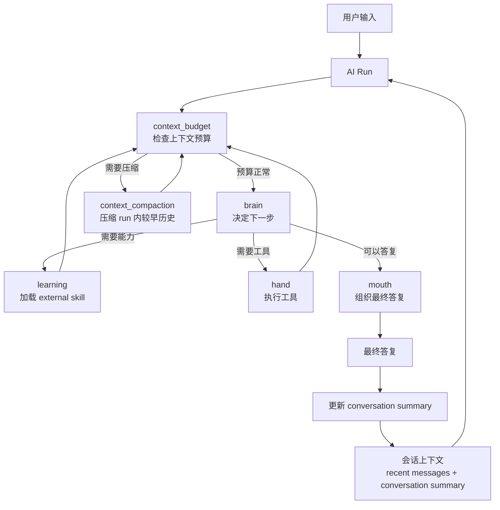

# NCurator-Desktop 架构

本文是项目唯一架构入口，只描述长期稳定的系统结构、模块职责和主流程。具体字段、工具 schema、底层实现细节以代码和测试为准。应用只支持 macOS 和 Windows。

## 技术栈

### 核心环境

- Runtime: Electron v39
- Language: TypeScript v5
- Build: Electron-Vite v5
- Package Manager: pnpm

### Renderer

- React v19
- React Router DOM v7
- Ant Design v5
- Tailwind CSS v4 + Less

### Main

- LangChain JS
- LangGraph JS
- @huggingface/transformers v3
- SQLite + better-sqlite3
- LanceDB v0.22.3
- pdf-parse
- mammoth
- @node-rs/jieba

## 整体架构

NCurator-Desktop 是本地优先的 Electron 桌面应用。文档解析、嵌入、索引、检索、AI 编排和持久化都优先在本地完成。

系统按进程和能力分层：

- Renderer 负责 UI 展示、用户交互和状态呈现。
- Main 负责 AI 编排、数据库访问、文档处理、资料索引和写回流程。
- Main 负责 AI 运行终态的系统通知；通知由 `SystemNotificationService` 统一适配 macOS 和 Windows，Renderer 只负责接收通知点击后的会话打开事件。
- Preload 负责 Renderer 与 Main 之间的安全桥接。
- Shared 负责 IPC 契约、事件类型和跨进程共享类型。

存储按职责分层：

- SQLite 是业务真相，保存会话、消息、AI run、审批、文件修改记录、文档元数据、网页源、工作区状态和配置。
- LanceDB 只保存可重建的 `vector_chunk` 向量索引。
- SQLite schema 通过 migration 向前演进，LanceDB 索引可按文档 generation 重建。

检索采用混合召回：

- 向量搜索负责语义召回。
- LanceDB FTS 负责关键词召回。
- RRF 负责融合结果。

## 核心模块

### Application Shell

Application Shell 由 Renderer、Main、Preload 和 Shared 组成：Renderer 负责界面与交互，Main 负责本地能力和任务编排，Preload 提供安全桥接，Shared 维护 IPC 契约和共享类型。

### AI Runtime

AI Runtime 负责一次用户请求的 run 生命周期、事件流、审批、工具调用和最终答复。它不直接承担所有任务逻辑，而是把具体能力交给 human graph、工具和领域服务。

### Storage

Storage 负责本地持久化：

- `SqliteCore` 负责 SQLite 连接、PRAGMA 和 migration。
- `LanceDbCore` 只负责 `vector_chunk` 表初始化、搜索和维护。
- 各领域 Store 负责对应业务数据读写。

### Retrieval

Retrieval 负责文档索引、向量检索、全文检索和结果融合。检索前会先从 SQLite 读取当前有效的 `document.active_generation_id`，再到 LanceDB 搜索有效 generation。

### Tool Runtime

Tool Runtime 为 AI 提供文件、终端、浏览器等本地能力。工具实现位于 Main，由各领域服务负责具体操作；通用安全边界、审批和工作区变化追踪由运行时统一处理。

内置浏览器由 Electron `WebContentsView` 承载，Stagehand 通过仅绑定本机回环地址的随机 CDP endpoint 精确连接对应 Tab，不依赖固定端口或 URL 猜测页面。

开发版默认使用独立的 `*-dev` user-data 目录，避免和安装版共享数据库、实例锁或 `DevToolsActivePort`；E2E
可以通过 `NCURATOR_USER_DATA_PATH` 显式提供隔离目录。

### Workspace Change Tracking

每个 Run 前后扫描工作区，统一确认新增、修改、删除和重命名，并保存可回退的修改前对象。不同文件格式只负责提供对应的预览方式。

## AI 架构

AI 架构围绕一次 `run` 展开。每次用户请求都会创建一个 run，run 内由 `human` 推进任务。

### 主要职责

- `human` 是当前 AI run 的执行核心。
- `brain` 负责判断下一步，不直接执行工具。
- `learning` 负责按需加载 external skill。
- `hand` 负责执行工具，并把结果交回 run。
- `mouth` 负责组织最终答复和交付内容。
- `context_budget` 负责在每一步前检查上下文预算。
- `context_compaction` 只压缩当前 run 内较早过程，服务本次 run 继续推进。

### Skill 与 Tool

AI 能力通过 skill 和 tool 两层表达：

- builtin skill 默认可用，不需要 learning 加载。
- external skill 需要 learning 显式加载后才进入当前有效能力集合。
- skill 描述能力边界和适用场景。
- tool 是具体执行入口，输入输出和限制以代码中的 schema 为准。

skill 不按目录强行拆分，也不等同于工具数量。一个 skill 可以对应多个 tool，多个 skill 也可以共享同一实现域。

### 结构化输出策略与重试

AI 结构化调用按配置和模型记忆成功策略；能力不支持、解析失败或 Schema 不匹配时降级，服务容量、限流和超时按统一重试策略处理。只有完整成功的策略会被保存，供应商差异不写死在执行器中。

### 会话连续性

跨轮上下文由 conversation summary 和未被摘要覆盖的 recent messages 组成。摘要只覆盖完整轮次，并在后台生成；失败或陈旧结果不会推进覆盖边界。run 内压缩和跨 run 的会话记忆是两套独立机制。

文件 artifact 是预览、差异与回退所需的内部业务数据；传入模型时只投影必要语义，不暴露内部记录标识。运行失败或取消不会撤销已落地修改，所有终态都保留可查看、可回退的修改记录。

## 存储架构

存储架构遵循一个原则：业务状态只有一个真相。

- SQLite 保存业务状态和元数据。
- LanceDB 保存可重建索引。
- 业务查询先经过 SQLite 确认有效范围，再进入 LanceDB 检索。
- 详细数据库设计见 `doc/database.md`。

## 索引一致性

文件和网页索引通过 `generation_id` 原子切换当前有效版本；新索引失败时继续使用旧版本，检索只读取 active generation。详细规则见 `doc/database.md`。

## 主链路

1. Renderer 发起用户请求。
2. Main 创建 run，并读取会话上下文和工作区状态。
3. AI Runtime 通过 human graph 推进 brain、learning、hand、mouth。
4. 需要资料时进入 Retrieval，读取 SQLite 元数据并检索 LanceDB。
5. 需要本地能力时由 Tool Runtime 调用对应领域服务。
6. 文件写回后记录统一修改记录和对应预览，供 UI 展示和回退。
7. 最终答复和事件流通过 IPC 回到 Renderer 展示。
8. Run 持久化为 `completed`、`failed` 或 `cancelled` 后，Main 触发一次系统通知；通知点击通过 Preload IPC 打开对应会话。
