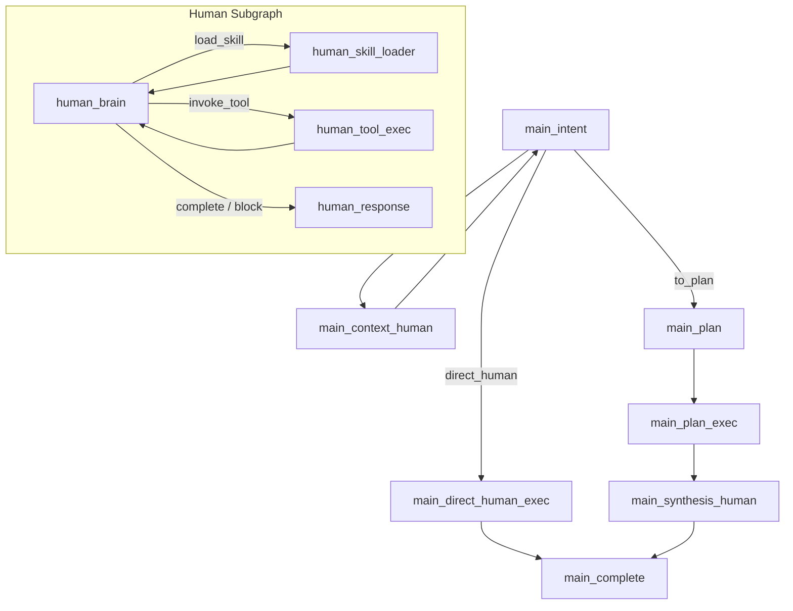

# NCurator-Desktop AI 架构入口

本目录是当前 AI runtime 的默认真相源。当前模型是 `human-led delivery`：

- `main` 只负责编排
- `human` 负责任务完成与正式交付
- plan 模式下由 runtime 追加 `synthesis human`
- 任务间依赖优先通过 `markdown handoff` 传递

## 1. 总览图

## 2. 什么时候读这里

- 修改 LangGraph / AI runtime
- 调整 `main` / `human` 图节点
- 修改 prompt contract、delivery contract、handoff 语义或事件流
- 调整 workspace / approval / draft review 边界
- 调整 AI 工作台展示、回放与测试报告

## 3. 阅读顺序

1. [runtime.md](/Users/test/work-space/NCurator-Desktop/doc/architecture/ai/runtime.md)
2. [event-contracts.md](/Users/test/work-space/NCurator-Desktop/doc/architecture/ai/event-contracts.md)
3. [glossary.md](/Users/test/work-space/NCurator-Desktop/doc/architecture/ai/glossary.md)
4. [extension-playbook.md](/Users/test/work-space/NCurator-Desktop/doc/architecture/ai/extension-playbook.md)
5. [upgrade-playbook.md](/Users/test/work-space/NCurator-Desktop/doc/architecture/ai/upgrade-playbook.md)

## 4. 文档分工

- `runtime.md`
  - 当前节点图、状态字段、objective 编译、handoff 与 synthesis 机制
- `event-contracts.md`
  - 运行事件、task delivery、最终答复流、审批与本地资料状态
- `glossary.md`
  - `Task Delivery`、`Handoff Markdown`、`Synthesis Human` 等统一术语
- `extension-playbook.md`
  - 新增 tool、prompt、delivery、事件、UI 和测试时该改什么
- `upgrade-playbook.md`
  - 架构升级时必须同步的 canonical 文档、skills、AGENTS 与 specs

## 5. 代码真相源

文档不足或与实现冲突时，按以下顺序核对：

1. `src/main/services/ai/graph/*`
2. `src/main/services/ai/node/main/*`
3. `src/main/services/ai/node/human/*`
4. `src/main/services/ai/state/stateSchemas.ts`
5. `src/shared/types.ts`
