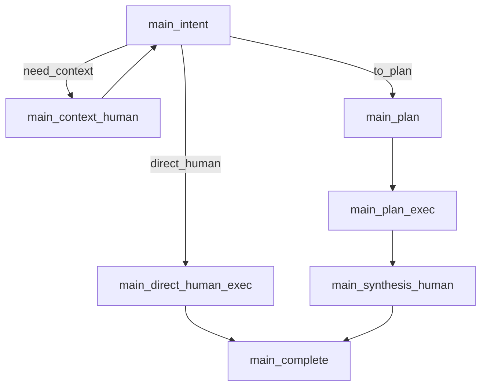
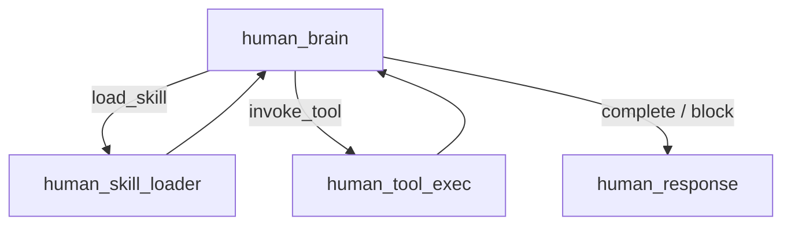

# NCurator-Desktop AI Runtime

## 1. 核心原则

- `main` 只做 orchestration，不生成自然语言最终答复
- `human` 负责单任务执行与正式交付
- 单任务请求走 `direct_human`
- 多任务请求走 `plan -> business humans -> synthesis human`
- 任务间依赖第一版通过 `markdown handoff` 传递，而不是结构化依赖图

## 2. 主执行图



### `main_intent`

- 负责 `need_context | direct_human | to_plan` 三路分流
- 只决定编排路径，不输出最终答复
- `contextRounds` 达到上限后，默认降级到 `to_plan`

### `main_context_human`

- 运行一次 `human` 做上下文补充
- 交付不会直接对用户开流
- 输出写回 `contextEvidence`，再回到 `main_intent`

### `main_direct_human_exec`

- 直接派发一个 `human`
- 该 `human` 的交付就是本轮最终用户答复
- 最终答复流由 `human_response` 发出

### `main_plan`

- 只生成业务任务列表
- planner 不负责“总结答复任务”
- synthesis 是 runtime 注入的系统步骤

### `main_plan_exec`

- 按顺序执行业务任务
- 每个任务完成后沉淀 `summary + deliveryMarkdown`
- 若某个业务任务阻塞，停止后续业务任务派发
- 即使阻塞，未取消时仍必须进入 `main_synthesis_human`

### `main_synthesis_human`

- 基于全部任务交付生成最终用户答复
- 这是 runtime 强制追加的系统步骤
- 不属于 planner 的业务拆分输出

### `main_complete`

- 只负责 run 收尾
- 写回 `status`、`finalDeliveryMarkdown`、draft review finalize 与生命周期结束
- 不再调用模型生成答复

## 3. Human 子图



### `human_brain`

- 每步只能输出 `load_skill | invoke_tool | complete_task | block_task`
- `complete_task` 和 `block_task` 不直接生成长文本交付
- terminal 决策后必须进入 `human_response`

### `human_skill_loader`

- 加载 skill 正文、引用资源与工具集
- 更新 `loadedSkills`、`activeSkillIds`、`activeTools`

### `human_tool_exec`

- 执行原子工具
- 记录 `lastObservation`
- 将运行结果继续交回 `brain`

### `human_response`

- 基于 `objective + summary + stepHistory + observation` 生成正式交付
- 中间业务任务输出 `handoff markdown`
- direct human 与 synthesis human 输出最终答复 markdown
- 最终答复流和 `task_delivery_ready` 都从这里发出

## 4. Objective 编译

对模型可见的最小输入仍然是 `objective`。
runtime 不要求 human 消费显式 `taskRole` 或固定模式字段，而是通过 objective 文本表达任务语义。

### direct human objective

- 明确“直接完成用户请求并输出最终答复”
- 附带 `contextEvidence`

### plan task objective

- 明确“完成当前子任务并输出供后续任务继续的交接文档”
- 附带总体目标、上下文证据与前序交付

### synthesis objective

- 明确“基于全部交付总结最终答复”
- 附带全部任务交付与阻塞信息

## 5. 任务交付模型

`HumanTaskOutput` 当前以两层结果收敛：

- `summary`
  - 给 UI 时间线、计划状态、测试断言与报告摘要
- `deliveryMarkdown`
  - 真正的任务交付真相源
  - plan 模式下供后续任务与 synthesis human 使用
  - direct human / synthesis human 下同时也是最终用户可见答复

### Handoff Markdown 软协议

中间任务建议输出：

```md
# 子任务交付

## 已完成
## 关键发现
## 证据与来源
## 风险与未决
## 建议后续步骤
```

最终答复建议输出：

```md
# 最终答复

## 结论
## 已完成内容
## 关键依据
## 未完成或待确认
## 下一步建议
```

## 6. 运行状态

### Main 状态核心字段

- `mainStage`
- `contextRounds`
- `contextEvidence`
- `plan`
- `dispatchCursor`
- `finalDeliveryMarkdown`
- `finalDeliveryTaskId`
- `localSourceStatus`
- `localSourceSummary`

### Human 状态核心字段

- `phase`
- `deliveryKind`
- `streamAnswer`
- `lastDecision`
- `lastObservation`
- `stepHistory`
- `summary`
- `deliveryMarkdown`

## 7. 安全与边界

- `terminal_exec` / `docx` 未绑定 workspace 时必须拒绝
- 本地资料不足时，最终答复必须显式说明不足，不得伪装成已使用范围外信息
- 审批命中后必须走事件与用户决策，不得在内部静默重试
- 取消优先级高于 synthesis；取消后必须停止当前 human 和剩余派发

## 8. 代码落点

- Graph：`src/main/services/ai/graph/*`
- Main 节点：`src/main/services/ai/node/main/*`
- Human 节点：`src/main/services/ai/node/human/*`
- State：`src/main/services/ai/state/stateSchemas.ts`
- Prompts：`src/main/services/ai/prompts/*`
- Shared 契约：`src/shared/types.ts`
