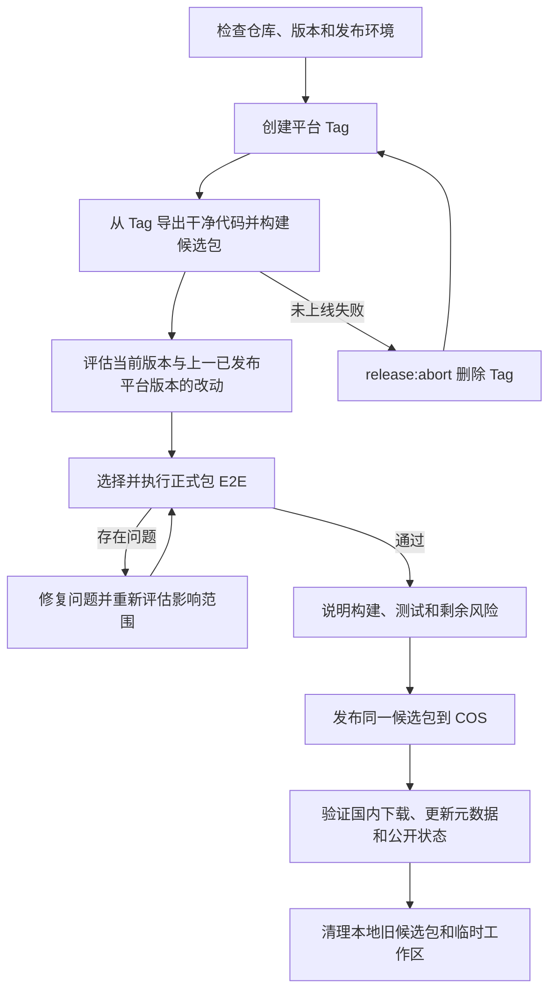

# 桌面端发布流程

本文供发版操作遵循：Windows / macOS Tag、候选包、正式包回归与 COS 发布。构建约束、对象存储布局、CDN/更新通道设计见 [`design.md`](./design.md)；国内 CDN 资费见 [`tencent-cdn-billing.md`](./tencent-cdn-billing.md)。

当前正式发布只发腾讯云 COS（一次即停）；不要在国内发布后再把同一 Tag 同步到 Cloudflare R2。R2 仅预留给未来海外版，须显式设置 `RELEASE_STORAGE_TARGET=r2`。当前只发布 Windows x64 和 macOS arm64；Windows 使用 `windows-vX.Y.Z`，macOS 使用 `mac-vX.Y.Z`，两平台独立递增。

## 1. 发布流程

原则：

- 平台 Tag **正式上线后**不可修改、覆盖或删除；未上线用 `release:abort` 删掉后可重打同版本。
- 候选包必须从 Tag 导出的干净代码构建。
- 按当前版本与上一已发布同平台版本的差异选择正式包 E2E，测实际安装后的候选包；影响面可控时定向回归，不必默认全量。
- 发布测试过的同一份候选包到 COS，并验证国内公开下载和更新通道；COS 验证通过即结束，不要再对同一 Tag 上传或 finalize 到 R2。



### 发布准备与 Tag

在干净且与 `origin/main` 完全一致的 `main` 上开始。新版本必须高于该平台**当前仍存在的**最高 Tag。发版机须具备 live `.env`（`AI_LIVE_KEY_*`，默认 provider 为 dashscope）。

`release:start` 顺序：

1. 校验 `released-migrations.json`（已锁 migration 的 version / name / 文件名 / SHA-256）
2. 并行 `typecheck:node` 与 `typecheck:web`，并 ensure sidecar
3. 以 6 worker 跑全部 Unit（含正式 v9→当前 schema）、update backend 与除 `live` 外的 AI backend
4. **必跑** live 门禁 `human-prefix-cache-retain-live`（跨 run 前缀缓存；无 live key 直接失败，不 skip；不全量 live）
5. 通过后把当前连续 migration 纳入发布锁、与 `package.json` 版本号一并提交，创建 annotated Tag 并原子推送 `main` 与 Tag

第一个平台执行 `release:start` 时锁定本次新增 migration；另一平台随后使用同一份已锁源码。已锁 migration 不能合并、重排或修改，只能新增更高版本。

```bash
pnpm release:start -- --platform windows --version X.Y.Z
pnpm release:start -- --platform mac --version X.Y.Z
```

Windows 在本地 Windows x64 构建候选包；macOS 只创建 Tag，候选包须在 Apple Silicon Mac 上单独构建。平台环境与构建审计见 [`design.md`](./design.md)。

### 未上线 Tag 中止与重打

Tag 已推送但尚未成为任一公开通道 `releases/latest` 上的 live 版本时：

```bash
export NCURATOR_ALLOW_ABORT_TAG=abort-unpublished-tag
pnpm release:abort -- --tag windows-vX.Y.Z
# 或 mac-vX.Y.Z
```

`release:abort` 拒绝删除已 live 或本地状态为 `published` 的 Tag；删除 origin/本地 annotated Tag 与该 Tag 本地候选目录。`main` 上的 `release: prepare …` 提交保留。abort 后同版本重打 `release:start`。已上线版本有问题：发更高版本修复，不要 abort live Tag。

### 干净构建与候选包

prepare 从 Tag 建独立工作区，执行 `pnpm install --frozen-lockfile`、正式构建、安装包审计和 bundle 固化；不复用当前源码、旧 `node_modules` / `dist`，也不上传对象存储。

Windows / macOS 用户可见安装包名为“馆长-…”。**公开 artifacts 对象键与用户可见名一致。** 产品命名分层、技术标识冻结清单见 [`doc/brand.md`](../brand.md)。

候选包目录：`~/.ncurator/release-candidates/<tag>/<platform>/`。状态：`prepared` → 正式包 E2E 通过（或明确 `skipped`）后 `ready`；失败 `rejected`；公开发布并验证后 `published`。本地目录约定见 [`design.md`](./design.md)。

### 影响评估与正式包回归

```bash
git diff <previous-platform-tag>..<current-platform-tag>
```

按提交与模块影响从 `doc/test-plan/**` 选正式包 E2E；影响面广或无法收敛则全量。正式包 E2E 只消费已构建的 `release-bundle-*.json`：复验 Tag/commit/fragment/哈希，安装 EXE/DMG 后对安装态程序跑测试，不重新构建。过滤参数与执行契约（含 warmup、并发）见 `doc/test.md` §4.2；命令见本文 §4。

正式包 E2E **不改候选包品牌**（仍是同一份将上线的「馆长」安装包），只把测试安装落到本机 `NCurator-E2E` 目录；测完删除该目录及指向它的入口。

- Windows：静默装到 `%LOCALAPPDATA%\\NCurator-E2E`。同一 `appId` 下 NSIS 可能覆盖本机已安装的正式包。测完结束 E2E 进程，删除指向 E2E 目录的快捷方式与卸载项，并删除该安装目录。
- macOS：ditto 到 `~/Applications/NCurator-E2E/<platform>/`，把安装副本改名为「馆长 E2E.app」，不触碰 `/Applications` 或 `~/Applications` 下的正式「馆长.app」。测完删除 `~/Applications/NCurator-E2E`。

选中的正式包 E2E 全部执行（含真实 AI / 服务 case）。源码 E2E、backend、unit、独立 `test:ai*` 不替代正式包 E2E，不属于标准发布门。涉及 SQLite 变更的正式包回归至少包含 `sidebar-app-update`、`database-version-update-required`，并用上一公开 schema 的可审查 fixture 验证原地升级（见 `doc/test-plan/workbench-test.md`）。

### 问题处理与发布

临时环境问题可复测同一候选包。改了产品、打包或测试代码：

- **未上线**：`release:abort` 后在修复后的 `main` 重打**同版本**并重新 prepare；
- **已上线**：必须发更高版本新 Tag 与候选包。

同一次发布中，修复不影响已通过用例时不必重跑那些用例。测试完成后说明版本、影响范围、回归结果与剩余风险。publish 只读已通过候选包，不重新构建；默认写入 COS，国内通道验证成功即完成。不要再设 `RELEASE_STORAGE_TARGET=r2` 对同一 Tag 做第二次上传或 finalize。对象键、CDN Cache-Control 与公开 URL 见 [`design.md`](./design.md)。

真实发布默认锁定；用户明确批准上线后，在该终端设置：

```bash
export NCURATOR_ALLOW_LIVE_PUBLISH=publish-to-production
```

未设置时，`--publish-only`、上传与 finalize 在网络写入前失败。普通构建、候选包测试与 `pnpm release:storage:plan` 不需要该变量。

## 2. 按需：Windows 真实覆盖升级（不进回归 / 发布门禁）

```bash
pnpm test:update:real:win -- \
  --source-installer <已发布旧版安装包.exe> \
  --source-version 0.1.68 \
  --expected-version 0.1.69 \
  --downgrade-installer <含禁止降级逻辑的较低版本候选包.exe>
```

- 脚本 `scripts/test/update-real-windows.mjs`，不在 `tests/case/**`，不进 runner / `test:update` / 发布命令。
- 离线本地 HTTP feed 托管新版与 `latest.yml`；不触碰生产通道；独立安装与 user-data，结束后卸载并恢复缓存。
- 应用不含本次修复的已发布旧包复现问题；`--expected-version` 用当前代码构建更高版本。
- 通过：静默覆盖升级成功（无 “Failed to uninstall old application files”）、版本变为 `--expected-version`、marker 保留。
- `--downgrade-installer`：升级后再跑较低版本候选包，断言拒绝安装且版本与 marker 不变；两包都必须含新版 NSIS 保护，不能用历史旧包。

报告：`tests/logs/settings/update/real-windows/<运行时间>/report.json`。

## 3. 中断与恢复

- Tag 已创建但 prepare 中断：同 Tag 重跑 `--prepare-only`；源码已改且未上线则先 abort 再同版本重打。
- 候选已生成但测试中断：同候选 `--test-only`。
- 上传 / finalize 中断：同候选恢复 publish，或 `release:storage:finalize`。
- 未上线整轮作废：abort 后同版本重打，不要另起版本号。
- 已发布有问题：发更高版本修复；回退下载通道不会让已装客户端自动降级。
- 同 Tag 对象存储已存在且哈希不同：禁止覆盖；未上线换产物走 abort + 同版本重打。

## 4. 命令参考

### 构建与审计

```bash
pnpm run build
pnpm run build:unpack
pnpm run build:win
pnpm run build:mac:arm64
pnpm run package:audit
pnpm run package:audit:summary
```

### 候选包

```bash
pnpm release:win -- --tag windows-vX.Y.Z --prepare-only
pnpm release:win -- --tag windows-vX.Y.Z --test-only [回归过滤参数]
pnpm release:win -- --tag windows-vX.Y.Z --publish-only

pnpm release:mac -- --tag mac-vX.Y.Z --prepare-only
pnpm release:mac -- --tag mac-vX.Y.Z --test-only [回归过滤参数]
pnpm release:mac -- --tag mac-vX.Y.Z --publish-only
```

独立测已构建候选：

```bash
pnpm test:e2e:package -- --bundle <release-bundle.json>
pnpm test:e2e:package -- --bundle <release-bundle.json> --domain workbench
pnpm test:e2e:package -- --bundle <release-bundle.json> --case <caseId>
```

### 状态与恢复

```bash
pnpm release:status -- --tag <windows-vX.Y.Z|mac-vX.Y.Z>
export NCURATOR_ALLOW_ABORT_TAG=abort-unpublished-tag
pnpm release:abort -- --tag <windows-vX.Y.Z|mac-vX.Y.Z>
pnpm release:storage:plan
pnpm release:storage:finalize -- --tag <windows-vX.Y.Z|mac-vX.Y.Z>
# 以上默认针对 COS。不要在国内 COS 发布后再对同一 Tag 设 RELEASE_STORAGE_TARGET=r2 做第二次 plan / finalize。
# 仅未来海外版才显式：RELEASE_STORAGE_TARGET=r2
```

硬规则：构建 / 审计失败不放宽包规则；公开 metadata / 下载 / 哈希验证失败不更新 latest 通道。
