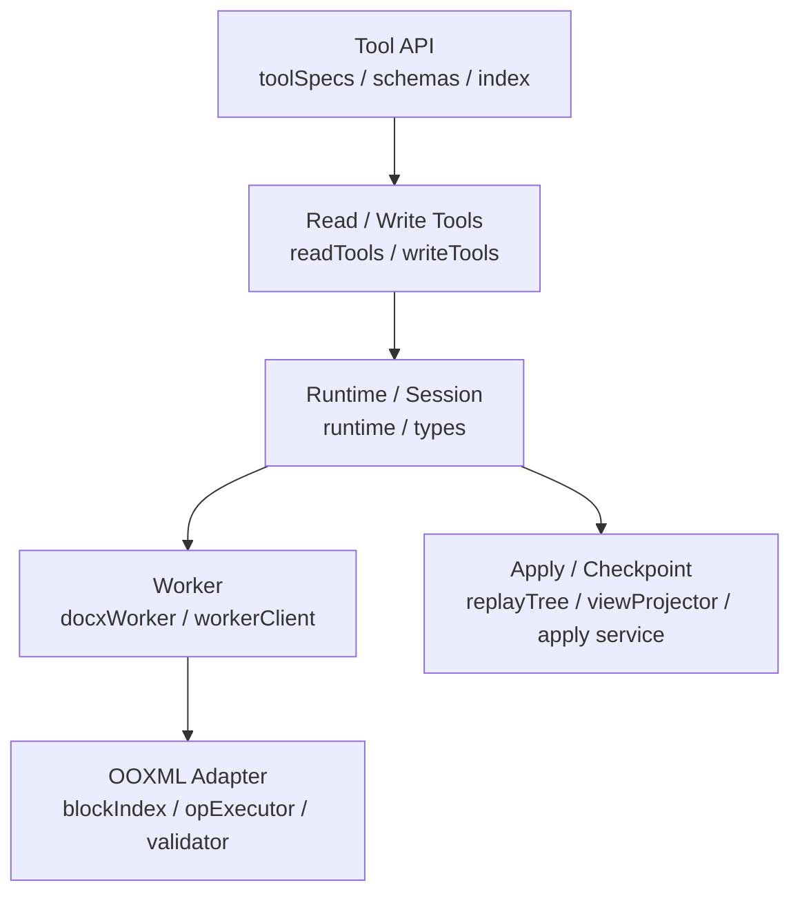

# NCurator-Desktop Docx 架构设计

本文定义 docx 编辑子系统的整体思路，只描述主线、角色和核心原则。

## 1. 子系统目标

docx 子系统负责三件事：

- 让 AI 在同一份文档上高效读取，并在需要时升级到连续多轮编辑。
- 让 AI 的多轮编辑始终基于任务内最新状态继续推进。
- 在最终写回源文件前保存 checkpoint，让用户可以回退本次 AI 修改。

## 2. 核心结构

docx 子系统围绕五个对象工作：

- `source baseline`：原始文档基线，只负责初始化和最终写回目标定位。
- `read session`：只读阶段真相，持有解析结果、索引与局部缓存。
- `replay session`：当前会话真相，持有持续更新的最新状态。
- `working view`：给 AI 读取和继续编辑的当前工作视图。
- `committed view / checkpoint`：committed view 用于直接写回源文件，checkpoint 用于用户回退。

## 3. 整体分层

- Tool API 层负责对 AI 暴露 docx 工具与 schema。
- Read / Write tools 层负责 AI-facing 的读取、搜索、编辑与任务内回滚语义。
- Runtime / Session 层负责 sourcePath、read session、replay session、revision 与 open target 的统一管理。
- Worker 层负责实际文档打开、读取、搜索、编辑执行与校验。
- OOXML Adapter 层负责 docx 结构解析、block 建模与底层 op 执行。
- Apply / Checkpoint 层负责 committed view 生成、写回前 checkpoint、直接写回与用户回退。

## 4. 主流程

### 4.1 初始化与读取

- 纯读取阶段，打开 `source` 后先建立 `read session`。
- `read session` 只负责解析、索引、分页读取与搜索，不建立 revision 状态。
- 只有当 AI 真的要 create / edit / history / rollback 时，才从当前 `read session` 升级到 `replay session`。

### 4.2 持续更新当前状态

- AI 每轮都读取最新的 `working view`。
- AI 发起 edit 后，系统把改动写进当前 `replay session`。
- session 更新后，再投影出新的 working view。

这条链路的关键不是“反复回到 source 重算”，而是：

> 当前状态会持续更新，下一轮始终基于最新状态继续工作。

### 4.3 直接写回

- run 结束时，系统从当前 session 生成 `committed view`。
- 写回前先保存当前磁盘源文件 checkpoint。
- committed view 原子写回源文件。
- 系统记录 `DocxApplyRecord`，供 UI 展示和回退。

### 4.4 回退

- 用户回退时默认校验当前源文件是否仍等于 AI 写回后的 checksum。
- 若文件已被后续修改，UI 提示继续回退会丢失后续修改；用户确认后仍允许强制恢复 checkpoint。
- update 写回恢复 checkpoint；create 写回删除 AI 新建文件。

## 5. 关键原则

- `source` 只做初始化基线和最终写回目标，不做持续工作副本。
- `read session` 只负责读取，不能提前承担持续编辑职责。
- `replay session` 是运行时唯一真相。
- AI 永远只读当前 `working view`。
- 用户可见的是已写回源文件和可回退的 apply record，不再有待确认审阅稿。
- 写回永远只从 `committed view` 落盘。
- checkpoint 是用户回退真相，revision 是 AI 任务内编辑历史，二者不能互相替代。

## 6. 文档边界

- 设计边界、核心数据与关键规则见 `/Users/test/work-space/NCurator-Desktop/doc/docx-design/design-detail.md`
