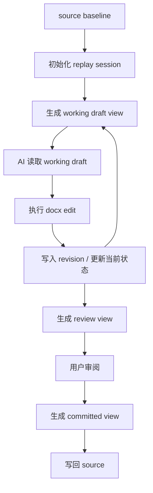
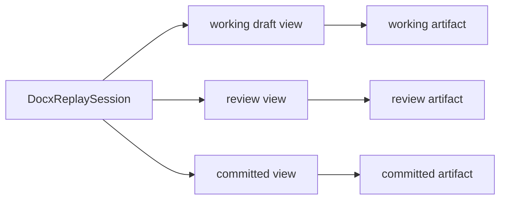

# NCurator-Desktop Docx 数据定义与流转

本文只定义 docx 子系统的数据结构与状态流转，不重复实现规范。

## 1. 主流程图



## 2. 核心数据

```ts
interface DocxReplaySession {
  // 本次会话绑定的源文件路径；初始化和最终提交都围绕它进行。
  sourcePath: string
  // baseline 打开时对应的 worker 文档标识；用于追溯会话起点。
  sourceDocId: string
  // 当前最新状态对应的 worker 文档标识；working draft 物化时基于它生成。
  activeDocId: string
  // 当前会话最新修订引用；history、rollback 和工具返回都围绕它暴露。
  activeRevisionRef: string
  // 下一次成功编辑要分配的修订号。
  nextRevisionNumber: number
  // baseline 对应的结构快照；作为 replay tree 的起点。
  sourceSnapshot: DocxReplaySnapshot
  // 当前最新状态对应的结构快照；三个 view 都从它继续投影。
  activeSnapshot: DocxReplaySnapshot
  // 当前会话所有节点的真相表；节点的来源、位置和 reviewState 都在这里维护。
  nodeById: Map<string, DocxReplayNode>
  // 当前正文顺序；定义当前块级结构的前后关系。
  bodyNodeIds: string[]
  // 当前会话的修订集合；每一轮编辑都会形成一个 revision。
  revisionByDocId: Map<string, DocxRevision>
  // 最近一次物化出来的视图 artifact；只是缓存，不是真相本身。
  viewArtifacts: {
    working?: DocxViewArtifact
    review?: DocxViewArtifact
    committed?: DocxViewArtifact
  }
}

interface DocxReplayNode {
  // 节点稳定标识；跨 revision 用它追踪同一个语义节点。
  nodeId: string
  // 节点在 source 中对应的原始 block 标识；新增节点可缺失。
  sourceBlockId?: string
  // 节点在当前 active snapshot 中对应的 block 标识。
  currentBlockId?: string
  // 节点当前结构对象；working/review/committed 投影都从它读取。
  spec: DocxBlockSpec
  // 节点当前审阅状态。
  reviewState: DocxReviewState
  // 节点来源；用于区分 source 节点与后续新增节点。
  sourceOrigin: 'source' | 'generated'
  // 节点最近一次被哪个 revision 变更过。
  changedRevisionRef?: string
  // 节点最初由哪个 revision 创建。
  createdRevisionRef?: string
}

interface DocxRevision {
  // 对外暴露的修订引用。
  revisionRef: string
  // 该修订对应的 worker 文档标识。
  docId: string
  // 该修订的直接父修订。
  parentRevisionRef?: string
  // 修订创建时间。
  createdAt: number
  // 本次修订的摘要。
  summary?: string
  // 本次修订命中的块级变化摘要。
  changedBlocks?: DocxChangedBlock[]
  // 本次修订真正执行过的编辑 op。
  ops?: DocxOp[]
  // 本次修订新增的 block 列表。
  createdBlocks?: DocxCreatedBlock[]
}

interface DocxViewArtifact {
  // 当前 artifact 属于哪个视图。
  kind: 'working' | 'review' | 'committed'
  // 物化后的文件路径。
  path: string
  // 最近一次生成时间。
  createdAt: number
}
```

## 3. 关键流转

### 3.1 打开 source

- source 初始化 baseline。
- baseline 初始化 `DocxReplaySession`。
- 当前 session 同时得到第一版 `activeSnapshot`。

### 3.2 编辑

- AI 读取当前 `working draft view`。
- edit 执行后生成新的 `revision`。
- 本次 revision 写入 session，并更新当前最新状态。
- session 更新后重新投影新的 working draft。
- 对结构插入，新增块集合按插入区间解析；下游旧块即使 `blockId` 漂移，也不能被计入 `createdBlocks`。

### 3.3 审阅

- 当前 session 直接投影 `review view`。
- review view 物化成 `review artifact`。
- review artifact 只给用户看，不回流为新的运行真相。

### 3.4 提交

- 当前 session 直接投影 `committed view`。
- committed view 物化成 `committed artifact`。
- 最终只把 committed artifact 写回 source。

### 3.5 回滚

- history 按 revision 展示。
- rollback 选中目标 revision 后，session 恢复到该 revision 对应状态。
- working/review/committed 三个 view 随当前状态一起重建。

## 4. 视图关系



- `working draft view`：给 AI 使用，只保留当前有效内容。
- `review view`：给用户使用，显示新增、删除与替换。
- `committed view`：给提交使用，去除审阅态。
- 结构插入后的 replay 重绑必须先保留本轮新增块，再去匹配旧节点，避免 review 中出现下游旧块重复或错位。

三种 view 都来自当前 session，关系始终是：

```text
DocxReplaySession -> working/review/committed views -> artifacts
```

不能反过来从 artifact 重建 session 真相。
