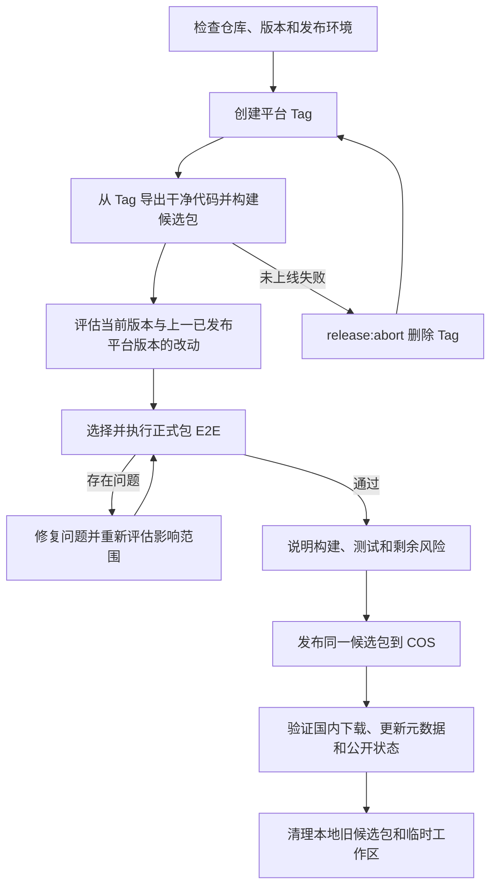

# 桌面端构建与发布

本文是 Windows、macOS 构建、正式包回归和对象存储发布的统一说明。当前桌面端正式发布只发腾讯云 COS（一次即停）；不要在国内发布后再把同一 Tag 同步到 Cloudflare R2。R2 仅预留给未来海外版，须显式设置 `RELEASE_STORAGE_TARGET=r2`，不是同一轮发布的并行通道。当前只发布 Windows x64 和 macOS arm64；Windows 使用 `windows-vX.Y.Z`，macOS 使用 `mac-vX.Y.Z`，两平台独立递增。

## 1. 发布流程

原则：

- 平台 Tag **正式上线后**不可修改、覆盖或删除；未上线用 `release:abort` 删掉后可重打同版本。
- 候选包必须从 Tag 导出的干净代码构建。
- 按当前版本与上一已发布同平台版本的差异选择正式包 E2E，测实际安装后的候选包；影响面可控时定向回归，不必默认全量。
- 发布测试过的同一份候选包到 COS，并验证国内公开下载和更新通道；COS 验证通过即结束，不要再对同一 Tag 上传或 finalize 到 R2。



### 发布准备与 Tag

在干净且与 `origin/main` 完全一致的 `main` 上开始。新版本必须高于该平台**当前仍存在的**最高 Tag。

`release:start` 会先校验 `released-migrations.json`（已锁 migration 的 version / name / 文件名 / SHA-256），再并行 `typecheck:node` 与 `typecheck:web`，并以 6 worker 队列跑全部 Unit（含正式 v9→当前 schema）、update backend 与除 `live` 外的 AI backend。通过后把当前连续 migration 纳入发布锁、与 `package.json` 版本号一并提交，创建 annotated Tag 并原子推送 `main` 与 Tag。

第一个平台执行 `release:start` 时锁定本次新增 migration；另一平台随后使用同一份已锁源码。已锁 migration 不能合并、重排或修改，只能新增更高版本。

```bash
pnpm release:start -- --platform windows --version X.Y.Z
pnpm release:start -- --platform mac --version X.Y.Z
```

Windows 在本地 Windows x64 构建候选包；macOS 只创建 Tag，候选包须在 Apple Silicon Mac 上单独构建。

### 未上线 Tag 中止与重打

Tag 已推送但尚未成为任一公开通道 `releases/latest` 上的 live 版本时：

```bash
export NCURATOR_ALLOW_ABORT_TAG=abort-unpublished-tag
pnpm release:abort -- --tag windows-vX.Y.Z
# 或 mac-vX.Y.Z
```

`release:abort` 拒绝删除已 live 或本地状态为 `published` 的 Tag；删除 origin/本地 annotated Tag 与该 Tag 本地候选目录。`main` 上的 `release: prepare …` 提交保留。abort 后同版本重打 `release:start`。已上线版本有问题：发更高版本修复，不要 abort live Tag。

### 干净构建与候选包

prepare 从 Tag 建独立工作区，执行 `pnpm install --frozen-lockfile`、正式构建、安装包审计和 bundle 固化；不复用当前源码、旧 `node_modules` / `dist`，也不上传对象存储。

Windows / macOS 用户可见安装包名为“馆长-…”。npm 包名、`appId`、`.ncurator` 与本地 `storageName`（ASCII）等内部标识可不变；**公开 artifacts 对象键与用户可见名一致**。

候选包目录：`~/.ncurator/release-candidates/<tag>/<platform>/`。状态：`prepared` → 正式包 E2E 通过（或明确 `skipped`）后 `ready`；失败 `rejected`；公开发布并验证后 `published`。

### 影响评估与正式包回归

```bash
git diff <previous-platform-tag>..<current-platform-tag>
```

按提交与模块影响从 `doc/test-plan/**` 选正式包 E2E；影响面广或无法收敛则全量。正式包 E2E 只消费已构建的 `release-bundle-*.json`：复验 Tag/commit/fragment/哈希，安装 EXE/DMG 后对安装态程序跑测试，不重新构建。过滤参数与执行契约（含 warmup、并发）见 `doc/test.md` §4.2；命令见本文 §6。

选中的正式包 E2E 全部执行（含真实 AI / 服务 case）。源码 E2E、backend、unit、独立 `test:ai*` 不替代正式包 E2E，不属于标准发布门。

### 问题处理与发布

临时环境问题可复测同一候选包。改了产品、打包或测试代码：

- **未上线**：`release:abort` 后在修复后的 `main` 重打**同版本**并重新 prepare；
- **已上线**：必须发更高版本新 Tag 与候选包。

同一次发布中，修复不影响已通过用例时不必重跑那些用例。测试完成后说明版本、影响范围、回归结果与剩余风险。publish 只读已通过候选包，不重新构建；默认写入 COS，国内通道验证成功即完成。不要再设 `RELEASE_STORAGE_TARGET=r2` 对同一 Tag 做第二次上传或 finalize。

真实发布默认锁定；用户明确批准上线后，在该终端设置：

```bash
export NCURATOR_ALLOW_LIVE_PUBLISH=publish-to-production
```

未设置时，`--publish-only`、上传与 finalize 在网络写入前失败。普通构建、候选包测试与 `pnpm release:storage:plan` 不需要该变量。

## 2. 平台与构建

### Windows

本地 Windows x64：Node.js 22 x64、项目指定 pnpm、Python 3.12 x64、Git、tar；发 COS 时还需 AWS CLI 与 COS 存储配置。仅未来海外版才需要 R2 配置。`pnpm release:doctor` 检查本机条件。prepare / test / publish 只消费本机候选包。

### macOS

prepare 必须在 Apple Silicon Mac；需已信任的 `Ncurator Update Signing` P12（自建更新签名，`timestamp: none`、`notarize: false`，非 Apple Developer ID 公证）。候选包须完成正式包 E2E。不构建、测试或发布 Intel Mac。

### 构建与审计硬约束

`pnpm run build`：准备 native 与网页抓取 sidecar → 类型检查与应用构建 → 追踪生产依赖并生成最小化 `release-stage/app` → 真实验证关键读取/写入路径 → 混淆 `out/main` → 审计 staging → electron-builder 打安装包 → 审计真实 `win-unpacked` / `.app`（macOS 另做签名与启动验证）。

electron-builder 只从 `release-stage/app` 打包。安装包不得含源码、测试、文档、开发配置、`.env`、锁文件、Source Map、测试日志、fixture、私钥或错误平台文件。网页抓取 sidecar 须保留 Playwright 驱动 JS，不得含 Playwright Node、`.local-browsers` 或 `chromium_headless_shell-*`，解包体积 ≤ 400 MiB。被定向裁剪的 Node 目录属审计禁区；trace 若触达则删除前构建失败。`app.asar` 非加密，`VITE_*` 按公开信息处理。使用 `maximum` 压缩。候选 bundle 绑定 Tag、commit、fragment、安装包、更新文件与哈希；测试与发布前复验。

## 3. 对象存储与公开通道

每平台独立目录；只保留最新一份 `artifacts`；官网与自动更新共用同一 artifacts URL：

```text
artifacts/windows/windows-vX.Y.Z/*
artifacts/macos/mac-vX.Y.Z/*
release-status/windows/windows-vX.Y.Z.json
release-status/macos/mac-vX.Y.Z/macos-arm64.json
updates/latest/latest.yml
updates/latest/latest-mac.yml
releases/latest/windows.json
releases/latest/macos.json
```

`artifacts` 不可变长缓存；`updates/latest` 与 `releases/latest` 为 `no-store`。`latest.yml` / `latest-mac.yml` 供 electron-updater；`releases/latest/*.json` 供官网 `fetch` 后导航到 artifacts。

公开对象键使用用户可见文件名（如 `馆长-X.Y.Z-macos-arm64.dmg` / `馆长-X.Y.Z-Windows-x64.exe`），官网 `/api/download/*` 仍 307 到该直链；浏览器保存名取自 URL 末段。本地构建产物与 fragment 的 `storageName` 可仍为 ASCII（如 `Ncurator-mac-arm64.dmg`），仅用于解析磁盘文件。

当前正式发布只写 COS：环境变量 `SecretId` / `SecretKey`（或 `TENCENT_SECRET_ID` / `TENCENT_SECRET_KEY`）。桶与公开地址已固化为 `ncurator-1324873382` / `ap-guangzhou` / `https://download.guanzhangai.cn`，无需写入 `.env`。CDN、DNS、资费与采购见 `doc/tencent-cdn-billing.md`。发布子用户权限模板：[`scripts/release/cos/cam-policy.json`](../scripts/release/cos/cam-policy.json)。

国内官网 / 下载：`https://www.guanzhangai.cn`、`https://download.guanzhangai.cn`。海外官网 `www.ncurator.com` 存在，但当前桌面端发行包与自动更新只走国内通道。国内 COS 发布完成后不要再同步同一 Tag 到 R2。

仅当有意发布未来海外版时才切 R2（非当前常规循环）：`RELEASE_STORAGE_TARGET=r2`，并设置 `R2_ACCESS_KEY_ID`、`R2_SECRET_ACCESS_KEY`、`R2_ACCOUNT_ID`、`R2_BUCKET_NAME`、`R2_PUBLIC_BASE_URL=https://download.ncurator.com`。

publish 上传候选与 fragment，更新该平台自动更新 metadata 与官网 manifest，验证公开 yml / 清单 / artifacts 的大小、sha512 与 manifest URL（安装包 URL 须以用户可见文件名结尾）。验证成功后标记 `published`，清理本地 `tests/logs/**`，并清理该平台更早 artifacts / release-status。失败、prepare-only、test-only 不清理 logs。

### 本地保留与清理

`~/.ncurator/release-work`：prepare/test 临时目录，阶段结束删除。`~/.ncurator/release-candidates`：发布并公开验证后只保留本平台最新候选及其 E2E 结果。`~/.ncurator/release-tools`：可复用构建缓存，不随发布删除。

## 4. 自动更新（发布视角）

公开地址：

```text
Windows 清单：https://download.guanzhangai.cn/releases/latest/windows.json
macOS 清单：https://download.guanzhangai.cn/releases/latest/macos.json
Windows 更新：https://download.guanzhangai.cn/updates/latest/latest.yml
macOS 更新：https://download.guanzhangai.cn/updates/latest/latest-mac.yml
```

官网下载页写死上述清单地址，`fetch` 后导航到 artifacts；不要 `fetch` 整包。

模拟 E2E（`sidebar-app-update`、`database-version-update-required` 与 `pnpm test:update*`）见 `doc/test-plan/workbench-test.md`，不证明真实安装成功。涉及 SQLite 变更的正式包回归至少包含上述两 case，并用上一公开 schema 的可审查 fixture 验证原地升级。

### 按需：Windows 真实覆盖升级（不进回归 / 发布门禁）

```bash
pnpm test:update:real:win -- \
  --source-installer <已发布旧版安装包.exe> \
  --source-version 0.1.68 \
  --expected-version 0.1.69 \
  --downgrade-installer <含禁止降级逻辑的较低版本候选包.exe>
```

- 脚本 `scripts/test/update-real-windows.mjs`，不在 `tests/case/**`，不进 runner / `test:update` / 发布命令。
- 离线本地 HTTP feed 托管新版与 `latest.yml`；不触碰生产通道；独立安装与 user-data，结束后卸载并恢复缓存。
- 应用不含本次修复的已发布旧包复现问题；`--expected-version` 用当前代码构建更高版本。
- 通过：静默覆盖升级成功（无 “Failed to uninstall old application files”）、版本变为 `--expected-version`、marker 保留。
- `--downgrade-installer`：升级后再跑较低版本候选包，断言拒绝安装且版本与 marker 不变；两包都必须含新版 NSIS 保护，不能用历史旧包。

报告：`tests/logs/settings/update/real-windows/<运行时间>/report.json`。

## 5. 中断与恢复

- Tag 已创建但 prepare 中断：同 Tag 重跑 `--prepare-only`；源码已改且未上线则先 abort 再同版本重打。
- 候选已生成但测试中断：同候选 `--test-only`。
- 上传 / finalize 中断：同候选恢复 publish，或 `release:storage:finalize`。
- 未上线整轮作废：abort 后同版本重打，不要另起版本号。
- 已发布有问题：发更高版本修复；回退下载通道不会让已装客户端自动降级。
- 同 Tag 对象存储已存在且哈希不同：禁止覆盖；未上线换产物走 abort + 同版本重打。

## 6. 命令参考

### 构建与审计

```bash
pnpm run build
pnpm run build:unpack
pnpm run build:win
pnpm run build:mac:arm64
pnpm run package:audit
pnpm run package:audit:summary
```

### 候选包

```bash
pnpm release:win -- --tag windows-vX.Y.Z --prepare-only
pnpm release:win -- --tag windows-vX.Y.Z --test-only [回归过滤参数]
pnpm release:win -- --tag windows-vX.Y.Z --publish-only

pnpm release:mac -- --tag mac-vX.Y.Z --prepare-only
pnpm release:mac -- --tag mac-vX.Y.Z --test-only [回归过滤参数]
pnpm release:mac -- --tag mac-vX.Y.Z --publish-only
```

独立测已构建候选：

```bash
pnpm test:e2e:package -- --bundle <release-bundle.json>
pnpm test:e2e:package -- --bundle <release-bundle.json> --domain workbench
pnpm test:e2e:package -- --bundle <release-bundle.json> --case <caseId>
```

### 状态与恢复

```bash
pnpm release:status -- --tag <windows-vX.Y.Z|mac-vX.Y.Z>
export NCURATOR_ALLOW_ABORT_TAG=abort-unpublished-tag
pnpm release:abort -- --tag <windows-vX.Y.Z|mac-vX.Y.Z>
pnpm release:storage:plan
pnpm release:storage:finalize -- --tag <windows-vX.Y.Z|mac-vX.Y.Z>
# 以上默认针对 COS。不要在国内 COS 发布后再对同一 Tag 设 RELEASE_STORAGE_TARGET=r2 做第二次 plan / finalize。
# 仅未来海外版才显式：RELEASE_STORAGE_TARGET=r2
```

硬规则：构建 / 审计失败不放宽包规则；公开 metadata / 下载 / 哈希验证失败不更新 latest 通道。
