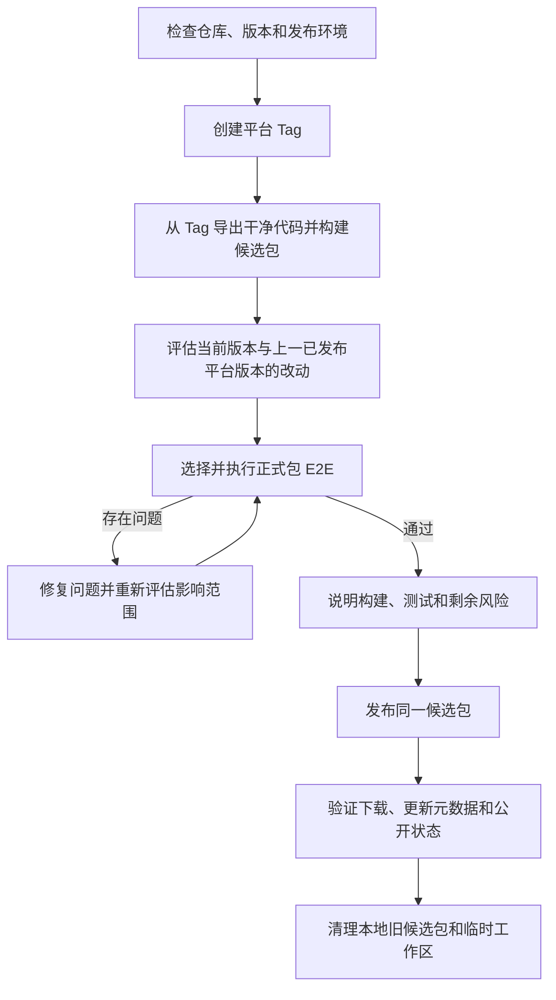

# 桌面端构建与发布

本文是 Windows、macOS 构建、正式包回归和 R2 发布的统一说明。当前发布 Windows x64、macOS arm64 和 macOS x64，不发布 Linux。Windows 使用 `windows-vX.Y.Z`，macOS 使用 `mac-vX.Y.Z`，两个平台独立递增和发布。

向量模型由应用单独下载，不进入安装包。当前不创建 GitHub Release，官网和应用更新均读取 R2。

## 1. 发布流程

发布只遵循四项原则：

- 平台 Tag 创建后不可修改或覆盖。
- 候选包必须从 Tag 导出的干净代码构建。
- 根据当前版本与上一已发布同平台版本的差异选择正式包 E2E，并测试实际安装后的候选包。
- 问题处理完后，发布测试过的同一份候选包，并验证公开下载和更新通道。



### 发布准备与 Tag

在干净且与 `origin/main` 完全一致的 `main` 上开始发布。新版本必须高于该平台已有的最高版本。

`release:start` 会先执行：

```bash
pnpm typecheck:node  # 与 typecheck:web 并行
pnpm typecheck:web
node scripts/test/workflow.mjs --type backend --exclude-group live
```

这些是创建 Tag 前的基础检查，不是正式包回归：两套 typecheck 并行执行；全部 Unit、update backend 和除 `live` 外的 AI 测试进入统一的 6 worker backend 队列，避免重复执行 update 子集。检查通过后，脚本更新 `package.json`、提交版本号、创建 annotated Tag，并原子推送 `main` 与 Tag。

Windows 随后按本地优先的路线构建候选包；macOS 只创建 Tag，候选包需要在 Apple Silicon Mac 上单独构建。

```bash
pnpm release:start -- --platform windows --version X.Y.Z
pnpm release:start -- --platform windows --version X.Y.Z --local-only
pnpm release:start -- --platform windows --version X.Y.Z --actions
pnpm release:start -- --platform mac --version X.Y.Z
```

### 干净构建与候选包

prepare 阶段从 Tag 创建独立工作区，执行 `pnpm install --frozen-lockfile`、正式构建、安装包审计和 bundle 固化。它不复用当前源码、旧 `node_modules` 或旧 `dist`，也不上传 R2。

Windows 的用户可见名称统一为“馆长”：安装包为 `馆长-X.Y.Z-Windows-x64.exe`，安装后的主程序为 `馆长.exe`，快捷方式与卸载项也使用“馆长”。npm 包名、`appId`、`.ncurator` 目录和 R2 对象键等内部技术标识保持不变。

候选包保存在：

```text
~/.ncurator/release-candidates/<tag>/<platform>/
```

候选包生成后处于 `prepared`。需要正式包 E2E 的平台通过后进入 `ready`；暂时不要求正式包 E2E 的平台会明确记录为 `skipped` 后进入 `ready`，不会伪装成测试通过。测试失败时为 `rejected`；公开发布并验证完成后为 `published`。

### 影响评估与正式包回归

使用当前 Tag 与上一已发布同平台 Tag 比较改动；未上线或中断的 Tag 不作为回归基线：

```bash
git diff <previous-platform-tag>..<current-platform-tag>
```

评估提交、文件和模块变化，重点关注用户可见功能、主进程与 IPC、存储兼容、安装与更新、平台专用代码和打包配置。随后从 `doc/test-plan/**` 选择对应的正式包 E2E；如果影响范围较广或无法可靠收敛，就运行全量正式包 E2E。

正式包 E2E 只消费已经构建完成的 `release-bundle-*.json`。runner 会复验 Tag、commit、fragment 和文件哈希，安装 EXE 或 DMG，再连接实际安装后的程序执行测试；测试过程不会重新构建。

不带过滤参数时运行全部正式包 E2E，也可以使用 `--domain`、`--suite`、`--group` 或 `--case` 收窄范围：

```bash
pnpm release:win -- --tag windows-vX.Y.Z --test-only
pnpm release:win -- --tag windows-vX.Y.Z --test-only --domain workbench
pnpm release:win -- --tag windows-vX.Y.Z --test-only --domain workbench --suite result
pnpm release:win -- --tag windows-vX.Y.Z --test-only --case <caseId>

pnpm release:mac -- --tag mac-vX.Y.Z --test-only
pnpm release:mac -- --tag mac-vX.Y.Z --test-only --case <caseId>
```

macOS arm64 候选包必须通过选定的回归范围。macOS x64 仍正常构建、签名、审计、启动验证和发布，但由于 Rosetta 下正式包 E2E 速度过慢，默认不执行 x64 正式包 E2E，也不把它作为发布门禁。需要人工诊断时可显式执行 `--include-x64-e2e`，x64 E2E 固定单并发：

```bash
pnpm release:mac -- --tag mac-vX.Y.Z --test-only --include-x64-e2e
```

所有发布阶段最多运行 60 分钟；测试 runner 在 55 分钟停止领取新用例并保存部分结果。正式并发开始前，每个实际参加 E2E 的候选包先串行通过唯一的 `warmup` 向量索引用例，让模型和磁盘缓存完成冷启动；warm-up 产生的 split/vector 缓存会作为种子复制到后续 case 的隔离缓存目录，warm-up 失败时不会启动后续并发。随后 E2E 总并发和 live 并发上限均为 3，原生对话框、鼠标和桌面焦点用例独占执行。显式启用 macOS x64 E2E 时，x64 仍固定为单并发。

选中的正式包 E2E 全部执行，其中使用真实 AI 或真实服务的 E2E 也不排除。源码 E2E、backend、unit 和独立的 `test:ai*` 测试集只用于开发验证或问题排查，不替代正式包 E2E，也不属于标准发布门。

### 问题处理与发布

发现问题后先定位原因，修复实现或测试，再重新判断修复带来的影响并复测相关正式包用例，直到没有发布阻塞问题。

每次发布都根据实际改动评估影响范围，再决定回归范围；同一次发布中的后续改动不影响已通过用例时，无需重复执行这些用例。

临时环境问题可以复测同一候选包；如果修改了产品、打包或测试代码，由于 Tag 不可变，必须创建更高版本的新 Tag 和候选包。

测试完成后应向用户说明本次版本、主要影响范围、执行的回归、结果和剩余风险。确认可发布后，publish 阶段只读取已经通过测试的候选包，不重新构建。

```bash
pnpm release:win -- --tag windows-vX.Y.Z --publish-only
pnpm release:mac -- --tag mac-vX.Y.Z --publish-only
pnpm release:status -- --tag <windows-vX.Y.Z|mac-vX.Y.Z>
```

## 2. 构建与平台

### Windows

Windows 默认优先在本地 Windows x64 构建。本地环境不可用且配置了 `NCURATOR_ACTIONS_TOKEN` 时，自动回退到手动 dispatch 的 GitHub Actions。

- `--local-only`：强制本地构建，不满足条件就失败。
- `--actions`：强制使用 GitHub Actions。
- Actions checkout 指定 Tag，不从浮动 `main` 构建。
- Actions prepare 后保存完整候选包 Artifact，保留 14 天。
- Actions test 下载 prepare 或上一次 test 的候选包，完成正式包 E2E 后重新保存候选包。
- Actions publish 必须使用测试阶段的 run id，下载原候选包发布，不重新构建。

```bash
# Actions prepare
pnpm release:win -- --tag windows-vX.Y.Z --prepare-only --actions

# Actions test，candidate-run-id 来自 prepare 或上一次 test
pnpm release:win -- --tag windows-vX.Y.Z --test-only --actions --candidate-run-id <run-id>
pnpm release:win -- --tag windows-vX.Y.Z --test-only --actions --candidate-run-id <run-id> --domain workbench

# Actions publish，candidate-run-id 必须来自已通过测试的 run
pnpm release:win -- --tag windows-vX.Y.Z --publish-only --actions --candidate-run-id <run-id>
```

Windows 本地发布环境：

- Windows x64、Node.js 22 x64、项目指定版本的 pnpm；
- Python 3.12 x64、Git、tar；
- 发布到 R2 时还需要 AWS CLI 和 R2 配置。

`pnpm release:doctor` 当前检查 Windows 本地发布与 R2 访问条件。

### macOS

macOS 没有 Actions 构建路线。prepare 必须在 Apple Silicon Mac 执行，并从同一 Tag 分别导出 arm64 与 x64 两份干净代码。

- arm64 使用本机 arm64 Node/Python。
- x64 使用 Rosetta、x64 Node 和 x64 Python。
- 两个架构分别安装依赖、构建、签名、审计和生成候选包。
- arm64 候选包必须完成正式包 E2E；x64 默认跳过正式包 E2E，但发布时仍会检查两个架构的更新签名一致。

```bash
git fetch --tags
git checkout main
git pull --ff-only
pnpm release:mac -- --tag mac-vX.Y.Z --prepare-only
```

macOS 需要已安装并信任的 `Ncurator Update Signing` P12。当前使用项目自建更新签名，`timestamp: none`、`notarize: false`，不等同于 Apple Developer ID 公证。

### 构建、打包与审计

`pnpm run build` 主要完成：

1. 准备 native 模块和网页抓取 sidecar，完成类型检查与应用构建。
2. 追踪生产依赖，生成最小化 `release-stage/app`。
3. 验证 DOCX、PDF、PDF worker 和进程边界，混淆 `out/main`。
4. 审计 staging，再由 electron-builder 生成安装包。
5. 审计真实 `win-unpacked` 或 `.app` 的文件、依赖、敏感信息和体积。
6. macOS 额外执行签名和真实启动验证。

electron-builder 只从 `release-stage/app` 打包：

```text
release-stage/
├── runtime-trace-report.json
├── main-obfuscation-report.json
└── app/
    ├── package.json
    ├── out/{main,preload,renderer}/
    ├── node_modules/
    └── resources/{native,web_crawler_sidecar,open-with}/
```

安装包不得包含源码、测试、文档、开发配置、`.env`、锁文件、Source Map、测试日志、fixture、私钥或错误平台文件。`app.asar` 不是加密，所有 `VITE_*` 变量都按公开信息处理。

候选 bundle 绑定 Tag、commit、release fragment、安装包、更新文件、大小、sha256 和 sha512。测试和发布前都会重新验证这些内容。

## 3. 发布与维护

### R2 与公开通道

Windows 和 macOS 使用独立目录、latest metadata 和固定下载地址：

```text
artifacts/windows/windows-vX.Y.Z/*
artifacts/macos/mac-vX.Y.Z/*
release-status/windows/windows-vX.Y.Z.json
release-status/macos/mac-vX.Y.Z/macos-arm64.json
release-status/macos/mac-vX.Y.Z/macos-x64.json
updates/latest/latest.yml
updates/latest/latest-mac.yml
releases/latest/windows.json
releases/latest/macos.json
downloads/latest/windows-x64.exe
downloads/latest/macos-arm64.dmg
downloads/latest/macos-x64.dmg
```

版本化产物使用不可变缓存；latest、manifest 和固定下载使用 `no-store`。fragment 中的 `name` 记录用户可见文件名，`storageName` 记录 R2 ASCII 对象名；二者共同进入候选 bundle 校验。Windows 固定下载与 manifest 返回 `馆长-X.Y.Z-Windows-x64.exe`，自动更新 metadata 则指向对应的 ASCII 对象键。

本地 `.env` 使用：

```text
R2_ACCESS_KEY_ID
R2_SECRET_ACCESS_KEY
R2_ACCOUNT_ID
R2_BUCKET_NAME
R2_PUBLIC_BASE_URL=https://download.ncurator.com
```

Windows Actions 额外使用：

```text
NCURATOR_ACTIONS_TOKEN
RELEASE_REPOSITORY=owner/repo
```

publish 会上传候选产物和 fragment，更新对应平台的自动更新 metadata、官网 manifest 与固定下载地址，然后验证公开文件大小、sha512、文件名和 manifest。公开验证成功后才把候选状态标记为 `published`；随后清理本地 `tests/logs/**`，不在失败、prepare-only 或 test-only 阶段清理。

公开验证成功后会清理该平台更早版本的 artifacts 与 release-status，R2 只保留当前最新版本。

### 本地保留与清理

prepare 和 test 的临时代码、依赖与构建目录位于 `.ncurator/release-work`，阶段结束后自动删除。候选包位于 `.ncurator/release-candidates`；发布并完成公开验证后，本地只保留本平台最新候选及其 E2E 结果。

`.ncurator/release-tools` 保存 Python 环境、浏览器和构建缓存，`.ncurator/runtime` 保存运行资源；它们可复用且不属于历史安装包，不随发布自动删除。Actions 候选 Artifact 保留 14 天后由 GitHub 自动清理。

### 自动更新与下载

```text
Windows 清单：https://download.ncurator.com/releases/latest/windows.json
macOS 清单：https://download.ncurator.com/releases/latest/macos.json
Windows 下载：https://download.ncurator.com/downloads/latest/windows-x64.exe
macOS arm64：https://download.ncurator.com/downloads/latest/macos-arm64.dmg
macOS x64：https://download.ncurator.com/downloads/latest/macos-x64.dmg
Windows 更新：https://download.ncurator.com/updates/latest/latest.yml
macOS 更新：https://download.ncurator.com/updates/latest/latest-mac.yml
```

应用启动 5 秒后静默检查更新，持续运行时每 4 小时检查一次。发现新版本后由用户主动下载；下载完成后可以立即重启或稍后安装。

页面 fixture 只验证更新交互，不证明真实安装包下载或升级成功。真实更新验证需要使用已发布的旧版本安装包连接公开更新通道。

### 中断、恢复与回滚

- Tag 已创建但 prepare 中断：基于原 Tag 重新执行 `--prepare-only`。
- 候选包已生成但测试中断：基于原候选包重新执行 `--test-only`。
- 上传或 finalize 中断：基于原候选包恢复 publish，或使用 `release:r2:finalize`。
- 已发布版本存在问题：通常发布更高版本修复包。回退下载通道不会让已安装客户端自动降级。

同一个 Tag 的 R2 对象如果已存在但哈希不同，禁止覆盖。恢复过程中也不能重新构建并替换候选包。

## 4. 命令参考

### 构建与审计

```bash
pnpm run build
pnpm run build:unpack
pnpm run build:win
pnpm run build:mac:arm64
pnpm run build:mac:x64
pnpm run package:audit
pnpm run package:audit:summary
```

### 候选包

```bash
pnpm release:win -- --tag windows-vX.Y.Z --prepare-only
pnpm release:win -- --tag windows-vX.Y.Z --test-only [回归过滤参数]
pnpm release:win -- --tag windows-vX.Y.Z --publish-only

pnpm release:mac -- --tag mac-vX.Y.Z --prepare-only
pnpm release:mac -- --tag mac-vX.Y.Z --test-only [回归过滤参数]
pnpm release:mac -- --tag mac-vX.Y.Z --publish-only
```

独立测试已构建的候选包：

```bash
pnpm test:e2e:package -- --bundle <release-bundle.json>
pnpm test:e2e:package -- --bundle <release-bundle.json> --domain workbench
pnpm test:e2e:package -- --bundle <release-bundle.json> --case <caseId>
```

### 状态与恢复

```bash
pnpm release:status -- --tag <windows-vX.Y.Z|mac-vX.Y.Z>
pnpm release:r2:finalize -- --tag <windows-vX.Y.Z|mac-vX.Y.Z>
```

常见失败处理：构建或审计失败时先确认真实运行依赖，不直接放宽包规则；macOS 签名或启动失败时停止该架构发布；正式包 E2E 失败时读取 package summary 和对应 case raw logs；公开 metadata、下载或哈希验证失败时停止更新 latest 通道。
