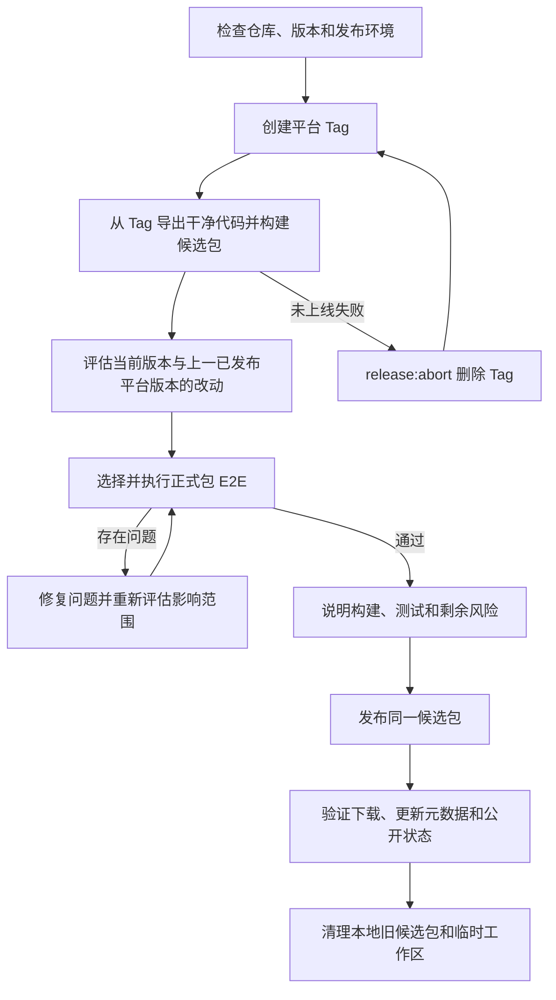

# 桌面端构建与发布

本文是 Windows、macOS 构建、正式包回归和对象存储发布的统一说明。国内默认发布到腾讯云 COS，海外可显式切换到 Cloudflare R2。当前只发布 Windows x64 和 macOS arm64，不支持 Intel Mac，也不发布 Linux。Windows 使用 `windows-vX.Y.Z`，macOS 使用 `mac-vX.Y.Z`，两个平台独立递增和发布。

注意评估改动影响，只回归需要回归的测试用例，避免动不动就全部回归，尤其是在回归一次后，修复的代码并不影响已通过的测试用例时。

## 1. 发布流程

发布只遵循四项原则：

- 平台 Tag **正式上线后**不可修改、覆盖或删除；未上线（构建/测试失败、中断）用 `release:abort` 删掉后可重打同版本，不要堆无效 Tag。
- 候选包必须从 Tag 导出的干净代码构建。
- 根据当前版本与上一已发布同平台版本的差异选择正式包 E2E，并测试实际安装后的候选包。
- 问题处理完后，发布测试过的同一份候选包，并验证公开下载和更新通道。



### 发布准备与 Tag

在干净且与 `origin/main` 完全一致的 `main` 上开始发布。新版本必须高于该平台**当前仍存在的**最高 Tag；若上一轮从未上线，先 abort 再重打同版本，不要另起一串版本号。

`release:start` 会先执行：

```bash
pnpm typecheck:node  # 与 typecheck:web 并行
pnpm typecheck:web
node scripts/test/workflow.mjs --type backend --exclude-group live
```

在这些检查之前，脚本会校验 `released-migrations.json` 中所有已发布 SQLite migration 的 version、name、文件名和源码 SHA-256，已锁文件发生任何变化都会直接失败。两套 typecheck 并行执行；全部 Unit（包含正式 v9 到当前 schema 的升级测试）、update backend 和除 `live` 外的 AI 测试进入统一的 6 worker backend 队列。全部通过后，脚本把当前连续 migration 纳入发布锁清单，再与 `package.json` 版本号一起提交，创建 annotated Tag，并原子推送 `main` 与 Tag。

第一个平台执行 `release:start` 时会锁定本次新增 migration；另一个平台随后使用同一份已锁源码。已经进入发布锁清单的 migration 永远不能合并、重排或修改，只能新增更高版本修复。

Windows 在本地 Windows x64 构建候选包；macOS 只创建 Tag，候选包需要在 Apple Silicon Mac 上单独构建。

```bash
pnpm release:start -- --platform windows --version X.Y.Z
pnpm release:start -- --platform mac --version X.Y.Z
```

### 未上线 Tag 中止与重打

Tag 已推送但**尚未**成为国内或海外 `releases/latest` 上的 live 版本时，可以中止并重打同版本：

```bash
export NCURATOR_ALLOW_ABORT_TAG=abort-unpublished-tag
pnpm release:abort -- --tag mac-vX.Y.Z
# 或
pnpm release:abort -- --tag windows-vX.Y.Z
```

`release:abort` 会：

- 拒绝删除任一公开通道（`download.guanzhangai.cn` / `download.ncurator.com`）上已 live 的 Tag；
- 拒绝删除本地候选状态为 `published` 的 Tag；
- 删除 origin 与本地的该 annotated Tag；
- 删除该 Tag 的本地候选目录。

`main` 上的 `release: prepare …` 提交会保留（版本号与 migration 锁仍在）。abort 后重新执行同版本 `release:start` 即可重打 Tag。若误多打了更高版本的 prepare 提交且尚未需要，用常规 git 手段回退该提交后再 abort / 重打目标版本。

已正式上线的版本有问题：发布更高版本修复；不要 abort live Tag。

### 干净构建与候选包

prepare 阶段从 Tag 创建独立工作区，执行 `pnpm install --frozen-lockfile`、正式构建、安装包审计和 bundle 固化。它不复用当前源码、旧 `node_modules` 或旧 `dist`，也不上传任何对象存储。

Windows 的用户可见名称统一为“馆长”：安装包为 `馆长-X.Y.Z-Windows-x64.exe`，安装后的主程序为 `馆长.exe`，快捷方式与卸载项也使用“馆长”。npm 包名、`appId`、`.ncurator` 目录和对象键等内部技术标识保持不变。

候选包保存在：

```text
~/.ncurator/release-candidates/<tag>/<platform>/
```

候选包生成后处于 `prepared`。需要正式包 E2E 的平台通过后进入 `ready`；暂时不要求正式包 E2E 的平台会明确记录为 `skipped` 后进入 `ready`，不会伪装成测试通过。测试失败时为 `rejected`；公开发布并验证完成后为 `published`。

### 影响评估与正式包回归

使用当前 Tag 与上一已发布同平台 Tag 比较改动；未上线或中断的 Tag 不作为回归基线：

```bash
git diff <previous-platform-tag>..<current-platform-tag>
```

评估提交、文件和模块变化，重点关注用户可见功能、主进程与 IPC、存储兼容、安装与更新、平台专用代码和打包配置。随后从 `doc/test-plan/**` 选择对应的正式包 E2E；如果影响范围较广或无法可靠收敛，就运行全量正式包 E2E。

正式包 E2E 只消费已经构建完成的 `release-bundle-*.json`。runner 会复验 Tag、commit、fragment 和文件哈希，安装 EXE 或 DMG，再连接实际安装后的程序执行测试；测试过程不会重新构建。

不带过滤参数时运行全部正式包 E2E，也可以使用 `--domain`、`--suite`、`--group` 或可重复的 `--case` 收窄范围。`--case` 可以同时指定多个用例（可跨域），修复后只需重跑受影响的用例，不必全量重跑：

```bash
pnpm release:win -- --tag windows-vX.Y.Z --test-only
pnpm release:win -- --tag windows-vX.Y.Z --test-only --domain workbench
pnpm release:win -- --tag windows-vX.Y.Z --test-only --domain workbench --suite result
pnpm release:win -- --tag windows-vX.Y.Z --test-only --case <caseId>
pnpm release:win -- --tag windows-vX.Y.Z --test-only --case <caseId-1> --case <caseId-2>

pnpm release:mac -- --tag mac-vX.Y.Z --test-only
pnpm release:mac -- --tag mac-vX.Y.Z --test-only --case <caseId>
pnpm release:mac -- --tag mac-vX.Y.Z --test-only --case <caseId-1> --case <caseId-2>
```

回归范围由执行者根据改动影响评估决定：影响面广时跑全量，修复后的定向复测用 `--case` 列出受影响的用例。`--case` 指定的用例必须能匹配到测试文件，匹配不到时 runner 直接失败，不会静默通过。

macOS arm64 候选包必须通过选定的回归范围。项目不再构建、测试或发布 Intel Mac 安装包。

所有发布阶段最多运行 60 分钟；测试 runner 在 55 分钟停止领取新用例并保存部分结果。正式并发开始前，每个实际参加 E2E 的候选包先串行通过唯一的 `warmup` 向量索引用例，让模型和磁盘缓存完成冷启动；warm-up 产生的 split/vector 缓存会作为种子复制到后续 case 的隔离缓存目录，warm-up 失败时不会启动后续并发。使用 `--domain`/`--suite`/`--case` 收窄回归范围时，只要本次执行的 case 数超过 1，runner 也会自动纳入全仓唯一的 `warmup` 用例并先预热，不会因过滤漏掉它。随后 E2E 总并发和 live 并发上限均为 3，原生对话框、鼠标和桌面焦点用例独占执行。

选中的正式包 E2E 全部执行，其中使用真实 AI 或真实服务的 E2E 也不排除。源码 E2E、backend、unit 和独立的 `test:ai*` 测试集只用于开发验证或问题排查，不替代正式包 E2E，也不属于标准发布门。

### 问题处理与发布

发现问题后先定位原因，修复实现或测试，再重新判断修复带来的影响并复测相关正式包用例，直到没有发布阻塞问题。同一次发布中的后续改动不影响已通过用例时，无需重复执行这些用例。

临时环境问题可以复测同一候选包。若修改了产品、打包或测试代码：

- **尚未上线**：`release:abort` 删除该 Tag 后，在修复后的 `main` 上重打**同版本**并重新 prepare；
- **已经上线**：必须发布更高版本的新 Tag 与候选包。

测试完成后应向用户说明本次版本、主要影响范围、执行的回归、结果和剩余风险。确认可发布后，publish 阶段只读取已经通过测试的候选包，不重新构建。

```bash
pnpm release:win -- --tag windows-vX.Y.Z --publish-only
pnpm release:mac -- --tag mac-vX.Y.Z --publish-only
pnpm release:status -- --tag <windows-vX.Y.Z|mac-vX.Y.Z>
```

真实发布默认锁定。只有用户明确批准上线后，才可在单次发布终端中设置：

```bash
export NCURATOR_ALLOW_LIVE_PUBLISH=publish-to-production
```

普通构建、候选包测试和 `pnpm release:storage:plan` 都不需要这个变量。未设置时，`--publish-only`、上传脚本和 finalize 都会在发起网络写入前失败。

## 2. 构建与平台

### Windows

Windows 在本地 Windows x64 构建，不提供远程构建路线；本地环境不满足要求时发布失败。prepare、test 和 publish 都只消费本机候选包，publish 不会重新构建。

```bash
pnpm release:win -- --tag windows-vX.Y.Z --prepare-only
pnpm release:win -- --tag windows-vX.Y.Z --test-only --domain workbench
pnpm release:win -- --tag windows-vX.Y.Z --publish-only
```

Windows 本地发布环境：

- Windows x64、Node.js 22 x64、项目指定版本的 pnpm；
- Python 3.12 x64、Git、tar；
- 发布到 COS 或 R2 时还需要 AWS CLI 和对应存储配置。

`pnpm release:doctor` 检查 Windows 本地发布与当前存储目标的访问条件。

### macOS

macOS 没有 Actions 构建路线。prepare 必须在 Apple Silicon Mac 执行，使用本机 arm64 Node/Python 安装依赖、构建、签名、审计和生成唯一的 arm64 候选包。该候选包必须完成正式包 E2E。

```bash
git fetch --tags
git checkout main
git pull --ff-only
pnpm release:mac -- --tag mac-vX.Y.Z --prepare-only
```

macOS 需要已安装并信任的 `Ncurator Update Signing` P12。当前使用项目自建更新签名，`timestamp: none`、`notarize: false`，不等同于 Apple Developer ID 公证。

### 构建、打包与审计

`pnpm run build` 主要完成：

1. 准备 native 模块和网页抓取 Python sidecar，完成类型检查与应用构建；sidecar 保留 DDG、Crawl4AI、Python Playwright 和 Playwright 驱动 JavaScript，但复用 Electron 的 Chromium 与 Node，不下载或打包 Playwright 浏览器和 Node。
2. 追踪生产依赖，生成最小化 `release-stage/app`；只在 trace 未触达待删目录时，定向移除 MathJax 重复发行物、`pdf-parse` 未使用的 PDF.js 版本、已进入 Renderer bundle 的 ExcelJS browser dist，以及非 Windows 包中的 ConPTY 源码。
3. 在裁剪后真实验证 DOCX/PDF 读取、MathJax 公式转 SVG、ExcelJS 写入回读、PDF worker 和进程边界，再混淆 `out/main`。
4. 审计 staging，再由 electron-builder 生成安装包。
5. 审计真实 `win-unpacked` 或 `.app` 的文件、依赖、敏感信息和体积。
6. macOS 额外执行签名和真实启动验证。

electron-builder 只从 `release-stage/app` 打包：

```text
release-stage/
├── runtime-trace-report.json
├── main-obfuscation-report.json
└── app/
    ├── package.json
    ├── out/{main,preload,renderer}/
    ├── node_modules/
    └── resources/{native,web_crawler_sidecar,open-with}/
```

安装包不得包含源码、测试、文档、开发配置、`.env`、锁文件、Source Map、测试日志、fixture、私钥或错误平台文件。网页抓取 sidecar 必须保留 Playwright 驱动 JavaScript，不得包含 Playwright Node、`.local-browsers` 或 `chromium_headless_shell-*`，且解包体积不得超过 400 MiB；staging 和正式包审计都会硬校验。被定向裁剪的 Node 目录同样属于审计禁区，未来 trace 如果触达这些目录会在删除前直接使构建失败。`app.asar` 不是加密，所有 `VITE_*` 变量都按公开信息处理。

electron-builder 使用 `maximum` 压缩，以更慢的发布构建换取更小的安装包，不改变安装后的文件和运行逻辑；相比默认压缩，`maximum` 能有效缩减 DMG 与 ZIP 安装包解包与传输体积。

候选 bundle 绑定 Tag、commit、release fragment、安装包、更新文件、大小、sha256 和 sha512。测试和发布前都会重新验证这些内容。

## 3. 发布与维护

### COS、R2 与公开通道

Windows 和 macOS 使用独立目录、更新 metadata 与官网清单；每平台只保留最新一份安装包（`artifacts`），官网与自动更新共用同一 artifacts URL：

```text
artifacts/windows/windows-vX.Y.Z/*
artifacts/macos/mac-vX.Y.Z/*
release-status/windows/windows-vX.Y.Z.json
release-status/macos/mac-vX.Y.Z/macos-arm64.json
updates/latest/latest.yml
updates/latest/latest-mac.yml
releases/latest/windows.json
releases/latest/macos.json
```

不再发布 `downloads/latest/*` 安装包拷贝。版本化 `artifacts` 使用不可变长缓存；`updates/latest` 与 `releases/latest` 使用 `no-store`。fragment 中的 `name` 记录用户可见文件名，`storageName` 记录对象存储的 ASCII 对象名；二者共同进入候选 bundle 校验。`latest.yml` / `latest-mac.yml` 仅供 electron-updater；`releases/latest/*.json` 仅供官网（JS `fetch` 清单后由浏览器导航到其中的 artifacts URL）。清单中的 `url` 与更新 metadata 指向同一 artifacts 对象；对象带 `Content-Disposition`，纯导航下载即可得到带版本的文件名（Windows 为 `馆长-X.Y.Z-Windows-x64.exe`）。

国内默认目标（腾讯云 COS）使用以下环境变量：

```text
SecretId（或 TENCENT_SECRET_ID）
SecretKey（或 TENCENT_SECRET_KEY）
```

COS 默认值已经固化为桶 `ncurator-1324873382`、地域 `ap-guangzhou`、公开地址 `https://download.guanzhangai.cn`，无需重复写入 `.env`。只有切换海外发布时才设置 `RELEASE_STORAGE_TARGET=r2`。

海外发布时显式设置 `RELEASE_STORAGE_TARGET=r2`，并使用：

```text
R2_ACCESS_KEY_ID
R2_SECRET_ACCESS_KEY
R2_ACCOUNT_ID
R2_BUCKET_NAME
R2_PUBLIC_BASE_URL=https://download.ncurator.com
```

腾讯云侧固定配置：COS 桶为 `ncurator-1324873382`、地域为广州；`download.guanzhangai.cn` 经腾讯云 CDN（加速类型「下载大文件」、中国境内）回源该私有桶。DNSPod 上 `download` 的 CNAME 指向 `download.guanzhangai.cn.cdn.dnsv1.com`。节点对 `artifacts/**` 长缓存（默认约 30 天 / immutable）；`/updates/latest`、`/releases/latest` 不缓存。官网从 `www.guanzhangai.cn`（及必要时根域）`fetch` 清单时，CDN 需对 `/releases/latest/*` 允许跨域 `GET`。新版本使用新的 artifacts 路径，热节点首次请求回源一次后主要消耗 CDN 下行；发版一般不必刷新 artifacts 缓存。AWS CLI 访问 COS 必须使用虚拟主机风格，不能用 path-style。发布子用户使用 [最小 COS 权限模板](../scripts/release/cos/cam-policy.json)，不授予账号管理、域名、DNS 或其他桶权限。CDN 刷新权限后续单独配置，不混入上传密钥。

过渡发版：已安装客户端仍从 `download.ncurator.com` 检查更新。第一次切到国内通道的版本必须把同一份候选包先上传 R2（`RELEASE_STORAGE_TARGET=r2` 调用 `upload-fragment` / `finalize-*`），再走默认 COS 的 `--publish-only`。之后默认只发 COS；海外才显式切回 R2。

官网与桌面端的国内地址固定为：

```text
官网：https://www.guanzhangai.cn
下载：https://download.guanzhangai.cn
```

海外官网 `www.ncurator.com` 仍通过 Cloudflare 访问，官网按请求域名选择国内或海外的 `releases/latest/*.json`，再导航到清单中的 artifacts URL。桌面端发行包统一使用国内官网与国内更新通道。

publish 会上传候选产物和 fragment，更新对应平台的自动更新 metadata 与官网 manifest（均指向同一 artifacts），验证公开 yml、清单与 artifacts 的大小、sha512、`Content-Disposition` 与 manifest URL。公开验证成功后才把候选状态标记为 `published`；随后清理本地 `tests/logs/**`，不在失败、prepare-only 或 test-only 阶段清理。

公开验证成功后会清理该平台更早版本的 artifacts 与 release-status，并删除遗留的 `downloads/latest/*`；当前发布目标只保留最新版本安装包。

### 本地保留与清理

prepare 和 test 的临时代码、依赖与构建目录位于 `~/.ncurator/release-work`，阶段结束后自动删除。候选包位于 `~/.ncurator/release-candidates`；发布并完成公开验证后，本地只保留本平台最新候选及其 E2E 结果。

`~/.ncurator/release-tools` 保存 Python 环境和构建缓存，可复用且不属于历史安装包，不随发布自动删除。工作区侧的 `.ncurator/runtime` 是运行资源目录，发布脚本不管理它。

### 自动更新与下载

```text
Windows 清单：https://download.guanzhangai.cn/releases/latest/windows.json
macOS 清单：https://download.guanzhangai.cn/releases/latest/macos.json
Windows 更新：https://download.guanzhangai.cn/updates/latest/latest.yml
macOS 更新：https://download.guanzhangai.cn/updates/latest/latest-mac.yml
```

官网下载页写死上述清单地址，用 JS `fetch` 读取后导航到 `downloads.*.url`（artifacts）；不要用 `fetch` 拉取整包。安装包实际 URL 随版本变化，清单地址保持不变。

应用启动 5 秒后静默检查更新，持续运行时每 4 小时检查一次。发现新版本后由用户主动下载；下载完成后可以立即重启或稍后安装。

Windows 更新采用“先完成应用关闭、再启动安装器”的时序：点击立即安装时会先等待应用完成关闭（刷新工作区、终止 embedding / 网页抓取 sidecar / 终端会话等子进程），再调用 `quitAndInstall` 触发 NSIS 安装器，避免旧版本文件被运行中的进程占用而导致“Failed to uninstall old application files”。

从当前方案发布的 Windows NSIS 安装包开始，安装器在卸载旧版或写入应用文件前读取 HKCU/HKLM 的已安装版本：更高版本安装与同版本修复允许继续，低版本安装包直接提示安装最新版并退出。自动更新仍是正常的高版本覆盖安装。macOS DMG 无法阻止用户手动覆盖旧 `.app`，由应用启动时的 SQLite schema version 检查兜底。

应用不支持数据库降级，也不自动备份数据库。旧应用发现数据库版本更高时不初始化 Storage、LanceDB、AI、Workbench、定时任务或业务 IPC，只提供自动更新、前往官网下载和退出。已经公开发布的历史安装包无法被追溯加入安装器保护；完整保护从包含本方案的版本开始。

页面 fixture 只验证更新交互，不证明真实安装包下载或升级成功。真实更新验证需要使用已发布的旧版本安装包连接公开更新通道。

正式发布涉及 SQLite 变更时，除 Tag 前全量 Unit 外，正式包回归至少包含 `sidebar-app-update` 和 `database-version-update-required`，并用上一公开 schema 的可审查 fixture 验证原地升级。Windows 禁止降级专项必须使用两个都包含新版 NSIS 保护的候选安装包：先安装较高版本，再运行较低版本，断言安装被拒绝且已安装版本和隔离 userData 不变。不能拿历史旧安装包验证这一点，因为历史安装包本身没有可追溯增加的版本检查。

### 中断、恢复与回滚

- Tag 已创建但 prepare 中断：基于原 Tag 重新执行 `--prepare-only`；若源码已改且未上线，先 `release:abort` 再重打同版本。
- 候选包已生成但测试中断：基于原候选包重新执行 `--test-only`。
- 上传或 finalize 中断：基于原候选包恢复 publish，或使用 `release:storage:finalize`。
- 未上线整轮作废：`release:abort` 删除 Tag 后重打同版本，不要另起无用版本号。
- 已发布版本存在问题：通常发布更高版本修复包。回退下载通道不会让已安装客户端自动降级。

同一个 Tag 在对象存储中若已存在但哈希不同，禁止覆盖。恢复过程中也不能重新构建并替换候选包；未上线需要换产物时走 abort + 同版本重打。

## 4. 命令参考

### 构建与审计

```bash
pnpm run build
pnpm run build:unpack
pnpm run build:win
pnpm run build:mac:arm64
pnpm run package:audit
pnpm run package:audit:summary
```

### 候选包

```bash
pnpm release:win -- --tag windows-vX.Y.Z --prepare-only
pnpm release:win -- --tag windows-vX.Y.Z --test-only [回归过滤参数]
pnpm release:win -- --tag windows-vX.Y.Z --publish-only

pnpm release:mac -- --tag mac-vX.Y.Z --prepare-only
pnpm release:mac -- --tag mac-vX.Y.Z --test-only [回归过滤参数]
pnpm release:mac -- --tag mac-vX.Y.Z --publish-only
```

独立测试已构建的候选包：

```bash
pnpm test:e2e:package -- --bundle <release-bundle.json>
pnpm test:e2e:package -- --bundle <release-bundle.json> --domain workbench
pnpm test:e2e:package -- --bundle <release-bundle.json> --case <caseId>
pnpm test:e2e:package -- --bundle <release-bundle.json> --case <caseId-1> --case <caseId-2>
```

### 状态与恢复

```bash
pnpm release:status -- --tag <windows-vX.Y.Z|mac-vX.Y.Z>
export NCURATOR_ALLOW_ABORT_TAG=abort-unpublished-tag
pnpm release:abort -- --tag <windows-vX.Y.Z|mac-vX.Y.Z>
pnpm release:storage:plan
pnpm release:storage:finalize -- --tag <windows-vX.Y.Z|mac-vX.Y.Z>
```

常见失败处理：构建或审计失败时先确认真实运行依赖，不直接放宽包规则；macOS 签名或启动失败时停止该架构发布；正式包 E2E 失败时读取 package summary 和对应 case raw logs；公开 metadata、下载或哈希验证失败时停止更新 latest 通道。
