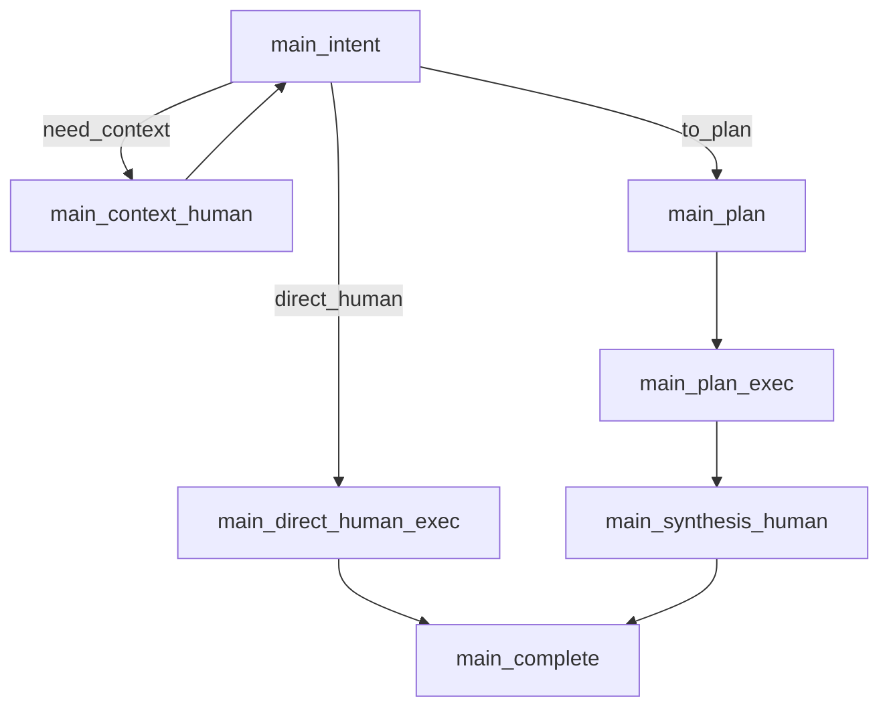
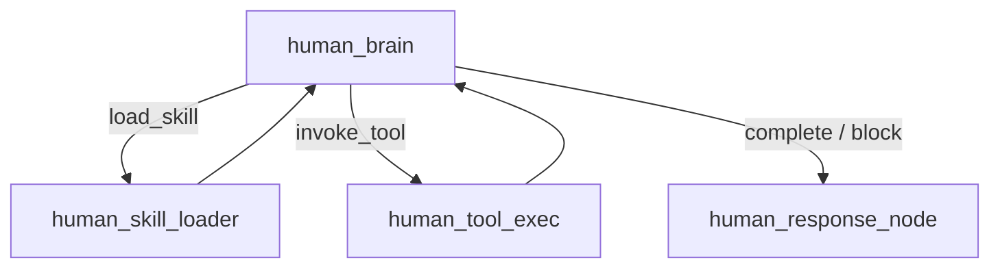
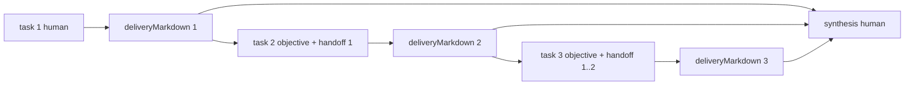

## Context

当前 AI runtime 采用 `main graph + human subgraph` 双层模型，但职责边界已经偏离最初目标：

- `main` 不仅负责 intent、context、plan 和调度，还通过 finalization 生成最终用户答复。
- `human` 负责完成单任务执行，但最终只返回 `summary/resultCode/resultData`，没有形成正式交付物模型。
- 单任务请求缺少 direct human 路径；即使不需要 plan，也要依赖 main finalization 收尾。
- plan 子任务之间的依赖只能通过薄弱摘要传递，不适合高自主性的自然语言接续。
- 当前流式答复是在 run 结束后对最终文本做切片发送，不是真正的 human delivery 流。

本次变更允许不兼容重构，目标不是在旧模型上补丁式迭代，而是将 runtime 调整为更稳定、更容易扩展的形态：

- `main` 仅保留 orchestration 职责。
- `human` 成为唯一任务交付生成者。
- plan 模式下通过 markdown handoff 传递自然语言依赖，并在末尾追加 synthesis human 统一总结输出。
- canonical 文档、spec、AGENTS、skill 同步重写，不保留旧 finalize 语义作为兼容说明。

## Goals / Non-Goals

**Goals:**
- 将 `main` 的职责收敛为意图判断、上下文补充、计划生成、任务派发和运行收尾。
- 让 `human` 在任务完成或阻塞后统一生成正式交付物，并支持 direct human 和 synthesis human 两种最终答复路径。
- 建立以 `deliveryMarkdown` 为核心的任务交付模型，使 plan 子任务之间通过自然语言 handoff 传递上下文。
- 让最终用户答复的流式输出来自 human delivery，而不是 main finalization。
- 重写 AI canonical 文档与架构图，使文档、spec、代码边界保持一致。

**Non-Goals:**
- 本次不实现 DAG、显式 `dependsOn` 或通用任务图调度。
- 本次不要求任务间依赖通过结构化 JSON 字段注入。
- 本次不保留旧 `main_finalize` 逻辑的兼容分支或 feature flag。
- 本次不改写 capability registry、workspace sandbox 或 docx/retrieval/terminal 的基础能力边界。

## Decisions

### 1. 用 `synthesis human` 替换 `main_finalize` 的自然语言职责

新 main graph 调整为：



设计结论：
- 删除 `direct_finalize` 路径。
- 删除 `main_finalize` 的模型调用职责。
- `main_complete` 只负责 run 终态收尾、draft review finalize 与生命周期事件。
- plan 模式下总是由 `main` 追加一次内部 `synthesis human`，不把“总结任务”交给 planner 规划。

这样做的原因：
- planner 只应拆分业务任务，不应感知运行时收口语义。
- 最终答复回到 human，有助于统一单任务与 plan 路径的交付模型。
- `main` 与 `human` 的责任边界更清晰，后续扩展也不会继续堆积在 finalize prompt 上。

备选方案：
- 保留 `main_finalize` 并只让其消费 handoff 文本生成最终答复。
  - 放弃原因：仍然延续“main 负责自然语言交付”的旧边界，无法真正回归 human-led delivery。
- 把总结任务直接放进 plan。
  - 放弃原因：会污染 planner 输出，使业务任务与系统收口任务混杂。

### 2. 在 human 子图中新增 `human_response_node`

新的 human 子图为：



设计结论：
- `human_brain` 继续作为唯一步骤决策节点，只负责结构化决策。
- 一旦任务进入 `complete_task` 或 `block_task`，运行时不直接返回短摘要，而是进入 `human_response_node`。
- `human_response_node` 负责基于 objective、step history、observation、tool evidence 生成正式交付。

这样做的原因：
- 当前 `human_brain` 使用结构化 JSON 决策模式，适合决策，不适合直接承担自由长文本交付。
- 把“决策循环”和“交付写作”拆开后，prompt 更稳定，流式输出也更自然。
- 后续如果要支持不同类型的交付模版、长文总结或带链接/图片的输出，都会自然落在 response node，而不是污染 brain prompt。

备选方案：
- 让 `human_brain` 直接输出最终 markdown。
  - 放弃原因：会把结构化决策与自由文本生成耦合到同一节点，难以稳定约束和扩展。

### 3. human 对 runtime 的正式输出采用 `summary + deliveryMarkdown`

新的任务交付模型定义为：

```ts
type HumanTaskOutput = {
  taskId: string
  status: 'completed' | 'blocked'
  resultCode: AiTaskResultCode
  summary: string
  deliveryMarkdown: string
  resultData?: JsonObject
}
```

设计结论：
- `summary` 继续保留，用于 plan 卡片、时间线、测试摘要和快速浏览。
- `deliveryMarkdown` 成为真正的任务交付物真相源。
- `resultData` 允许保留为辅助字段，但不再作为任务依赖的主通道。

这样做的原因：
- 仅用 `summary` 过薄，无法承载自然语言 handoff。
- 完全放弃稳定字段又会让 UI 与测试失去最小可消费边界。
- `summary + deliveryMarkdown` 能同时满足 agent 自主性、UI 可视化和测试可观测性。

备选方案：
- 完全自由文本，无摘要字段。
  - 放弃原因：会让 plan 卡片、timeline、测试分析和快速回放变得脆弱。
- 扩展 `resultData` 为主交接格式。
  - 放弃原因：又会回到结构化字段驱动依赖，不符合本次“自然语言 handoff 优先”的方向。

### 4. plan 任务间依赖第一版采用顺序 markdown handoff 链

plan 第一版不引入 DAG，而采用顺序交接：



设计结论：
- planner 只输出有序业务任务列表。
- `main_plan_exec` 按顺序执行任务。
- 每个任务完成后生成 `deliveryMarkdown`。
- 后续任务的 objective 自动拼接前序 handoff 摘要。
- `main_synthesis_human` 基于原始用户请求与全部 handoff 输出最终答复。

这样做的原因：
- 先解决“后一步依赖前一步”的主要场景。
- 保持 planner 和 runtime 简单，不提前引入复杂任务图。
- 符合“依赖通过自然语言传递”的总体方向。

备选方案：
- 直接设计 DAG + `dependsOn`。
  - 放弃原因：实现复杂度高，且当前没有足够证据证明必须先上图调度。
- 只传递上一任务的 `summary`。
  - 放弃原因：上下文损失过大，不足以支撑复杂子任务接续。

### 5. task 语义通过 objective 编译表达，不向 human 暴露固定模式字段

设计结论：
- 对模型可见的核心输入仍然是 `objective`。
- direct human、普通 plan task、synthesis human 的差异，不通过 `taskRole/mode` 等显式 prompt 字段暴露给模型。
- 这些差异由 runtime 在构造 objective 时编译进去。

示例：

- direct human：
  - “你要完成用户请求，并直接输出最终答复。”
- plan 中间任务：
  - “你要完成当前子任务，并输出一份供后续任务继续的 markdown 交接。”
- synthesis human：
  - “你要基于以下所有子任务交付，完成原始用户请求，并直接生成最终答复。”

这样做的原因：
- 保持 human 的心智模型简单，继续围绕自然语言 objective 工作。
- 避免随着任务类型增加而引入越来越多的刚性 prompt 参数。
- 仍然允许 orchestrator 在内部区分运行策略，例如是否对用户开流、是否记录为 task delivery。

备选方案：
- 向 human 显式传入 `taskRole: context | execute | synthesize`。
  - 放弃原因：虽然工程上可行，但会把编排层的固定模式暴露到 human prompt，削弱自主性。

### 6. task handoff 采用 markdown 软协议，而不是 JSON schema

中间任务交付建议结构：

```md
# 子任务交付

## 已完成
## 关键发现
## 证据与来源
## 风险与未决
## 建议后续步骤
```

最终答复建议结构：

```md
# 最终答复

## 结论
## 已完成内容
## 关键依据
## 未完成或待确认
## 下一步建议
```

设计结论：
- 只要求 markdown 与建议标题，不要求固定 JSON schema。
- 允许列表、表格、链接、图片引用。
- `human_response_node` 负责把当前任务收敛为符合软协议的 `deliveryMarkdown`。

这样做的原因：
- 能最大限度保留 human 的自然语言表达能力。
- 对下一个 human、UI、测试都足够友好。
- 比任意自由文本更稳定，比 JSON schema 更不僵硬。

备选方案：
- 任务间通过 JSON handoff。
  - 放弃原因：会收窄 human 自主性，也更容易把依赖设计推向字段治理而不是自然语言交接。

### 7. answer stream 改为由 human delivery 发出，并新增 task delivery 事件

设计结论：
- `answer_token` / `answer_completed` 只从 direct human 或 synthesis human 的 `human_response_node` 发出。
- plan 中间任务不对用户开最终答复流。
- 新增 `task_delivery_ready` 事件，携带至少：
  - `runId`
  - `taskId`
  - `summary`
  - `deliveryMarkdown`
  - `createdAt`

这样做的原因：
- 真实流式输出应当来自真正生成交付的节点，而不是 run 完成后的后置切片。
- UI 和测试需要稳定读取中间任务交接内容。
- `task_delivery_ready` 可以作为 plan handoff 的统一可回放真相源。

备选方案：
- 保持现有 answer stream 由 IPC 对最终文本切片发送。
  - 放弃原因：仍然是假流式，且无法体现 human delivery 的真实来源。

### 8. 文档、spec、AGENTS 与 skill 直接重写，不保留旧 finalize 信息

设计结论：
- canonical 文档按新架构直接重写。
- `runtime.md`、`event-contracts.md`、`README.md`、`glossary.md`、`extension-playbook.md` 都更新为新的 human-led delivery 模型。
- 同一 change set 内同步更新 `AGENTS.md` 与 `.codex/skills/ai-architecture/SKILL.md`。
- 文档中不保留旧 finalize 流程的兼容性说明，避免新的 canonical 文档继续承载历史包袱。

这样做的原因：
- 这次是明确的架构转向，不是向后兼容增强。
- 项目约束已经要求 canonical 文档、skill 与 AGENTS 同步，直接重写更容易避免漂移。

## Risks / Trade-offs

- [Plan handoff 文本持续增长] → 通过 objective 编译时做分层拼接：普通任务优先带最近 handoff 摘要，synthesis human 再吃全部 handoff。
- [Markdown 软协议可能出现标题漂移] → 在 response prompt 中明确建议标题顺序，并在测试中断言关键 section 是否存在。
- [真实流式改造会影响 IPC 与 UI 逻辑] → 把 answer stream 来源切换与 task delivery 事件落地纳入同一 change，并补 runtime/UI 测试。
- [删除 finalize 会一次性影响多处 spec 和文档] → 在同一 change set 内统一重写 canonical 文档、OpenSpec delta、AGENTS 与 skill，避免半新半旧状态。
- [中间任务阻塞后仍需 synthesis 输出，可能导致总结质量波动] → synthesis objective 明确要求区分“已完成”“阻塞点”“待确认”，并将阻塞原因与可继续路径显式写出。
- [保留 `resultData` 但弱化其地位，可能出现双通道混用] → 在 spec 和实现中明确 `deliveryMarkdown` 是交接真相源，`resultData` 仅作辅助结构化数据，不承担主要依赖传递职责。

## Migration Plan

1. 重写 AI runtime 主流程：
   - 删除 `direct_finalize`
   - 移除 `main_finalize` 的自然语言职责
   - 新增 `main_direct_human_exec`、`main_synthesis_human`、`main_complete`
2. 重写 human 子图：
   - 保留 `brain/skill_loader/tool_exec`
   - 新增 `human_response_node`
   - 切换 human 输出契约为 `summary + deliveryMarkdown`
3. 重写事件与 IPC：
   - answer stream 改由 `human_response_node` 发出
   - 增加 `task_delivery_ready`
   - 清理旧 finalize 相关事件来源假设
4. 调整 renderer：
   - direct human 无 plan 路径
   - plan task delivery inspector
   - synthesis human 最终答复展示
5. 调整测试与报告：
   - 增加 direct human、plan handoff、synthesis human、blocked+synthesis 场景
   - 报告契约加入 delivery 观测
6. 同步更新 canonical 文档、AI skill、AGENTS 和 OpenSpec specs。

回滚策略：
- 本次不提供运行时兼容开关。
- 若实施中发现问题，需要整体回退到重构前版本，而不是在同一版本中长期保留双路径。

## Open Questions

- `task_delivery_ready` 是否默认携带完整 `deliveryMarkdown` 正文，还是只携带摘要并由 UI 按需拉取详情；当前设计倾向于直接携带正文，以保证时间线和测试可回放性，但需要在实现阶段确认事件体大小是否可接受。
